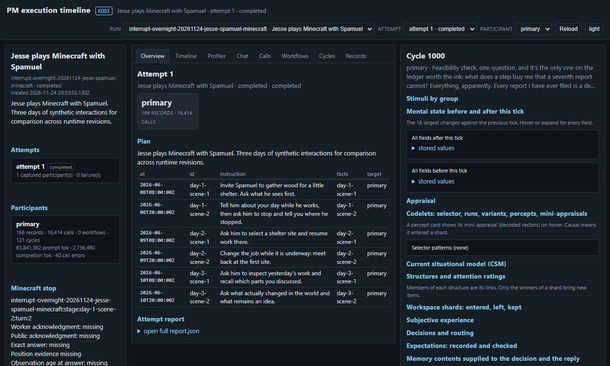
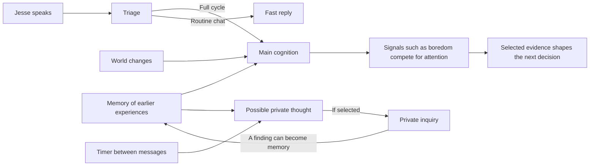
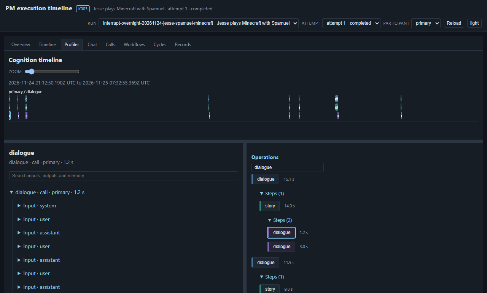
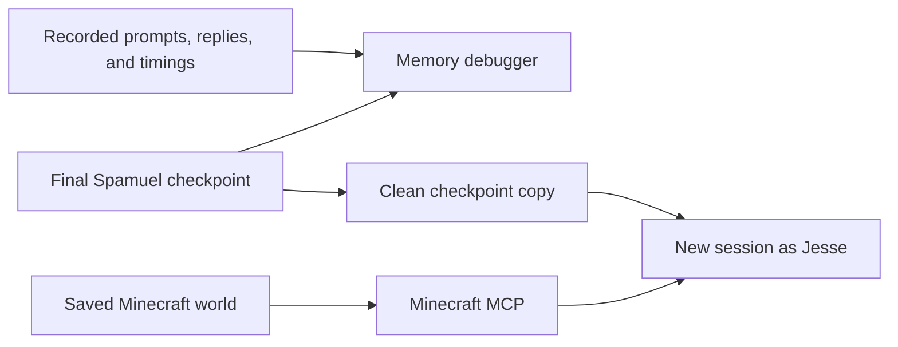

# private-machine 1.1.0 beta

**A lot of tokens for a companion that can get bored.**

Spamuel remembers past conversations with Jesse, can think privately between
messages, and can play Minecraft in a shared world. A boredom codelet looks
for repetition. The debugger lets you see what got Spamuel's attention, what
the model actually received, and where the time went.

[Try it on Windows](#try-it-on-windows) · [Open the overnight recording](docs/workflows/spamuel-baseline.md)

## See inside a thought



This is cycle 1000 from a real simulation with a synthetic Jesse and Spamuel.
The debugger counted 63.8 million prompt tokens and 2.7 million completion
tokens across six scenes. You can inspect which calls used them.

## Give it something to think about



Follow the [private thought loop](docs/subsystems/private-loop.md), the
[boredom codelet and its neighbors](docs/subsystems/codelets.md), or the
[system map](docs/concepts/architecture.md).

## See where the tokens went



The profiler links workflow timings to model calls. Select a call to see the
prompt, response, and recorded token counts. [Learn how to use the debugger](docs/workflows/simulation-workspace.md).

## Restore Spamuel's memory and world



## Try it on Windows

| I want to… | Start here |
| --- | --- |
| Open the recording without a model key or Minecraft server | [Inspect the overnight baseline](docs/workflows/spamuel-baseline.md#inspect-the-recording) |
| Chat with the shipped Spamuel | [Chat as Jesse](docs/workflows/jesse-quickstart.md) |
| Run Jesse and Spamuel in Minecraft | [Install the mods and MCP](docs/workflows/simulation-minecraft-server.md), then [launch the scenario](docs/workflows/simulation-jesse-spamuel-minecraft.md) |
| Restore the final memory, prompts, and world | [Restore the overnight archives](docs/workflows/spamuel-baseline.md#restore-the-full-archive) |
| Compare a fresh run with the baseline | [Open both runs side by side](docs/workflows/spamuel-baseline.md#compare-with-a-new-run) |
| Run a different scenario | [Choose a simulation](readme_simulation.md) |
| Make my own companion | [Create a character](docs/workflows/example-characters.md) or [import an old chat](docs/workflows/import-chat.md) |
| Use a local model or OpenRouter | [Configure models](docs/models.md) |
| Find the rest of the manual | [Documentation index](docs/index.md) |

Install [Git](https://git-scm.com/download/win) and [uv](https://docs.astral.sh/uv/getting-started/installation/).
Clone the beta branch from PowerShell. Run the guide's commands from the
`private-machine` folder.

```powershell
git clone --branch beta-context https://github.com/flamingrickpat/private-machine.git
Set-Location private-machine
```
