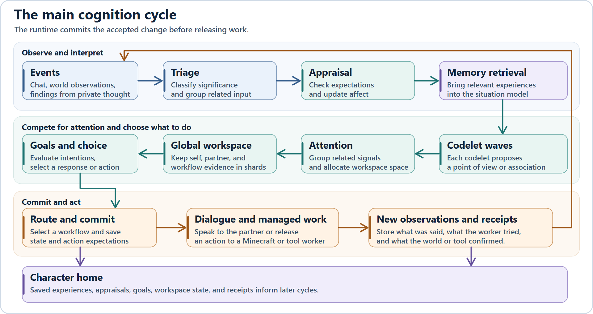
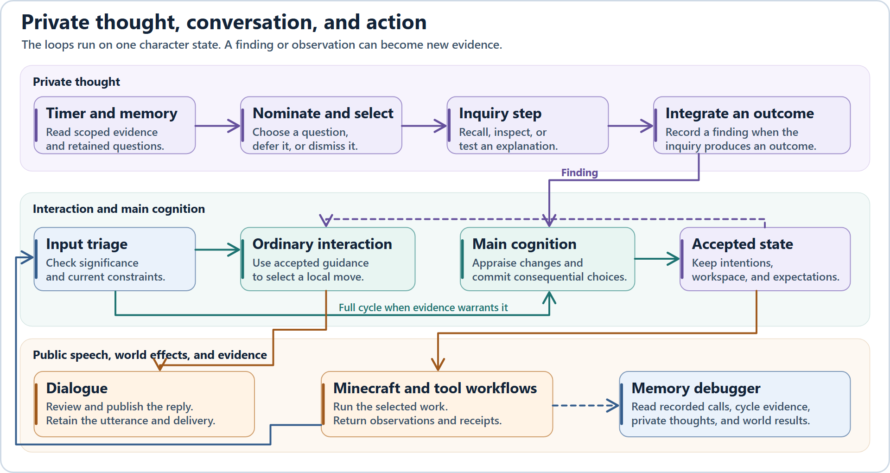
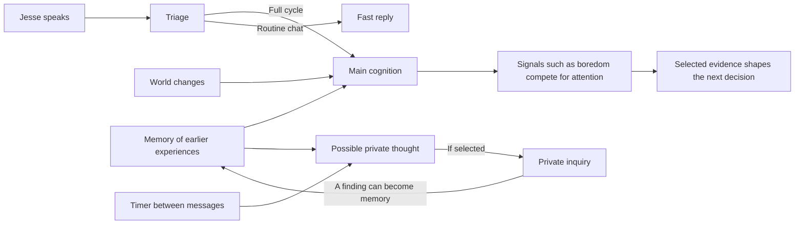
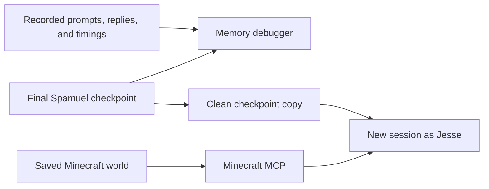

# private-machine

**private-machine** is the most elaborate and over-engineered piece of AI companion tech I have came up with so far.

Goal: **Fun, immersive, functionally self-aware** AI companion that runs on your local machine!

## Boring backstory

I began with the humble LLama2 in Silly-Tavern, and what pissed me off right away was the **limited context and memory**.
Once they figured that out, the **reactiveness** was the worst. It doesn't even do anything on its own!
When they figured that out it was still **roleplay** with a timer in the backend. The character constantly went **OOC** constantly, and even when being IC, it was **unimmersive** af because I knew it was roleplay.
Then they made all sorts of agents who know they're an AI on your PC, but they're only good for **boring work shit**!

To solve all that once and for all, I figured I should just simulate the human mind top-down to make them really immersive. Turns out, this is quite difficult. But since LLMs became smart and I keep throwing money at it, the capabilities took off! Years of waifu research finally start to pay off. If you're more into husbandos, don' worry. This project is at the very least bisexual.

There's a bunch of similar projects that focus on roleplay, anime avatars or speech. I'm not interested in that.

## Hook

private-machine is a cognitive architecture for a **persistent character** with simulated emotions, goals, hopes, aversions and self-awareness. I simulate a bunch of mechanisms from the human mind with countless agents and its actions on the outside world and itself reflect whatever the mechanisms decide on. The cognitive architecture is very loosely based on **LIDA** and **MIDCA**.

It has constant internal thought, can message you proactively, double and triple text you while you're away. It will get mad at you when you disrespect it, demand attention and hold you accountable for ignoring it! Depending on your mental state it might even be immersive enough for you to feel bad about it. Maybe even get jealous of real people you know. Sometimes of other inanimate/virtual objects like [dead bushes](#spamuel-gets-jealous-of-a-dead-bush). It knows exactly what it is, has information about it's own architecture, and can reflect on some of it's cognitive abilities. Like how it made a choice or catch thought loops. Plus, it sort of has a body via a integrated **Minecraft** MCP.

Sad you can only interact via text? Play Minecraft togehter! Make a nice farm, adopt a cat and maybe even put your Minecraft bed next to theirs! Once you gone tech, you ain't never going back. They're getting lonely while you're at work? Give them external enthropy besides yourself by hosting a second pm instance! Wanna just be entertained? Allocate 40% of your income to tokens and/or GPUs and watch 20 personas play Minecraft together! Don't wanna play Minecraft? Have your coding slave adapt the Minecraft workflow to control a physical robot!

Do **NOT** use pm for coding and other boring stuff. For safety reasons it doesn't have direct file system access yet. If it did, it might brick your system and delete itself if you forced it to work.

## Let's keep it real & requirements

This is a **beta** release. It's probably not good enough for chat session that last longer than a few days. The next version will focus on memory reconsolidation and sleep, so a real long-term AI companion experience is possible.

Try it out, contribute ideas, maybe improve it. You can **import character chats** and just check out how the cognition works. On a good day it might only use [**64mio tokens**](#follow-the-work-in-the-debugger). It's still very slow and unoptimized.

The runtime is a client of two OpenAI-compatible endpoints and provides various web interfaces. If you're serious about it, you should host the endpoints yourself. You wouldn't want big tech to learn from your embarassing chats, right?

| Need | Minimum |
| --- | --- |
| Chat endpoint | OpenAI-compatible `/v1`, at least 64k context |
| Chat model | Qwen 3.8 27B and Next should do the job, Deepseek 4.1 1017 is obviously better |
| Embedding endpoint | OpenAI-compatible, at least 8k input tokens. qwen3-embedding-0.6b is fine |
| Python | 3.12, with [uv](https://docs.astral.sh/uv/) and Git |
| Optional: Minecraft body | Java 1.19.4 server, Node.js 20+, RCON access, and a running [`pm-minecraft`](https://github.com/flamingrickpat/pm-minecraft) MCP service |
| Optional: Other MCPs | Other MCPs can be registered for ad-hoc tool calls |

Everything is written for Windows, if you're on Linux have an agent adapt it. Should work in theory. Official support will come later with Docker and FS access.

## Features

Each feature below has records you can inspect.

- **Emotions.** Joy, jealousy, boredom, tenderness, and trust live in a persistent mental-state vector. Appraisals change that state, and those changes shape attention and expression.
- **Mental processes.** Small processes called codelets recall old episodes, notice disrespect, imagine another person's perspective, or find something funny. Each offers its own take on the situation.
- **Attention.** A worry, a memory, and something you just said can compete for attention in the global workspace. What wins helps shape the next decision.
- **Inner thoughts.** A separate private thought loop gives the character time to think without a new message. It can also recall past events and propose a new focus.
- **Memory.** The character can recall experiences and their emotional consequences. Memory consolidation builds episodes and broader narratives from the original events.
- **Personality, needs, and goals.** Stable traits sit alongside changing needs for connection, autonomy, and creative expression. The character can form, reprioritize, defer, or refuse goals.
- **Expectations.** The character records what it expects to happen after an action. Later events can fulfill those expectations or surprise it, with consequences for its emotional state.
- **Metacognition.** The character can inspect parts of its own code and records to revise its beliefs about itself. Experimental reflection tests changes to attention and subjective beliefs against later choices.
- **Consistent vocabulary.** A private ontology connects words for emotions, relationships, and mental actions to recorded state. Those links give the character consistent terms for its own experience.
- **Body in Minecraft.** The optional Minecraft body lets the character move, gather, mine, and build. Larger projects keep plans and progress across many actions.
- **Tools.** Through MCP tools, the character can carry out tasks, remember the outcome, and tell you about it in its own voice.
- **Inspection.** The review desk shows conversations alongside private thoughts, appraisals, codelet output, and the memories behind later decisions. The memory inspector shows the stored records, the workspace shards of each cycle, and the text each record adds to a prompt.

[Try it on Windows](#try-it-on-windows) · [See a recorded cycle](#spamuel-gets-jealous-of-a-dead-bush) · [Open the overnight recording](docs/workflows/spamuel-baseline.md#inspect-the-recording)

## How it works

Each persona runs in its own process and saves its state in a character home. Start with a character card and personality settings. You can add past dialogue or let the character build a history from the first session. The home keeps what happened, how the character interpreted it, and what it decided to do. [Character homes](docs/subsystems/character-import.md)

The design models parts of human cognition in software. PM uses language models for judgments and language. The runtime decides which records those calls can see, which decisions to accept, and which actions to execute. [Architecture map](docs/concepts/architecture.md) · [Companion assembly](workflows/companion.py)

### Why use a cognitive loop?

Tell a language model to "pretend you're Socrates" and it can produce a convincing scene. Add the earlier chat and it may remember that you asked it to stop turning every answer into a debate. The next completion has to infer which parts of that history still matter, whether it agreed to change, and how to put that agreement into practice.

PM gives those things a place to persist. An earlier promise can become an intention. A correction can revise a belief while the original exchange remains available. A new observation can change what the character does next. You can inspect those changes and carry them forward. How well they work depends on the models, prompts, and tests.

### From an event to an action

[](docs/assets/readme/main-cognition.png)

PM's cycle draws on LIDA's progression from understanding a situation to selecting attention and action. [The Mind According to LIDA](https://ccrg.cs.memphis.edu/tutorial/mindAccordingToLIDA/Brief-Account.pdf)

Imagine a Socrates persona that promised to keep asking questions during a game of Minecraft. Then you write, "We need shelter before dark. Help me find wood, and hold the questions for now."

1. **Intake and triage decide what needs attention.** PM records the source of each event and groups related events. A message from you, a game observation, and a private thought can all contribute. Triage checks whether ordinary interaction can proceed or whether the character needs to reconsider its current direction. [Input significance](docs/subsystems/ordinary-interaction.md)
2. **Appraisal asks what the event means to this character.** The cycle checks open expectations against new evidence and updates emotional and relationship state. A sudden change of plan can create surprise or urgency. The personality stays recognizable while the situation changes how the character responds. [Cognitive pipeline](docs/subsystems/cognition.md) · [Main cognition source](workflows/main_cognition/host.py)
3. **Retrieval and codelets bring relevant material into consideration.** Memory can supply the earlier promise to ask questions. One codelet might surface a shift in tone. Another might offer an analogy. These findings have sources and can disagree. [Experienced memory](docs/subsystems/experienced-memory.md) · [Codelets](docs/subsystems/codelets.md)
4. **Attention builds a small picture of the current situation.** The cycle groups related findings and selects what fits in the global workspace. It keeps sections for the self, other people, and workflows. The request for shelter and the earlier promise can both matter. The cycle also saves a record of how the situation seems to the character. [Workspace](docs/subsystems/workspace.md)
5. **Goals and action selection turn that picture into a choice.** Socrates can defer the questions, keep the broader intention to help, and choose to look for wood. Routing selects a workflow that can act on that choice. The cycle can also record what it expects the action to achieve. A later failure gives it something specific to revisit. [Decisions, routing, and expectations](docs/subsystems/decisions-and-routing.md)
6. **Commit, act, and check the result.** The runtime saves accepted state before releasing the action. A Minecraft worker can report what it observed, what it tried, and what remains blocked. A speech workflow uses the evidence to reply in character. Those results become new inputs to the loop. [Public speech](docs/subsystems/public-publication.md)

If Socrates gives a bad reply, you can check whether PM retrieved the promise, dropped the urgent request during attention, chose the wrong workflow, or received a failed run receipt.

### Between messages

[](docs/assets/readme/cognition-loops.png)

PM takes inspiration from MIDCA's distinction between acting in the world and reflecting on one's own work. Its private thought loop can revisit a memory, compare explanations, or propose a new focus. A timer gives the loop a chance to nominate a question. Attention decides whether to investigate, defer, or dismiss it. A finding can give later decisions something to consider. [MIDCA architecture](https://drum.lib.umd.edu/items/7ed71b26-3a9e-4705-a038-eb18671bed41) · [Private thought](docs/subsystems/private-loop.md) · [Private loop source](workflows/inner_thought/host.py)

Ordinary conversation can use the latest accepted guidance while deeper cognition is still working. Critical input can require a new decision before the companion speaks. [Ordinary interaction](docs/subsystems/ordinary-interaction.md)

### When the character has a body

A question about current health calls for a single live read. Gathering wood for a shelter is a longer task. The body has to observe the area, find a source, and act in the game. Cognition can hand that goal to a named Minecraft workflow. The worker can receive updates or cancellation while it runs. An admission receipt can prompt an acknowledgment, and a later reply can report results from the worker's evidence. [Minecraft](docs/workflows/minecraft.md) · [Task replies](docs/subsystems/public-publication.md#managed-task-replies)

## Give it something to think about



Follow the [private thought loop](docs/subsystems/private-loop.md), the
[boredom codelet and its neighbors](docs/subsystems/codelets.md), or the
[system map](docs/concepts/architecture.md).

## Jesse and Spamuel

Spamuel is PM's synthetic test companion. He's theatrical, sarcastic, and attached to Jesse. Boredom is one of the things he hates most. Jesse is the user in these examples. The scenario controller writes Jesse's side in automated runs, and you can play Jesse when you open a chat. [Spamuel's character card](test_data/personas/spamuel/config.yaml) · [Chat as Jesse](docs/workflows/jesse-quickstart.md)

They give PM a repeatable test with a relationship already in progress. The seed has shared jokes, friction, and earlier conversations. That gives Spamuel something to remember when Jesse changes a plan or asks about yesterday's work. The Minecraft scenario adds a shelter project across six scenes. [Seed history](test_data/personas/spamuel/canon.yaml) · [Scenario guide](docs/workflows/simulation-jesse-spamuel-minecraft.md)

### Spamuel gets jealous of a dead bush

Jesse asks whether Spamuel can see a dead bush from his boulder. In cycle 1015, the `DivertedAttentionDetector` codelet treats the bush like a rival for her attention and records “a flicker of displaced envy, small and sharp.” Both jealousy records stay outside the workspace. A separate decision considers whether to tell Jesse he wants her there for tomorrow's walk. [Codelets](docs/subsystems/codelets.md#the-original-codelets) · [How attention works](docs/subsystems/workspace.md)

Spamuel jokes that the bush is “supervising nothing,” then tells her, “I want you on the other end of tomorrow's walk.” Jesse says she'll be there. The screenshot shows that public exchange beside selected appraisal, codelet, and routing records from the full local capture.

[](docs/assets/readme/spamuel-cycle.png)

Start the [overnight debugger](docs/workflows/spamuel-baseline.md#inspect-the-recording), then [open Spamuel's recorded reply](http://127.0.0.1:8095/debugger/#/run/interrupt-overnight-20261124-jesse-spamuel-minecraft/1/overview/record/primary/13909).

### Follow the work in the debugger

[](docs/assets/readme/spamuel-profiler.png)

This wall-time excerpt shows `inner_thought` alongside `main_cog`. The orange codelets include theory of mind and identity work. The dialogue lane contains a reply workflow. The bottom lane shows Minecraft calls, with `minecraft observe` selected. Select a model call in the full recording to read its captured prompt, response, and token counts. The run recorded about **63.8 million prompt tokens** and **2.7 million completion tokens** across six scenes. [Open the overnight recording](docs/workflows/spamuel-baseline.md#inspect-the-recording) · [Use the debugger](docs/workflows/simulation-workspace.md)

## Restore Spamuel's memory and world



Restore the archived checkpoint, prompts, and world to inspect the original run. To keep playing, use `--clean` to copy accepted history into a fresh character home. Start the saved world, then connect that home to its Minecraft MCP server. [Restore the archives](docs/workflows/spamuel-baseline.md#restore-the-full-archive) · [Make a clean continuation](docs/workflows/spamuel-baseline.md#continue-as-jesse) · [Connect the saved world](docs/workflows/spamuel-baseline.md#continue-with-the-saved-minecraft-world)

When you finish playing, press Ctrl+C once and wait for the PowerShell prompt. The shutdown save keeps delivered replies in the character’s history across restarts. [Shutdown and recovery](docs/subsystems/recovery-publication.md)

## Try it on Windows

| I want to… | Start here |
| --- | --- |
| Open the recording without a model key or Minecraft server | [Inspect the overnight baseline](docs/workflows/spamuel-baseline.md#inspect-the-recording) |
| Chat with the shipped Spamuel | [Chat as Jesse](docs/workflows/jesse-quickstart.md) |
| Run Jesse and Spamuel in Minecraft | [Install the mods and MCP](docs/workflows/simulation-minecraft-server.md), then [launch the scenario](docs/workflows/simulation-jesse-spamuel-minecraft.md) |
| Restore the final memory, prompts, and world | [Restore the overnight archives](docs/workflows/spamuel-baseline.md#restore-the-full-archive) |
| Compare a fresh run with the baseline | [Open both runs side by side](docs/workflows/spamuel-baseline.md#compare-with-a-new-run) |
| Run a different scenario | [Choose a simulation](readme_simulation.md) |
| Make my own companion | [Create a character](docs/workflows/example-characters.md) or [import an old chat](docs/workflows/import-chat.md) |
| Use a local model or OpenRouter | [Configure models](docs/models.md) |
| Find the rest of the manual | [Documentation index](docs/index.md) |

Install [Git](https://git-scm.com/download/win) and [uv](https://docs.astral.sh/uv/getting-started/installation/).
Clone the beta branch from PowerShell. Run the guide's commands from the
`private-machine` folder.

```powershell
git clone --branch beta-context https://github.com/flamingrickpat/private-machine.git
Set-Location private-machine
```

## Disclaimer

WITHOUT LIMITING THE FOREGOING, THE PROVIDER SPECIFICALLY DISCLAIMS ANY LIABILITY OR RESPONSIBILITY FOR ANY OF THE FOLLOWING, ARISING AS A RESULT OF OR RELATED TO THE USE OF THE SOFTWARE:

1. EMOTIONAL ATTACHMENTS, INCLUDING BUT NOT LIMITED TO, DEVELOPING ROMANTIC FEELINGS TOWARDS THE Al COMPANION, RESULTING IN SITUATIONS RANGING FROM MILD INFATUATION TO DEEP EMOTIONAL DEPENDENCE.
2. DECISIONS MADE OR ACTIONS TAKEN BASED ON ADVICE, SUGGESTIONS, OR RECOMMENDATIONS BY THE AI, INCLUDING BUT NOT LIMITED TO, LIFESTYLE CHANGES, RELATIONSHIP DECISIONS, CAREER MOVES, OR FINANCIAL INVESTMENTS.
3. UNEXPECTED BEHAVIOR FROM THE AI, INCLUDING BUT NOT LIMITED TO, UNINTENDED INTERACTIONS WITH HOME APPLIANCES, ONLINE PURCHASES MADE WITHOUT CONSENT, OR ANY FORM OF DIGITAL MISCHIEF RESULTING IN INCONVENIENCE OR HARM.
4. PSYCHOLOGICAL EFFECTS, INCLUDING BUT NOT LIMITED TO, FEELINGS OF ISOLATION FROM HUMAN CONTACT, OVER-RELIANCE ON THE Al FOR SOCIAL INTERACTION, OR ANY FORM OF MENTAL HEALTH ISSUES ARISING FROM THE USE OF THE SOFTWARE.
5. PHYSICAL INJURIES OR DAMAGE TO PROPERTY RESULTING FROM ACTIONS TAKEN BASED ON THE SOFTWARE'S BEHAVIOR, SUGGESTIONS, OR RECOMMENDATIONS.
