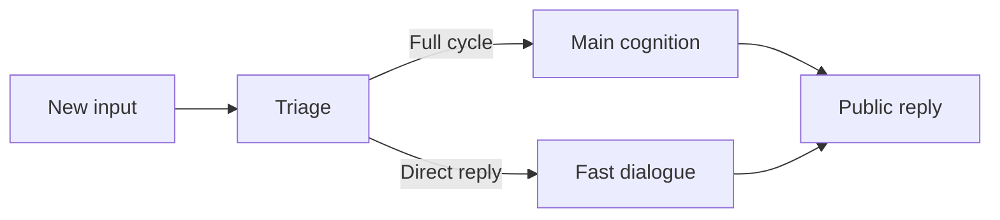

# private-machine 1.1.0 beta

Private-machine runs a persistent companion. Memory, attention, and private
thought let earlier experiences shape the next conversation.

- [Chat with Spamuel as Jesse](docs/workflows/jesse-quickstart.md)
- [Create a character](docs/workflows/example-characters.md)
- [Import an old chat](docs/workflows/import-chat.md)
- [Run a simulation](readme_simulation.md)
- [Inspect the overnight baseline](docs/workflows/spamuel-baseline.md)
- [Configure your models](docs/models.md)

[Main cognition](docs/subsystems/cognition.md) applies memories and goals to
the situation. [Fast dialogue](docs/subsystems/ordinary-interaction.md) serves
routine exchanges. The [system map](docs/concepts/architecture.md) shows how
the modules fit together.
