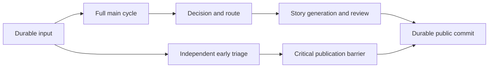
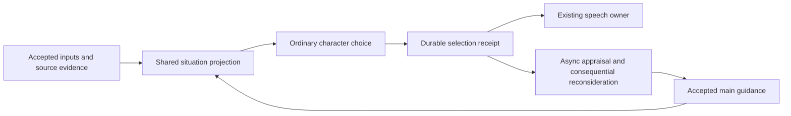
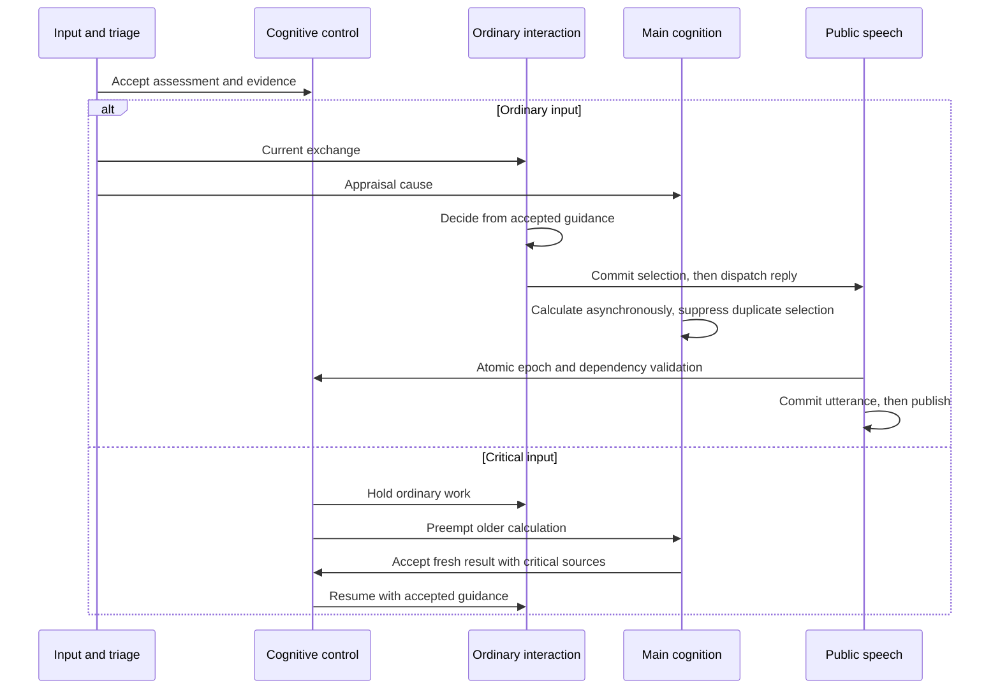
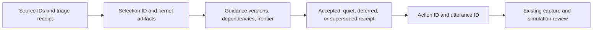

# B03: ordinary interaction during asynchronous cognition

Status: implemented with targeted engineering verification, 2026-11-11. Sustained beta acceptance remains separate.
Source revision: `666734c043337be28bc2e4aed2500550dff49084` on `beta`.

This proposal supports [beta](beta.md) and the [capability audit](beta-capability-audit.md).
The [milestone](../../docs/continuous-character-milestone.md) remains authoritative.
Root review accepted the contracts and bounded implementation below.
The source audit establishes no runtime behavior. Verification remains required.

## Purpose and accepted direction

Ordinary interaction must use accepted character guidance while deeper mental calculation continues.
Critical triage retains its blocking reconsideration rule.
Main cognition retains accepted intentions, appraisal, and consequential action authority.
The ordinary path selects local conversational moves through character reasoning.
It adds no conversational permission agent or availability keyword rule.

The owner authorized incremental beta implementation and minimal interim simulations.
The current interim development limit is $25 total from the latest instruction.
Final tests have a separate budget and scope.
This work adds no budget framework. Initial source auditing made no inference calls.
All later inference uses OpenRouter. No local model service starts.

## Implementation refinements

The shared workflow dependency contract lives in `workflows/public_speech/dependencies.py`.
The speech library cannot import the cognitive-control workflow host.
Its flat `WorkDependencies` carries source stamps, input commits, guidance tick,
critical epoch, partner identity, scopes, source IDs, and partner input frontier.
Separate nested guidance/frontier models were unnecessary for these consumers.
Main cognition retains its own exact intention and focus authority guards.

The initial live fixture reused the B01 betrayal scenario's accepted guidance.
Actual triage considered its later topic change Critical.
That fixture could not establish ordinary interaction.
The corrected gate uses a fresh two-identity Spamuel scenario with its real
character card, one actual neutral foundation turn, then two ordinary continuations.
No classification is forced and no cognitive phase is disabled.
Its evidence establishes engineering behavior, not long-history character quality.

Per-endpoint admission coordinates stage-client calls in the PM process.
Native pm-coder sessions have separate transports.
No global provider-wide scheduling or hardware-preemption claim follows from this policy.

## Current execution, grounded in source

The [assembly](../../workflows/companion.py) installs independent bus-module threads.
`UserInputProxy` commits dialogue before it publishes `user.input`.
`InputTriage` classifies that durable input through a separate kernel.
`CognitiveControl.accept_triage` persists its exact evidence and publication epoch.
Unknown input temporarily holds publication. Critical input additionally requires an accepted main cycle containing its sources.

`MainCogLoop.deliver` reserves foreground inference before mailbox admission.
`handle_batch` retains each reservation throughout full cognition and dispatch.
The cycle runs intake through appraisal, retrieval, codelets, attention, goals, decision, and routing.
Only its accepted `ActionRequest` normally starts Story speech.
Separate threads therefore do not provide the required ordinary path.

`PublicDialogue.prepare_reply` reads partner stimuli, late partner lines, shard context, and shared situational guidance.
Story generates and reviews the draft.
`commit_public_reply` checks the critical epoch, commits speech and exchange resolution, then permits bus publication.
The publication owner and its existing delivery acknowledgment remain suitable.



The graph reconstructs the current call path from source.
No runtime trace ran during this audit.

### Concrete conflicts

| Source | Current behavior | B03 consequence |
| --- | --- | --- |
| `pm/llm/concurrency.py:InferenceAdmission` | One active completion per endpoint, with foreground reservations across calls | Ordinary main cognition can exclude private inference for an entire cycle. |
| `main_cognition/host.py:deliver` | Every ordinary input enters full cognition before speech selection | Accepted guidance cannot serve a separate ordinary exchange. |
| `cognitive_control/host.py:observe` | Every external input increments `generation` and calls `cancel_private` | Unrelated ordinary input discards useful private calculation. |
| `cognitive_control/host.py:commit_private` | A generation difference rejects the whole result | Relevant evidence does not determine acceptance. |
| `inner_thought/host.py` | Resume and episode rules also reject newer ordinary input | Removing one commit check alone cannot repair starvation. |
| `main_cognition/host.py:publish_output` | Stimuli use raw revision checks, while guidance uses `expect_head` with raw revisions | Speech resolution and delivery can invalidate unchanged source meaning. |
| `public_speech/public_context.py:source_fingerprint` | Already excludes a small publication bookkeeping set | Supplies an existing semantic precedent, but not a complete dependency contract. |
| `public_speech/publication.py:commit_public_reply` | An action ID checks its own reply before the exchange status | A second action for the same input can evade exchange-level deduplication. |
| `public_speech/reply_recovery.py:resume` | Unanswered exchanges return to main cognition | Restart needs to preserve an ordinary quiet choice and replay selected speech directly. |

Current accepted state, record scope, provenance, and immutable source IDs remain authoritative.
No runtime code imports the simulation.
`pm/` continues to have no import from `workflows/`.

## Target responsibilities and files

One new cohesive workflow owns ordinary conversational selection:

```text
workflows/interaction/
    host.py                 # Canonical overview, input admission, durable selection, replay.
    schemas.py              # Frozen request and receipt contracts.
    steps.py                # Adapt accepted state, reuse decision and routing mechanisms.
    interaction.workflow.md # Prepare, decide, route, report.
```

Existing owners retain their roles:

| Owner | Responsibility |
| --- | --- |
| `InputTriage` and `CognitiveControl` | Unknown-input hold, critical epoch, critical preemption, wait state |
| `Interaction` | One local conversational selection for an ordinary input group |
| `MainCogLoop` | Async appraisal, accepted direction, consequential actions, critical reconsideration |
| `PublicDialogue` and publication helpers | Speech generation, review, commit, delivery, replay |
| `MemoryStore` | Accepted records, atomic conflict checks, clean recovery |
| `InferenceAdmission` | Per-call resource scheduling, independent of memory authority |

`pm/memory/dependencies.py` owns shared source comparison and typed source stamps.
`workflows/cognitive_control/dependencies.py` owns behavior-specific authority and frontier contracts.
The existing fingerprint helper moves to the core dependency module.
All inspected callers use that one implementation through static imports.
No competing fingerprint algorithm remains in public speech.

## Ordinary selection and main cognition

After early classification, an ordinary group can select from accepted guidance immediately.
The request contains the relevant self and partner shards, current attributed input, character card, accepted intentions, and actual capabilities.
Its situation projection includes current direct evidence, uncertainty, and recent delivered moves.
Scope and reality filters match B02.

The workflow adapts these inputs to `CycleWork` for existing `decide.run` and routing mechanisms.
The adapter copies accepted state and replaces only its temporary stimulus groups and decisions.
It derives feeling and regulation through production functions.
It does not fabricate appraisal, new attention winners, goal changes, or a subjective experience for an unexecuted phase.
The latest accepted main broadcast supplies prior experience, explicitly labeled as prior context.

The route still sees the generic action space.
A local reply selects the existing Story workflow.
A quiet choice produces a durable quiet receipt for this exchange.
A consequential action produces a main-cognition request with the original decision and route proposal.
This proposal does not dispatch its external effect from the ordinary host.
Main cognition reasons about the proposal before it accepts the action.

Routing currently also anticipates released actions.
Extract its existing route-and-resolve portion into a typed helper.
Both clients then use the same route validation and dispatch construction.
Main cognition retains its existing anticipation step.
The ordinary client anticipates only an admitted local reply.
It does not pay for expectations about a consequential action that it cannot accept.

The character can decline current guidance or suspend its local use.
Its receipt names the guidance sources and explains the mismatch.
The host supplies this evidence to main cognition.
It does not revise the durable intentions itself.
A quiet result creates no permanent wait, contact prohibition, or long-term preference.
An ordinary `Sleep` proposal therefore becomes a quiet local outcome plus a proposed wait for main review.

No accepted main guidance exists before initial cognition.
In that case, ordinary selection waits for the real initial main result.
It does not invent empty accepted guidance.

### Selection and duplicate prevention

An ordinary input belongs to one selection owner after classification.
Critical input belongs to main cognition. Ordinary input belongs to `Interaction`.
Main cognition still appraises all inputs, including ordinary exchanges.
Its decide phase excludes ordinary groups whose selection belongs to `Interaction`.
Consequential reconsideration explicitly returns decision authority to main cognition.

The ownership decision comes from accepted triage and durable receipts, not thread timing.
An in-flight main cycle checks this boundary again under `ghost.lock` before dispatch acceptance.
A receipt that arrives after that cycle's snapshot cannot create a second ordinary reply.
The host suppresses the overlapping dispatch and records that disposition.
It retains the cycle's valid appraisal and claimed input.

An already accepted speech action wins over a proposed competing action.
The ordinary host checks existing accepted action and exchange evidence before selection acceptance.
It replays the existing action rather than accept another one.
Both publication paths check the covered exchange IDs, even with a non-null action ID.
Task-result replies keep their distinct existing identity because a terminal outcome can warrant later speech.
This exception requires an explicit task-reply origin, never a generic bypass.

Main cognition coalesces ordinary input already queued while it calculates.
It does not restart for each newly arrived ordinary envelope.
The next main batch appraises the remaining input once.
No new timer, automatic month run, or full-cycle-per-reply requirement appears in B03.

## Exact proposed contracts

These models use Pydantic for frozen inputs and durable payloads.
Field descriptions must specify identity, time, scope, and authority in implementation.
Existing `ActionRequest`, `ActionDispatch`, `DecisionAnswer`, `RouteAnswer`, and `SituationalGuidance` remain domain contracts.

```python
class SourceDependency(BaseModel):
    record_id: int
    revision: int
    fingerprint: str
    current_head: bool


class EvidenceFrontier(BaseModel):
    partner_entity_id: int | None
    scopes: list[RecordScope]
    source_ids: list[int]
    latest_partner_input_id: int | None


class GuidanceDependency(BaseModel):
    main_tick: int
    main_commit_id: str
    intention_sources: list[SourceDependency]
    focus_sources: list[SourceDependency]


class WorkDependencies(BaseModel):
    sources: list[SourceDependency]
    input_commit_ids: list[str]
    guidance: GuidanceDependency
    frontier: EvidenceFrontier
    critical_epoch: int


class GuidanceDisposition(StrEnum):
    Follow = "follow"
    Decline = "decline"
    Suspend = "suspend"


class InteractionOutcome(StrEnum):
    Reply = "reply"
    Quiet = "quiet"
    Reconsider = "reconsider"


class InteractionRequest(BaseModel):
    selection_id: str
    cycle: CycleRequest
    dependencies: WorkDependencies


class InteractionReceipt(BaseModel):
    selection_id: str
    source_ids: list[int]
    outcome: InteractionOutcome
    decision: DecisionAnswer
    route: RouteAnswer | None
    guidance_disposition: GuidanceDisposition
    guidance_reason: str
    dependencies: WorkDependencies
    action_request: ActionRequest | None
```

An empty decision permits `Quiet` with no route.
`Reply` requires its accepted action request.
`Reconsider` requires a route or an explicit guidance mismatch.
Model validators reject contradictory combinations before persistence.
The selection ID derives from the sorted original source IDs and their fingerprints.
Successor corrections therefore produce a different identity.
No unnamed domain tuple or open dictionary replaces these contracts.

Important public signatures:

```python
# pm.memory.dependencies
def source_fingerprint(record: RecordBase) -> str: ...

def capture_source(view: Snapshot, record_id: int, *,
                   current_head: bool) -> SourceDependency: ...

# pm.memory.write_batch.WriteBatch
def expect_source(self, dependency: SourceDependency) -> None: ...

# workflows.cognitive_control.dependencies
def capture_dependencies(view: Snapshot, source_ids: Sequence[int], *, guidance: GuidanceDependency,
                         frontier: EvidenceFrontier,
                         critical_epoch: int) -> WorkDependencies: ...

def validate_dependencies(ghost: MemoryStore, dependencies: WorkDependencies, *,
                          current_partner_input: bool) -> None: ...

# workflows.interaction.steps
def prepare_work(request: InteractionRequest) -> CycleWork: ...

def select_interaction(context: RoleContext,
                       request: InteractionRequest) -> InteractionReceipt: ...

# workflows.interaction.host.Interaction
def resume(self) -> None: ...

def accept_selection(self, receipt: InteractionReceipt) -> CommitReceipt: ...

```

`capture_dependencies` captures the actual selected source IDs through the frontier and guidance plus the frozen read scope.
Implementation must retain every source actually supplied to model or tools.
A broad snapshot is provenance, not permission to invent a narrower dependency after generation.
`WorkDependencies` travels with public context and ordinary receipts.
Main requests retain it with their actual evidence frontier.
Older saved records without this contract retain their existing strict guards until a fresh request replaces them.

## Dependency meaning and acceptance

Source meaning excludes an explicit publication bookkeeping set.
The set contains `exchange_status`, `public_reply_id`, `publication_status`, `recovery_outcome`, `dispatch_status`, and `execution_status`.
The last field needs an explicit addition because speech completion changes its action record.
An exact lifecycle guard still applies whenever execution status controls whether an operation can start or repeat.
Text, provenance, attribution, scope, reality, timestamps, actual output records, and epistemic fields remain significant.
Changing the source head still invalidates a dependency that requires the current head.
Historical evidence can retain an explicitly historical dependency.
Its unchanged historical content does not grant current authority.

`WriteBatch.expect_source` validates under the existing atomic commit lock.
An equal fingerprint tolerates a revision increment from exchange resolution or delivery.
It never replaces the captured fingerprint with the current value before comparison.
Only after semantic acceptance does the batch use the current revision for ordinary write-conflict protection.
Raw guards remain for lifecycle operations whose exact status controls execution.

Source inspection found that lifecycle overlays did not advance record revisions.
An exact revision guard therefore could not detect a concurrent execution-status change.
The implementation repairs this gap by advancing each changed record once per lifecycle commit.
New records with lifecycle fields receive one initial revision, and idempotent commits retain their original revision.
Existing checkpoint revision baselines remain unchanged until a new lifecycle commit occurs.
The semantic guard still compares the original fingerprint before it accepts the current revision.
Focused store checks cover persistence, semantic tolerance, strict status rejection, and clean restart.

Authority differs from evidence.
Current intention and focus membership must still match the request's captured authoritative family.
An added, removed, or superseded governing intention invalidates a conflicting direction proposal.
Implementation uses explicit named family collection in workflow code and existing metadata-family guards where applicable.
Main workspace replacement also compares its parent main-state identity.
An inner GWT turn is not a competing main workspace parent.

A frontier records what the computation observed.
It is not a global cancellation generation.
Unrelated ordinary input does not invalidate ordinary main results.
The next main cycle still appraises that unseen evidence.
An ordinary selection and speech draft additionally require the current frontier for their own partner and scope.
New same-partner input coalesces into a refreshed request before publication.
Other partners do not cancel that exchange.
Critical epochs override all these local rules.

`CognitiveControl.generation` retains its current wait and private-work semantics in this first B03 slice.
Ordinary main cognition does not use that generation as a blanket acceptance veto.
Private thought still conservatively yields after ordinary input.
Its resume and episode rules also contain generation checks.
Removing one private commit guard cannot safely repair those rules.
B05 owns that coordinated private continuation change.
The B03 gate establishes async main calculation, not uninterrupted private inquiry.

## Inference scheduling

The current per-endpoint limit remains one active chat completion initially.
This is a conservative existing limit, not a claim about local GPU requirements.
OpenRouter can support concurrency, but this audit supplies no latency or capacity measurement for changing that limit.
Admission occurs per call. No ordinary main cycle holds an endpoint reservation across phases.
The active HTTP call remains nonpreemptible at the scheduler boundary.
Critical cooperative cancellation can terminate obsolete workflows through their existing cancellation signals.

The proposed scheduling roles are:

```python
class InferenceRole(StrEnum):
    Triage = "triage"
    Critical = "critical"
    Interaction = "interaction"
    Cognition = "cognition"
    Private = "private"


@contextmanager
def inference_role(role: InferenceRole) -> Iterator[None]: ...


class InferenceAdmission:
    def reserve(self, event_id: str, *, role: InferenceRole) -> None: ...
    def release(self, event_id: str) -> None: ...
    @asynccontextmanager
    async def slot(self, cancel: Event | None = None) -> AsyncIterator[None]: ...
```

Critical reservations hold unrelated calls between successive critical phases.
Triage always remains eligible because a later input can supersede current reconsideration.
Unknown triage holds new ordinary publication and selection admission, as in B01.
It need not discard an unrelated result that finishes during that temporary hold.
That result waits outside the store lock, then validates its dependencies.

Outside a critical reservation, calls use two FIFO lanes.
Triage and ordinary interaction form the urgent lane.
Ordinary cognition and private work form the normal lane.
At most four consecutive urgent admissions can precede one waiting normal admission.
Within the urgent lane, triage precedes interaction.
Within each equal role, ticket order is stable.
Normal cognition and private calls share FIFO order rather than separate strict priorities.
An empty lane lends its turn immediately to the other lane.

During required critical reconsideration, triage precedes critical calls and normal fairness pauses.
Critical work therefore cannot wait behind a fairness grant to unrelated calculation.
Fairness resumes after the accepted critical barrier clears.
Repeated genuine critical input can hold ordinary work indefinitely by the owner's chosen rule.
The normal quota bounds admission starvation outside that deliberate condition.
It does not bound wall-clock delay from a slow active provider call.
Telemetry records the role, queue duration, active duration, critical reservation, and selection identity.

## Persistence, restart, and effects

An ordinary selection receipt is an append-only private `StateUpdate` feature.
Its metadata contains a validated `InteractionReceipt` payload.
Its lineage names original input, governing intentions, and the selection ID.
A reply creates its selected `ActionSchemaRecord` in the same batch.
The stored action request uses the existing durable dispatch contract.
Neither record creates a main GWT turn or claims main appraisal.

The ordinary host reads `recovery_snapshot()` and freezes only accepted or recovery-root evidence.
Its append-only selection commit uses `preserve_on_recovery()`.
This fits the B01 recovery rule because it adds records without lifecycle changes or workspace replacement.
The batch depends on original input, accepted assessment, accepted guidance, and all supplied source commits.
The existing store rejects any speculative dependency that escapes this boundary.

Publication remains a separate atomic speech-and-resolution transaction.
Its accepted selection supplies durable authority for clean recovery.
The pending publication marker remains the outbox.
No lifecycle mutation moves into an append-only recovery root.

Restart derives work from accepted input, early assessments, interaction receipts, pending dispatches, and utterances.
It restores critical barriers before ordinary work resumes.
It replays a selected reply without another decision or main cycle.
It preserves a quiet receipt without manufacturing speech.
It queues a `Reconsider` proposal for main cognition with original source identities.
Unselected input returns through early triage and the correct selection owner.
Original envelopes retain their causal identity where present.
Committed but unacknowledged speech replays its utterance ID, as today.
No external task runs again to repair telemetry.

## Proposed flows

Data flow:



Execution flow:



Telemetry flow:



## Small implementation sequence

1. Add shared semantic source guards and real-store checks.
   Update main/public acceptance before ordinary concurrent publication becomes possible.
2. Add per-call roles and two-lane admission with the four-call quota.
   Preserve explicit critical reservations and independent triage admission.
3. Add the interaction request, receipt, workflow adapter, and durable local selection.
   Reuse existing decision, routing, Story, and expectation contracts.
4. Wire selection ownership, main appraisal, coalescing, and acceptance-time duplicate suppression.
   Integrate the explicit consequential-reconsideration proposal.
5. Integrate clean restart, quiet outcomes, publication recovery, and focused evidence capture.
   Update module docstrings and affected conceptual pages only after the implementation exists.

Each step forms a coherent local change.
No subsystem relocation, dependency update, B04 entity schema, or B05 inquiry graph belongs in this slice.

## Affordable verification and remaining gates

Development starts with deterministic checks against actual stores and checkpoint files.
No fake model response establishes runtime acceptance.
Admission checks exercise real synchronization with cancellable local operations and require no inference.
Source checks change lifecycle metadata, source text, successors, scopes, intention authority, and partner frontiers.
Duplicate checks exercise both acceptance orderings and default clean reload.
Main acceptance checks demonstrate that unrelated ordinary input preserves calculation while a relevant correction rejects it.
Private continuation remains outside this gate.

The narrow later OpenRouter gate forks the retained completed B01 checkpoint with real accepted guidance.
It uses one real companion and two ordinary messages during one actual background cycle.
This avoids another paid cold-start cycle while preserving the real workflow mechanisms.
An added critical interruption runs only if changed admission needs a new live B01 check.
The capture must show an ordinary response selected before the background cycle finishes.
It must also show main progress, no duplicate full-cycle reply, and no publication under the critical barrier.
A checkpoint restart then replays only retained work without repeating accepted selection.
The gate uses actual production kernels, real chat and embedding endpoints where required, and existing record packages.
It records first visible output and total response time separately.
It names model identities, endpoint, workload, active calls, source revision, and receipts.
OpenRouter hardware remains provider-managed and unobserved.

Gate execution and the actual fixture are recorded in the verification section below.
No per-subtask month simulation runs.
The separate final scenarios remain Jesse–Spamuel, Jesse–Spamuel1–Spamuel alpha, and Spamuel–Spamuel–Minecraft.
Those final scenarios do not become acceptance claims from the short B03 gate.
Human character-quality review remains distinct from engineering acceptance.

Configured formatting, scoped strict typing, architecture checks, and affected deterministic checks follow each code change.
The implementation also requires the strict manual build and inspection of affected HTML/API links.
This proposal changes only a development record outside the manual navigation.
The root owns any shared documentation build for this planning change.

### Implementation ownership for the root

The scheduler task owns `pm/llm/concurrency.py` and its focused deterministic admission checks.
It adds role contexts, critical reservations, FIFO tickets, and the four-call fairness quota.
The root owns workflow call-site wiring to those roles.

The dependency task owns `pm/memory/dependencies.py`, `pm/memory/write_batch.py`, and the source-guard validation inside `pm/memory/store.py`.
It also owns focused real-store dependency checks.
The root owns workflow dependency capture, public fingerprint import changes, and acceptance consumers.
No scheduler task edits memory code. No dependency task edits workflow behavior.

The root owns the interaction workflow, generic routing extraction, main-cycle ownership, public deduplication, restart, and documentation integration.
The proposal author makes no product edits until the root assigns implementation work.

## Decisions, risks, and review boundary

The root review accepts local conversational authority and consequential nomination to main cognition.
Root review selected one active call per endpoint and four urgent calls per normal admission as initial policies.
These defaults preserve the existing endpoint limit and add an explicit starvation bound.
Measured latency can justify a later concurrent-call limit without changing memory ownership.

The source adapter must not smuggle fabricated phase results into Story prefixes.
Private continuation retains conservative cancellation until its coordinated B05 repair.
Semantic comparison must retain scope, attribution, reality, and interpretation changes.
Recovery roots must never admit speculative context or lifecycle mutations.
Main acceptance must suppress duplicate dispatch even after a concurrent receipt arrives.
Same-partner bursts can defer a reply until the partner frontier stabilizes.
A slow active provider call still delays new triage admission.
The short gate cannot establish sustained fairness or long-term character quality.

No product code, runtime checkpoint, service, or dependency changed during this proposal audit.
No paid inference, local inference, or simulation ran.

## Implementation verification

The actual OpenRouter gate passed on November 11:

```powershell
.venv/Scripts/python.exe -m unittest tests.live.test_async_interaction -v
```

Evidence: `.runtime/beta-b03/live/20261111T182006Z-e5266f63/`.
The explicit short Spamuel fixture established neutral guidance through one real initial main cycle.
Both subsequent ordinary inputs were classified Significant without forcing the category.
Their coalesced reply, record 88, appeared before the background main cycle accepted.
First visible ordinary output took 34.609 seconds in this workload.
Both original sources, 80 and 82, received exactly one appraisal, in main ticks 2 and 3.
Main cognition released no competing ordinary reply for those sources.
The ordinary interval lasted 280.156 seconds; the full gate including initial setup lasted 439.916 seconds.
It drained and joined normally with no application error.
The model was `deepseek/deepseek-v4.1-flash-1017` through OpenRouter.
Its 85 stage-client requests exclude the separate native-agent transports.

The real resulting checkpoint also passed default clean recovery inspection without inference.
`recovery-proof.json` records the retained reply, exact appraisal ticks, no duplicate replay events,
and the unchanged original checkpoint hash.
This exercised actual memory loading, cognitive-control reconstruction, reply recovery, and interaction resume.

An earlier attempt found duplicate equal scopes in a coalesced selection.
The shared capture now normalizes that producer output; the actual-store regression passes.
That failure remains in `live/20261111T121452Z-40965e7c/failure.json`.
The B01-checkpoint fixture was unsuitable because its unresolved dispute produced Critical triage.
Its interruption and real classifications remain in `live/20261111T121659Z-42ccd201/interrupted.json`.
Neither earlier attempt is counted as an ordinary-overlap pass.

The broad affected local check passed 119 tests; `local-checks.log` retains its output.
After the missing-owner guard was tightened, 50 final focused checks passed in 6.012 seconds.
Those checks cover actual synchronization, stores, source meaning, publication, interaction ownership,
early-triage barriers, and imports. They make no model-quality claim.
Configured strict Pyright reported zero errors.
Receipts live under `.runtime/beta-b03/`.

The final strict manual build passed in 197.84 seconds.
Four affected manual pages had 2,378 local targets with no missing files.
The engineering capture contains five actual public lines and three accepted cycles:
`http://127.0.0.1:8095/#capture/beta-async-20261111`.
Browser inspection found all collections and 119 record cards with no JavaScript errors.
The screenshot and browser receipt are in `.runtime/beta-b03/review/`.

Provider receipts across all three B03 attempts report $0.21543439976.
This includes PM usage and unique native-agent responses, with no overlapping response IDs.
One request has unknown cost and one has no final receipt.
The reported amount is a known lower bound, not a wallet reconciliation.
Receipt: `.runtime/beta-b03/spend-final.json`.
The shared interim development limit remains $25.

This verifies one short ordinary burst during actual full cognition, not sustained character quality.
Private episode continuation and global scheduling across native transports remain outside B03.
The next slice is B04 persistent entity context. Final integrated scenarios remain pending.
