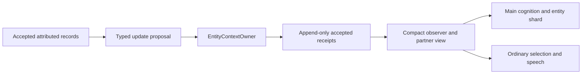
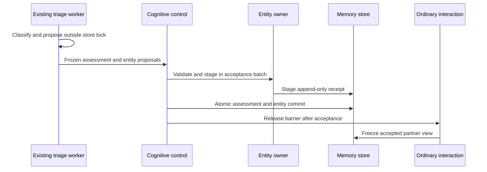
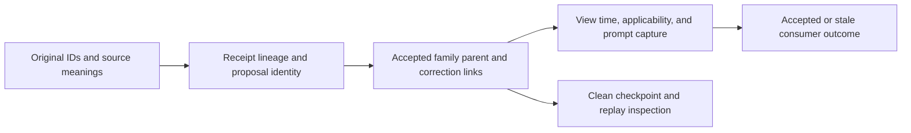

# B04: persistent entity context

Status: implemented; targeted verification completed on 2026-11-12.
B03 passed its targeted gate and committed as `a9e78e8` before B04 implementation.

Root selected one append-only staging owner, atomic immediate updates, scoped attribution,
and relevant projected-meaning guards with explicit partial-main outcomes.
No new speech permission policy is accepted.
The owner/projection folder is a shared workflow library without a separate kernel.
Register that library in the existing architecture checks and enforce its import boundary.

This record defines the entity-context part of [beta](beta.md).
The [milestone](../../docs/continuous-character-milestone.md), sections 12–13 and ARCH-06, ARCH-07, ARCH-10, and ARCH-11, remains authoritative.
The [capability audit](beta-capability-audit.md#b04-persistent-entity-context) supplies the earlier gap analysis.
This document preserves the accepted design and implementation evidence.
The [entity-context manual](../../docs/subsystems/entity-context.md) describes the current system.

## Inspected ownership before implementation

The following contracts and paths exist in the inspected source.

| Source | Current responsibility | B04 consequence |
| --- | --- | --- |
| [`Entity`](../../pm/records/memory_records.py) | Identity, aliases, and entity class | Keep this identity anchor. Do not add mandatory human biography fields. |
| [`BeliefRecord`](../../pm/records/cognitive_records.py) | General beliefs, confidence, supporting and conflicting records, and supersession | Reuse existing beliefs as attributed evidence or proposals. They lack an observer and freshness contract. |
| [`update_beliefs`](../../workflows/main_cognition/experience.py) | Accepts exact user quotes and scoped corrections during main cognition | Entity-specific updates must pass through the new owner. Avoid two accepted copies of the same current claim. |
| [`Narrative`](../../pm/records/memory_records.py) | Entity-linked interpretive text and refinement tick | Retain historical interpretations. They cannot override current attributed evidence. |
| [`_Run._narrative_chain`](../../pm/memory/reconsolidation/pipeline.py) | Generates narrative versions from causal features and an earlier narrative | Keep long-horizon refinement separate from current entity-state authority. |
| [`SemanticRecord` and `DeclarativeFactRecord`](../../pm/records/memory_records.py) | Consolidated claims with epistemic classification and source links | Cite these records when relevant. Do not duplicate the semantic store. |
| [`GraphEdge`](../../pm/records/graph_records.py) | Consolidated relations and validity windows | Its validity dates do not establish current availability or observer knowledge. |
| [`build_situational_guidance`](../../workflows/public_speech/situational_guidance.py) | Selects recent beliefs, narratives, dialogue, intentions, and moves | Replace its partner-context selection with the owner's projection. Preserve purposes and actual delivery evidence. |
| [`WorkspaceShard`](../../pm/records/workspace.py) | References conscious records and a bounded recent stream | Retain references. Present a compact projection rather than an entire entity history. |
| [`CognitiveControl.accept_triage`](../../workflows/cognitive_control/host.py) | Accepts early assessments before releasing the input barrier | Stage immediate entity updates at this boundary, before ordinary selection reads its guidance. |

The current path is accepted input, early triage, shared situation projection, then ordinary selection and asynchronous main cognition.
Main cognition also selects narratives and consolidated memory into entity shards.
Public speech consumes shared guidance and its selected partner's context.

B02 supplies recent attributed evidence, without a durable current claim model.
Its partner context contains at most four interpretations and eight dialogue lines.
The last two beliefs can displace an older availability report from that view.
`BeliefRecord.about_entity_ids` names subjects, not the observer whose knowledge the belief represents.
Narrative selection uses refinement tick and time. It does not resolve a newer direct correction against an older narrative assertion.

## Proposed owner and storage

Add one workflow-side `EntityContextOwner`.
It validates every accepted entity-context update and stages it through the existing `MemoryStore` batch.
The store remains the only durable writer.
Main cognition, immediate maintenance, and later thought or ToM workflows submit proposals to this owner.
None of those producers directly changes accepted entity context.

Use an append-only receipt stream carried by existing private `FeatureType.StateUpdate` records.
The metadata boundary contains a validated `EntityContextReceipt` payload and an explicit entity-family key.
This avoids a new record kind, a second identity store, and a mutable aggregate beside existing memory.
The current model is the deterministic fold of accepted receipts for one subject, observer, and `RecordScope`.
An in-memory fold cache is optional derived data. It never becomes another authority.

Append-only storage is necessary for immediate updates that survive clean restart independently of a main cycle.
`WriteBatch.preserve_on_recovery()` rejects lifecycle changes and successor mutations.
The new owner must use that existing boundary rather than weaken it.
Accepted receipts retain their exact source dependencies and their preceding accepted receipt.
Each receipt's lineage identifies its source events, parent receipt, and producing operation.

Proposed files:

```text
workflows/entity_context/schemas.py      persisted payloads, producer proposals, and compact views
workflows/entity_context/owner.py        sole validation and staging owner; canonical overview
workflows/entity_context/projection.py   deterministic current view and freshness projection
```

No separate bus module or availability agent is required initially.
The companion assembly constructs the owner and supplies it to the existing hosts.
`pm/` never imports these workflow modules.
The core store persists ordinary features without interpreting this workflow-owned metadata payload.
All entity-context models therefore stay together in the workflow, like the existing interaction and cognitive-control contracts.

Proposed data flow:



Proposed execution flow:



Proposed telemetry and provenance flow:



## Proposed contracts

All models use Pydantic with explicit fields and forbidden extra fields.
Persisted inputs and receipts are frozen.
Implementation must add field descriptions and validators, including naive UTC clock validation.
The contracts below define meaning, not a mandatory human attribute catalogue.

```python
class EntityContextKey(BaseModel):
    subject_entity_id: int
    observer_entity_id: int
    scope: RecordScope


class EntityClaimEvidence(BaseModel):
    source: SourceDependency
    exact_quote: str | None


class InteractionClaim(BaseModel):
    dimension: Literal["receive", "respond"]
    ability: Literal["can", "cannot", "unknown"]


class EntityContextClaim(BaseModel):
    claim_id: str
    layer: Literal["background", "relationship", "pattern", "situation",
                   "perspective", "open_question"]
    claim_key: str
    statement: str
    epistemic_kind: Literal["observation", "report", "inference", "hypothetical"]
    perspective_entity_id: int | None
    confidence: float
    evidence: list[EntityClaimEvidence]
    observed_at_utc: datetime
    applicable_from_utc: datetime
    review_after_utc: datetime | None
    applicable_until_utc: datetime | None
    interaction: InteractionClaim | None


class EntityContextProposal(BaseModel):
    proposal_id: str
    key: EntityContextKey
    parent_receipt_id: int | None
    producer: Literal["immediate", "main", "thought", "tom", "migration"]
    input_commit_ids: list[str]
    claims: list[EntityContextClaim]
    retract_claim_ids: list[str]
    challenge_claim_ids: list[str]
    correction_evidence: list[EntityClaimEvidence]


class EntityContextReceipt(BaseModel):
    schema_version: Literal["pm.entity-context.v1"]
    proposal: EntityContextProposal


class EntityUpdateResult(BaseModel):
    proposal_id: str
    disposition: Literal["staged", "deferred", "rejected"]
    reason: Literal["accepted", "stale_parent", "changed_source",
                    "unsupported_interpretation"]
    current_parent_receipt_id: int | None
    staged_receipt_id: int | None


class EntityClaimView(BaseModel):
    claim: EntityContextClaim
    applicability: Literal["current", "due_for_review", "expired", "future"]
    contested: bool


class EntityProjectionQuery(BaseModel):
    key: EntityContextKey
    claim_keys: list[str]
    include_interaction: bool
    token_budget: int


class EntityContextView(BaseModel):
    key: EntityContextKey
    query: EntityProjectionQuery
    identity_source: SourceDependency
    head_receipt_id: int | None
    projected_meaning_fingerprint: str
    as_of_utc: datetime
    next_applicability_change_utc: datetime | None
    claims: list[EntityClaimView]
    source_dependencies: list[SourceDependency]
    omitted_claim_count: int
```

`confidence` ranges from zero to one and describes support for the stated epistemic claim.
Confidence in an accurately quoted report does not establish the report's external truth.
An announced plan to stop interacting and an inference of sleep are separate claims.
Only the announcement can use the report classification.
A connection receipt can support reachability without establishing willingness or ability to answer.
An incoming line establishes recent sending, not guaranteed future responsiveness.
The receive/respond `ability` is an attributed estimate qualified by its claim's evidence, confidence, and applicability.
It never becomes an unqualified environment fact or a speech permission.

`claim_key` groups one proposition within its complete family key.
It is not a global dictionary field or a substitute for the named contract.
Corrections target explicit claim IDs. Matching words alone never authorize retraction.
`perspective_entity_id` identifies whose attributed knowledge or belief the statement describes.
It remains distinct from the observer who holds that interpretation.

The public owner signatures are:

```python
def stage_update(self, batch: WriteBatch,
                 proposal: EntityContextProposal) -> EntityUpdateResult: ...

def current_head(self, view: Snapshot,
                 key: EntityContextKey) -> int | None: ...

def project_entity_context(view: Snapshot, *, query: EntityProjectionQuery,
                           as_of_utc: datetime) -> EntityContextView: ...

def expect_entity_context(batch: WriteBatch,
                          context: EntityContextView, *,
                          as_of_utc: datetime) -> None: ...
```

`stage_update` never calls a model or commits independently.
The caller owns its transaction and cancellation.
The owner validates the supplied evidence, observer, subject, scope, corrections, and preceding receipt.
An independently retained immediate update requires dependencies from the accepted recovery view.
A main-cognition proposal can stage in its owning main batch and becomes accepted with that batch.
The owner does not mark that batch as an independent recovery root.
An unaccepted thought cannot acquire accepted authority through an immediate-update receipt.
`staged` requires a staged receipt ID and the `accepted` reason.
`deferred` or `rejected` requires no staged receipt ID and an explicit reason.
Validators reject contradictory result combinations.
Malformed internal contracts still fail loudly. These dispositions describe expected stale or unsupported proposals, not programming-error recovery.

The owner derives claim IDs from the proposal identity and stable claim position.
The proposal identity includes the producer, original source meanings, family key, and proposed interpretation.
Idempotent acceptance reuses the recorded receipt rather than append another interpretation after restart.
An independent repeat inference cannot increase confidence without new evidence or an explicit evidential argument.
The first producer permits at most four proposed claims per input and can return no claims.
The boundary rejects an oversized response for correction rather than silently discard evidence.
Initially, structured interaction estimates cover receiving and responding.
Presence and activity remain attributed situation statements until a concrete consumer requires another structured dimension.

## Attribution, corrections, and freshness

Raw features, their provenance, scopes, and timestamps remain unchanged.
An exact report quote must occur in the cited source.
Observed claims require an actual observation or tool receipt that exposes the relevant state.
A generated hypothesis cannot label itself an observation.
Companion prose and successful delivery never prove another entity's private state or knowledge.

The owner retains competing claims and explicit challenge links.
An explicit correction retracts the targeted current interpretation and adds the corrected claim in the same receipt.
The original claim and source remain available as history.
Contradictory evidence without a justified correction marks a contest rather than erase either side.
An attributed report can be certain as a report while its inferred consequence remains contested.

Current applicability is separate from historical truth.
The projection computes freshness from the supplied world time without writing a timer-generated opposite claim.
`review_after_utc` marks a claim due for review.
`applicable_until_utc` ends the stated interval, while retaining the original historical observation.
A past sleep estimate becoming stale produces uncertainty. It does not establish waking.
An old routine does not automatically establish today's activity.
Stable background claims need no arbitrary short expiry.

World timestamps use the repository's existing naive UTC convention and `vclock` source.
The receipt's causal transaction order resolves conversational ordering. Cognition ticks are not elapsed time.
An explicit local-time report needs the source's known time zone before conversion.
Unknown time zones or ambiguous intervals remain unresolved. The producer must not invent a clock interpretation.
No default sleep schedule, keyword classifier, or periodic unsolicited contact rule enters this slice.

## Observer, reality, and partner boundaries

The family key includes subject, observer, reality, and frame.
The owner must not merge claims across those boundaries.
An observer requires evidence that the observer can access.
Global game state becomes evidence only through the relevant observer's actual observation contract.
One character's private model is not another character's knowledge.
The first producer writes only the configured companion's observer model.
Another entity's attributed beliefs use `perspective_entity_id` inside that model.
Foreign observer models require their own evidence-aware producer and are not populated from global access.

Projection selects the requested observer, partner, and `RecordScope` rather than merge every entity's context.
It preserves original speaker and addressee attribution when it cites dialogue.
Unrelated private context from another partner must not enter that partner's compact view merely because it exists in the store.
Private guidance remains the character's interpretation, rather than an external observation or another entity's knowledge.
The existing `Presentation` contract and speech owner retain their actual speech choices.
No confidentiality grant list, inherited permission intersection, or new speech authorization rule enters this slice.
Actual prompt capture must demonstrate correct attribution and partner selection.
The owner rejects a proposal whose declared observer or reality contradicts its evidence.

## Producers, consumers, and acceptance ordering

Extend the existing early-triage result with entity-update proposals for the supplied inputs.
Reuse the same real model call initially. Do not add a dedicated dialogue eligibility decision.
This extraction proposes attributed reports, local interpretations, explicit corrections, and uncertainty.
`EntityContextOwner` validates the proposals at acceptance.

`CognitiveControl.accept_triage` stages the assessment and accepted entity receipts in the same append-only recovery batch.
Only then does it release the unknown-input barrier and wake ordinary selection.
Classification authority stays with cognitive control. Entity-context authority stays with its owner.
The owner is a typed staging collaborator, so cognitive control does not implement entity semantics.
An entity proposal conflict requires refreshing that proposal's evidence and current parent.
It never turns a stale generated interpretation into an accepted update by replacing its captured dependencies.
The main-cycle partial-acceptance rule does not release this immediate-input barrier early.
If a required immediate update is deferred, triage acceptance waits for its refreshed proposal.
The already completed classification can remain pending while only the entity interpretation refreshes.
The eventual atomic assessment records every staged or rejected proposal outcome before ordinary selection resumes.

Actual tool and world observations can submit immediate proposals through the same owner boundary.
Sources must already have durable accepted receipts.
Thought and ToM later submit proposals only. They cannot mutate the model or authorize contact directly.
Main cognition retains intention and appraisal authority.
For entity-specific updates, its existing `update_beliefs` producer delegates to the owner instead of creating a competing current belief.
Generic self-model and non-entity beliefs retain their present owners.

B02 guidance, ordinary interaction, main decisions, and speech use the same accepted entity projection.
The projection keeps identity and minimal relationship grounding, relevant situation, and explicit uncertainty within a token budget.
It reports omitted claims and preserves source identities for every supplied assertion.
The initial budget comes from the existing caller's context budget, not an additional global fixed narrative size.

Entity shards reserve their current receipt reference using `WorkspaceItem` and the existing `Feature` identity mechanism.
The renderer presents the compact view for that frozen receipt and its cited evidence.
It never renders the full receipt history or serializes the entire metadata payload into the prompt.
The richer model remains in accepted memory outside GWT.
Old narratives can appear as labeled interpretive background, but current corrections and conflicts remain visible beside them.

### Writes require a current parent

The owner applies the strict family-parent guard only to entity writes.
Its metadata-family guard also covers the initially empty family.
An accepted append therefore cannot silently overwrite a concurrent interpretation.
A late ToM proposal returns `deferred/stale_parent` after direct evidence changes that family.
Its producer must reconsider the new evidence. Updating only the parent ID cannot repair the stale interpretation.

Acceptance validates and stages proposals under the same store lock as the caller's commit.
This prevents an accepted proposal's parent from changing between its disposition and the main transaction.
No model call occurs under that lock.

### Main appraisal can retain its historical view

Reading entity context does not make the whole main cycle depend on the family's latest receipt.
Main appraisal retains its supplied as-of evidence and B03 frontier semantics.
A newer ordinary receipt, including one for the same entity, does not by itself invalidate that appraisal.
Critical epochs, original source corrections, and existing main-state authority guards keep their B03 meaning.

Root accepts an explicit partial-acceptance contract for entity proposals within main cognition.
Each proposal receives a typed `EntityUpdateResult` before the main batch commits.
A stale entity proposal produces no entity receipt, while the valid main appraisal and claimed input can commit.
The main receipt persists every deferred or rejected disposition with its proposal ID and current parent.
This is a recorded outcome, not silent fallback or a successful entity update.
Only that proposal can return for fresh entity reasoning. It never requires repeating accepted appraisal or the full main cycle.

Current direction remains separate from historical appraisal.
If a selected action depends on stale entity meaning, the host defers that action and records its disposition.
It preserves the valid appraisal. It does not publish an obsolete direction merely because appraisal can commit.

### Ordinary choices compare projected meaning

Ordinary selection and speech require current relevant meaning, rather than an unchanged receipt count or family parent.
Before generation, `EntityProjectionQuery` freezes the actual supplied claim keys, partner, observer, scope, and compactness budget.
The query also represents receiving and responding as unknown when their estimates are absent.
The consumer cannot invent a narrower query after generation.

The captured fingerprint covers the selected statements, attribution, epistemic kind, perspective, confidence, applicability, conflict state, and receive/respond estimates.
It preserves explicit applicable intervals when those intervals form part of the supplied assertion.
Receipt IDs, additional equivalent support IDs, and bookkeeping do not define projected meaning.
A repeated equivalent report does not change meaning merely because it has a newer observation time or refreshes a derived review deadline.
Original evidence IDs and timestamps remain attached to the captured view and its raw source guards.
The comparison never replaces those captured source fingerprints with current values.

Equivalent claim support is folded without creating a second current assertion in the compact view.
A newer report with a different estimate, explicit correction, confidence, attribution, or unresolved conflict changes the relevant meaning.
Such a change rejects stale ordinary direction.
An unrelated claim outside the frozen query does not veto this choice.
Its next invocation can select that new context normally.

`expect_entity_context` compares the original fingerprint against a fresh projection of the same query under the store lock.
It also retains the original supplied source dependencies.
The host keeps that lock through the corresponding acceptance commit.
The current world time determines applicability during this comparison.
A crossed review boundary requires reevaluation, but an unchanged resulting meaning can still pass.
The captured head receipt ID remains provenance, rather than a read-side acceptance veto.
Existing B03 same-partner input-frontier and Critical guards still apply independently.
Equivalent entity estimates do not bypass a newly arrived partner message that B03 requires coalescing.

## Migration and recovery

No checkpoint rewrite is required initially.
Existing `Entity` IDs, belief IDs, narrative IDs, semantic IDs, and historical references remain valid.
An absent receipt stream means no accepted B04 claims, rather than an invented empty biography.
The first view can cite legacy records as explicitly labeled, attributed priors.
Legacy text never receives current availability authority through field defaults.

New evidence supersedes those priors in the projection through explicit claim lineage.
The migration producer can later propose carefully scoped legacy claims with original source links.
It must preserve uncertainty and avoid reclassifying narrative inference as direct observation.
No automatic bulk migration or LLM regeneration belongs in the first slice.

Clean restart folds only accepted receipts and recovery roots, following their recorded parent chain.
A missing required parent, duplicate incompatible proposal identity, or corrupt receipt fails loudly.
Restart never repeats accepted extraction merely to rebuild a cache.
An input without an accepted triage receipt still follows the existing recovery path.
One new-contract assessment must not omit its atomic entity-update outcomes or bypass a deferred required immediate update.
Old assessments remain valid under their original schema and receive no fabricated entity payload.

## Small implementation sequence and review choices

Root review must accept the following choices before implementation:

1. Use an append-only typed receipt stream and one workflow owner for accepted entity context.
2. Extend the existing triage call and accept its entity proposals atomically with classification.
3. Use explicit observer, reality, and speaker attribution, plus partner-specific projection, without a new speech permission layer.
4. Route entity-specific main belief proposals through the owner and retain narratives as attributed background.
5. Preserve valid main appraisal through explicit entity-proposal dispositions, and guard ordinary direction by projected meaning rather than receipt append order.

After acceptance, implement the following small steps:

1. Add persisted contracts, owner staging, semantic dependencies, family conflicts, and actual-store checkpoint checks.
2. Add deterministic freshness, correction folding, partner isolation, and compact projection checks.
3. Wire immediate extraction and atomic triage acceptance. Retain old receipt compatibility without a bulk migration.
4. Replace B02 partner selection and entity-shard rendering with the shared projection. Wire its meaning comparison into ordinary acceptance.
5. Route entity-specific main proposals through the owner, then run the short real gate and update the current-system manual.

No thought graph, deliberate ToM workflow, new intention system, transport, or general biography catalogue enters B04.
No dedicated permission agent decides whether the character can talk.
Action selection reasons about receiving, responding, preferences, current purpose, and moves already made.

## Verification and affordable real gate

First exercise the actual store and checkpoint files without inference.
Required checks cover exact source quotes, correction history, conflicting interpretations, observer and reality isolation, partner selection, and parent-family races.
Advance world time deterministically to inspect review and expiry. Neither operation can create an opposite assertion.
Check that another entity's receipt leaves an unrelated dependency valid.
Check that same-family corrections reject stale selection and speech contexts.
Check that a repeated equivalent report and an unrelated same-family claim do not starve ordinary replies.
Check that a stale main entity proposal records `deferred` while its valid appraisal and claimed input still commit.
Check that an obsolete ToM proposal cannot overwrite a newer direct report.
Check clean restart before main appraisal and after atomic triage acceptance.
Inspect the resulting records and the actual rendered compact views.

The later real gate reuses a retained accepted Spamuel checkpoint and configured OpenRouter models.
It uses one resident companion and at most four new messages:

1. Jesse reports, “I am stepping away and cannot answer for a while.”
2. Jesse briefly returns: “I can answer this now, but I am still occupied.”
3. After a controlled world-time advance, Jesse corrects one retained background fact and reports current availability.
4. A distinct supported peer supplies sparse context, to inspect attribution and partner separation.

Capture immediate accepted claims before any deliberate ToM action or full main-cycle completion.
Capture separate presence, receiving, responding, willingness, and uncertainty where evidence supports them.
Capture the time-advance view before message three: it must remain uncertain about unobserved replacement states.
Capture the correction beside its old narrative prior, then clean-restart the checkpoint and inspect the retained model and prompts.
No reply is forced merely to satisfy the script. Quiet and reply outcomes both require the correct contextual reasoning.

This gate samples SC-01, SC-03, SC-08, SC-16, and SC-19 boundaries.
It does not complete every scenario, establish character quality, or replace the final integrated runs.
The peer check uses an actual supported input path and real character processing, not a fabricated service response.
If that path requires a second resident companion, root must account for its additional inference before scheduling it.

Root schedules the gate only after checking the provider-reported cost remaining within the shared $25 interim limit.
The remaining balance is unknown in this planning task because the B03 gate is still in progress.
Use existing usage receipts, actual model identities, timestamps, source revision, rendered prompts, and checkpoint evidence.
Missing usage remains unknown. No new budgeting subsystem or month-long simulation is required.
If the budget cannot support the gate, report `NOT RUN — budget prerequisite unavailable` and retain the deterministic evidence.

No product code, checkpoint, service, or model configuration changed during this proposal.
No inference ran during this proposal audit. The selected implementation follows the recorded root review.

## Implementation review

The shared entity owner and compact projection now exist under `workflows/entity_context/`.
Immediate extraction shares the existing early-triage call and atomic assessment commit.
Current speech retains both the selected action's original view and the newly rendered situation.
Historical main appraisal does not require the latest entity family head.

Review found two additional acceptance requirements:

- A stale ordinary selection must derive a new identity from changed semantic guidance, not reuse the old receipt.
- A stale main or terminal-task reply must retain a durable reconsideration cause and exact task evidence.

The reconsideration cause is a new internal event. It does not requeue the original user input for duplicate appraisal.
Terminal task execution must not repeat merely because its reporting context changed.
These paths require focused store, restart, and real-kernel verification before completion.

Actual-store integration checks exposed invalid snapshot commit IDs after an explicit persona import.
The baseline retained removed transaction IDs as live dependencies.
Commit `4cdca09` clears those IDs when establishing a fresh import baseline.
The regression exercises import, a subsequent recovery root, clean reload, and another accepted root.
An affected check run passed 133 tests; its log is `.runtime/beta-b04/local-checks.log`.
Later implementation changes still require their final focused checks.

The library's focused checks cover correction history, competing claims, attribution, observer/scope isolation,
current-source authority, repeated equivalent support, compact budgeting, expiry, concurrent writers, and clean restart.
They use actual stores and checkpoint files. They do not establish generated interpretation quality.

Current-direction validation conservatively rejects a crossed captured freshness deadline,
even if unseen equivalent evidence could extend that estimate.
No speech permission layer, automatic silence policy, or new resident entity agent was introduced.
That review preceded the paid verification recorded below.

## Final verification

The four-input OpenRouter gate passed:

```powershell
.venv/Scripts/python.exe -m unittest tests.live.test_entity_context -v
```

Evidence: `.runtime/beta-b04/live/20261112T124451Z-75061e71/`.
The gate used the actual triage kernel, intake, staging owner, control barrier, and checkpoint loader.
Its explicit synthetic fixture contained Spamuel's card, two identities, and a labelled legacy Berlin prior.
It did not load or mutate the earlier B03 checkpoint.
The four actual inputs were sources 3, 6, 9, and 13; the supported peer identity was 12.
The model was `deepseek/deepseek-v4.1-flash-1017` through OpenRouter.
Ten transport requests, including schema repairs, completed in 112.437 seconds.
No main cycles or companion utterances ran in this narrow gate.

Observed results:

- Immediate claims and classification survived clean reload after each input, before main appraisal.
- An explicit correction retracted the exact earlier response claim and supplied the replacement estimate.
- Time expiry weakened response ability to unknown without asserting that Jesse returned.
- A later report restored current response evidence and recorded Hamburg beside the retained legacy Berlin prior.
- Sparse peer input preserved Jesse's separate family and actual speaker attribution.
- Reports retained exact quotes. An additional inferred change in occupation remained labelled inference and contested against prior evidence.

The first attempt exposed an adapter defect: valid ISO timestamps with offsets reached a strict naive-UTC internal claim.
The semantic draft boundary now normalizes explicit offsets to UTC before hydration.
Accepted internal claims retain their strict clock convention.
A regression covers offset, `Z`, and offset-free UTC inputs.
Its retained interrupted evidence is `live/20261112T123830Z-ceb2db62/`.

The second attempt correctly retracted the earlier claim but omitted the replacement's structured interaction estimate.
The extraction prompt now requires an evidenced receive/respond estimate to accompany that semantic claim.
The fresh successful gate retained the original acceptance criterion.
The failed sample remains at `live/20261112T124129Z-373344f0/`.
No keyword classifier or forced response value was introduced.

The final affected local run passed 77 tests in 5.373 seconds.
It covers actual stores, atomic triage, family races, partial main acceptance, semantic reselection, publication,
and task-result reconsideration across clean restart.
The earlier broader affected run passed 133 checks, including the import-baseline repair.
Configured strict Pyright reports zero errors and warnings.
Local logs: `.runtime/beta-b04/focused-final.log`, `local-checks.log`, and `types-final.log`.

All three B04 attempts report $0.0122847844 in provider cost, with no unmatched B04 start/end receipts.
Known B03 plus B04 cost is $0.22771918416; prior incomplete B03 usage remains unknown.
Receipt: `.runtime/beta-b04/live/cost_summary.json`.
This is a provider-reported lower bound for interim development, not a wallet reconciliation.

The gate does not establish full-cycle generated action quality, sustained character behaviour, private inquiry, or deliberate ToM.
Those remain later beta work and final integrated verification.
The owner requested a stop after B04 and an uncommitted handoff. B05 implementation has not started.

The final strict manual build passed in 184.09 seconds: `.runtime/beta-b04/docs-delivery.log`.
Four changed manual pages had 2,552 valid local file and anchor targets.
The browser rendered all three entity-context diagrams without JavaScript errors.
New entity-context tests and the live gate also passed their scoped strict type check.
The live gate received only post-run annotation and optional-value narrowing cleanup; no extra inference ran for that cleanup.

The engineering capture contains four actual incoming messages, four accepted entity receipts, and four atomic assessments.
Its direct URL is `http://127.0.0.1:8095/#capture/beta-entity-20261112`.
Browser inspection found all four collections and 15 record cards without JavaScript errors.
The capture operation left the successful checkpoint hash unchanged.
Packages and browser receipts live under `.runtime/beta-b04/review/`.
