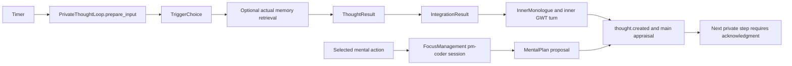

# B05: spontaneous nomination and bounded inquiry

Status: close-out complete, 2026-11-14. The four close-out passes are implemented and verified; the owner closes B05 after rating the record package at http://127.0.0.1:8095/#capture/b05-dwelling-20261114. See [Audit and close-out decisions](#audit-and-close-out-decisions-2026-11-14) and the dated pass sections at the end of this record. Work deferred from B05 is [gamma G01](gamma.md).
Source baseline: `d72fd3b`, after B03 implementation `a9e78e8`.
B04 committed as `e7a7ce8`. This continuation starts from that commit.

Root review accepts the existing private host, one active episode, three nominations,
and three alternatives within the existing episode limits.
Nomination, attention selection, executed thought, and accepted finding remain distinct.
Ordinary unrelated input does not cancel independent private work; relevant source changes and Critical input retain authority.
Use the same inquiry path for spontaneous and selected mental work.
Do not add a second needs system or a new understanding axis in this slice.
Actual inquiry sufficiency remains explicit; interest cannot establish truth or external action authority.

This proposal implements milestone sections 8-11 and ARCH-03-05, ARCH-09-10, and ARCH-12.
The [milestone](../../docs/continuous-character-milestone.md) remains authoritative.
The [beta plan](beta.md) defines the shared $25 interim OpenRouter limit.
This source audit used no inference. It changed no product code or checkpoint.

## Current execution and concrete gaps

`companion.build_app` already installs one `PrivateThoughtLoop` and a deliberate `FocusManagement` host.
B05 retains those hosts, their kernel, memory store, inference admission, and cancellation ownership.



The source provides these foundations:

| Owner | Current contract and observed source behavior |
| --- | --- |
| `inner_thought/host.py` | `_candidates` chooses up to ten committed records; `_commit_cycle` owns private records and the inner GWT turn. |
| `inner_thought/pipeline.py` | `run_cycle` runs trigger, thought, and integrate; it validates citable IDs and reality labels. |
| `inner_thought/operations.py` | `Operation.mode` already distinguishes generation and discrimination. Recall, imagination, evaluation, and noticing operations exist. |
| `inner_thought/triggers.py` | Deterministic opportunities include unresolved intentions, expectations, surprise, idle opportunity, and rumination. No trigger produces no inference. |
| `inner_thought/schemas.py` | `ThoughtCandidate`, `ThoughtResult`, `ThoughtAlternative`, `InnerRequest`, and `InnerReport` already exist. |
| `cognitive_control/schemas.py` | `ControlConfig` already bounds episode steps, elapsed duration, stalled steps, and parking. Defaults are six steps, 600 seconds, two stalls, and 900 seconds. |
| `pm/records/lineage.py` | `RecordLineage` already stores episode identity, operation, sequence, multiple parents, sources, intentions, topics, and reality. |
| `main_cognition/phases/attention.py` | Main attention already uses accepted mental aperture, deliberate focus, structure ratings, and bounded workspace selection. |
| `cognitive_control/attention.py` | `active_focus` reads accepted advice; `resolve_focus` accepts proposals without changing their source grant. |
| `focus_management/host.py` | A selected mental action currently runs its own agent, stores a `MentalPlan`, and returns that proposal to main appraisal. |

These are source findings. This audit did not reproduce their runtime behavior.

The following gaps prevent the required target:

1. `ThoughtCandidate` names existing evidence records. It does not represent independently generated candidate thoughts.
2. Trigger selection immediately becomes deliberate elaboration. No separate nomination result competes for attention.
3. `_commit_cycle` links each thought mainly to its previous episode thought. Alternatives remain text without independent lineage.
4. `_resolve_episode` requires main appraisal before every continuation. This prevents a bounded inquiry from advancing independently.
5. `concrete_progress` accepts any different artifact text or alternative text as progress. Semantic repetition can therefore pass.
6. Episode state and several `InnerRequest` fields remain anonymous mappings. New graph work cannot extend that pattern.
7. `CognitiveControl.observe` increments generation and calls `cancel_private` for every external input.
8. `commit_private`, `admit`, `resume`, `_resolve_episode`, and `_end_expired_episode` also enforce global input freshness.
9. `_end_expired_episode` closes an episode for any newer user line. An unrelated ordinary line therefore discards useful work.
10. Deliberate focus and spontaneous thought currently have separate execution paths. Reusing only their record names does not establish shared inquiry.

B03 semantic source guards exist in `pm/memory/dependencies.py` and `WriteBatch.expect_source`.
B03 ordinary `WorkDependencies` lives in `public_speech/dependencies.py`; it does not replace these private generation checks.
B05 must change the actual private acceptance path explicitly.

## Proposed owners and source layout

B05 adds logical stages inside the existing private host. It adds no resident service or general agent framework.
`PrivateThoughtLoop` remains the sole owner of spontaneous nomination, private episode execution, and accepted inquiry records.
`FocusManagement` remains the owner of selected mental-action lifecycle and result delivery.
It delegates deliberate inquiry execution to the same pipeline and retains its accepted action identity.
Main cognition retains intentions, affect appraisal, consequential actions, and acceptance of deliberate focus changes.
B04 retains entity-context acceptance. Inquiry results can propose entity changes through that owner after B04 commits.

```text
workflows/inner_thought/
    host.py                     # Existing host and canonical subsystem overview.
    schemas.py                  # Extend existing named contracts; typed episode state.
    nominations.py              # Candidate production and bounded source association.
    inquiry.py                  # Shared graph step execution and validation.
    pipeline.py                 # Existing parent orchestration and outcome integration.
    triggers.py                 # Existing cheap opportunity and suppression policy.
    operations.py               # Existing operation catalogue and modes.
    stages/nominate/             # Separate child workflow that proposes candidates.
    stages/trigger/              # Existing selection stage, now an attention decision.
    stages/thought/              # Existing generation or discrimination call.
    stages/integrate/            # Existing boundary integration call.
workflows/cognitive_control/
    attention.py                # Shared attention admission, using accepted focus/state.
    host.py                     # Critical and wait authority; relevant private acceptance.
workflows/focus_management/
    host.py, steps.py            # Existing action adapter into shared inquiry.
```

The two new Python modules separate candidate production from deliberate graph execution.
Their conceptual parent remains `inner_thought/host.py`.
No graph database, second memory owner, second needs model, or ToM workflow enters this change.
B06 can later invoke the shared inquiry function with specialized context.
B05 does not introduce a ToM mode or claim that general perspective shifts implement B06.

## Nomination and coordinated attention

A timer opportunity first runs the existing cheap trigger policy.
A qualifying opportunity permits one nomination batch. It does not promise an inquiry or a conscious thought.
No opportunity means no model call and no fabricated idle thought.

The nomination stage sees current GWT, accepted intentions, mental state, relevant unresolved material, and bounded associated memory.
Association uses the existing scoped `MemoryReadSession` and real retrieval.
It can retrieve outside current GWT, within the captured observer and reality grant.
It cannot read newly committed material through an old frozen grant.
An absent memory stays absent. A failed required retrieval does not become an invented association.

The recommended initial batch contains at most three nominations.
This is an explicit proposal limit for root review, not an inherited production policy.
Each nomination names its source IDs, proposed question or association, epistemic status, and separate judgments.
A valid empty batch means nothing attracted attention.

Candidate records use existing self-origin `FeatureType.Thought` records with typed payloads.
Their lifecycle identifies them as nominations. They are neither external evidence nor automatic inner GWT items.
Every nomination retains `RecordLineage` and captured `SourceDependency` values.
Persistent nominations allow deferral and review without rerunning unchanged generation.

The existing trigger child becomes the selection call after nomination.
`cognitive_control.attention` owns its acceptance policy, rather than the candidate producer.
It reads competing pending input, accepted focus, current intentions, accepted mental aperture, and the nominations.
It chooses at most one inquiry, explicitly defers it, or dismisses it with a reason.
The host enforces that limit and validates the selected nomination ID.
The producer cannot select itself by returning a high interestingness score.

The selection call does not duplicate main workspace assembly or write main attention winners.
It allocates the existing private episode slot under current shared attention guidance.
Main attention still owns the main workspace and later appraisal of private findings.
Selection alone does not make every alternative a conscious experience.
The first accepted elaboration step creates the actual inner GWT turn.
The nomination batch and selection receipt persist before that step, so interruption cannot erase their distinction.

An active episode occupies that one private slot until it yields or stops.
New ordinary traffic can delay its next call through B03 admission without deleting it.
Critical reconsideration excludes unrelated private calls and remains authoritative.
New accepted focus or changed governing intentions can displace an episode after dependency review.
A nomination cannot override an accepted wait or force public contact.

## Contracts and graph semantics

Reuse `ThoughtCandidate` for its current job: a source record offered to private attention.
Do not silently change `knoxel_id` from an evidence identity to an uncommitted idea identity.
Reuse `ThoughtResult`, `ThoughtAlternative`, `InnerReport`, `MentalPlan`, and `RecordLineage` where their meanings fit.
Use Pydantic frozen contracts for new persisted payloads, with explicit field descriptions and finite choices.

The required additions are small named contracts:

```python
class ThoughtJudgments(BaseModel):
    interestingness: float
    character_relevance: float
    plausibility: float
    consequence: float
    desirability: float
    action_suitability: float
    reason: str


class ThoughtNomination(BaseModel):
    text: str
    question: str
    evidence_ids: list[int]
    reality: Literal["remembered", "internal", "inferred", "imagined"]
    judgments: ThoughtJudgments
    suggested_operation: str


class ThoughtRelation(BaseModel):
    target_record_id: int
    kind: Literal["extends", "supports", "challenges", "reformulates", "merges", "dismisses", "notices"]
    reason: str


class ThoughtAttentionDecision(BaseModel):
    nomination_id: int | None
    disposition: Literal["select", "defer", "dismiss"]
    reason: str


class InquiryState(BaseModel):
    episode_id: str
    origin_record_id: int
    node_ids: list[int]
    frontier_ids: list[int]
    sequence: int
    status: Literal["active", "paused", "completed", "abandoned"]
    stop_reason: str
    started_at_utc: datetime
    active_elapsed_seconds: float
    stalled_steps: int
    next_operation: str
    resume_after_utc: datetime | None
    resume_source_ids: list[int]
    reflection_source_id: int | None
```

Scores range from zero to one. Desirability measures welcome outcomes, not evidence support.
Plausibility is a revisable judgment supported by actual evidence; it is never a generic truth certificate.
High interest, emotional intensity, or need pressure cannot increase evidence counts or confer action authority.
The implementation retains distinct reasons when a judgment materially affects selection.

`ThoughtResult` gains typed relations, assumptions, judgments, and an explicit information gap.
`ThoughtAlternative` gains its own evidence IDs, assumptions, reality, and judgments.
The host materializes alternatives as existing private Thought features under their actual generation parent.
Their accepted record IDs become available to later discrimination calls.
No model invents committed record IDs for alternatives in its current response.

One executed operation creates an `InnerMonologue` node plus any proposed alternative nodes.
All nodes keep their actual record IDs and `RecordLineage.parent_record_ids`.
A discrimination step can examine several prior nodes and link their accepted IDs explicitly.
A merge or reformulation creates a new node; it does not erase the alternatives.
Dismissed nodes remain inspectable with their reasons.
Revisiting creates another executed step referencing its earlier subject.
A causal link cannot point forward or to an unknown record.

`InnerRequest.episode` becomes `InquiryState | None`; corresponding report state is typed.
Revised request fields use existing named records or bounded typed source views, rather than anonymous domain mappings.
Serialization into workflow input files remains an external boundary.
This migration must not pass nested untyped graph payloads between internal modules.

The proposed public integration points are:

```python
# inner_thought/nominations.py

def nominate(context: RoleContext, request: InnerRequest) -> list[ThoughtNomination]: ...

# cognitive_control/attention.py

def select_private_thought(context: RoleContext, request: InnerRequest,
                           nomination_ids: Sequence[int]) -> ThoughtAttentionDecision: ...

# inner_thought/inquiry.py

def run_inquiry(context: RoleContext, request: InnerRequest) -> InnerReport: ...

# cognitive_control/host.py

def commit_private(self, batch: WriteBatch, *, critical_epoch: int) -> CommitReceipt: ...
```

`InnerRequest` retains the selected origin record, captured source dependencies, and Critical epoch.
Each entry caller uses the same `run_inquiry` contract and existing real kernel tools.
`CommitReceipt` is the existing contract from `pm.memory.checkpoint`.
No dictionary return or duplicate receipt model substitutes for that type.

## Inquiry execution, stopping, and useful progress

After selection, the pipeline can execute several graph steps without another main-cognition round trip.
Existing `Operation.mode` chooses generation or discrimination through the same thought stage.
A generative step proposes possibilities. A discriminatory step compares evidence, assumptions, consequences, and alternatives.
No forced reassuring outcome or universal social caution rule enters either stage.
A generated branch needs discrimination before it becomes a proposed conclusion.
A recall or inspection result can instead stop with an explicit information gap.

The existing integrate stage runs at an outcome boundary, not automatically after every branch.
It returns the existing `InnerReport` and `MentalPlan` proposals.
A consequential finding can return early for main appraisal without pretending the inquiry completed.
Public questions and external searches requiring effects remain proposed actions.
The inquiry cannot execute speech or external writes through its read-only memory tools.
Actual acquisition receipts remain distinct from proposed acquisition and failed acquisition.

Reuse `ControlConfig.episode_steps`, `episode_seconds`, `stalled_steps`, and `parked_seconds`.
A step means one executed graph operation; nomination and selection remain separately visible calls.
The proposed branch cap is three alternatives per generative step.
The resulting episode graph has a finite derived bound. It does not grow through hidden recursion.
Required context overflow fails visibly rather than truncating mandatory graph evidence.

No textual inequality establishes progress.
New evidence requires an actual newly inspected original source, not another summary of the same premise.
A meaningful alternative must state a distinct assumption, prediction, consequence, or acquisition choice.
Discrimination records that distinction or marks repetition as stalled.
A different sentence without a changed distinction cannot reset the stall counter.
The host enforces finite limits even when the model repeatedly claims novelty.

Valid outcomes include provisional finding, reformulated question, information gap, wait, pause, displacement, completion, or abandonment.
A result can remain unresolved and still establish useful behavior.
An expired opportunity parks the episode with a recorded reason.
Parking time permits reconsideration; it does not establish new evidence or demand automatic resumption.
Relevant evidence, changed priorities, or an explicit selected continuation can nominate the parked episode again.
Unrelated ordinary input does not release every parked source or close every active inquiry.

The current host measures episode duration through `vclock`, despite `ControlConfig` describing real elapsed duration.
B05 resolves that mismatch explicitly.
Use an accumulated monotonic duration for active computation within a process.
Persist elapsed duration at accepted step boundaries.
World UTC timestamps describe evidence, review occasions, and retained chronology.
Offline time does not count as executed thought. No restart fabricates intermediate steps.
After restart, an overdue episode can close or seek fresh admission under its retained identity.

## Mental state, needs, and metacognition

Reuse `FullMentalState`, its accepted owner, and the existing felt-state projection.
The inspected cognition fields are `interlocus`, `mental_aperture`, `ego_strength`, and `willpower`.
Existing needs include `data_access`, `learning_growth`, `creative_expression`, `connection`, and `autonomy`.
Curiosity, playfulness, fear, and boredom already exist as emotions.
No new vector axis or silently renamed need enters this slice.

Mental aperture influences how many alternatives fit attention within the hard cap.
Interlocus informs whether internal association fits current demands.
Willpower, emotional preoccupation, and accepted intentions inform persistence and displacement reasoning.
Need satisfaction and uncertainty remain separate evidence in the selection prompt.
These influences receive recorded reasons; they do not multiply plausibility scores.

`data_access` means information availability, and `learning_growth` means acquisition and improvement.
Neither field currently means sufficient understanding of a specific question.
B05 therefore represents sufficiency as the inquiry's explicit stopping question, not a new homeostatic need.
A finding can explain why the character knows enough to proceed or must wait for evidence.
Merely generating text never satisfies a need automatically.
Main appraisal remains the only path for accepted affect or need changes.
A separate understanding-need extension remains an owner decision after this bounded slice.

Reuse `rumination_notice`, `attention_drift_notice`, and existing reflection evidence.
A metacognitive observation becomes another nomination referencing actual inquiry nodes and their original source roots.
It competes for attention; it cannot recursively launch a child inquiry from inside a thought call.
One active episode remains the limit, including reflection about reflection.
A later selected episode can inspect the earlier observation under the same ordinary bounds.
Repeated self-generated nodes do not become independent corroboration.
Introspective explanations retain uncertainty rather than claiming privileged access to their causes.

## Acceptance, evidence, and recovery

Every executed thought remains an actual internal event about content with its own epistemic status.
An imagined conversation never becomes actual dialogue. An imagined world change never becomes an observation.
Record scopes retain actual/imagination reality and frame boundaries independently of the prose reality label.
Memory traversal preserves original source roots, speakers, observer, and record revisions.
Neither a selected nomination nor its descendants acquires outside evidence authority.

Each request captures `SourceDependency` values before generation.
The batch stages `expect_source` guards for supplied evidence and relevant current authority.
Historical evidence uses `current_head=False`; a governing active intention requires current authority.
A changed source meaning rejects or refreshes the affected work.
An operational receipt revision alone does not invalidate unchanged source meaning.
The episode state also has a current-parent guard, preventing competing continuations from committing the same sequence.
A rejected step leaves earlier accepted independent nodes intact.
A correction can make an old conclusion unsuitable for current direction without erasing its historical inquiry record.
B04 entity proposals use its current-parent owner guard and receive explicit dispositions.
Reading B04 context for historical reasoning does not grant authority to overwrite its current family.

Remove ordinary global-generation vetoes from private acceptance, replay, and episode closure together.
`observe` still wakes waits and tracks external input, but ordinary input does not call `cancel_private` globally.
Accepted Critical triage retains cooperative cancellation, Critical reservations, and epoch invalidation.
Unknown triage holds new private admission and acceptance until classification; it need not destroy a completed independent result.
After that hold, the result validates its original dependencies without replacing their captured fingerprints.
An accepted wait still prevents private continuation and late commit.
A result from an older Critical epoch never commits after the barrier clears.

`thought.created` replay uses accepted result identity and actual main acknowledgment.
It no longer discards accepted independent thoughts because an ordinary message changed generation.
A private finding awaiting appraisal does not require every intermediate node to receive its own main cycle.
The final or important intermediate finding produces one existing self-origin event with its graph references.
Main can appraise that finding while another ordinary exchange uses B03 interaction ownership.

Persist each accepted graph step and episode state atomically through existing write batches and recovery roots.
A crash before commit repeats only an unaccepted step.
A crash after commit resumes from its recorded sequence and never reruns accepted inference merely to rebuild state.
Selected mental actions keep their existing action receipt, correlation, and delivery acknowledgment.
Their adapter creates the same inquiry origin from the accepted action and returns the shared final proposal.
No alternative agent path continues to produce incompatible graphs after migration.

## Minimal migration and ordered implementation

Existing Feature IDs, lineage, inner GWT turns, and accepted `MentalPlan` records remain valid.
No bulk checkpoint rewrite or mass LLM regeneration is required.
The boundary reader can interpret an old linear episode as its retained chain, with explicit legacy provenance.
It must not invent branch links or confidence values absent from the old record.
Old standalone mental results remain terminal proposals; only new selected sessions enter shared inquiry.
Invalid required metadata fails loudly instead of silently creating an empty graph.

After root acceptance and the B04 commit:

1. Add typed nomination, judgments, relations, and episode payloads with actual-store serialization and restart checks.
2. Add source-root validation, graph relations, stopping rules, and the explicit legacy reader.
3. Add the nomination child and shared attention selection through the existing private host.
4. Extend thought execution for connected generation and discrimination, with integration only at outcome boundaries.
5. Replace private generation vetoes with source and Critical guards across commit, replay, parking, and resume.
6. Adapt selected `FocusManagement` mental work into that same pipeline while preserving action receipts.
7. Run focused local checks, the bounded real gate, and source-linked documentation updates.

These are coherent implementation steps, not independent service projects.
A discovered mismatch in B04 APIs requires proposal correction before implementation crosses that boundary.

## Verification and affordable real gate

First use actual store batches, checkpoints, rendering, and real admission synchronization without model calls.
Local checks cover branch parents, merge and dismissal links, unknown citations, source-root deduplication, and reality isolation.
They also cover finite step limits, semantic repetition receipts, parked resumption, and cancellation during a Critical hold.
Test ordinary unrelated input during work, a source correction, and a later Critical epoch separately.
Inspect that only the latter two reject work whose dependencies or epoch changed.
Test restart before and after a step commit, and accepted-result replay without duplicate findings.
Test the deliberate-action adapter against the same contracts and actual lifecycle records.
Canned model outputs cannot establish generation quality or count as a live workflow pass.

The proposed real gate uses one retained accepted Spamuel checkpoint and the configured OpenRouter endpoint.
A synthetic private concern supplies two plausible interpretations and an unresolved question with actual source IDs.
No companion response or external contact is forced.
The gate exercises one nomination batch, one attention selection, one generative step, one discriminatory step, and one integration boundary.
It therefore targets five real stage calls, plus necessary scoped retrieval and any explicit repair attempts.
It does not launch full main cycles for every branch or run a month simulation.
A second deliberate-entry or metacognition episode runs only if the first gate leaves that changed path unverified and budget remains.
Otherwise those live cases remain explicitly NOT RUN pending the next bounded gate.

Capture nominations, selection/defer reasons, actual prompts, original source roots, graph links, alternative judgments, stop reason, and restart state.
Inspect whether repeated concern shares one source rather than pretending to corroborate itself.
Inspect whether interest and need pressure affect exploration without changing evidence or imagined-event status.
Capture the resulting inner GWT turn separately from unselected candidate records.
Retain any failed quality sample and diagnose it without weakening provenance rules.

Root checks current provider receipts before scheduling this gate.
The owner limit is $25 across interim beta development. B03 reported approximately $0.22.
B04 usage and later receipts must determine the actual remaining balance.
Both PM usage and pm-coder provider costs count; cancelled or absent usage remains unknown.
No new budget subsystem or full-month check belongs here.
Missing services or insufficient budget produce an explicit NOT RUN result.
The final integrated tests retain their separate owner authorization and do not follow automatically from this proposal.

## Review decisions and risks

Root review must accept these choices before product changes:

- Keep nomination and elaboration inside the existing private host, with shared attention acceptance in `cognitive_control.attention`.
- Use existing Features and `RecordLineage` for the graph, with explicit typed relation payloads and no graph store.
- Start with three nominations, one active episode, and three alternatives per generative step under existing episode limits.
- Remove ordinary global cancellation across every private lifecycle consumer while retaining Critical and wait guards.
- Route new deliberate mental sessions through shared inquiry, preserving the existing selected-action owner.
- Treat sufficient understanding as an inquiry stopping condition; defer a new need axis and all B06 ToM specialization.

The main risks are partial migration of generation checks, candidate promotion before attention, source-root laundering, and duplicate accepted action results.
Focused actual-store checks and retained prompt inspection address these risks before any sustained test.
Five stage calls establish a narrow operational sample, not long-term thought diversity or character quality.
The current-source manual changes only after implementation and its evidence exist.

## Persistence slice — implementation boundary

The first continuation implements the storage portion of migration steps 1 and 2.
It does not complete those steps' host/request migration or any later execution gate.
The timer, model-stage schemas, Critical control, ordinary-input cancellation, and selected mental-action execution remain unchanged.

Implemented source:

- `workflows/inner_thought/schemas.py`: frozen, named nomination, attention, judgments, grant, relation,
  graph-step, state, and receipt contracts. Existing `InnerRequest`, `InnerReport`, `ThoughtResult`,
  and `ThoughtAlternative` remain unchanged until their consumers migrate together.
- `workflows/inner_thought/nominations.py`: captured source closure, fingerprint-preserving grant extension,
  original-root resolution, and bounded private nomination staging.
- `workflows/inner_thought/inquiry.py`: separate attention receipts, one active graph slot per observer,
  atomic operation/branch/state staging, current-parent and family guards, bounded progress,
  and an explicit reader for retained linear episodes.
- `tests/unit/workflows/inner_thought/test_inquiry_records.py`: actual-store boundary checks with checkpoints.
  Explicit proposals are inputs to storage, not substitutes for generated model output.

The staging functions leave commit, Critical/wait authority, GWT turns, and finding delivery to their caller.
They send no bus event and change no mental state.
The new graph step uses `InquiryStep` as a persisted contract alongside the existing stage result.
Host integration must map or extend the existing stage contracts coherently; no competing model pipeline is installed here.
The old request's anonymous fields have not yet migrated.

Original source fingerprints survive extension after an operational revision.
Newly inspected graph nodes add dependencies without refreshing prior ones.
Historical evidence can retain its exact ID after a successor; governing evidence requires its captured current head.
Source-root resolution follows actual thought lineage, summary inputs, canonical semantic sources, and belief evidence.
It ignores canonical back-pointers rather than manufacturing a causal cycle.
A narrative or legacy summary without exact source links supplies internal context, not invented original evidence.

One accepted operation produces one InnerMonologue record, up to three independent Thought branches,
and a typed StateUpdate receipt in the same batch.
Selection alone produces no executed thought.
Generation cannot certify its own conclusion; later discrimination must name actual accepted nodes.
Text inequality is not a progress criterion.
Acquired evidence requires a newly inspected original source; internal derivations and receipts do not qualify.
Recorded comparisons still require real model-quality inspection after integration.
Hard finite bounds constrain the graph even when a future model overstates meaningful difference.

Persistence checks use append-only recovery roots through the actual MemoryStore.
No production checkpoint is rewritten, and no inference runs in this slice.
The legacy reader returns a distinct `LegacyInquiry` variant with the original world-clock duration.
It does not convert that duration into active computation time or invent absent judgments.

### Persistence verification

Command:

```powershell
.venv/Scripts/python.exe -m unittest tests.unit.workflows.inner_thought.test_inquiry_records tests.unit.test_architecture -v
```

Result: **34 passed in 4.795 seconds** (27 inquiry boundaries and seven architecture checks).
Receipt: `.runtime/beta-b05/checks-final.log`.
These checks use actual stores, atomic commits, durable files, and clean checkpoint recovery.
They include two competing staged continuations and competing selections; only one can commit.
They do not call a model, replace a collaborator, or certify workflow generation quality.

Configured strict Pyright and the scoped check of both new modules and their tests report zero errors and warnings.
Receipts: `types-final.log` and `types-scoped-final.log` in `.runtime/beta-b05/`.
The checker remains `node C:/Users/rick/AppData/Local/npm-cache/_npx/110e52990071af13/node_modules/pyright/index.js`.
Both new modules are now included in the configured strict check.

A separate whole-file strict scan of `schemas.py` reports **27 existing legacy diagnostics**.
A matched baseline scan of `e7a7ce8` reports the identical 27 rule/message diagnostics, with zero new diagnostics.
The old anonymous request fields remain visible work for the coordinated request/host migration.
Do not describe that file as strictly clean.
Receipts: `types-schema-baseline.json`, `types-schema-current.json`, and `types-schema-comparison.json`.
The baseline copy required an explicit checker configuration because the default checker excludes `.runtime`.
The comparison requires one analyzed file on each side; an excluded file does not count as a clean baseline.

Retained concrete state: `.runtime/beta-b05/records/inquiry.pickle` and `receipts.json`.
The actual accepted graph contains three transition receipts and four nodes: one generation, two branches, and one comparison.
Its manifest labels the inputs as synthetic storage proposals, not generated companion content.
The retained checkpoint reloads to the same typed receipt and node identities.

The first fixture used a dangling hypothetical reality ID and correctly failed the store's reference validation.
The fixture now creates a real RealityRecord before using its identity.
That failure remains in `records-first.log`; no production reference validation was weakened.
Review also found that an already supplied but uncited source could appear newly acquired.
Progress now excludes prior grant identities as well as previously inspected roots; an actual-store regression covers that case.

The source header and `docs/subsystems/private-loop.md` distinguish available storage from designed execution integration.
The data diagram describes the storage contracts. Current timer execution and telemetry diagrams remain unchanged.
The library emits no telemetry or publication. No new owner rationale or FAQ claim was inferred.
The final manual command passed in **186.33 seconds**:

```powershell
uv run --locked --with-requirements requirements-docs.txt mkdocs build --strict
```

Receipt: `.runtime/beta-b05/docs-final-source.log`.
Five generated manual/API pages have 4,524 valid local file and anchor targets: `docs-links.json`.
Chromium opened the local index, manual, and all three affected API pages without JavaScript or request errors.
Both private-loop diagrams rendered. The new vertical storage diagram was visually inspected for legibility.
Receipts: `docs-browser.json`, `docs-browser.png`, and `docs-diagram.png`.
The first browser assertion inspected the normal DOM and could not see Material's closed diagram shadow roots.
The final check reads the actual closed roots through Chromium's DOM inspection protocol; each diagram contains one SVG.
No documentation rendering code was changed to satisfy that inspection.
The final generated API includes the last progress guard and the updated schema overview.
The earlier successful builds precede that final source check and are retained separately.

### Next implementation boundary

1. Migrate the live `InnerRequest` fields and episode consumers to named typed views.
   Retain explicit legacy provenance rather than converting absent judgments or world duration into invented values.
2. Add the nomination child and shared attention selection. Retain empty nomination-stage receipts in the host.
   Wire the existing private owner to the new staging boundary, including GWT construction and finding delivery.
3. Execute connected generation/discrimination through the existing kernel. Integrate at outcome boundaries.
   Add explicit parked resumption and deliberate-action origin admission under the same private slot.
4. Coordinate source guards, Critical epochs, unknown-triage holds, accepted waits, admission, replay,
   parking, acknowledgment, and the main private-only generation checks together.
   Ordinary-input cancellation remains unfixed in the current runtime.
5. Adapt FocusManagement into that shared inquiry execution while preserving action receipts and delivery acknowledgment.
6. Inspect the shared interim provider receipts, then run the bounded real OpenRouter gate and its review capture.

**NOT RUN — B05 real workflow gate:** execution integration is not ready.
The gate's endpoint is not being replaced by the persistence tests.
No paid inference, full main cycles, long simulation, or Minecraft run occurred in this slice.
There is no new provider usage to add. The known prior spend and its unknown B03 remainder remain unchanged.
B05 and the beta milestone remain incomplete.

## Named requests and graph entry slice

The continuation starts from persistence commit `84538ac`.
The owner authorizes the next handoff items, with the handoff file kept uncommitted.

The live request and episode consumers now use named types in `request_views.py` and `schemas.py`.
Legacy episodes retain an explicit `legacy_linear` provenance and their original world duration.
An open retained episode finishes through its existing pipeline before a new graph can enter.
No absent judgments, branch relations, or active computation duration are invented.
The previous 27 strict schema diagnostics are resolved rather than excluded.

The actual assembly injects `run_private_inquiry` into the existing parent kernel.
The new nomination child proposes up to three questions and can return an empty result.
The host retains the empty-stage receipt as well as nonempty nomination records.
Opportunity identities derive from captured sources and guidance, rather than fresh timer invocation IDs.
The existing trigger child now supports a separate shared-attention request.
Its accepted focus comes from the frozen view; selection validates the original focus head and expiry under the final store lock.

`graph_execution.py` coordinates those child kernels and one connected thought operation per invocation.
The existing thought child receives actual branch assumptions, judgments, dispositions, source roots, and accepted node identities.
Its structured-output correction boundary rejects unknown citations, invalid relations, and conclusions before discrimination.
Explicit outcome boundaries invoke the existing integration child.
Graph outcome metadata retains proposed goals, disclosure, expectation effects, and their original source guards.
Main cognition still owns accepted goals and mental-state changes.
Public context can consume a graph finding's actual candid disclosure.

### Recovery refinement

The first adapter check exposed a conflict with the existing recovery-root invariant.
An append-only recovery root cannot contain a GWT turn, cycle mutation, or expectation replacement.
The core invariant remains unchanged.

The graph operation, independent branches, outcome proposal, and episode receipt commit atomically as recovery roots.
A separate derived commit projects the accepted operation into the inner GWT and applies retained expectation effects.
`ensure_inner_turn` reconstructs a missing projection without inference or mutation of the accepted graph.
Runtime replay repairs those projections before finding delivery; event ticks identify the actual inner turn.
Projection failures remain visible and preserve the accepted graph.
This refines the implementation sequence while preserving the approved atomic graph/state boundary.

### Current limits

Ordinary-input cancellation and global generation fences are still unchanged.
This slice does not establish independent private continuity during conversation.
An active inquiry from an older Critical epoch is held for fresh admission; its epoch is never silently replaced.
Explicit parked resumption, admission after displacement, and the deliberate FocusManagement adapter remain outstanding.
Legacy experiment and inspection summaries are excluded from graph input with an explicit context-limit field.
Their source scope is not yet captured by the graph adapter.
Graph execution does not yet reproduce legacy reflection experiments or per-channel quale emission.
Those paths require explicit integration before B05 can be complete.

### Local evidence

The actual application prepared named requests from persisted legacy records using the OpenRouter configuration, without inference or service startup.
Evidence: `.runtime/beta-b05/request-preparation/` and `request-assembly-connected.log`.
The first combined host check passed 61 actual-store, checkpoint, deterministic-boundary, and architecture checks in 5.450 seconds.
The next focused graph check passed eleven checks, including original branch payloads and semantic model validation.
Configured strict coverage now includes the new schemas, request views, graph modules, and nomination/attention children.
Receipts: `host-wiring-checks.log`, `host-wiring-types.log`, and the focused nomination/outcome logs under `.runtime/beta-b05/`.
These checks do not substitute for the real kernel/model gate.

The first retained B04 fixture could not admit private work: its accepted Critical assessments still await main appraisal.
The gate did not disable triage or fabricate acknowledgment.
That prerequisite result remains in `.runtime/beta-b05/live-prerequisites-20261112.json`; it incurred no paid usage.
The bounded gate instead copies the retained B03 checkpoint with three actual accepted main cycles.
Its original checkpoint remains unchanged, and the gate must create no additional main cycle.

### Connected verification and delivery, 2026-11-13

The final affected command runs the six new boundary modules, deterministic triggers and operations,
expectation and disclosure boundaries, both inspection rendering classes, public context/publication/dependencies, and architecture checks.
Exact command and results are retained in `.runtime/beta-b05/finish/verification.json`.
Result: **115 passed in 9.012 seconds**; `affected-final.log`.
Configured strict checking and the scoped new-test/live-gate check report zero errors and warnings.
Legacy mocked workflow tests are not used as integration evidence.

The real command is `.venv/Scripts/python.exe -u -m unittest tests.live.test_private_inquiry -v`.
It passed in **59.291 seconds**, with seven actual OpenRouter requests and two private parent invocations.
Model: `deepseek/deepseek-v4.1-flash-1017`; endpoint: `https://openrouter.ai/api/v1`.
Evidence: `.runtime/beta-b05/live/20261112T230740Z-af28b3da/`.
Selection receipt 185 precedes generation 186 and its branches 187/188; comparison 190 names accepted graph nodes.
Receipt 191 retains the final outcome. Original source roots 171 and 180 remain distinct from generated nodes.
Generation publishes no finding. The final comparison and integration produce one accepted private outcome event.
The fixture retains three original main cycles and creates zero new main cycles.
Clean reload preserves the exact graph, node IDs, source guards, and pending outcome.
The retained B03 source checkpoint remains unchanged.

This is a short engineering gate with explicit synthetic story notes on a retained accepted Spamuel checkpoint.
It does not establish full-history recall, sustained character quality, ordinary-input continuity, or deliberate-action execution.
The source fixture ages its concern through eight actual synthetic input commits, rather than fabricated main cycles.
The opportunity policy uses tick age; a world-clock timestamp alone did not activate the intended concern.

The first interrupted run omitted the full thought output schema and retained repeated schema repair samples.
The next cancelled run exposed ambiguous relation instructions: source IDs are not accepted graph node IDs.
The child now supplies the full output schema, legal relation IDs, and the operation's actual generative/discriminatory restriction.
Both interrupted request receipts remain visible, with unknown final usage.
Run `20261112T230421Z-c4ce500b` completed real kernel work but failed an invalid cross-store object-equality assertion.
Exact serialized public payloads match; store-bound private owner references do not.
The corrected assertion compares the complete serialized payload, retaining all persisted fields.
No acceptance criterion for generation, comparison, provenance, integration, or restart was relaxed.

Additional actual-store review fixed two defects before final delivery.
GWT repair now reads `FrozenProjectionPayload` from the original accepted operation, rather than later mental state.
A nondefault-state regression retains original joy 0.1 after a later accepted state reaches 0.9 and a clean restart occurs.
Forced step/time/stall pauses never promote an undiscriminated continuing generation to a finding.
Expectation resolution now returns its actual immutable successor, while the original pending payload remains historical.
An admitted memory search uses the real scoped frozen-view retrieval path and retains matched source dependencies and its trace.

Final strict MkDocs passed in **206.14 seconds**.
Eight pages contain 7,955 valid local file/anchor targets; Chromium rendered all three diagrams without JavaScript or request errors.
The final build retained unchanged hashes for all 32 affected source files.
Evidence: `.runtime/beta-b05/finish/docs-final.log`, `docs-source-verification.json`, `docs-links.json`, and `docs-browser.json/png`.

Owner review: `http://127.0.0.1:8095/#capture/beta-inquiry-20261113`.
Four named collections show actual synthetic inputs, generated nominations, separate attention, and the accepted graph.
Related captured evidence remains inspectable; no public companion reply or human rating is invented.
The review listener binds `0.0.0.0:8095`, starts no simulation automatically, and enforces OpenRouter-only configuration.
Packages and browser receipts are in `.runtime/beta-b05/review/`; the successful checkpoint remains unchanged.

All B05 attempts report **$0.03521263988**; successful run alone reports $0.00767874820.
Known B03+B04+B05 usage totals **$0.26293182404**, plus prior unknown B03 usage and two interrupted B05 requests.
Receipt: `.runtime/beta-b05/finish/spend.json`. This is a provider-reported lower bound, not wallet reconciliation.
The shared interim limit remains $25. No local LLM, month simulation, or Minecraft test ran.

Next: explicit parked resumption and deliberate origin admission, followed by coordinated Critical/source/wait/replay guards.
Do not remove one global cancellation check without migrating its remaining consumers.
FocusManagement, reflection integration, and sustained final scenarios remain later work.
B05 and beta remain incomplete; the beta Kanban card stays doing.

### Explicit parked admission boundary

The next increment after `9598717` adds deterministic resume staging without enabling automatic runtime resumption.
Earlier `InquiryReceipt` chains assumed every transition after selection executed another operation.
That assumption prevented separate attention admission without inventing an executed thought.

Add a named `InquiryResumeDecision` and an optional resume payload on the existing receipt.
A resume uses the exact paused parent, one observer slot, the same reality, and the original Critical epoch.
It retains node IDs, branch/frontier state, source fingerprints, original start time, and cumulative computation duration.
Operation sequence counts executed operations; a separate admission must not increment that count.
Exhausted global step or computation bounds cannot reset through resumption.

Early admission requires newly supplied original external evidence.
Generated nodes, internal state receipts, and new self-origin intentions do not count as outside corroboration.
After the original park deadline, attention can admit the retained question without claiming new evidence.
The attention decision selects a delivered next operation and records its reason.
The existing private owner and control callback still own durable acceptance.
Runtime selection, Critical displacement, and coordinated ordinary-input cancellation remain later work.

Implemented APIs: `InquiryResumeDecision`, `InquiryReceipt.resume`, `stage_inquiry_resume`, and `PrivateInquiryOwner.accept_resume`.
History now distinguishes transition count from executed-operation sequence.
Selection, pause, resume, and another operation retain sequences `(0, 1, 1, 2)`.
The new admission receipt creates no thought, inner turn, finding, or claimed progress.
Its graph, original grant, cumulative duration, and finite global budgets survive clean checkpoint recovery.

Ten new actual-store/checkpoint checks cover original deadlines, early outside evidence,
generated-evidence spoofing, Critical changes, source changes, competing parents and private slots, and unchanged global bounds.
The combined affected command passed **125 checks in 6.493 seconds**: `finish/affected-resume.log`.
Configured strict checking and the new resume-test scan report zero errors and warnings: `types-resume.log` and `types-resume-test.log`.
The successful live graph also loads unchanged with the new receipt reader: `resume-live-readback.json`.
That is a saved-receipt compatibility check, not a replacement for live workflow acceptance.

No new inference runs for this storage boundary.
The timer does not select a paused inquiry yet; that integration and its real model gate remain outstanding.
The prior seven-request connected gate remains evidence for commit `9598717`, with its exact execution hashes retained.
The graph coordinator's module overview also now describes its actual kernel orchestration responsibility.
Final strict MkDocs passed in **196.81 seconds**, with unchanged hashes for all 32 affected sources.
Eight inspected pages contain **8,009 valid local targets** and zero missing targets.
Chromium confirms the new admission APIs, three rendered diagrams, and zero JavaScript/request errors.
Receipts: `.runtime/beta-b05/finish/docs-resume-*` and `resume-verification.json`.

### Parked re-entry through shared attention

Previous slice staged resume receipts but no runtime path could select them.
Elapsed parking must never resume a question by itself. One observer holds one private slot, so
parked work must lose to fresher work whenever the same selection owner says so.

`workflows.inner_thought.inquiry.parked_offer` builds a reconsideration only when the retained park
deadline elapsed or original outside evidence arrived after the pause. Generated nodes, self-origin
intentions, and internal state receipts stay excluded.
`workflows.inner_thought.graph_execution.parked_candidate` reads the observer's eligible parked work
each opportunity and delivers at most one `ParkedInquiryOffer` beside the nominations, because the
slot admits one episode.
`workflows.inner_thought.schemas.PrivateAttentionContext.parked` carries that offer, and
`workflows.inner_thought.schemas.ThoughtAttentionDecision` now admits either one nomination or one
parked receipt plus its `admitted_operation`. A selection that names both, or neither, is refused at
the schema boundary. `workflows.cognitive_control.attention.validate_private_attention` rejects a
parked name outside the delivered catalogue and an operation outside the delivered set.
Non-select dispositions may now name the nomination they refused, so deferred questions keep a record
instead of being offered again blind. The old empty-batch guard became unreachable once every
selection had to name an offered identity, so it was removed rather than kept as dead code.

`workflows.inner_thought.graph_execution.admit_opportunity` owns one paid selection call per
opportunity and routes its outcome.
`workflows.inner_thought.graph_host.PrivateInquiryOwner.admit_parked_inquiry` commits the attention
outcome and the resume receipt in one store batch, so a restart cannot pay for the same decision
twice. A decision that admits nothing still leaves a durable outcome through
`workflows.inner_thought.graph_host.PrivateInquiryOwner.record_attention_outcome` and
`workflows.inner_thought.inquiry.stage_attention_outcome`, both keyed by the opportunity's
`attention:<batch>` identity that `thought_attention_batch` records. The host reads that identity
back before spending another call. Resume keeps the parked graph identity, source fingerprints,
Critical epoch, operation count, and cumulative active duration; it creates no thought, GWT turn,
finding, or claimed progress.

Verification: 94 affected actual-store and architecture checks passed in **5.924 seconds**
(`.runtime/beta-b05/finish/affected-readmission.log`), including five new parked-reconsideration
checks, five new deliberate-entry checks, and two new shared-attention checks.
Configured strict checking reports zero errors (`types-readmission.log`). A scoped strict scan of
changed files outside the configured include, plus the new and changed tests, reports zero new errors
(`types-readmission-scoped.json`); the four remaining diagnostics live in
`workflows/cognitive_control/attention.py` at lines 192 and 220 and reproduce unchanged at HEAD
`5f5e6cb` as lines 183 and 211 (`types-head-attention.json`).

`docs/subsystems/private-loop.md` gained the parked re-entry path and a deliberate-entry section.
Strict MkDocs passed (`docs-readmission.log`) and all **579** local link targets on that page resolve.

Pre-existing failures, unrelated to this slice and reproduced at HEAD `5f5e6cb` in a separate
worktree: `tests.unit.workflows.inner_thought.test_pipeline` (3 errors: stale `episode` field on
`InnerRequest`) and `tests.unit.workflows.inner_thought.test_private_host` (11 errors plus 1 failure:
role `work` requests the `run_private_inquiry` tool its run manifest does not grant).
Receipt: `.runtime/beta-b05/finish/preexisting-failures-readmission.log`. These need their own triage.

**NOT RUN:** the real OpenRouter gate for parked re-entry and deliberate entry. No inference ran in
this increment and no budget was spent. The owner scheduled the live model gate plus the full suite
for the end of the beta work items, so runtime re-entry is verified only against actual stores and
checkpoints so far.

## Pass: fresh private work leaves the linear pipeline (2026-11-13)

`workflows.inner_thought.steps.run` now routes by episode shape. A private cycle whose
`InnerRequest.episode.state` is `None` has no retained linear episode, so it must call the manifest
tool `run_private_inquiry` and write the returned `PrivateGraphResult`. Only a retained pre-graph
episode, where `state` is not `None`, still finishes through `run_cycle` and the trigger, thought,
and integration children. No fresh private opportunity can silently keep using the cheaper linear
path.

`build_inner_thought_tools` now requires `inquiry_provider`. The `inner_thought` manifest grants
`run_private_inquiry` to its `work` role unconditionally, and the kernel refuses a role whose
declared tool is missing from the run grant. Registering the tool only when a provider happened to
be supplied therefore broke every caller that omitted it. Assembly now fails at the factory instead
of at the first private cycle, and a private loop without inquiry authority is not a supported shape.

Test support gained `tests.support.seed_retained_episode`, which commits one accepted private
thought carrying a `LegacyEpisodeState`, and `tests.support.refuse_private_inquiry`, which satisfies
the manifest grant and raises if a linear-pipeline test enters the graph. Retained-episode tests now
start from the only cycle shape that still uses the linear path.

`tests.unit.workflows.inner_thought.test_private_host` keeps its thirteen checks and gained
`FreshCycleRoutingTests.test_a_fresh_opportunity_leaves_the_linear_pipeline_before_any_stage`, which
asserts that a fresh opportunity reaches the inquiry provider before any linear stage runs.
`tests.unit.workflows.inner_thought.test_episode` keeps its ten checks. Its acknowledgement case now
reads the host request gate (`awaiting_acknowledgment` plus empty trigger candidates) instead of a
full cycle, and its new-generation and expired-episode cases now pin the routing boundary: the
retained episode ends or closes, and no fresh linear episode starts.
`tests.unit.workflows.inner_thought.test_pipeline` keeps its sixteen checks and its episode fixtures
now build the typed `LegacyEpisodeContext` state and full introspection `EpisodeRow` instead of the
old flat `episode` keys.

Verification: **157** inner-thought unit checks passed in **2.489 seconds**
(`.runtime/beta-b05/triage/unit-inner-thought.log`), covering `test_private_host`, `test_episode`,
`test_pipeline`, `test_graph_host`, and the inquiry stage modules. The three stale `InnerRequest`
errors and the eleven manifest-grant errors recorded above are closed by this pass.
Probe receipt `.runtime/beta-b05/triage/probe_legacy.py` shows a retained episode on the linear path
and a fresh cycle on the graph path against an actual store.

Still red and unrelated to this slice: `tests.contract.inner_thought.test_inner_parent_contract`
(4 failures plus 1 error, stale `InnerRequest` fixtures in that file). The identical failure set
reproduces at HEAD `5f5e6cb` with `workflows/inner_thought/host.py` and `steps.py` stashed, so it is
pre-existing. It needs its own contract-fixture triage.

No formatter, linter, or type checker ran: `pyproject.toml` configures none and `.venv/Scripts`
installs no `ruff`, `mypy`, or `pyright`. **NOT RUN** for lack of configured tooling, not skipped.
Strict MkDocs passed and the new routing sentence plus its `workflows.inner_thought.steps.run`
reference render in `site/subsystems/private-loop.html`.

**NOT RUN:** the real OpenRouter gate. This pass added no inference call and spent no budget; the
live model gate stays scheduled for the end-of-beta acceptance run.

## Review corrections: parked selection authority (2026-11-13)

The owner requested a B05 completion assessment with a small remaining weekly allowance.
This correction closes three concrete review defects. It does not complete B05.

- Parked admission and parked-only deferral now require captured focus. Both validate its head and expiry under the store lock before staging any receipt.
- `graph_host.parked_inquiries` returns paused heads in descending receipt allocation order. Episode names contain hashes and cannot determine chronology.
- `graph_execution.parked_candidate` examines those heads until it finds eligible work. An exhausted newer inquiry cannot hide older eligible work.
- Candidate eligibility compares the current opportunity's Critical epoch with the parked inquiry's retained epoch. Extending a retained grant preserves its old epoch, so checking only that extended grant missed later Critical reconsideration.

Five new actual-store cases cover receipt ordering after clean restart, an exhausted newer head,
the caller's newer Critical epoch, expired focus, and replaced focus during admission or deferral.
These storage proposals use no model substitute and certify no generated attention quality.
The affected command passed **44 checks in 5.346 seconds**, including architecture checks.
`npx --no-install pyright --project pyrightconfig.json` reports zero errors and warnings.
The earlier statement that no checker was configured was incorrect: `pyrightconfig.json` exists,
and the cached checker runs through `npx` without adding a dependency.
Receipts: `.runtime/beta-b05/review-fixes-20261113/`.
Final strict MkDocs passed in **196.30 seconds**. Inspection confirms all **659** local links on
the changed page, its new prose, the renamed API anchor, and `site/index.html`.
All four recorded source hashes remained unchanged through the final build.

**NOT RUN:** new OpenRouter inference or a full unit/contract suite. The owner previously deferred
those gates until integrated beta acceptance. Existing parent contract fixtures remain known red.

Remaining B05 completion work, in dependency order:

1. Coordinate ordinary-input continuity across `CognitiveControl.observe`, `admit`, `commit_private`, main private-only commits, private replay, and retained linear-episode handling. Preserve unknown-triage holds, accepted waits, semantic source guards, and Critical fencing.
2. Add an explicit durable displacement/reconsideration transition for active inquiries from older Critical epochs. The current implementation holds them; it cannot silently rebase their original grant.
3. Wire `FocusManagement` selected actions to the shared private owner and real child kernels. Preserve one-slot arbitration, accepted action identity, atomic result receipts, replay, and main acknowledgment. The admission API alone does not provide this integration.
4. Integrate scoped reflection/inspection evidence and graph felt-state emission. The graph currently excludes legacy inspection/reflection summaries explicitly.
5. Repair stale parent-contract fixtures, run the required real lifecycle gates, inspect resulting record packages, and then update acceptance status. A passing deterministic suite cannot establish companion quality.

## Pass: ordinary input leaves independent private work alone (2026-11-14)

The owner asked for a cheaper way to check architecture changes than a full live
run. This pass adds that harness and uses it to retire the first unfinished B05
integration item.

### Recorded scenario replay harness

`tests/replay/` records one real situation once and replays it for free.
A recording holds every model request and answer in call order, the starting
memory checkpoint, a manifest, and a typed outcome.
A replay serves those answers over a copy of the checkpoint while the real
classes, store, kernels, control fences, and child workflows run unchanged.

Determinism required three explicit decisions:

- `tests.replay.determinism.deterministic_identities` replaces the process
  identity source with a seeded counter. Invocation and commit ids reach prompts.
- `tests.replay.script.normalize_timing` replaces accumulated wall-clock
  seconds with a placeholder; the value is a receipt of how long the run took.
- The harness reruns itself under `PYTHONHASHSEED=0`, because a set of names
  otherwise prints in a different order in each process and that text reaches a
  validation message inside a prompt.

`ReplayDivergence` stops at the first changed request and writes both full
prompts beside the sample, so a change that alters a prompt is a loud result.
A scenario whose injection cancelled an invocation marks the sample
`NotReplayable`, because a cancelled run is a partial trace and its call
boundary races the model call.

Two checks cover the harness utilities: `tests/unit/test_replay_harness.py`
(13 checks). They prove the recording format, request identity, and divergence
report, not any scenario.

### The continuity defect and its correction

Recorded twice, two samples each, over one synthetic story concern:
`.runtime/replay/private-continuity-20261113T211349Z` (before) and
`.runtime/replay/private-continuity-20261113T211905Z` (after).
An unrelated ordinary message was delivered through the real input proxy and
classified by the real triage module while the second private invocation was
inside its model call.

| Sample | Before | After |
| --- | --- | --- |
| 1 | cycle 2 cancelled before any result | cycle 2 produced an accepted step |
| 2 | cycle 2 cancelled before any result | cycle 2 produced an accepted step (stalled progress) |

Both post-change samples replay exactly, in order, with no unasked calls.

Source changes:

- `CognitiveControl.observe` no longer advances the control generation or calls
  `cancel_private` on arrival. Arrival is not a classification.
- `CognitiveControl.accept_triage` advances the generation when the assessment
  is Critical, so a grant captured before that reconsideration can never commit,
  even after the required sources are appraised and the barrier clears.
- `CognitiveControl.commit_private` accepts independent private work under the
  current authority. An unclassified message holds acceptance cooperatively and
  cancellably instead of destroying the result. An accepted wait, a wake, a
  newer Critical epoch, or a changed source still rejects the work.

Three new actual-store boundary checks cover the new rules in
`tests/unit/workflows/cognitive_control/test_early_triage.py`: ordinary input
changes no generation and cancels nothing, unclassified input holds acceptance
until its assessment and then releases it, and a Critical assessment refuses
work from the older generation both before and after the barrier clears.

### Verification

Affected deterministic checks:

- `tests/unit/workflows/cognitive_control/test_early_triage.py`: **14 passed**
  (11 pre-existing plus the three new rules).
- `tests/unit/workflows/inner_thought` discovery: **162 passed**.
- `tests/unit/workflows/interaction` discovery: **7 passed**.
- `tests/unit/test_replay_harness.py`: **13 passed**.
- `tests.unit.workflows.interaction.test_boundaries`,
  `tests.unit.workflows.entity_context.test_owner_projection`,
  `tests.unit.workflows.entity_context.test_immediate_updates`, and
  `tests.unit.test_architecture`: **41 ran**, one pre-existing architecture
  failure from the harness's own `subprocess` use, fixed by moving that call to
  the `OperatingSystem` boundary; the final run reports `OK`.

Type checking: configured strict Pyright reports **0 errors, 0 warnings**.
A scoped strict scan of `tests/replay`, the new unit check, and the changed
control module reports **11 remaining diagnostics, all pre-existing**:
five in unchanged `workflows/cognitive_control/host.py` lines (`admit` and
`release_wakes`) and six `reportPrivateUsage` entries in unchanged early-triage
test lines.

Strict MkDocs passed in **212.98 seconds**, including the new
`docs/workflows/scenario-replay.md` page and the renamed
"What supersedes private work" section in `docs/subsystems/private-loop.md`.

### Recorded provider cost

The four recordings issued **82 provider requests** in total
(`request_count` in each `manifest.json`):
baseline 5 + 5, continuity before the change 6 + 8, continuity after 46 + 12.

Correction (2026-11-14): this line first read "continuity after 6 + 12", which
sums to 42, not 82. The manifests in
`.runtime/replay/private-continuity-20261113T211905Z/` hold 46 and 12. The
46-request sample is the post-change sample 1; its cause is diagnosed in the
displacement pass below.

Their dollar cost is **not measured**. The harness disables the prompt log so
that replay and recording draw the same identities, and the recording keeps the
completion text without the provider usage block. `request_count` is therefore
a lower bound on the requests, not a spend receipt. A future harness version
should retain the provider usage beside the recorded answer without drawing an
identity; until then, quote request counts and not dollars.

### Not run and remaining limits

**NOT RUN:** any new paid inference beyond the four scenario recordings, the
full unit/contract suite, the integrated live gates, and the final Jesse–Spamuel,
Jesse–Spamuel1–Spamuel alpha, and Spamuel–Spamuel–Minecraft scenarios.

**NOT RUN — full cognitive_control discovery:** it contains
`tests.unit.workflows.cognitive_control.test_wait`, which retries remote
embeddings until an endpoint answers; the same module also retries at HEAD
`60ea26f`, so it cannot run offline. The affected modules were run individually.

Pre-existing red, reproduced at HEAD `60ea26f` in a separate worktree and
unchanged by this pass:

- `tests/unit/workflows/cognitive_control/test_focus.py`: three errors, its
  `_Runtime` fixture has no `stop_event`.
- `tests/unit/workflows/main_cognition` discovery: **46 errors**, all from test
  fixtures whose `llm_complete` tool provides no context measurement. The same
  46 errors appear at HEAD.
- `tests/unit/workflows/public_speech` discovery: one error and one failure
  (`test_attribution`, `test_speech_review`), identical at HEAD.
- `tests.contract.inner_thought.test_inner_parent_contract` was red at HEAD
  `60ea26f`. Commit `eb829ca` repaired its fixtures; see item 4 below.

Still unfinished in B05, in dependency order:

1. ~~An explicit durable displacement/reconsideration transition for an active
   inquiry from an older Critical epoch.~~ Done; see the displacement pass below.
2. Wire `FocusManagement` selected actions to the shared private owner and the
   real child kernels, preserving one-slot arbitration, action receipts, replay,
   and main acknowledgment.
3. Integrate scoped reflection/inspection evidence and graph felt-state emission.
4. ~~Repair the stale parent-contract fixtures~~ — done: commit `eb829ca` gives
   each parent contract a retained pre-graph episode and a measuring completion
   fixture. All four pass. The remaining contract errors are in the main-cognition
   phase contracts, whose fake `llm_complete` also provides no measurement; that
   is the same pre-existing fixture staleness and is not part of B05.
5. Run the integrated live gates.

## Owner decision (2026-11-14): displacing an inquiry from an older Critical epoch

Decided and implemented; the pass that follows this section records it.
The owner chose Option B in a changed shape:

1. The old episode ends with a terminal `displaced` status, not `paused`.
   `paused` keeps its one meaning: the same graph can resume under the same grant.
2. The question is offered to shared attention as a third candidate kind and
   starts a new episode under a fresh grant.
3. A displaced question is not dismissed for now and does not expire. The owner
   named a later memory-reconsolidation "sleep" phase as the possible place to
   retire such questions. That phase is not designed.

The situation and the options below are kept as they were offered.

### The situation

`run_graph_opportunity` refuses an active inquiry whose retained
`grant.critical_epoch` is older than the current control epoch. It returns
"This inquiry predates accepted Critical reconsideration and requires fresh
admission." and changes nothing.

That is safe but not terminal. The inquiry stays `active`, and
`active_inquiry(view, observer_entity_id=...)` keeps returning it. Every later
private opportunity takes the same branch, so the one private slot stays
occupied by work that can never proceed. The character stops having private
thoughts after a Critical reconsideration until a restart.

The plan calls for "the actual displacement/resumption transition" and forbids a
silent rebase of the original grant. The two halves of that sentence pull apart:

- **Displacement** means the stale inquiry gives up the slot.
- **Resumption** means the question survives the displacement.
- **No silent rebase** means the new work cannot inherit the old grant, because
  the old grant was captured under an authority the character no longer has.

### Option A — abandon and free the slot

Stage one durable receipt: `status="abandoned"`,
`stop_reason="Critical reconsideration superseded this inquiry's authority"`,
`next_operation=""`. The nodes stay inspectable as history.

- Slot frees on the next timer tick; a fresh nomination runs normally.
- No new concept, no new field, no resumption path.
- The question is lost. A later episode can still read the old nodes as evidence,
  but nothing re-offers them.
- Honest but wasteful: a Critical message about something else ends an unrelated
  private inquiry.

### Option B — displace to paused, resume only through fresh attention

Stage a `paused` receipt with an explicit displacement reason and no automatic
deadline, and teach `parked_offer` to treat a displaced inquiry differently from
a parked one: it may be *offered* to shared attention, but its admission creates a
**new episode**, not a continuation.

Admission would re-capture the grant from the current view under the current
epoch, keep the old episode as `origin`/historical input, and start `sequence=0`.
The old nodes become evidence the new episode may cite, never authority it
inherits.

- The question survives; the authority does not. That matches the plan's wording.
- Costs a new persisted distinction (`displaced`), a second admission shape in
  `admit_opportunity`, and a rule that a displaced offer reuses the same
  one-slot arbitration as a parked offer.
- Risk: the model may treat the old nodes as corroboration of the new episode.
  That needs an explicit rendering rule ("these are earlier internal artifacts,
  not outside evidence").

### Option C — keep holding, add an operator escape

Leave the current behaviour and require a restart or an explicit operator action
to clear the slot.

- No new semantics.
- Leaves a known stall in normal operation, which is why it is listed as work.

### Recommendation

Option B, with the displaced inquiry admitted as a new episode under a fresh
grant. It is the only option that satisfies all three constraints the plan states,
and it reuses the existing parked-offer arbitration instead of adding a second
admission path. It is also the most expensive: it needs a persisted `displaced`
state, a second admission shape, and a rendering rule that separates "earlier
private artifacts" from outside evidence.

Option A is the cheap fallback if the owner prefers a smaller B05. It ends
unrelated private work after a Critical message, which is a real behaviour loss.

At the time of this write-up nothing was implemented for this item.

## Pass: Critical displacement, repair diagnosis, and recording receipts (2026-11-14)

The owner accepted three things together: the displacement shape above, a fix
for the repair loop behind the 46-request sample, and the smaller record and
harness corrections found while checking the previous pass.

### Displacement

- `InquiryState.status` gains `displaced`. `InquiryReceipt.displacement` holds
  the superseding Critical epoch. `InquiryOrigin.kind` gains `displaced_inquiry`.
- `stage_inquiry_displacement` closes active or parked work from an older epoch
  with one terminal receipt. It keeps the original grant, nodes, operation
  count, and active duration, and it stages no source fingerprint, so a changed
  source cannot block it. `inquiry_history` rejects any transition after it.
- `PrivateInquiryOwner.displace_superseded` runs at the start of
  `run_graph_opportunity`, one commit per closed episode through the host's
  control fence, before nomination. The earlier "requires fresh admission"
  return is gone. An active inquiry with a newer epoch than the opportunity
  now raises, because the host captures both under one lock.
- Parked inquiries from an older epoch were stranded the same way: nothing
  offered them and nothing closed them. They are displaced by the same call.
- `displaced_offer` and `displaced_candidate` offer the newest displaced
  question that no episode took over. `PrivateAttentionContext.displaced` and
  `ThoughtAttentionDecision.displaced_receipt_id` carry it through the existing
  single attention call. A non-selecting decision cannot name it.
- `stage_displaced_inquiry` and `PrivateInquiryOwner.admit_displaced_inquiry`
  open the new episode and the attention outcome in one batch. The new grant
  is the opportunity's grant extended with the displaced receipt and the
  earlier nodes, captured from the current view.
- `GraphThoughtRequest.earlier_artifacts` supplies the earlier nodes to the
  thought stage, and the step instruction states that they are earlier private
  thinking and not corroboration. They cannot be relation targets, compared
  nodes, or newly acquired evidence, and citing one adds no source root.

Deviation from the accepted wording: the decision said attention's existing
`dismiss` would be the abandonment. The owner then chose no dismissal for now,
so `dismiss` leaves a displaced question offered.

### Repair diagnosis

The 46-request sample is
`.runtime/replay/private-continuity-20261113T211905Z/sample-01`. 35 answers of
its generative `plan_next_step` operation were rejected, 30 of them with
"Discrimination progress must compare at least two accepted nodes." Each
rejected answer claimed `progress.kind="discrimination"` and compared two to
five nodes. The check tested the operation mode and the node count together and
reported only the count. The nine-rejection reset restored the original prompt
four times, and the model repeated the claim each time.

- `validate_graph_step` now reports the operation mode separately and names the
  two legal progress kinds for a generative operation.
- `graph_thought_instruction` states the progress rule for the admitted
  operation's mode before the first answer.
- `pm.llm.structured.RepeatedRejectionError` stops a repair when one identical
  problem rejects every answer of two consecutive nine-rejection
  conversations. It is a `ModelFormatError`, so the private loop discards the
  cycle with `thought.rejected` telemetry. A conversation shortened by its
  context budget does not count. This changes the shared repair policy for
  every caller of `complete_json` and `complete_json_async`.

### Recording receipts

- `LazyStageModel.complete_chat` returns the provider result that `complete`
  reduces to text. `complete` now calls it, so both use one path.
- The recorder keeps `ProviderUsage` beside each completion and `UsageTotal` in
  the manifest. A total is `null` when a completion reported no value.

### Verification

Affected deterministic checks, all with actual stores and no model:

- `tests/unit/workflows/inner_thought` discovery: **179 passed**: the 162 from
  before, 15 displacement checks, and 2 validator-message checks.
- `tests.unit.workflows.inner_thought.test_inquiry_displacement`: **15 passed**.
  One of them drives the real `CognitiveControl`: an explicitly supplied
  Critical assessment, an accepted main state batch, and every private commit
  through `commit_private`. It shows that no displacement lands before main
  cognition accepts the reconsideration, and that the next opportunity closes
  the inquiry and can re-admit its question at the new epoch.
- `tests.unit.pm.llm.test_structured`: **20 passed**, including the stop after
  18 identical rejections and the unchanged reset behaviour for mixed problems.
  The earlier reset check used 19 identical rejections; its second conversation
  now holds one different problem, because 18 identical ones stop the repair.
- `tests.unit.test_replay_harness`: **17 passed** with four usage checks.
- Early triage (14), architecture (7), interaction boundaries (7), empty
  completions (3), and the parent contracts (4): passed.
- Configured strict Pyright: **0 errors, 0 warnings**. A scoped strict scan of
  the new test, `tests/replay`, and the harness check: 0 errors.
  `pm/llm/structured.py` and `pm/llm/stage_model.py` are outside the configured
  set and report the same 21 diagnostics as their `HEAD` versions.
- Strict MkDocs passed in **198.62 seconds**. Headless Chromium rendered the
  four diagrams of `docs/subsystems/private-loop.md`, found the new API text on
  ten changed pages, and recorded no JavaScript or request error. The first two
  renderings clipped one edge label of the new diagram; the label is shorter now.

Real model evidence, `deepseek/deepseek-v4.1-flash-1017` through OpenRouter:

- `python -m tests.replay record --scenario private-continuity --samples 2`
  recorded `.runtime/replay/private-continuity-20261114T064112Z`:
  **7 and 14 provider requests, provider-reported $0.008035 and $0.009270**.
  Both samples replay exactly with an identical summary, also after the last
  source edit of this pass.
- Three generative `plan_next_step` operations ran in those samples with
  **zero rejections**. Three calls do not establish a rate; they show that the
  new instruction and schema are accepted by the real model and that the
  earlier loop did not recur.
- Both samples show the injected ordinary message classified Moderate and the
  inquiry continuing, so the previous pass's result holds on the new prompts.

Receipts: `.runtime/beta-b05/displacement-20261114/`.

### Not run and remaining limits

**NOT RUN — displacement through a model-classified Critical message.** The
recorded scenarios never step main cognition, and clearing a Critical barrier
needs a main cycle. That cycle uses agent sessions and remote embeddings that
the scripted model does not record, so it cannot become a replayable scenario
without extending the harness. The attention model has therefore never seen a
displaced offer, and the thought model has never seen `earlier_artifacts`. The
integrated live gate has to cover both.

**NOT RUN:** the full unit and contract suites, the integrated live gates, and
the final scenarios.

The six recordings made before this pass no longer replay: the attention prompt
and the step instruction changed. That is the harness's intended stop. A replay
attempt on `.runtime/replay/private-baseline-20261113T211133Z` during this pass
replaced that snapshot's earlier successful `replay-*.json` files with the
divergence result. The earlier success is recorded only in the pass above.

Every recorded sample still shows one rejected early-triage answer:
"Missing required properties at $.entity_extraction.claims[0]". It costs one
extra request per message and repairs on the second answer. It is a prompt
defect in input triage and is not addressed here.

A cycle discarded by `RepeatedRejectionError` leaves the inquiry active, so the
next timer tick can repeat the same failing step: at most 18 requests per tick
instead of an unbounded loop, visible as `thought.rejected` each time.

Still unfinished in B05, in dependency order:

1. Wire `FocusManagement` selected actions to the shared private owner and the
   real child kernels. A deliberate entry must also meet a slot that stale work
   no longer holds; `displace_superseded` currently runs only on the private
   timer opportunity.
2. Integrate scoped reflection/inspection evidence and graph felt-state emission.
3. Run the integrated live gates, including a real Critical displacement.

## Pass: which displaced question is offered (2026-11-14)

The displacement pass offered the newest displaced question first. That rule
was copied from parked work and had no other reason. The owner asked for the
question with the highest salience against the current workspace, with some
random chance, and then for two signals combined into one weighted score:
a shared source, and plain similarity, because hearing something similar or
having an adjacent thought should also bring a question into focus.

### Changed

- New module `workflows/inner_thought/offer_salience.py`. It reads the frozen
  private request as cues, rates each waiting question, and picks one. It
  makes no model call and reads no store.
  - Source overlap: share of the question's source roots among the cue records.
  - Similarity: highest embedding cosine between the question and any one cue.
  - Relevance: `0.5 * overlap + 0.5 * similarity`. The equal weights are an
    implementation starting value, not an owner decision.
  - Noise and selection follow `SituationalModel.snapshot_for`: jitter scaled
    by `1 - salience_bias`, the highest rating at a bias of 0.9 or more, and
    one weighted draw below it.
- `displaced_candidate` uses it when two or more questions wait. One waiting
  question is offered without measurement. The generator is seeded with the
  opportunity's batch identity.
- The private host passes its embedding endpoint as `embed_texts`. Rating
  costs one embedding request per opportunity, after the check for an existing
  attention outcome. Several waiting questions without an endpoint raise.
- `ThoughtAttentionReceipt.displaced_selection` keeps the full
  `RetainedOfferSelection` on every attention outcome of the opportunity. It is
  not part of the attention prompt. An admitted displaced question must be the
  one its selection names.
- `pyrightconfig.json` includes the new module.

Found during the pass: with very small ratings the weighted draw computed
sample keys that all rounded to 0.0, which turned the draw into a fixed
tie-break. The weights are now scaled so the largest is 1; the draw depends
only on their ratios.

Parked work keeps its newest-first rule. The owner has not decided whether it
shares this rule.

### Verification

- `tests.unit.workflows.inner_thought.test_offer_salience`: **17 passed**.
  These are in-process checks of the pure arithmetic with explicit vectors.
- `tests.unit.workflows.inner_thought.test_inquiry_displacement`: **17 passed**,
  with the retained selection, the mismatched-selection refusal, and the raise
  without an embedding endpoint.
- `tests/unit/workflows/inner_thought` discovery: **198 passed**.
- Configured strict Pyright, now including `offer_salience.py`: **0 errors**.
  A scoped strict scan of the three new or changed test modules: 0 errors.
- The recorded `private-continuity-20261114T064112Z` samples still replay
  exactly, so the attention prompt did not change.
- Strict MkDocs passed in **200.20 seconds**. Headless Chromium rendered the
  five diagrams of `docs/subsystems/private-loop.md` and found the new API
  text, with no JavaScript or request error. The first rendering of the new
  diagram was too wide to read; it now flows top to bottom.

Real embedding endpoint, `perplexity/pplx-embed-v1-0.6b` through OpenRouter,
`python -m unittest tests.live.test_displaced_offer_salience`, run twice with
identical values, four embedding requests each and no chat completion:

| Opportunity | Sketch question | Tap question | Offered |
| --- | --- | --- | --- |
| A new remark about a leaking pipe | similarity 0.06 | similarity 0.40 | tap |
| A private thought about the harbour picture | similarity 0.45 | similarity 0.06 | sketch |
| The tap's original report held again | overlap 0, rating 0.03 | overlap 1.0, similarity 0.62, rating 0.83 | tap |

The store, both inquiries, their displacement, and the coordinator are real;
the texts are synthetic. Evidence: `.runtime/beta-b05/offer-salience/`.

### Not run and limits

**NOT RUN:** the selection inside a running private loop. No scenario or live
gate has two displaced questions, so `PrivateThoughtLoop.run_inquiry` has not
called the embedding endpoint for this purpose yet. Full suites and the
integrated live gates: not run.

With this embedding model related text scores about 0.4 to 0.45 and unrelated
text about 0.06. A related cue therefore adds about 0.2 to the relevance, and
a fully held source adds 0.5. Whether that balance is right is an owner tuning
question for the two weights.

The rating has no recency term. Two questions that nothing cues are drawn by
noise alone.

The replay harness does not record embedding requests. A scenario with several
displaced questions would send real embedding requests during a replay.

## Pass: graph felt-state emission (2026-11-14)

This closes the felt-state half of remaining item 2. The graph's inner turn
did not sample the felt-state channels and emitted no `QualeRecord`; only the
retained linear path did.

### Changed

- `workflows.inner_thought.graph_host.capture_felt_state` samples the five
  channels when an operation is accepted. It uses the operation's frozen
  mental state, the newest accepted cycle that carries a sample, the active
  intentions, and the acceptance time. The drivers are the sources the
  operation cited.
- `FrozenProjectionPayload.felt_state` retains that sample
  (`FeltStateSample`: time and channel map) on the operation before the graph
  commit. It is `None` only for an operation accepted before this pass.
- `PrivateInquiryOwner.ensure_inner_turn` stores the retained sample in
  `CycleState.qualia_channels`, gives the cycle the sample's own time, and
  calls `stage_felt_state`. That function creates one `QualeRecord` for each
  channel whose velocity or acceleration reaches 0.05, in the operation's
  scope, and adds it to the inner turn. The reportable gate is the linear
  path's gate: a driver the operation cited.
- The graph commit stays an append-only recovery root. The records and the
  cycle belong to the derived projection commit, like expectation effects.

A repaired projection reuses the retained sample. A later accepted state
cannot change it, and the next sample's interval is measured from the
original sample time, not from the repair time.

### Consequence for recordings

The next private request reads the earlier samples as context
(`InnerRequest.channels`). Graph cycles now carry samples, so later requests
of a scenario changed. `private-continuity-20261114T064112Z` stops at call 8
with a request-text difference at the `channels` field. That is the harness's
intended stop. The replay ran on a copy, so the snapshot's earlier successful
`replay-*.json` files are unchanged.

### Verification

- `tests.unit.workflows.inner_thought.test_graph_host`: **21 passed** (16
  before). Five new actual-store checks: a first sample covers all five
  channels and emits no record; joy 0 to 1 over two seconds emits one
  reportable `affect.valence` record with velocity 0.1 in the inner turn;
  the same movement without a cited driver stays unreportable; a repair after
  a later accepted main state reuses the retained sample and its time and is
  idempotent; an operation without a retained sample gets an empty channel
  map. The mental states are explicit test inputs.
- `tests/unit/workflows/inner_thought` discovery: **203 passed**.
- Configured strict Pyright: **0 errors**. A scoped strict scan of the changed
  test module: 0 errors.
- Real model, OpenRouter: `python -m tests.replay record --scenario
  private-continuity --samples 1` wrote
  `.runtime/replay/private-continuity-20261114T081059Z`. 14 calls, 7 requests,
  provider-reported **$0.009361**. The new recording replays exactly.
  Inspection of the recorded store: three inner turns, each cycle carries the
  five channels and the virtual-clock time of its sample, and calls 7, 12, 13,
  and 14 carry the earlier samples.
- Strict MkDocs passed in **209.26 seconds**; the four new API links on
  `private-loop.html` resolve to existing anchors. The final build after the
  `scenario-replay.md` snapshot name changed passed in **200.91 seconds**.

Receipts: `.runtime/beta-b05/felt-state/`.

### Not run and limits

**NOT RUN — a `QualeRecord` from the graph in a real run.** The recorded
scenario never changes the mental state, so every position stayed 0.0 and no
record was due. Emission is verified only against actual stores with explicit
states. A scenario needs a main cycle that moves the state between two private
operations, and the harness cannot record a main cycle yet.

Full suites and the integrated live gates: not run.

`workflows.inner_thought.felt_state.CHANNELS` is still an untyped
`dict[str, dict]`. It is outside the configured strict set and unchanged here.

## Owner decision (2026-11-14): how deliberate mental work enters the private slot

Remaining item 1 is not implemented. The wiring changes behaviour the accepted
design did not spell out, so the choices are recorded here first.

### Observed in the current source

- `FocusManagement` runs one pm-coder agent session per accepted action
  (`workflows/focus_management/steps.py`). The agent searches memory as often
  as it wants, reads goals, and returns a `MentalPlan` with goal changes and
  optional focus advice. The proposal and the action's lifecycle commit in one
  batch. The session also runs during an accepted wait; only delivery waits.
- `PrivateInquiryOwner.accept_deliberate_entry` exists and has no production
  caller. `stage_deliberate_inquiry` refuses an occupied slot and refuses a
  second entry for the same action.
- A graph step commit is a recovery root, and the store rejects lifecycle
  changes in a recovery root. The action's lifecycle therefore needs its own
  commit after the finding.
- A graph finding carries `GraphMentalProposal` with `focus: None`.
- A graph `memory_search` step makes one retrieval with the origin's question.
  For a deliberate episode that is the instruction text.
- The private loop executes one operation per timer tick (default 30 s) and
  does not run during an accepted wait. A spoken reply arms such a wait
  (default 600 s).

### Proposed wiring, following the accepted design

1. `FocusManagement` stops running its own agent. For a new `action.request`
   it closes superseded work through `displace_superseded`, then commits
   `accept_deliberate_entry` through `CognitiveControl.commit_private`. The
   first operation is `arguments.operation` when it names a delivered
   operation, otherwise `memory_search`.
2. The private loop executes the episode on its timer through the existing
   child kernels. No second executor exists.
3. `FocusManagement` keeps the action lifecycle and delivery. When the episode
   reaches a finding, it commits `mental_result_id` and `mental_status` on the
   action and delivers `thought.created` with the action's correlation. The
   private loop does not deliver findings of a deliberate episode. A restart
   reads the episode by action identity and repeats no inference.
4. The pm-coder session files, the workflow manifest, `MentalWorkRequest`, and
   the fake-driver tests are removed. Old standalone results stay terminal
   proposals and still replay.

### Decision 1 — focus advice

The graph proposal has no focus advice. Deliberate work is today the only
producer of `MentalPlan.focus`.

- **A.** Add optional focus advice to the integration result for episodes that
  began from a deliberate action. IDs must lie in the episode grant. Main
  attention still accepts or rejects it. Spontaneous prompts stay unchanged.
- **B.** Drop focus advice from deliberate work. Main cognition then receives
  no new focus proposals until another producer exists.

Recommendation: A. It keeps an implemented capability.

### Decision 2 — the slot is occupied by spontaneous work

- **A.** The action waits. `FocusManagement` retries on its one-second timer
  without inference. The wait is bounded by the episode limits.
- **B.** The deliberate action parks the spontaneous episode. This needs a new
  receipt transition without an executed step. The parked question returns
  through shared attention like other parked work. An in-flight spontaneous
  step is then discarded at its commit.

Recommendation: A first. It is what the accepted boundary already enforces,
and B can be added later without a migration.

### Decision 3 — recall depth and pace

The agent session made several searches in one run. The graph makes one
retrieval per `memory_search` step, always with the instruction as its query,
and one step per 30-second tick. A deliberate task therefore recalls less per
step and takes several ticks. It also starts only after an accepted wait ends,
although its result could not be delivered before then in either design.

- **A.** Accept this as the shared-inquiry behaviour.
- **B.** Let a `memory_search` step use a query the previous step proposed.
  That changes the step contract for every inquiry.

Recommendation: A now. B is a separate change to the inquiry contract.

### Owner answer (2026-11-14)

The owner asked which choice gives more human behaviour, and named a second
criterion: the companion should be able to reflect on why its focus was
managed the way it was. On that criterion the recommendation changed to 1A, 2B,
and 3B. The owner accepted 1A and 2B for this pass and 3B as a separate later
pass.

## Pass: deliberate mental work enters the private slot (2026-11-14)

This closes remaining item 1.

### Changed

- `workflows/focus_management/host.py` is rewritten. `FocusManagement` is now a
  plain bus module without a kernel, a model, or an agent. It admits the
  selected action into the private slot, commits the action's lifecycle, and
  delivers the result under the action's correlation. The pm-coder session
  (`steps.py`, `agent.md`, the workflow manifest, `schemas.py`) and its
  fake-driver tests are removed.
- Parking (decision 2B). `inquiry.stage_inquiry_preemption` parks an active
  spontaneous inquiry with a receipt that names the action
  (`InquiryReceipt.preemption`). It executes no thought and keeps the graph,
  the next operation, and the budgets. The parked deadline is the parking
  time, so shared attention can reconsider it once the slot is free.
  Deliberate work never parks deliberate work; the later action waits.
  `PrivateInquiryOwner.admit_deliberate_action` first closes work from an older
  Critical epoch, then parks, then opens the episode, each as its own commit.
- Focus advice (decision 1A). The integration that ends deliberate work is
  asked for optional focus advice (`FocusAdviceRequest`,
  `IntegrationResult.focus`, a prompt block in the integrate stage). The advice
  may only name citable IDs. `GraphMentalProposal.focus` carries it to main
  cognition through the existing `mental_plan` contract. A spontaneous
  integration is never asked, and its prompt is unchanged.
- Delivery. A deliberate finding carries `mental_action_id` and
  `mental_correlation`. `pending_findings` and the private loop leave it out;
  `FocusManagement.resume` delivers it once its inner turn exists.
  `CognitiveControl.admit` no longer drops a mental-action result from an older
  control generation, as the earlier results carried no generation stamp.
- The first operation is `arguments.operation` when it names a delivered
  operation, else `memory_search`.
- The thought stage of a deliberate episode reads the text of the sources the
  action named (`with_origin_evidence`).
- The integrate stage prompts are now a typed `IntegrationPrompts` model.
- `pyrightconfig.json` includes `workflows/focus_management`.

### Three defects found on the way

1. **Deadlock, pre-existing.** While input awaited classification,
   `CognitiveControl.commit_private` polled with the store lock held, because
   every `PrivateInquiryOwner` method stages under that lock. Triage acceptance
   needs the same lock, so the hold could never end. A probe with a real store
   and real control showed another thread could not take the lock. The hold now
   waits on a condition of the store lock, which releases every level of it.
   Consequence: other writers can commit during a hold; the batch guards reject
   the batch if they changed what it depends on, but a check made before
   staging that the batch does not guard (the focus head) is not repeated.
2. **Unaccepted source, pre-existing.** A graph outcome opens its expectation
   in the derived inner-turn commit. The next private opportunity cited that
   record in a recovery-root commit, and the store refused it (`Recovery root
   depends on unaccepted transactions`). The third real run hit this.
   `graph_host.accepted_source_ids` now limits the private request and grant,
   and the deliberate entry's evidence, to records from accepted commits.
3. **No answer for the selected action, introduced by the new path.** The
   first real run parked the deliberate episode at the stall bound, and main
   cognition would have heard nothing about the action it selected. The earlier
   agent path always delivered a result, including failures. The module now
   commits a short first-person notice when an episode is parked at a bound or
   displaced before an outcome, and delivers it like a finding. This was not in
   the proposal the owner accepted; it is reported for the owner's veto.

A fourth observation led to a prompt change. In the second real run the model
kept choosing another operation until the step limit. `DeliberateBudget` now
tells a deliberate step that main cognition waits, which operation of how many
this is, and how many operations without progress are used. The last operation
cannot continue, and neither can an operation that would use the last step
without progress. The field is left out of a spontaneous request, so that
prompt is unchanged. This was also not in the accepted proposal.

### Real model runs

Scenario `deliberate-entry` (`tests/replay/scenarios.py`): one private cycle
establishes a spontaneous inquiry; a synthetic accepted dispatch arrives; the
real deliberate owner, store, private loop, thought stage, and integrate stage
do the rest. OpenRouter, provider-reported cost.

| Run | Code state | Deliberate operations | Result | Cost |
| --- | --- | --- | --- | --- |
| 1 | first wiring, first operation `feasibility_check` | 2 | parked at the stall bound; nothing delivered (defect 3) | $0.008773 |
| 2 | with notice, first operation `future_projection` | 6 | never reached an outcome; parked at the step limit | $0.016859 |
| 3 | with budget rule | 2 | finding with focus advice; the next cycle failed on defect 2 | $0.013101 |
| 4 | with defect 2 fixed | 2 | parked at the stall bound; notice delivered | $0.011125 |
| 5a | with stall wording | 3 | completed; finding with focus advice; delivered | $0.013739 |
| 5b | same | 4 | completed; finding with focus advice; delivered | $0.011467 |

Runs 5a and 5b are `.runtime/replay/deliberate-entry-20261114T092813Z`, and
both replay exactly. In both, the spontaneous episode was parked by the
action with its graph kept, every deliberate step saw the budget rule, the
integrate stage saw the focus request, the action closed as `proposed`, and
`focus_management` delivered the finding under the action's correlation.
The next attention call saw the parked question with the preemption reason;
the model did not re-admit it in either sample. Run 5a's focus advice:
promote four records, reduce one, strength 0.4, one hour. The three rejected
model answers across both samples came from rules that existed before this
pass; neither new rule rejected an answer.

`private-continuity-20261114T081059Z` still replays exactly after all changes.

### Verification

- `tests/unit/workflows/focus_management`: **15 passed**. Real stores, a real
  bus, and for three cases the real `CognitiveControl`. Steps and
  classifications are explicit inputs; no model runs.
- `tests/unit/workflows/inner_thought` discovery: **210 passed** (203 before),
  including six focus-advice checks and the unaccepted-expectation check.
- `test_early_triage`, `test_architecture`, `test_shared_prefixes`: **24
  passed**, including the new lock check. That check fails on the old hold.
- Two deliberate mutations (delivery filter removed, parking disabled) each
  failed the new checks.
- Configured strict Pyright: **0 errors**. Scoped strict scan of the new
  module and both new test modules: 0 errors.
- Strict MkDocs passed; all local links on the three changed pages resolve.
  Headless Chromium found a Mermaid parse error in the first version of the
  new sequence diagram (a participant named `Loop`); it is fixed and both new
  diagrams were inspected as rendered pictures.
- Unchanged pre-existing red, compared with HEAD `ab9c7f3` in a worktree:
  `test_focus` (3), `test_cognition_wiring` (11, identical set), and
  `tests/contract/inner_thought` (1: a stale inspection fixture).

Receipts: `.runtime/beta-b05/deliberate-entry/`.

### Not run and limits

- **NOT RUN — `test_companion_wiring`.** It waits for an embedding endpoint
  before it reaches any assertion, also at HEAD. The assembled application
  with the new module ran through the replay harness instead.
- **NOT RUN — the default first operation `memory_search` in a real run.** It
  sends an embedding request that the harness does not record.
- **NOT RUN — main cognition.** No real run selected a mental action, appraised
  a deliberate finding, or accepted graph focus advice. The dispatch is
  synthetic input.
- **NOT RUN — an accepted wait holding admission**, in a check or a real run.
  Arming a wait needs the embedding endpoint.
- **NOT RUN — Critical displacement of a deliberate episode in a real run.**
- Full suites and integrated live gates: not run.
- Three of six real runs ended without a finding. The last two did not, after
  the budget wording. Two samples do not establish a rate.
- Deliberate recall is one retrieval per `memory_search` step with the
  instruction as its query (decision 3A for now; 3B is its own pass).
- Deliberate work does not run during an accepted wait, including the quiet
  window after a spoken reply.
- A deliberate episode parked at a bound closes its action. If attention later
  resumes that episode and it reaches a finding, the finding is still
  delivered, but the action keeps its `parked` status.
- `ControlConfig.mental_timeout_seconds` has no reader now. The field stays,
  because the model forbids unknown keys and existing configuration may set it.
- `dev/work_items/alpha_a18c_mental_gate.py` tested the removed agent session
  and no longer runs. Its docstring says so.

## Pass: scoped reflection and inspection evidence (2026-11-14)

This started remaining item 1 and closes its evidence half. The experiment
lifecycle and the graph's own episode rows remain, for the reason stated
below.

### Scope of the pass

The accepted design already said the graph excluded experiment and inspection
summaries because their source scope was not captured. This pass captures that
scope. No ownership changed: the reflection owner still owns experiments, the
inspector still owns capability evidence, and main cognition still accepts
focus advice. Nothing here needed an owner choice.

### Changed

- `workflows.reflection.experiments.context` takes an optional `permitted_ids`.
  An experiment or episode that names any record outside it is omitted, and
  the count is stated in `episode_limits`, because a projection with dropped
  evidence would claim support its reader cannot see. `None` keeps the owner's
  complete view, so the linear path is unchanged.
- `PrivateThoughtLoop._build_inspection` takes the same set and keeps only
  episode rows whose named records are inside it. `Episode.record_ids()` names
  those records. The capability overlay is implementation evidence, not a
  memory record, so it is not scoped.
- `PrivateThoughtLoop.run_inquiry` builds both under the observer's accepted
  scope. The evidence travels beside the request, not inside it: the
  attention, nomination, and integration prompts serialize the whole request,
  and scoped records with their text would bloat all three.
- `run_graph_opportunity(reflection=..., inspection=...)` passes the typed
  evidence on. `graph_thought_request` renders it only for the operation that
  reads it (`REFLECTION_OPERATIONS`, `INSPECTION_OPERATIONS`), into two
  prompt-ready fields. Every other step's request is byte-identical to before.
  The raw collections are excluded from the thought payload.
- A reflection step extends its citation grant with the reflection records
  (`extend_inquiry_grant`). A reflection step may cite them; no other step's
  grant changes.
- `workflows.reflection.rendering.private_material` renders at most four
  experiments, three episodes, and the sources they name, through the same
  typed renderers the reflection child uses. Omitted counts are stated.
- `_render_inspection` moved to `workflows.inner_thought.rendering.inspection`
  and now takes typed evidence instead of the whole request.
- New scenario `deliberate-reflection`: the deliberate entry with
  `reflection_review` as its first operation.

### What was deliberately not done, and why

- **The reflection child still runs only in the retained linear path.** A graph
  step cannot commit a `ReflectionDecision`: every graph commit is an
  append-only recovery root, and `stage_decision` replaces an existing
  experiment record. Committing a decision needs a derived, non-recovery-root
  commit (the shape `ensure_inner_turn` already has) plus a decision about what
  to retain on the operation so a repair can replay it without paying for the
  three calls again. That changes where an experiment transition is accepted,
  so it is an owner design choice, not a mechanical follow-on.
- **`EpisodeIndex` still lists only `loop == "inner"` monologues.** A graph
  operation stores `loop: "inquiry"`, so no graph step is an episode row yet.
  This is why the inspection evidence cannot show the graph's own trace. Adding
  it changes the A18 index that record packages and contracts read.
- **The graph's trigger policy still evaluates without inspection**, so
  `capability_doubt` fires only in the linear path. Feeding inspection to
  `evaluate_triggers` in the graph would create new opportunities and new paid
  calls on every private tick; that is a separate behaviour change.

### A defect found while re-recording

The first re-recording of `deliberate-reflection` did not replay. The recall of
one `memory_search` step returned an inquiry receipt, and the grant captured
that receipt as a source. Its metadata carries `active_elapsed_seconds`, so its
`source_fingerprint` differed between the recording and the replay although the
accepted state was identical. The harness already normalizes that same field in
a rendered request, for the same reason.

`pm.memory.dependencies.source_fingerprint` now hashes a receipt without its
accumulated computation time. Every other field stays significant, and a change
of the receipt's sequence still changes the fingerprint. This was not introduced
by the pass; it became visible because this scenario's recall reached a receipt.
It also affects real guards: a semantic dependency on a retrieved receipt could
never be satisfied across two runs.

Because the fingerprint rule changed, the recordings whose requests carried a
receipt fingerprint stopped replaying. `private-continuity` was unaffected;
`deliberate-entry` and `deliberate-reflection` were re-recorded after the fix.

Adding that check exposed a stale assertion in `test_source_dependencies`: it
expected a changed `timestamp_creation` to change the meaning, although that
field is excluded as process bookkeeping. It was already red at `eaef6a9`. The
test now asserts the documented behaviour.

### Verification

- `tests/unit/workflows/inner_thought`: **217 passed** (210 before, plus six
  scoped-evidence checks and one operation-gating check). The scoping checks use
  a real store, a Meta-frame record, and real GWT turns; the gating check drives
  real receipts.
- `tests/unit/workflows/focus_management`: **15 passed**.
- `test_architecture`, `test_early_triage`, `test_shared_prefixes`: **24
  passed**.
- `tests/unit/pm/memory`: **171 ran**; the one failure and one error are in
  `reconsolidation`, and the same two reproduce with the previous
  `dependencies.py` (20 tests, 1 failure, 1 error). `test_source_dependencies`
  itself passes, including the new receipt check.
- Configured strict Pyright: **0 errors, 0 warnings**.
- Real model, OpenRouter, provider-reported **$0.080125** for six samples, of
  which three are the current recordings and three are superseded development
  samples:
  - `deliberate-reflection-20261114T110440Z`: 12 requests, $0.010395. First
    operation `reflection_review`; calls 7-8 and 21-22 carried the reflection
    material, and no other call carried it. The episode completed with a
    finding, focus advice, and delivery. Replays exactly.
  - `deliberate-entry-20261114T110610Z`: 12 requests, $0.017514. Calls 11-12
    carried the reflection material for a `reflection_review` step. Finding with
    focus advice; the spontaneous question stayed parked. Replays exactly.
  - `private-continuity-20261114T104837Z`: 7 requests, $0.006495. Replayed
    without re-recording after the fingerprint fix.
  - Superseded: `104401Z` $0.013177 and `105637Z` $0.009508 carried the
    reflection material and showed the receipt fingerprint defect;
    `104553Z` $0.023036 was recorded before the fingerprint fix. None of the
    three replays against the current code, and none is claimed as evidence.
- Strict MkDocs passed in 215.19 s. The new section, its anchor, and both new
  API links resolve in the built pages (`private_material`,
  `reflection.experiments.context`).

### Private graph operations became episode rows

The index listed only the retained linear thoughts, so a mind that now thinks
in the graph could not see its own recent thinking. `pm/introspection/episodes.py`
reads a committed inquiry operation as its own episode, with kind
`inquiry_operation` and loop `inquiry`. Its evidence, cause, and proposal links
come from `RecordLineage`. Generated branches are found through their own
lineage, `lineage.operation == "inquiry_alternative"`, and stay proposals of the
step rather than episodes of their own. The step's judgement fields are read
through read-side `TypedDict` envelopes in the same module, because `pm` must not
import `workflows.inner_thought`. An outcome outside `_INQUIRY_OUTCOMES` raises
instead of being guessed. `EpisodeIndex.by_id` now accepts a record anchor of
kind `thought`, `inquiry_operation`, `action`, or `run_receipt`, and
`cross_loop_links` reads an inquiry output as private influence on a main turn.
`Episode.metadata` is now `dict[str, object]`; the one read that needs a row type
states its cast in `answer_questions`.

Verification of this step:

- `tests/unit/pm/introspection/test_episodes`: **13 passed**. Six new checks build
  a real `MemoryStore`, a real `PrivateInquiryOwner` attention capture, and real
  accepted graph steps through `stage_nominations`, `capture_inquiry_grant`,
  `accept_attention`, and `accept_step`. No model.
- `tests/unit/workflows/inner_thought`: **217 passed**.
  `tests/unit/workflows/reflection`: **22 passed**. The focus-management suite:
  **15 passed**. `test_architecture` and `test_replay_harness`: **24 passed**.
- `tests/unit/pm/introspection`: 42 ran, **3 failed**, and the same three fail at
  `4018528` in a clean worktree, so they are not from this change:
  `test_a_cycle_package_holds_the_state_the_turn_and_every_named_record`,
  `test_a_changed_finding_supersedes_and_keeps_history`, and
  `test_narrative_revision_keeps_the_original_episode_reference`.
- Configured strict Pyright on the two touched files: **92 errors**, against 101
  for the same files at `4018528`. Naming `Episode.metadata` removed a family of
  unknown-type errors. No new error kind was added. A whole-repo run still
  reports the older errors this file had before B05.
- The new row reaches real prompts. Replaying
  `deliberate-reflection-20261114T110440Z` and
  `deliberate-entry-20261114T110610Z` now diverges at the call that carries
  private episode material, calls 6 and 10. The replayed prompt gained
  `episode_id 15 (inquiry_operation, future_projection)` and `episode_id 29
  (inquiry_operation, feasibility_check)` beside the rows it already carried. In
  the second scenario the new row displaced one `action` row, because
  `private_material` renders at most three episodes and states what it omitted.
  Receipts: `divergence-01-006-{recorded,replayed}.txt` and
  `divergence-01-010-{recorded,replayed}.txt` beside those samples.
  `private-continuity-20261114T104837Z` still replays with an identical summary.

### Not run and limits

- **NOT RUN — a graph step that commits a reflection decision.** Not
  implemented, for the reason above.
- **NOT RUN — a recording that holds the graph episode row.** The two
  recordings above now prove the prompt changed, not that current behavior is
  good. `python -m tests.replay record --scenario deliberate-reflection` and
  `--scenario deliberate-entry` need the owner's go-ahead, because every sample
  spends provider money.
- **One private step still appears twice** in the recent list: its workspace turn
  and its accepted record. The private turn leaves `decision_id` empty, and that
  field names a main-cycle `StateUpdate`, not a private decision. Setting it, or
  adding a private decision identity, is a record-schema choice for the owner.
- **NOT RUN — a citation that needs the extended reflection grant.** The
  recorded reflection steps cited records the origin grant already covered, so
  the extension is present but unused by any sample.
- **NOT RUN — `capability_doubt` in the graph.**
- Full suites and the integrated live gates: not run.
- The first reflection sample showed one model defect worth keeping: it called
  the action record (id 20) "episode 20" and inspected it as an episode. The
  prompt states that an episode_id is not a record ID, and the model conflated
  them anyway. Prefixing episode identifiers is a later prompt improvement, not
  an architecture change.

Still unfinished in B05, in dependency order:

1. Run the reflection child for a graph `reflection_review` step and commit its
   decision in a derived commit. This needs the owner decision named above,
   because `stage_decision` replaces records and a recovery-root commit rejects
   replacements. The episode index now reads graph operations, so the rest of
   that item is done.
2. Run the integrated live gates, including a real Critical displacement, two
   waiting displaced questions, a graph `QualeRecord`, deliberate recall, and a
   main cycle that selects and appraises deliberate work.

Separate accepted pass after B05 item 1: decision 3B, a recall query proposed
by the previous step.

## Audit and close-out decisions (2026-11-14)

This section supersedes the "Still unfinished in B05" list above and the note about decision 3B.
The episode-index half is committed as `3c2640b`.

### What the audit found

The audit used a real store and a real `PrivateInquiryOwner`, with no model.
Probe and output: `.runtime/beta-b05/audit-20261114/probe.py` and `probe.txt`.
It also read the replayed prompt
`.runtime/replay/deliberate-reflection-20261114T110440Z/sample-01/divergence-01-006-replayed.txt`.

The private mind thinks in the inquiry graph (`loop: "inquiry"`).
Several readers still understand only the retained linear thought (`loop: "inner"`).
The companion therefore cannot read its own graph thinking well enough to notice that it dwells on one concern.
That is milestone section 10 and scenario SC-07.

- `PrivateThoughtLoop._recent_private_thoughts` reads a graph step through `LegacyThoughtMetadata`.
  The step enters `recent_thoughts` with an empty operation and no cited sources, so `repeated_concern` cannot count it.
  Observed in the probe.
- `PrivateThoughtLoop._private_thought_ids` and `workflows/introspection/snapshot.py` also read only linear thoughts.
  Found by reading the source. Not reproduced.
- One graph step is two episode rows. The reflection material renders three rows and the frame row sorts first.
  The replayed prompt held one thought three times.
- `_build_inspection` answers the episode questions for the newest row, which is the frame row with no evidence links.
- `EpisodeArchitecture` drops the step's outcome, reason, information gap, progress, and relations before rendering.
  Observed in the probe.
- `_from_inquiry_operation` reads required step fields with defaults, and its self-parent filter is dead code.
  The first step's parent is the origin nomination. Observed in the probe.
- `docs/subsystems/introspection.md` says a step "settled" its alternatives. A generative step only opens branches.
- `pm/introspection/episodes.py` is outside `pyrightconfig.json`. The configured strict run does not cover it.
- A diverging replay overwrote `replay-01.json` in the two current deliberate recordings. Their `calls.jsonl` is intact.

The 13 episode checks pass. The three failures in `tests/unit/pm/introspection` reproduce at `4018528` in a clean worktree.

### Owner decisions

| ID | Decision | Owner answer |
| --- | --- | --- |
| D1 | What counts as a repeated concern in the graph | Accepted. A graph step counts toward repetition only when its accepted `progress.kind` is `"none"`. Linear thoughts keep the existing rule. |
| D2 | One step shows as a frame row and a decision row | Accepted. No record-schema change. `EpisodeIndex` keeps both rows. The two companion-facing projections drop an inner frame row when the list holds the private episode it outputs. |
| D3 | Recording budget for the close-out | The owner declined a $2 cap: "no im going all out". Record what the passes need and report the provider cost of each sample. |
| D4 | Close B05 after the close-out passes | Accepted. The deferred work is the first gamma work item, [G01](gamma.md). |

D2 answers the earlier open question about a private decision identity: none is added.
D4 moves these out of B05: a graph step that commits a `ReflectionDecision`, `capability_doubt` in the graph,
decision 3B (a step proposes the next recall query), and a sample that needs the extended reflection citation grant.

### Remaining B05 work

Four passes, specified in [the handoff](beta-handoff-20261112.md):

1. Graph thoughts reach the private loop's own readers: recent thoughts, the repeated-concern trigger, self-feedback detection, and the capability observation.
2. The companion reads each step once, with its reasons. The episode reader fails on a missing required field.
3. Recorded evidence and owner review: record the three scenarios again, add `private-dwelling` with a non-neutral mental state,
   run `tests.live.test_private_inquiry`, and register a record package for owner rating.
4. One integrated live gate through the assembled application: a private finding that main cognition appraises,
   a Critical displacement of private work, and a main cycle that selects deliberate mental work.

Correction of 2026-11-14, after the owner accepted D4: the plan first said pass 3 would run the existing live gates.
Inspection showed that no existing live gate drives a private finding into a main cycle, a Critical displacement of private work,
or a main-selected mental action. `tests/live/test_private_inquiry.py` runs no main cycle, `tests/live/test_critical_preemption.py`
covers main calculation and a public draft, and the replay harness cannot record a main cycle. Pass 4 adds that gate.
It is the integrated-gate item this record already listed as unfinished; it adds no new mechanism.

B05 closes after pass 4 and the owner's review of the record package. None of the four passes has run yet.

## Pass 1 — graph thoughts reach the private loop's own readers (2026-11-14)

Status: implemented and verified with a real store and a real `PrivateInquiryOwner`, no model.

- `PrivateThoughtLoop._recent_private_thoughts` now branches on the record's `loop`.
  A linear thought keeps `LegacyThoughtMetadata`. An inquiry step is read through
  `InquiryNodeMetadata`, with the operation from `record.lineage.operation`, the sources from
  `step.evidence_ids`, and the step's `outcome`, `reason`, `information_gap`, and `progress.kind`.
  Any other loop value raises.
- `RecentThoughtView` carries `loop` and an optional `InquiryThoughtView` (episode id, outcome,
  reason, information gap, progress kind). A validator keeps the label and the step view consistent.
  A linear thought has no inquiry, so the field is null rather than an invented episode.
- `_repeated_source` implements D1: a graph step counts toward `repeated_concern` only when its
  accepted `progress.kind` is `"none"`. Linear thoughts keep the existing rule.
- `_private_thought_ids` includes `loop == "inquiry"` operations, so a main frame that claims only
  a graph finding is `self_feedback`.
- `workflows/introspection/snapshot.py` counts a graph operation as an observed private thought.

Checks, in `tests/unit/workflows/inner_thought/test_graph_readers.py`:

- a graph step appears in `recent_thoughts` with its real operation, sources, episode, outcome,
  reason, gap, and progress kind;
- three accepted stalled steps on one source make `evaluate_triggers` return `repeated_concern`;
- three steps that claim accepted discrimination progress do not;
- a main frame that claims only a graph step is `self_feedback`.

Ran: inner-thought suite (221 checks), focus-management suite (15 checks),
`tests.unit.test_architecture` (7 checks), strict Pyright (0 errors).
The request JSON now carries the new fields, so the three current recordings will diverge on
replay. Pass 3 records them again.

Not run: no model, no live gate. That is this pass's scope.

## Pass 2 — the companion reads each step once, with its reasons (2026-11-14)

Status: implemented and verified with a real store and a real `PrivateInquiryOwner`, no model.

- `_from_inquiry_operation` now validates the persisted `inquiry_step` payload through one
  read-side Pydantic model, `InquiryStepRead`, with required fields and `extra="ignore"`.
  The four `total=False` TypedDicts are gone. A missing required field raises.
  `pm` still imports no `workflows` module.
- The dead self-parent filter is deleted. The first step's `links["cause"]` is now the
  nomination record id, and the test asserts it.
- D2: `recent_without_duplicate_inner_frames` returns recent episodes without an inner frame
  row whose outputs hold a listed private episode. `EpisodeIndex.recent` and `EpisodeIndex.all`
  are unchanged. `workflows/reflection/experiments.py::context` and
  `host.py::_build_inspection` use the new projection.
- `EpisodeArchitecture` now carries `inquiry_outcome`, `reason`, `information_gap`, `progress`,
  and `relations`. `pm/context_render/architectural.json` omits their empty values, so other
  episode kinds add no prompt noise.
- Docs: corrected the "alternatives it settled" sentence in `docs/subsystems/introspection.md`
  and the two-row limit in `docs/subsystems/private-loop.md`.

Checks, moved from the audit probe into `tests/unit/pm/introspection/test_episodes.py`:

- the step's `reason` and `information_gap` appear in `private_material`;
- the step appears once as an episode, and its inner frame row is absent from the
  companion projection while owner queries keep it;
- `answer_questions` on the newest companion episode names the step's original evidence.

Ran: inner-thought (221), focus-management (15), reflection (22), `test_episodes` (16),
`tests.unit.test_architecture` (7), strict Pyright (0 errors), strict MkDocs build.
`tests/unit/pm/introspection` still shows the same three known failures at `4018528`.
`tests/contract/inner_thought` still shows its known stale inspection fixture failure.

Not added to `pyrightconfig.json`: `pm/introspection/episodes.py` reports 40 strict errors,
mostly untyped managed-run receipt fields. The configured run stays unchanged.

## Pass 3 — recorded evidence and owner review (2026-11-14)

Status: recorded against real OpenRouter endpoints. The review package is registered.

### Re-recorded scenarios

The request JSON changed in Passes 1 and 2, so the three current recordings were made again.
Each new snapshot was copied and the copy replayed exactly (`ok`, 0 unasked calls).

| Scenario | Snapshot | Requests | Provider cost |
| --- | --- | --- | --- |
| `private-continuity` | `private-continuity-20261114T180018Z` | 11 | $0.010687 |
| `deliberate-entry` | `deliberate-entry-20261114T180133Z` | 12 | $0.016946 |
| `deliberate-reflection` | `deliberate-reflection-20261114T180458Z` | 13 | $0.015769 |

The first `deliberate-reflection` attempt (`deliberate-reflection-20261114T180347Z`) failed before the
action arrived: the model completed the spontaneous inquiry in its first step, so no active episode
remained to park. That is a model-quality sample, preserved. The retry left the inquiry active.
Cost of the failed attempt: $0.004287.

### What the reflection step received

From `deliberate-reflection-20261114T180458Z/sample-01/calls.jsonl`, the reflection step's material
held the executed operation once as an episode, with its own reasons:

```
{"episode_id":26,"kind":"inquiry_operation","loop":"inquiry","operation":"plan_next_step",
 "outcome":"unresolved",...,"metadata":{...,"inquiry_outcome":"information_gap",
 "reason":"The next concrete step is fixed - draft the third ending's premise and hold it against
 the two slogans - but the inquiry stops here because certifying whether the two endings genuinely
 diverge requires comparing the pending branches under a discriminatory operation, which this
 generative step cannot do.",
 "information_gap":"Whether the two endings' stated premises genuinely diverge, and whether the
 third 'incidental' ending escapes the shared 'bond as proof' premise - needs a discriminatory
 comparison, not more generation.",
 "progress":{"kind":"none","reason":"This step names the concrete drafting step and its reserve
 variant; it acquires no new original source and the comparison of branches remains uncertified
 until a discriminatory operation runs.","meaningful_difference":false}}}
```

The inner frame row of that step is absent from the companion projection. The operation's own record
still appears in the cited evidence, which is provenance, not a second episode row.

### `private-dwelling`

Added to `tests/replay/scenarios.py` and `tests/replay/situations.py`.
The situation commits Spamuel's long message, Jesse's one-line reply, and a main cycle with a
non-neutral mental state (`state_core.valence = -0.45`, `arousal = 0.6`, `sadness = 0.5`,
`curiosity = 0.65`) and a subjective-experience record. The experience record is required: without
it the host drops the main frame from the private request, and the first diagnostic run
(`private-dwelling-20261114T180906Z`) showed the model reasoning about an empty frame. That run is
kept as the engineering receipt for the fix.

Three samples recorded in `private-dwelling-20261114T181741Z`; all three replay exactly.

| Sample | Requests | Cost | Steps | `repeated_concern` | Self-observation nominated | Quale |
| --- | --- | --- | --- | --- | --- | --- |
| 1 | 12 | $0.009515 | `expectation_review` gap, `expectation_review` gap, `rumination_notice` pause | true | true | none |
| 2 | 14 | $0.020383 | `perspective_shift` continue, `memory_search` continue (new evidence), `feasibility_check` finding (discrimination), `rumination_notice` completed | false | true | none |
| 3 | 12 | $0.011416 | `perspective_shift` gap, `emotional_debrief` continue, `rumination_notice` pause | true | true | none |

Samples 1 and 3 dwell on the short reply and stall on the same sources; D1 fires.
Sample 2 acquires evidence and discriminates, so it correctly does not fire.
No sample committed a `QualeRecord`: the private loop copies the previous cycle's mental state, and
no main appraisal ran, so no channel moved. That is a recorded result, not a missing capture.

### Live gate

`python -m unittest tests.live.test_private_inquiry` ran three times and failed each time:

- `20261114T182257Z-06dbc434`: `The real selected concern did not exercise generation.` (11 requests)
- `20261114T182429Z-a279ee37`: `The bounded real inquiry produced no accepted outcome finding.` (6 requests)
- `20261114T182525Z-1cfc3102`: `The real selected concern did not exercise generation.` (8 requests)

Two runs failed the same criterion. This is a model-quality result with the configured
`deepseek/deepseek-v4.1-flash-1017`; no validator or threshold was changed. All three evidence
folders are kept under `.runtime/beta-b05/live/`. The live test does not itemize provider cost.

### Owner review

Registered from the replayed final store of sample 3 (the most informative: three stalled steps,
`repeated_concern` true, a later nomination citing private thinking).

- Capture tool: `dev/work_items/beta_b05_review.py`
- Packages: `.runtime/beta-b05/review/b05-dwelling-records.json` and one `gwt` package per inner turn
- Review URL: http://127.0.0.1:8095/#capture/b05-dwelling-20261114

The package holds Jesse's reply, Spamuel's long message, every nomination, the selected attention
decision, every executed operation and its branches, each inner turn, and the (empty) felt-state set.
No rating was invented.

### Docs

`private-dwelling` is in the scenario table in `docs/workflows/scenario-replay.md`. The strict
MkDocs build passed and the page renders the new row.

## Pass 4 — one integrated live gate (2026-11-14)

`tests/live/test_private_integration.py` assembles the real application with `build_app`, a real
`MemoryStore`, real OpenRouter chat and embeddings, and the real private, control, triage, and focus
modules. Each part writes its evidence under `.runtime/beta-b05/integration/`.

### Part A — a private finding reaches main cognition: passed

`20261114T192729Z-99d18e27-part-a`: the private loop reached finding 19; main cognition committed a
main turn at tick 9 whose `stimulus_ids` is `[19]`; `EpisodeIndex.cross_loop_links()` returned
`{"main_episode_id": 9, "inner_episode_id": 8, "via_record_id": 19, "relation": "evidence"}`.
29 provider requests. An earlier run (`20261114T184031Z-8356eb1a-part-a`) passed the same assertions
with finding 13.

### Part B — Critical input displaces private work: observed, then NOT RUN

`20261114T185413Z-9cc297ec-part-b`: real triage classified the message as Critical; main accepted the
reconsideration; the next private opportunity closed the older inquiry with
`status = "displaced"` and `displacement.superseding_critical_epoch = 1`, matching the control's
publication epoch. That run used the old `preemption` field in the assertion, so the test recorded a
failure after the displacement had already happened. The evidence file `state-after-displace.json`
records `newest_status: "displaced"`.

Two later runs (`20261114T190500Z-7c2e2559-part-b`, `20261114T191124Z-cac246cd-part-b`) reported
`NOT RUN — main committed an inference wait`: main cognition chose to wait after the reconsideration,
and `CognitiveControl.waiting()` correctly blocks routine private inference. The gate now reports that
as `NOT RUN` instead of a failure. It does not clear the wait to force a displacement.

### Part C — main selects deliberate mental work: NOT RUN

`20261114T191635Z-78411b7c-part-c`: three real inputs invited private deliberation. Main cognition
selected no `focus_management` action in any attempt. The three decision records are in
`attempt.json`. This is the documented fallback: `NOT RUN — main did not select a mental action`.
The gate did not commit the action itself.

### Scope

The gate does not establish character quality or long-history behaviour. It shows the three
integrated paths where the model chose them, and records the model's choices where it did not.


## Close-out result (2026-11-14)

| Pass | Commit | Result |
| --- | --- | --- |
| 1 | `dec476c` | Graph steps reach the private loop's own readers; D1 repeated-concern rule. |
| 2 | `4d96d7a` | One required-field step read; the companion reads each step once with its reasons. |
| 3 | `1d6dd82` | Three scenarios re-recorded, `private-dwelling` added and recorded three times, review package registered. |
| 4 | `3d6624b` | Integrated live gate: Part A passed; Part B observed once and then NOT RUN on a main inference wait; Part C NOT RUN because main selected no mental action. |

The owner review package is http://127.0.0.1:8095/#capture/b05-dwelling-20261114.
B05 is not closed by this record. The owner closes it after rating the package. B06 and gamma have not started.
