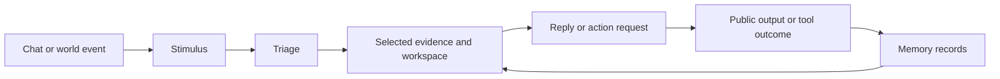
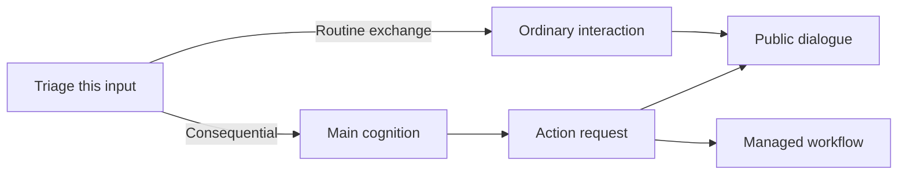
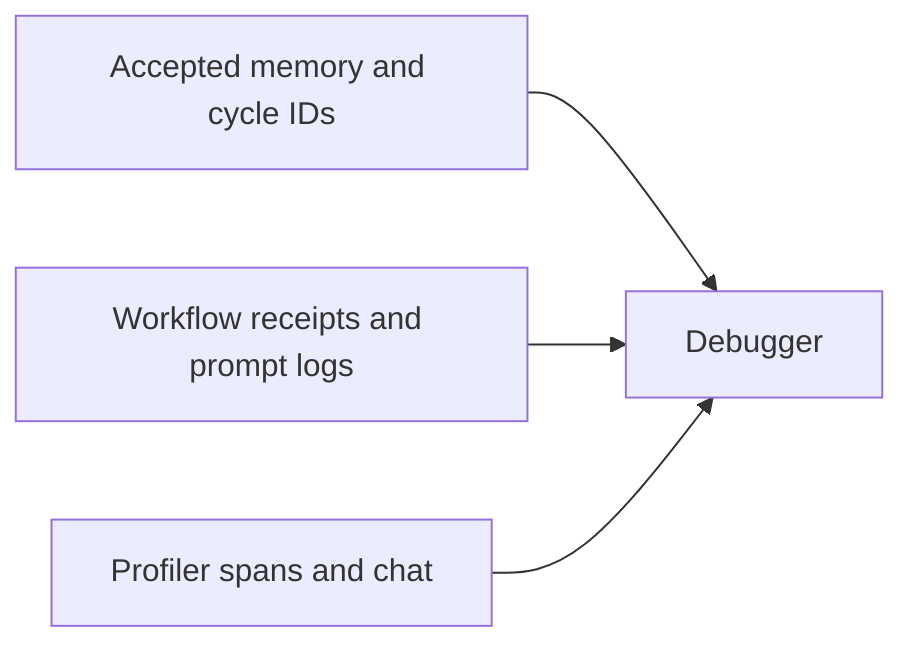

# System map

PM gives a companion a persistent viewpoint. It keeps track of what happened,
what matters now, and what the companion intends to do. These are computational
models of cognition.

## Data

[Memory](../subsystems/experienced-memory.md) stores events and experiences.
[Context planning](../subsystems/context-planning.md) prepares evidence for a prompt.

## Execution

The bus passes messages to the modules that own them.
[Input triage][workflows.input_triage.host.InputTriage] judges the new event.
[Ordinary interaction](../subsystems/ordinary-interaction.md) can select a local reply.
[Main cognition](../subsystems/cognition.md) can revise the workspace and release
[managed work](../subsystems/managed-work.md).

## Evidence

Use the [overnight Spamuel recording](../workflows/spamuel-baseline.md) to see
how a visible reply connects to prompts and workflow decisions.
