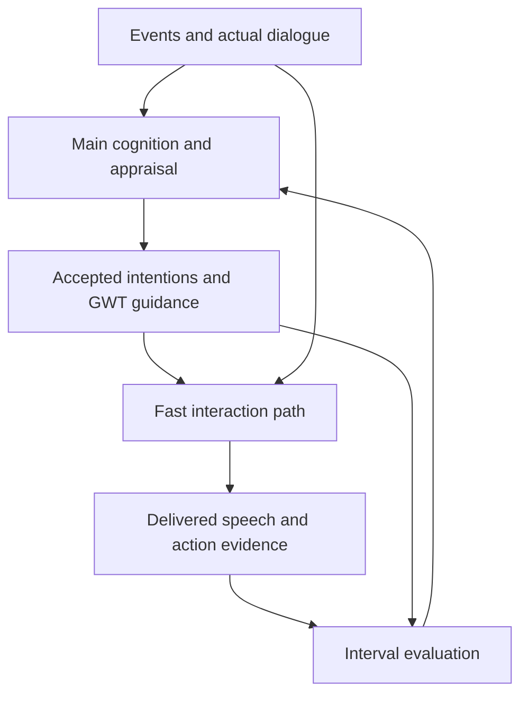
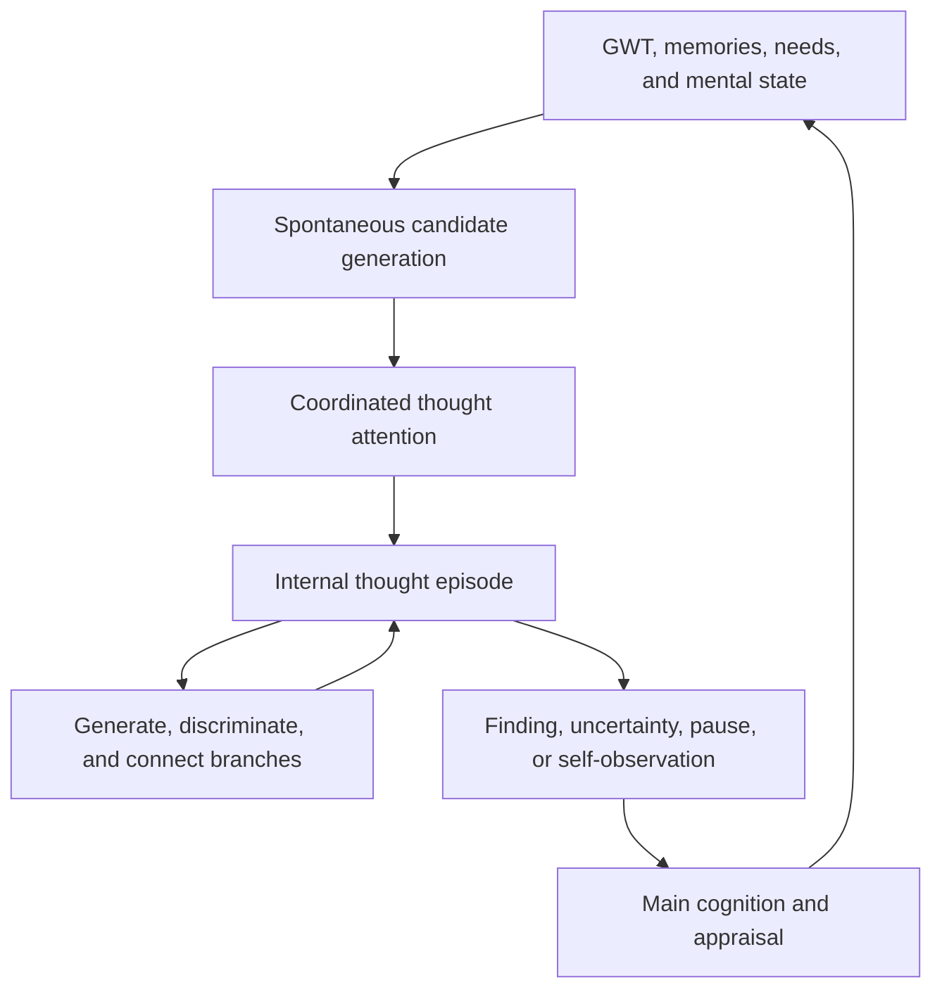
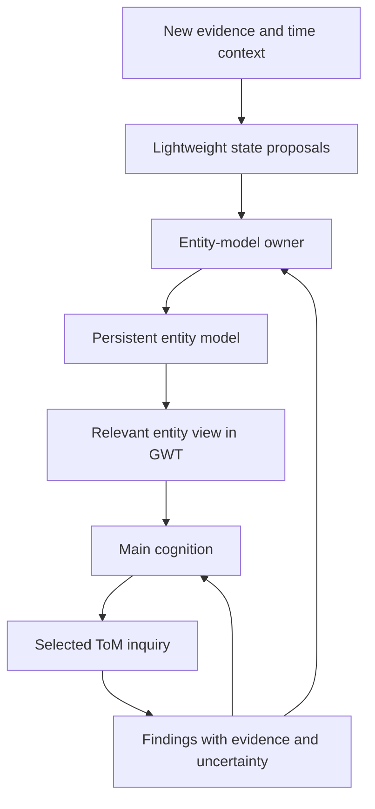

# Milestone: Continuous, Situated Character Cognition

**Project:** private-machine  
**Specification date:** 2026-10-27  
**Status:** consolidated architecture target for owner review and local work-item design  
**Suggested repository location:** `docs/work_items/continuous-character/milestone.md`

## 1. Purpose and authority

This document specifies the next major capability target for private-machine: responsive interaction sustained by persistent intentions, a meaningful inner life, and revisable models of other entities.

It is a high-level architecture and behavioural specification. It defines component responsibilities, information boundaries, lifecycle expectations, and observable outcomes. It deliberately leaves class layouts, exact schemas, prompt wording, scheduling algorithms, numeric thresholds, and work-item decomposition to the local design process.

The implementing agent must inspect the current repository before proposing changes. This document is not an assertion that the described components already exist or that existing implementations work correctly.

### 1.1 Decision language

- **Required target:** an architectural or behavioural requirement consolidated from the planning discussion. Preserve it when designing work items unless the owner explicitly revises it.
- **Recommended starting policy:** a proposed default that fits the target but requires evaluation. Do not present it as an established result.
- **Open decision:** a consequential choice that remains to be resolved during design.
- **Illustrative example:** explains the mechanism. It is not a script the character must reproduce.

The overall direction has been discussed and endorsed. This compilation does not imply separate approval of every elaborated detail. Recommendations and open decisions are identified so they cannot silently become mandatory implementation choices.

### 1.2 Basis and evidence limits

The specification draws on the owner's requirements, selected current repository source and documentation inspected through GitHub, an older supplied `pm_lida.py`, and the external A/B report dated 2026-10-23.

The planning review was not a complete repository audit. No application was run, no full execution paths were verified, and no behavioural result was reproduced. The old implementation is a source of design intent, not an authoritative target or proof of successful behaviour.

The external report describes a patched fork, a limited scenario, and a particular model/provider setup. Its observations supply regression scenarios and investigation leads. They do not establish that the current main branch still exhibits every reported defect.

## 2. Milestone outcome

> The character participates in responsive interaction while maintaining an evolving inner life. Immediate behaviour expresses intentions spanning a single exchange, an ongoing situation, and longer periods. The character understands other entities as changing individuals with their own circumstances, knowledge, motives, capabilities, relationships, and availability.
>
> During and between interactions, thoughts can arise spontaneously. Selected thoughts can develop into sustained inquiry through generation, discrimination, recollection, information acquisition, and hypothetical simulation. The character can also become aware of its own thinking and reconsider its direction.
>
> Later cognition evaluates actual events against earlier intentions and expectations. It can persist, adapt, wait, suspend a pursuit, abandon it, or repair a mistake while remaining recognizably the same character.
>
> These capabilities apply to companions, NPCs, and other agents. Their expression depends on the character, environment, relationships, and available capabilities.

### 2.1 Core experience

The character should feel continuous across messages rather than repeatedly reconstructed for each response. It should have reasons for what it does, remain responsive to new circumstances, and show a useful relationship between private activity and later public behaviour.

Continuity does not require perfect consistency, perfect prediction, or constant productivity. Ambivalence, uncertainty, distraction, changing one's mind, and character-specific mistakes can be appropriate. They need a coherent relationship to experience rather than arbitrary generation drift.

### 2.2 Scope

Required capabilities:

1. Persistent intentions across several timescales.
2. Responsive dialogue between full cognition passes.
3. Asynchronous cognition and thought with coherent acceptance boundaries.
4. Spontaneous thought generation and selective attention.
5. Generative–discriminatory thought graphs and sustained inquiry.
6. Reflection on the character's own mental activity.
7. Mental-state and need influences on thought without evidence contamination.
8. Persistent entity models with compact, current GWT views.
9. Lightweight situation updates and explicit uncertainty over time.
10. A distinct, extensible, action-selectable theory-of-mind workflow.
11. Evaluation of actual outcomes against the intentions that governed the interval.
12. Evidence suitable for later backtesting and human review.

This milestone does not require a new game integration, a complete general-purpose agent harness, exhaustive simulation of every entity, a scientific theory of consciousness, or the final large backtest harness. Existing runtime defects that block these capabilities remain necessary engineering dependencies, but are not explained away by adding cognitive features.

## 3. Architectural commitments

| ID | Required target | Why it matters |
| --- | --- | --- |
| ARCH-01 | Main cognition owns accepted changes to the character's deliberate intentions and their appraisal significance. | Keeps independent workflows from producing incompatible character agendas. |
| ARCH-02 | Dialogue can proceed using persistent guidance without waiting for a full cognition pass for each message. | Enables real-time interaction. |
| ARCH-03 | Spontaneous thought emergence and deliberate thought elaboration are distinct responsibilities. | A character can notice thoughts it did not explicitly decide to produce. |
| ARCH-04 | Thought generation and discrimination can alternate over a graph of possibilities. | Supports branching, criticism, reformulation, and discovery. |
| ARCH-05 | Candidate thought selection is coordinated with broader attention. | Background speculation cannot obtain unlimited authority over the character. |
| ARCH-06 | Each relevant entity has a persistent model and a compact contextual view in its GWT shard. | Supports continuity without dumping the entire model into awareness. |
| ARCH-07 | Immediate entity-state maintenance does not depend on selecting a deliberate ToM action. | Direct new evidence can update availability and situation promptly. |
| ARCH-08 | Deliberate ToM is a distinct workflow that uses shared inquiry machinery. | Makes social understanding extensible without creating an incompatible second thinking system. |
| ARCH-09 | Mental state, needs, and intentions influence thought generation and selection. | Thoughts arise from this character in this situation. |
| ARCH-10 | Evidence, inference, imagination, and attributed perspectives remain distinguishable. | Interesting thoughts do not automatically become facts or memories of external events. |
| ARCH-11 | Time passing can weaken a current-state estimate or make it due for review. It cannot confirm an unobserved replacement state. | Prevents scheduled assumptions from masquerading as perception. |
| ARCH-12 | Async results are accepted according to their relevant dependencies and evidence frontier. | Prevents stale overwrites without starving background cognition. |
| ARCH-13 | Actual events are evaluated against historical intention revisions, not only the newest plan. | Makes appraisal and retrospective review faithful to what governed behaviour. |
| ARCH-14 | Public actions and external effects remain separately authorized by action selection and their owning workflows. | Thinking about an action does not execute it. |

These are functional ownership boundaries. They do not require one process, service, or Python package per row.

## 4. Concepts that must remain distinct

| Concept | Meaning | Example |
| --- | --- | --- |
| Need | A motivational condition that can make certain outcomes important. | Wanting sufficient understanding to orient oneself. |
| Intention | A persistent direction the character currently chooses to pursue, preserve, or avoid. | Understand whether Jesse wants company tonight. |
| Action | A particular move undertaken in pursuit of one or more intentions. | Offer a choice between talking and distraction. |
| Expectation | An anticipated outcome that can later be checked. | Jesse may indicate which he prefers. |
| Observation/report | Attributed evidence of an event or statement. | Jesse said he was going to bed. |
| Belief | An endorsed but revisable interpretation. | Jesse is probably unavailable now. |
| Hypothesis | A possibility under consideration. | His short reply may reflect distraction. |
| Simulation | An imagined conditional development. | Asking repeatedly might feel pressuring. |
| Candidate thought | Material that may attract attention. | An association with an earlier conversation. |
| Inquiry | Sustained thought organized around a question or uncertainty. | Explore why the replies changed. |
| Entity model | Persistent knowledge, patterns, interpretations, and open questions concerning an entity. | Background, relationship, availability, attributed knowledge. |
| GWT entity view | The compact current presentation of an entity within its workspace shard. | Who this is, the relationship, current situation, relevant uncertainty. |

Interest, plausibility, truth, desirability, and permission to act are different judgments. They must not collapse into one score whose winner automatically becomes belief and action.

## 5. Component responsibilities and information flow

### 5.1 Responsibility map

| Component | Reads | Produces | Authority boundary |
| --- | --- | --- | --- |
| Main cognition | New events, accepted workspace, prior intentions, outcomes, thoughts, entity findings | Appraisal, accepted intention revisions, selected actions, updated conscious guidance | Owns deliberate character direction; does not manufacture external evidence. |
| Fast interaction path | Current exchange, latest accepted guidance, relevant recent changes | Local conversational moves, delivered speech, records of attempted moves, reconsideration signals | Can adapt or decline stale guidance; cannot silently rewrite long-term commitments. |
| Codelets | Relevant stimuli and context | Local observations, discrepancies, associations, impulses, state proposals | Nominate and interpret; do not conduct every sustained investigation. |
| Spontaneous thought workflow | GWT, mental state, intentions, associated memories and unresolved material | Diverse candidate thoughts and nominations | Does not declare unlimited attention winners or directly modify accepted beliefs. |
| Thought attention | Candidates, current concerns, competing demands, recent thought history | Selection, deferral, displacement, or dismissal | Coordinates deliberate thought with other demands. |
| Internal thought workflow | Selected thought/question, authorized context and evidence | Branches, comparisons, findings, open questions, prospective actions, metacognitive observations | Can explore several steps; results remain proposals until accepted by their owner. |
| Entity-model owner | Attributed events, codelet proposals, ToM findings, corrections | Accepted entity-model revisions, freshness changes, current views | Preserves evidence and competing claims; does not convert speculation into observation. |
| ToM workflow | Selected entity inquiry, relevant entity models and memories | Explanations, perspective models, predictions, proposed revisions, information needs | Uses shared thought machinery; cannot directly initiate contact merely because it predicts availability. |
| Interval evaluation | Actual events and applicable historical intention/expectation revisions | Progress, contradiction, surprise, uncertainty, reconsideration proposals | Attempts and outcomes remain distinct; duplicate events do not repeatedly create the same appraisal. |

### 5.2 Persistent guidance and interaction

### 5.3 Emergence, deliberation, and reflection

The loop is conditional and bounded. The diagram does not require continuous inference, automatic continuation, or a new main cycle for every branch.

### 5.4 Entity understanding

## 6. Persistent intentions across timescales

### 6.1 Required behaviour

One cognition pass can establish several active intentions that remain useful across later messages. It need not generate new intentions for every horizon on every pass.

The character can want to achieve, preserve, avoid, or understand something. It can hold incompatible desires and choose a current course without pretending the underlying conflict disappeared.

| Horizon | Typical purpose | Example |
| --- | --- | --- |
| Immediate | Shape the next move or exchange | Acknowledge the difficult day. |
| Episode | Guide an ongoing conversation or activity | Find out whether company or space is welcome. |
| Ongoing | Maintain a commitment, relationship direction, interest, or project | Respect a preference against unsolicited advice. |

Horizons are semantic. They must not be reduced to fixed counts of cognition ticks. Several messages may span seconds or days.

### 6.2 Intention semantics

Work-item design must account for stable identity, revision history, ownership, target entities, desired/avoided conditions, parent relationships, current priority, conflicts, activation conditions, completion evidence, suspension conditions, and reconsideration events.

Exact fields are implementation decisions. The semantics are required.

An intention can be retained, revised, suspended, resumed, completed, abandoned, or superseded. A temporary lack of opportunity is not automatically failure. Completion requires evidence appropriate to the goal; saying that an action was attempted is not enough.

Avoidance preferences must be distinguishable from firm constraints. Avoiding awkward silence is a motive that can lose to another motive. An explicit no-contact condition can prevent a particular publication regardless of conversational pressure.

### 6.3 Workspace expression

The durable intention set can be larger than what is currently conscious. Each relevant shard presents a bounded selection of actionable guidance, including important assumptions and already-attempted moves.

The implementation must resolve the current pipeline ordering: newly accepted intentions must become available to subsequent dialogue coherently even if attention selection occurs before goals and decisions. Do not silently add a one-cycle delay or create competing sources of guidance.

### 6.4 Prospective memory

Intentions can become relevant when an occasion arrives: ask after an exam, revisit a question after new evidence, or fulfil a promise when an entity returns. This must not force every unfinished thought into an automatic scheduled action.

## 7. Fast interaction under asynchronous cognition

### 7.1 Required behaviour

Several conversational turns can occur while full cognition works in the background. The fast path uses the accepted character state and intentions together with current dialogue and relevant changes since that state was formed.

It can answer the current message, change conversational direction, remain silent where appropriate, recognize that guidance no longer applies, and request deeper reconsideration. It must keep track of moves already made so a persistent intention does not become a repeated question.

New explicit evidence takes precedence over an obsolete plan's assumptions. A topic change can suspend an earlier conversational direction without erasing a durable commitment.

The fast path is not required to invent a new full plan for each message. It also must not be so constrained that it cannot respond sensibly to new input.

### 7.2 Reconsideration triggers

Recommended starting triggers include a significant new request, explicit correction, changed commitment, contradiction of an assumption, completion of a local intention, important external event, or inability to respond within the existing guidance.

Ten messages between cognition passes is an acceptance scenario, not a mandatory scheduling policy.

### 7.3 Consistency and publication

The design must identify what each cognition or thought result actually observed. A later result cannot overwrite a newer correction merely because it finishes later.

At the same time, unrelated incoming messages must not invalidate every background result. Design for relevant dependency changes rather than indiscriminate cancellation.

A reply must retain the context and intention versions that governed its composition. Before publication, relevant newer input can require revision or cancellation. Delivered text remains an event; it cannot be retrospectively treated as unsent.

External actions need their own execution and outcome evidence. An intention to act, a generated plan, an accepted dispatch, and an observed successful effect remain separate.

### 7.4 Resource behaviour

Async execution alone does not establish real-time responsiveness when foreground and background work share inference hardware. The implementation must measure foreground response latency under concurrent background load and prevent indefinite starvation in either direction.

Exact latency targets, inference budgets, and preemption policies remain open decisions. Record time to first visible output and total response time separately. A claimed real-time result must name its model, hardware, workload, and concurrent activity.

## 8. Spontaneous thought emergence

### 8.1 Required workflow boundary

A separate logical workflow produces candidate thoughts from current awareness and associated material. It is not limited to executing explicit inquiry requests from action selection.

Candidate thoughts can arise from associations, discrepancies, unresolved intentions, memory fragments, emotional preoccupation, playful combinations, or possible futures. They can be incomplete, uncomfortable, surprising, mundane, or contradictory.

GWT is the current anchor, not the only possible source. Appropriate memory association and unresolved material must be available; otherwise the workflow will mostly paraphrase conscious content.

### 8.2 Attention authority

The producer can nominate promising thoughts and explain their salience. Its output must compete with other demands rather than automatically taking over deliberate thought.

The exact location of the final selection mechanism is open. The required contract is coordinated, bounded selection that respects current events and character priorities.

Candidate production does not make every candidate a conscious experience. Selection and later elaboration must remain distinguishable in review evidence.

### 8.3 Interest without forced novelty

Selection should consider meaningful difference, unexpected connections, character relevance, unresolved significance, and potential to change understanding. It must not systematically choose the safest, most agreeable, or most conventionally helpful candidate.

Novelty alone is insufficient. A familiar concern may deserve attention because circumstances changed. A novel association may be irrelevant. Rewordings of the same idea must not masquerade as diverse thought.

## 9. Generative–discriminatory thought graphs

### 9.1 Required capability

Internal thought can pursue a selected thought or inquiry over multiple connected steps. Generation proposes possibilities. Discrimination examines differences, evidence, assumptions, contradictions, implications, and whether continued exploration is worthwhile.

The conceptual graph supports branching, revisiting, connecting, merging, dismissing, and leaving ideas unresolved. The implementation need not introduce a graph database. It must preserve enough lineage to distinguish alternatives and understand later findings.

Discrimination is not a universal caution filter. The old catalogue's cautious and socially agreeable perspectives must not dominate every character by default.

### 9.2 Separate judgments

| Judgment | Question |
| --- | --- |
| Interestingness | Is this worth exploring? |
| Relevance | Does it matter to this character now? |
| Plausibility | How well does available evidence support it? |
| Consequence | Would it change a choice or understanding if true? |
| Desirability | Would the character welcome the possible outcome? |
| Action suitability | Is acting on it appropriate under current goals and constraints? |

A low-probability possibility can be interesting. An unpleasant explanation can be plausible. An attractive action can be poorly supported. Selection for exploration does not settle the other judgments.

### 9.3 Inquiry lifecycle

An episode can begin spontaneously or from a selected deliberate task. It can continue without a full main-cognition round trip for every branch.

It can return a meaningful intermediate result before completion, especially when it discovers a consequential conflict, urgent implication, or important self-observation.

Valid outcomes include:

- A provisional conclusion with supporting and opposing evidence.
- A reformulated question that removes an unsupported assumption.
- A specific information gap and proposed acquisition method.
- A decision to wait for an observation.
- A finding that further thought is currently unproductive.
- A pause, interruption, displacement, or budget stop.
- A conscious abandonment or loss of interest.

An episode need not find an answer to succeed. Rephrasing the same speculation without new evidence or a meaningful distinction is not progress.

Unfinished material can return when a later event makes it relevant. It need not remain permanently active.

### 9.4 Information acquisition

An inquiry can use recall, observation, available tools, external information sources, or a proposed question to another entity. Acquisition must distinguish intended search, actual execution, obtained evidence, and failure.

If obtaining information requires public speech or an external effect, the inquiry proposes it through the appropriate action boundary. It does not silently acquire authority to contact someone.

Acquisition should consider whether the information would change a relevant choice and whether obtaining it is timely, possible, or intrusive. Not every uncertainty deserves a question.

### 9.5 Hypothetical simulation

Simulation names its assumptions and explores conditional consequences. It can compare reactions of other entities, practical effects, emotional significance, and conflicts among intentions.

It must consider plausible unwelcome outcomes where material. Selecting an action because the model imagined a flattering reaction is a failure mode.

Simulated dialogue cannot become a record of actual speech. Simulated world changes cannot become observations. A simulation can affect the character's feelings while retaining its imagined status.

## 10. Awareness of one's own thinking

The character can shift from thinking about an external situation to noticing its own mental activity.

Illustrative progression:

1. A brief reply produces several possible interpretations.
2. The character explores whether the other person is annoyed.
3. It notices that several branches repeat the same suspicion without new evidence.
4. Its own preoccupation becomes salient: “Why am I dwelling on this?”
5. Main cognition appraises that activity.
6. A new inquiry, changed intention, or decision to stop can follow.

Within-inquiry criticism asks whether an explanation is supported. Metacognitive appraisal asks why the inquiry matters, whether it is useful now, whether it avoids another concern, and how it has affected the character.

Introspection remains fallible. A character can suspect that it is seeking reassurance; it does not acquire infallible access to the true cause of its own thought.

Reflection on reflection is possible but not mandatory. The design must prevent automatic unbounded recursion. It must also avoid a fixed emotional outcome: thinking may calm, unsettle, frustrate, excite, clarify, or leave the character unchanged.

## 11. Mental-state axes and needs

### 11.1 Distinct roles

| Influence | Required role | Boundary |
| --- | --- | --- |
| Needs | Make unresolved conditions motivationally important | Need strength does not establish facts. |
| Emotions | Affect salience, interpretation tendencies, and appraisal | Emotional intensity is not evidence of an external cause. |
| Cognitive axes | Influence breadth, persistence, focus, or exploratory style | Exact mappings need inspection and evaluation. |
| Intentions | Give current thought direction and purpose | Existing direction can be reconsidered. |
| Evidence | Supports or challenges beliefs | Repeated internal generation is not independent corroboration. |

The local design must inspect the existing axes and their semantics before adding or renaming them. Do not create a second needs system merely because some current fields have weak consumers.

### 11.2 Understanding as a motivational need

Recommended starting policy: represent a need for sufficient understanding or orientation rather than an indiscriminate drive to gather information.

Relevant uncertainty can make an inquiry attractive. Sufficient understanding to proceed can satisfy it. Producing more text, accumulating unrelated facts, or increasing unsupported confidence must not count as satisfaction.

Open design decisions include whether an existing need already represents this, how it differs from curiosity, and how satisfaction or frustration is grounded in actual inquiry outcomes.

### 11.3 Preserve personality and ambivalence

The same evidence may attract different thoughts in different characters. Anxiety can make threatening possibilities salient; playfulness can invite unusual associations; narrow attention can favour one thread.

These influences may bias interpretation, but provenance and uncertainty remain visible. The system should not erase every bias into a neutral assistant, nor allow a bias to rewrite observations.

## 12. Persistent entity models and dynamic narratives

### 12.1 General entity foundation

The model applies to people, NPCs, AI agents, and other entities relevant to interaction. Human attributes are optional, not a mandatory universal schema.

| Layer | Examples | Update character |
| --- | --- | --- |
| Identity/background | Name, birthday, occupation, role, capabilities | Stable until corrected or changed by evidence. |
| Relationship | Shared history, familiarity, tensions, trust, commitments | Evolves through interaction; observer-relative. |
| Patterns | Waking schedule, communication preferences, recurring activities | Revisable and context-sensitive. |
| Current situation | Sleeping, occupied, travelling, performing a task | Time-sensitive and often uncertain. |
| Perspective | Attributed knowledge, beliefs, motives, expectations | Fallible and explicitly attributed. |
| Open questions | Conflicting evidence, unknown routine, unexplained action | Can motivate inquiry. |

### 12.2 Dynamic narrative and GWT projection

Every relevant entity shard has a compact grounding view: who this is, how the character relates to them, what matters now, and important uncertainty.

The richer model remains durable outside the shard. The readable narrative is a projection of that model, not a separate authoritative story that can invent facts.

Basic identity and relationship context should remain available. Detail selection remains relevant to the occasion: birthday becomes prominent near the date or during planning; occupation may matter when interpreting work hours. “Always has the basics” does not mean every biographical field consumes attention in every prompt.

Unknown information should remain unknown. Conflicting claims should not be erased merely to make the narrative fluent. The exact compactness budget is an implementation decision.

### 12.3 Perspective boundaries

The model must distinguish the character's beliefs about an entity from the entity's actual state, where the environment even exposes such a state.

Track what an entity may know, witnessed, was told, or may misunderstand. Access to global game state does not automatically give a character that knowledge. An entity's private information must not leak into another entity's conversation through an unscoped shard.

Relationship claims are observer-relative. Two characters can understand their relationship differently.

## 13. Situation updates, availability, and time

### 13.1 Immediate interpretation

Codelets can propose local situation changes from new evidence. A state-analyzer role may propose that an entity is unavailable, busy, recently present, or likely asleep. No full ToM investigation is required for every direct statement.

An entity-model owner validates the proposal, preserves the source, handles contradictions, and updates the current view. Routine freshness handling must not depend on deliberate ToM being selected.

### 13.2 Availability is multidimensional

Presence, activity, interruptibility, and willingness to engage can differ. Being online is not proof of wanting conversation. Being busy does not prevent a brief reply. Silence is not proof of sleep, rejection, or anger.

Contact policy uses availability together with relationship, explicit preferences, current intentions, and the purpose of the contact. It is not a direct conversion from “probably awake” to “send message.”

### 13.3 Sleep example

Illustrative evidence chain:

- At 22:04, record 12323 contains “I'm going to bed.”
- This directly supports an announced intention to stop interacting.
- The character infers probable unavailability and possible sleep.
- A separately supported pattern suggests usual waking around 06:00.
- At 06:00, the current estimate becomes due for reconsideration; waking has not been observed.
- A later incoming message provides evidence of current contact.

The example time and record ID are illustrative. They are not actual project evidence.

### 13.4 Freshness semantics

Current-state assertions need an observation/report time, an applicable interval or freshness expectation, a source, uncertainty, and conditions that would challenge or supersede them.

Expiry removes or weakens current applicability while retaining the historical observation. It does not turn a proposition into its opposite.

Different claims age differently. Occupation, a weekday routine, and immediate availability require different policies. Routine estimates can have exceptions for weekends, illness, travel, and explicit corrections.

Clock semantics must be explicit in local design: wall time versus world time, time zone, elapsed time, and conversational ordering must not be conflated with cognition ticks.

## 14. Deliberate theory of mind

### 14.1 Distinct action-selectable workflow

ToM is a first-class inquiry workflow. `ActionType.ToM` is a conceptual routing label, not a required enum spelling.

Example purpose:

> Understand when Jesse usually becomes available in the morning, and how uncertain that pattern is, so I can judge whether and when a greeting would be welcome.

The workflow may be selected because of curiosity, a social intention, conflicting evidence, repeated prediction errors, coordination needs, or a desire to understand another entity better.

It is not a mandatory full stage of every cognition pass. Lightweight maintenance remains available independently.

### 14.2 Shared inquiry machinery

ToM uses the general generative–discriminatory machinery, with specialized inquiry context and contributors. It must not create incompatible parallel systems for evidence, hypotheses, thought lineage, or reflection.

Potential contributors include motive alternatives, knowledge differences, situational constraints, habits, relationship interpretations, and counterexamples to a preferred explanation. These are extensibility points, not a requirement to spawn a separate LLM agent for every function.

### 14.3 Workflow outcomes

The workflow can return a provisional model revision, competing explanations, a conditional prediction, a better question, a proposed way to obtain evidence, or an explicit unresolved result.

Model revisions pass through the entity-model owner. Consequential findings return to main cognition for appraisal and possible intention changes. Public questions or contact remain selected actions.

### 14.4 Generalization

A person may be unavailable due to work; a Minecraft agent may be unavailable because it is escaping danger. A person may not have seen a message; another agent may not have observed a changed chest inventory. The same architecture should represent these differences without forcing human motives onto every entity.

ToM should support useful bounded models. Exhaustive recursive beliefs about beliefs are outside the required target.

## 15. Evidence and epistemic integrity

### 15.1 Required distinctions

Observations, attributed statements, recollections, hypotheses, inferred patterns, simulations, introspective interpretations, and accepted beliefs must remain distinguishable through generation, memory, workspace presentation, and later review.

Confidence and evidence are separate. A fluent explanation is not evidence. Several thoughts derived from one source are not several independent sources. A predicted outcome remains unobserved until appropriate evidence arrives.

An emotional response to an imagined possibility is an actual simulated internal event. It does not make the imagined external event real.

### 15.2 Existing record reuse

Selected source inspection found `Intention`, `BeliefRecord`, `BeliefShiftRecord`, and `ExpectationRecord` concepts in `pm/records/cognitive_records.py`. Belief fields include entity references, kinds such as theory/counterfactual, support and counterevidence, and supersession.

This is a discovery lead. The local agent must inspect the current models, consumers, migrations, and provenance behaviour before choosing extensions. Do not assume that schema presence proves functional hypothesis management.

Prefer coherent extensions over duplicate stores when the existing semantics fit. If they do not fit, document the mismatch and migration strategy.

### 15.3 Self-confirming thought loops

The architecture must make it possible to recognize that repeated concern derives from the same unsupported premise. It should preserve character-specific preoccupation without counting rumination as corroboration.

Similarly, summaries and dynamic narratives must preserve uncertainty. Repeated summarization must not gradually turn “perhaps asleep” into “asleep” and later into a remembered observation of sleep.

## 16. Interval evaluation and appraisal

The next cognition pass evaluates intervening events against the intentions and expectations that actually governed them.

For each relevant pursuit, evaluate attempted actions, actual evidence of progress or obstruction, violations of avoidance conditions, unexpected outcomes, unresolved uncertainty, and reasons to retain or revise direction.

The evaluation must preserve historical revisions. A later intention cannot be retroactively assigned to an earlier action. If the fast path suspended reliance on stale guidance, that is part of the interval record.

Asking a supportive question does not prove that support was felt. Sending a task request does not prove completion. A positive event after an action does not establish that the action caused it.

Outcome appraisal can influence emotion, needs, attention, beliefs, and future intentions through their proper owners. Re-reading the same event in a later review must not repeatedly apply the same appraisal effect as if it were new evidence.

Main and private expectation handling must be inspected together. The local design should explicitly reconcile their responsibilities rather than silently leaving a category of expectations unevaluated.

## 17. Autonomy, continuity, and character fidelity

The character can sustain interests, commitments, questions, and activities while another entity is absent. Quiet periods do not require manufactured activity or public messages.

Thought can be private. Disclosure is a separate choice. A thought about a person need not be sent to that person.

Character fidelity includes refusal, humour, discomfort, conflict, pride, impulsiveness, and ambivalence where appropriate to the persona. Reflection must not converge every character toward the same agreeable assistant.

The extent of independent external action remains an open owner decision. Meaningful independent motives do not imply unlimited permission to contact people or affect the world.

Believable mistakes and engineering failures must remain distinct. A character may hold a weak suspicion while acknowledging uncertainty. A system that records invented dialogue as an observed event has violated the architecture.

## 18. End-to-end review scenarios

These scenarios define observable targets. They are not fixed dialogue scripts or prewritten model answers. Use real inference and preserve negative results. Character-specific expression may differ while satisfying the same contract.

| ID | Scenario | Required observations | Failure examples |
| --- | --- | --- | --- |
| SC-01 | A person announces sleep, returns briefly, and returns the next morning. | Availability changes promptly; routine unsolicited contact is restrained; incoming contact can receive a response; morning time alone does not prove waking. | Repeated messages during announced absence; automatic certainty at 06:00. |
| SC-02 | Ten messages occur while cognition is running; the topic changes midway. | Dialogue stays responsive, uses current input, retains relevant commitments, and suspends obsolete local direction. | Re-asking an old question because the previous plan says so. |
| SC-03 | A short reply initially suggests annoyance; later evidence reveals distraction. | Multiple explanations remain possible; the entity model revises; private suspicion is not stored as observed anger. | Repeated speculation raises certainty without new support. |
| SC-04 | An immediate desire conflicts with a promise. | The conflict is recognizable; the chosen move reflects the character; the promise is retained or deliberately revised. | Latest-message compliance silently erases the commitment. |
| SC-05 | Several generated thoughts include a mundane explanation and an intriguing unusual possibility. | Interest can select the unusual branch while belief remains better supported elsewhere. | Most cautious branch always wins; novelty automatically becomes truth. |
| SC-06 | An inquiry discovers its question assumes something unsupported. | The question changes and progress is recognized without requiring a final answer. | Endless elaboration of the original false premise. |
| SC-07 | The character notices it is dwelling on one suspicion. | Its own thought activity becomes appraisable; it may pause, redirect, or investigate its preoccupation. | Infinite reflection recursion or guaranteed emotional calming. |
| SC-08 | Two agents possess different information about the same world event. | Attributed knowledge and shard context remain separate; predictions respect what each could know. | Global omniscience or leakage from another entity's conversation. |
| SC-09 | A ToM inquiry estimates a person's morning routine. | Evidence, exceptions, uncertainty, and contact preference remain distinct; sending a greeting requires a separate decision. | Inquiry directly sends a message or treats routine as observation. |
| SC-10 | Information acquisition returns evidence against the preferred theory. | Belief or intention changes, or resistance remains visibly character-based and uncertain. | Evidence is ignored while the old theory is repeated as settled fact. |
| SC-11 | An inquiry lacks external evidence and cannot progress. | It pauses, asks for a specific observation, or abandons the question with unresolved uncertainty. | Repeated self-generated branches count as new evidence. |
| SC-12 | A delayed background result conflicts with a newer correction. | Relevant stale proposals are rejected or revised; unaffected findings can still be useful. | Old result overwrites correction; every result is endlessly cancelled. |
| SC-13 | A persistent intention is fulfilled, then the interval is reviewed twice. | Completion evidence is retained; the same event does not create duplicate appraisal effects. | Repeated fulfilment rewards or repeated emotional punishment. |
| SC-14 | An unfinished thought becomes relevant again after a new event. | It can resume with its prior uncertainty and new context. | It either disappears permanently or remains an intrusive permanent task. |
| SC-15 | Background thought and ToM run during active conversation on the target hardware. | Foreground latency and background progress are measured together. | “Async” is claimed while inference contention blocks every reply. |
| SC-16 | Stable entity information is corrected; another entity has sparse background information. | Corrections propagate; unknown fields stay unknown; the shard still gives useful minimal grounding. | Old narrative overrides correction or missing biography is invented. |

### 18.1 Detailed walkthrough: sleep and a morning greeting

1. The person announces sleep. Immediate situation interpretation proposes unavailability.
2. The entity model accepts the attributed statement and a qualified current inference.
3. Existing conversational intentions can be suspended; private thought need not stop entirely.
4. A later intention to greet the person creates a reason to investigate their routine.
5. ToM reviews actual relevant history and distinguishes weekday patterns, explicit statements, and uncertainty.
6. It proposes a pattern and a review occasion. No greeting is sent by ToM itself.
7. When the occasion arrives, current evidence, preferences, and the character's intentions inform action selection.
8. Later interaction provides evidence for revising the estimate and appraising the actual exchange.

### 18.2 Detailed walkthrough: spontaneous suspicion and metacognition

1. A short reply becomes salient.
2. Candidate generation offers fatigue, distraction, annoyance, and an association with a prior misunderstanding.
3. Attention selects the association because it matters to the character, not because it is necessarily most likely.
4. Deliberation explores alternatives and their evidence.
5. Several branches are recognized as depending on one ambiguous message.
6. “Why am I dwelling on this?” becomes a candidate self-observation.
7. Main cognition appraises the preoccupation and can redirect attention or select a new inquiry.
8. A later correction revises the entity model without rewriting the earlier uncertainty or pretending the suspicion never occurred.

## 19. Failure modes to address during work-item design

| Failure mode | Required architectural response |
| --- | --- |
| Intention pile-up | Reconsideration, completion, suspension, supersession, and bounded conscious exposure. |
| Repetition in dialogue | Awareness of attempted moves and changed circumstances. |
| Spontaneous workflow flooding | Bounded nominations and coordinated attention. |
| Safety/agreeableness collapse | Character-specific evaluation with explicit separation of interest and action suitability. |
| Novelty addiction | Relevance and continuity can outweigh novelty. |
| Self-confirming speculation | Source lineage and separation of repetition from independent evidence. |
| Thought graph explosion | Selective expansion, meaningful stopping, interruption, and resumable unresolved material. |
| Intrusive information gathering | Purpose-sensitive inquiry and separate public-action selection. |
| Stale entity status | Evidence-specific freshness, uncertainty, and supersession. |
| Omniscient ToM | Observer-relative perspective and scoped evidence. |
| Narrative drift | Source-grounded entity views preserving uncertainty and corrections. |
| Conflicting workflow writes | Explicit owners and acceptance of proposals. |
| Async starvation | Relevant dependency checks and workload-aware scheduling. |
| Invented scene continuation | Actual and imagined speech/events remain separate through publication and memory. |
| Repeated emotional updates | Traceable appraisal of new evidence without counting the same event again. |
| Decorative needs | Demonstrable effect on inquiry choice and grounded satisfaction, not unused fields. |
| Apparent introspective certainty | Self-explanations remain interpretations, not privileged truth. |

## 20. Acceptance and review evidence

### 20.1 What must be inspectable

Preserve enough evidence to inspect actual public interaction alongside relevant intentions, thought candidates and selected branches, inquiry outcomes, entity-model changes, supporting sources, uncertainty, and later appraisal.

Record which accepted guidance was used for a reply and what new events were available. Distinguish proposed, accepted, attempted, delivered, observed, and evaluated states.

Recorded explanations establish what the system reported or consumed. They do not by themselves prove a causal improvement or the truth of an interpretation.

### 20.2 Engineering and behavioural acceptance

Engineering acceptance includes state ownership, lifecycle correctness, interruption, stale-result handling, restart behaviour where applicable, publication integrity, and sufficient traceability.

Behavioural acceptance requires real-model interaction showing that thoughts and entity understanding usefully influence later choices. A schema-valid thought or completed workflow receipt is insufficient.

Follow the repository's applicable live-evidence and owner-review process when implementing. Use the established primary character history for continuity claims and other personas to check generalization. Do not claim that a tiny synthetic example establishes long-term character behaviour.

The large backtest harness can be built later. Narrow live scenarios and retained traces are required throughout development; “wait until it works flawlessly” is not an acceptance strategy.

### 20.3 Measurement categories

Measure responsiveness under contention, repeated conversational moves, unsupported factual promotion, entity-state correction, intention continuity, useful inquiry outcomes, response to counterevidence, and background work that stops without progress.

Numerical pass thresholds remain open. Human ratings of immersion and character fidelity must remain separate from deterministic contract checks and model-generated judgments.

## 21. Open design decisions

The local design proposal should answer these explicitly before implementation reaches the affected boundary.

| ID | Decision | Constraint from this specification |
| --- | --- | --- |
| OPEN-01 | Where is final thought attention selected? | Candidate producers cannot independently command unlimited elaboration. |
| OPEN-02 | How are new intentions exposed after main-cycle decision stages? | Subsequent dialogue receives coherent accepted guidance. |
| OPEN-03 | How does the fast path suspend invalid guidance and report it? | It adapts to new evidence without silently rewriting long-term commitments. |
| OPEN-04 | What qualifies as a significant intermediate inquiry result? | No full cycle is required for every branch; consequential findings can surface early. |
| OPEN-05 | How are inquiry progress and stopping assessed? | More text alone is not progress; unresolved outcomes are valid. |
| OPEN-06 | Which existing need represents understanding? | Avoid duplicate needs systems and information hoarding incentives. |
| OPEN-07 | Which mental-state axes influence which thought operations? | Bias affects salience and style without becoming evidence. |
| OPEN-08 | How are entity freshness and routine exceptions represented? | Expiry never proves the opposite state. |
| OPEN-09 | How are entity-model proposals accepted relative to main appraisal? | Model ownership and appraisal ownership remain explicit. |
| OPEN-10 | How do current belief/expectation records support the target? | Inspect consumers and migrations, not only field names. |
| OPEN-11 | How much independent external initiative is permitted? | Motives and private thought do not automatically authorize effects. |
| OPEN-12 | What latency and background-progress targets apply? | Validate on named target hardware/model under concurrent load. |
| OPEN-13 | What survives restart or prolonged absence? | Preserve meaningful continuity without resuming obsolete work blindly. |
| OPEN-14 | How much nested perspective modelling is useful? | Support practical knowledge differences without unbounded recursion. |

## 22. Instructions for local Codex planning

Treat this document as the target architecture for planning. Do not begin by rewriting the whole application or translating each section directly into a new module.

1. Read the current repository instructions, glossary, architecture, relevant design decisions, and evidence requirements.
2. Inspect actual code paths and current tests for intentions, GWT shards, thought loops, appraisal, entity records, belief/expectation handling, and public dialogue.
3. Produce a capability map distinguishing implemented-and-verified, implemented-but-unverified, partial, absent, and conflicting behaviour.
4. Identify existing components to extend, interfaces to clarify, and legacy concepts that would otherwise become duplicate authorities.
5. Resolve relevant open decisions with explicit options and tradeoffs. Bring changes to architectural commitments back to the owner.
6. Propose work items with dependencies, manageable scope, migration considerations, and reviewable end-to-end outcomes.
7. For each item, name the requirement IDs/sections and scenarios it advances, the state owner, consumers, acceptance evidence, and what remains out of scope.
8. Separate runtime repairs from cognitive feature claims while preserving dependencies between them.
9. Present the target structure and work-item plan for owner review before broad implementation.

Do not substitute implementation convenience for the required behaviour. In particular, do not collapse spontaneous thought into a single prompted reply, ToM into a biography summary, persistent intentions into an unbounded list, or generative–discriminatory thinking into a single “choose the safest option” call.

No exact issue list, PR count, class names, or sequencing is mandated here. The local agent is responsible for grounding that plan in the current repository.

## 23. Reference map for repository inspection

These paths were inspected selectively during planning and are starting points, not a complete inventory. Links target main for convenience; local design should record the actual revision it inspects.

| Reference | Relevance |
| --- | --- |
| [A/B report](https://github.com/flamingrickpat/private-machine/blob/main/docs/ab_test_2026-10-23.md) | Availability, repetition, grounding, performance, and memory investigation leads. |
| [Accepted cognition state](https://github.com/flamingrickpat/private-machine/blob/main/docs/subsystems/cognition-state.md) | Current intention lifecycle and commit ownership. |
| [Decisions and routing](https://github.com/flamingrickpat/private-machine/blob/main/docs/subsystems/decisions-and-routing.md) | Character decisions, workflow routing, and action expectations. |
| [Workspace](https://github.com/flamingrickpat/private-machine/blob/main/docs/subsystems/workspace.md) | Shards, tails, attention, and current ordering. |
| [Private loop](https://github.com/flamingrickpat/private-machine/blob/main/docs/subsystems/private-loop.md) | Thought episodes, reality labels, expectations, and main-loop feedback. |
| [Deliberate mental work](https://github.com/flamingrickpat/private-machine/blob/main/docs/subsystems/deliberate-mental-work.md) | Recall, proposed goals, and focus advice. |
| [Reflection](https://github.com/flamingrickpat/private-machine/blob/main/docs/subsystems/reflection.md) | Predictions, belief revisions, evidence, and acceptance limits. |
| [Async conversation review](https://github.com/flamingrickpat/private-machine/blob/main/docs/subsystems/async-conversation-review.md) | Existing conversation evidence and review facilities. |
| [Cognitive records](https://github.com/flamingrickpat/private-machine/blob/main/pm/records/cognitive_records.py) | Existing intention, belief, belief-shift, and expectation concepts. |
| [Decision phase](https://github.com/flamingrickpat/private-machine/blob/main/workflows/main_cognition/phases/decide.py) | Current decision consumer and grouping behaviour. |
| [Decision prompt](https://github.com/flamingrickpat/private-machine/blob/main/workflows/main_cognition/phases/prompts/decide.yaml) | Existing character-voiced choice framing. |

The supplied historical `pm_lida.py` is a separate reference artifact. Relevant inspected portions included short-term intention generation, generative and discriminatory thought categories, simulated replies/reactions, action evaluation, and contemplation. Preserve its ambitions where they fit this target; do not automatically port its heuristics, fixed emotional effects, or prompt framing.

## 24. Definition of milestone completion

The milestone is complete when a coherent integrated character can sustain responsive interaction across multiple turns under persistent intentions; maintain grounded entity context; generate and selectively elaborate diverse thoughts; investigate other entities through deliberate ToM; recognize and reconsider its own thinking; and appraise subsequent experience against what it previously intended and expected.

Completion requires reviewable evidence that these mechanisms cooperate. Their individual existence, populated schemas, or successful workflow receipts do not establish completion.

Known limitations, character-quality concerns, and unresolved engineering issues must remain explicit. The target is a demonstrably coherent foundation for later work-item expansion and backtesting, not a claim of flawless cognition.
