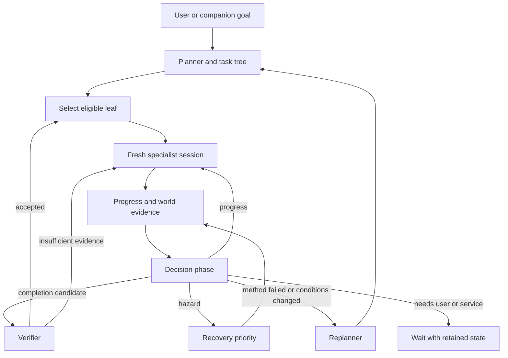

# Adaptive Minecraft partner architecture

## Summary

Minecraft work becomes a durable task tree.
Each selected leaf gets a fresh pm-coder specialist session with many tool calls.
A planner revises subtasks after meaningful observations.
A verifier requires completion evidence.
One actor owns the shared body.
Conversation and private cognition continue around this work.

Parent: [alpha plan](index.md).
Delivery: [A10](work-items/a10.md) through [A14](work-items/a14.md).

## Task hierarchy

The same generic workflow serves any feasible goal in the configured game action space.
User requests pass through appraisal before a workflow starts.
The companion can accept, refuse, defer, or reshape a request for persistent personal reasons.
The inner conscious loop can originate a goal without a user request.

Simple observations can route directly to Assistant dialogue.
For example, an inventory question can use one live inventory call and an evidence-backed reply.
It does not need a managed task, planner, or subtask tree.

The durable tree stores goal identity, specifications, dependencies, acceptance conditions, and revisions.
Execution attempts store observations, effects, failures, and evidence.
A specification is distinct from its execution journal.

A leaf expresses a meaningful outcome.
“Gather wood from five trees” can require navigation, inspection, harvesting, inventory handling, and return.
It remains one leaf despite 150 MCP calls.
Progress reports do not imply completion.

The planner may split an oversized leaf or revise a failed method.
It preserves successful work, stable identifiers, and the reason for each change.
The kernel keeps declared routing finite.
The number and content of task leaves can change at runtime.
Do not implement a fixed list of house, diamond, or farm workflows.
Those goals are fixtures that exercise the general mechanism.

## Specialist skill structure

Start from `C:\Users\rick\.agents\skills\minecraft-survival-coach\SKILL.md`.
Keep that upstream skill intact.
Compile scoped resources inside the project's Minecraft workflow.

| Resource | Relevant skill sections | Responsibility |
| --- | --- | --- |
| Shared survival core | 1–9, 36–37, 39–42, 49–50 | Evidence, schemas, recovery priority, goal/action distinctions, no-progress rules |
| Navigator and scout | 10–13, 26 | Geometry, routes, navigation diagnostics, return plans |
| Survival and recovery | 14–18, 33–35 | Water, lava, falls, food, combat, and death recovery |
| Gatherer and crafter | 19–23, 27–29 | Progression, inventory arithmetic, harvesting, crafting, and smelting |
| Builder | 24–25 | Site choice, materials, shelter, usable structures |
| Miner and expedition actor | 30–32 | Reversible mining, caves, iron, diamonds, and return |
| Planner and verifier | Task criteria and the shared core | Feasible leaves, prerequisite order, evidence-based completion |

Examples and section 48 drills become evaluation scenarios.
Do not inject the complete skill into every actor session.

Specialists are functional parts of the same companion.
They receive the same persona, relevant affect, goals, memory, and world facts.
They do not speak as separate characters.
Only the public dialogue path addresses the user.

## House and diamond examples

A house goal can produce site survey, material gathering, crafting, shelter construction, and usability verification.
The user can change the footprint while gathering is in progress.
The companion revises only affected work.
It does not rebuild a completed dependency merely because the plan changed.

A diamond expedition can require food, tools, light, safe descent, local searches, equipment repair, and return.
A blocked cave may create a new staircase leaf.
Low supplies may create a resupply leaf.
Lava may interrupt mining with recovery.
The first successful ore observation is not a completed expedition until the acceptance condition is satisfied.

Useful patterns include iterative feedback, skill reuse, and explicit verification.
These appeared in [Voyager's Minecraft work](https://arxiv.org/abs/2305.16291).
The alpha adds shared-world cooperation and persistent companion state.

## Body and world operation

Read [Minecraft operation](minecraft-operations.md) for ownership, recovery outcomes, and the actual survival environment.
