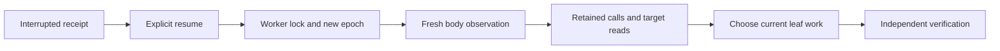

# Body interruption and recovery

## Summary

A12 preserves body intent through cancellation, disconnection, and process exit.
An explicit resume retains the task identity and issues a new worker epoch.
Fresh observation precedes mutation.
Durable journals retain effects that cancellation cannot undo.

Parent: [Minecraft actor controls](minecraft-actor-controls.md).
Details: [body leases](body-leases.md), [publication recovery](recovery-publication.md), and [A12 verification](../work_items/verification/a12-body-recovery.md).

## Control path

[`runtime.managed_runs.ManagedRunSupervisor.resume`][] accepts `interrupted`, `cancelled`, and `failed` body runs.
It supports `minecraft` and `minecraft_project`.
It rejects a running worker, incomplete cleanup, or an unavailable worker lock.
It preserves `run_id`, `action_id`, arguments, instruction revision, and artifact paths.
Duplicate nonempty resume request IDs return the existing receipt.

The receipt stores `execution_epoch`, `interrupted_from`, and `resume_requests`.
The accepted instruction revision stays unchanged.
Resume creates a new cancellation signal and opens instruction updates.
The replacement kernel starts at the workflow's observation boundary.
Its journal lives under `recovery/<run_id>/epoch-NNNN` within the managed runtime root.
Earlier kernel journals remain available.



## Operation commands

The console's Runs form provides **Resume interrupted body work**.
Its existing command API accepts this payload:

```json
{"action":"run_control","operation":"resume","run_id":"<existing-run-id>","request_id":"<stable-request-id>"}
```

Python callers use the shared domain:

```python
receipt = app.supervisor.resume(run_id, request_id="operator-recovery-1")
app.supervisor.update(run_id, instructions, request_id="instruction-2")
app.supervisor.terminate(run_id, request_id="operator-cancel-1")
```

[`runtime.management_tools.build_management_tools`][] exposes `managed_resume` through the management MCP.
[`runtime.steward.Steward.resume`][] uses the same domain after explicit steward activation.
SelfManagement accepts `operation: resume` through normal selected actions.
It uses the selected action ID as the default idempotency key.
Checkpoint restoration marks active receipts `interrupted`.
Restoration does not automatically resume world work.

## Observation and reconciliation

[`runtime.minecraft_actor.ActorGateway`][] pins the body token at its first leased call.
Its first successful `minecraft_observe` establishes observation for that epoch.
A mutation before this observation raises `StaleEpoch`.
[`runtime.minecraft_actor.ActorGateway.reconcile`][] reads earlier dispatches and their original results.
A dispatch without a result remains `uncertain`, even when current world state appears correct.

The reconciliation receipt records the body epoch, instruction revision, observation sequence, retained actions, and exact target reads.
Position, target, and base operands produce fresh `minecraft_inspect_block` calls.
An unavailable target read prevents mutation.
An explicit air result is usable even though the live tool returns `ok: false` and `reason: not_found`.
[`runtime.minecraft_actor.observed_target`][] checks that this result names the exact requested cell.
Project evidence retains the original tool outcome and adds `observation_available` for model review.
This lets the reviewer distinguish observed air from an unavailable cell.
Other changes require the body observation and the actor's normal task-specific reads.
The receipt never infers that an uncertain command failed or completed.
It records `automatic_mutation_replay: false`.

The actor receives `inbox/reconciliation.json` before native inference.
This file includes the original observation, so a resumed wood task retains its original home and inventory baseline.
The actor retains pm-coder's normal context discovery and compaction.
It chooses work from current evidence and saves another handoff.
The wood verifier recomputes the combined original receipts and final position.
Repeated partial harvests in the same trunk column count as one tree.

For a project, restart marks an in-progress attempt `interrupted`.
It retains the reviewed tree when the instruction revision matches.
Each replacement specialist receives earlier leaf journals and its latest handoff.
Independent verification still controls acceptance and prerequisite release.
Resume does not convert an actor claim into an accepted certificate.

## Cancellation and remaining uncertainty

The gateway orders its durable dispatch marker against accepted control changes.
An instruction update after this marker can coexist with the already authorized call.
A later marker cannot use the superseded revision.
Cancellation rejects new markers.
During a mutating call, a cancellation watcher sends `minecraft_stop` with the same body token.
It polls durable cancellation without consuming instruction revisions.
This also detects a cancellation accepted by another local process.
Its separate stop receipt records success or uncertainty.
The original call retains its actual result before cleanup releases ownership.

Journals flush and synchronize each complete append.
A torn final append remains visible with a `torn_tail` marker.
Earlier complete results remain readable.
Images keep their original call sequence names across worker epochs.
Blocks, inventory, entities, player state, and time remain external state.
Fresh observation establishes current facts, but cannot identify who caused a change during downtime.

Read [body leases](body-leases.md) for server fencing and restart requirements.
Read [A12 verification](../work_items/verification/a12-body-recovery.md) for the measured live boundaries and remaining limits.
