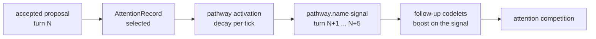

# Codelet pathways

## Summary

A pathway is a named, versioned state of mind that persists between cycles.
An accepted codelet proposal from a recent cycle is a *precursor*.
It raises the pathway's activation for the next cycles.
Later codelets in the same pathway boost on that activation.
A concern therefore stays alive after its cause ages, and it fades when nothing feeds it.

Parent: [codelets and attention competition](codelets.md).
Work item: [A16](../work_items/alpha-plan/work-items/a16.md).
Evidence: [A16 verification](../work_items/verification/a16-codelets.md).

## Place in the system

The pathways live in the same catalogue file as the codelets, so one digest identifies the exact configuration.
[`workflows.main_cognition.pathways`][] holds the pure rules.
The main module derives the precursors.
The codelets stage turns them into signals.

## Input → change → output

- Input: committed `AttentionRecord` records that attention accepted, from codelets that belong to a pathway.
- Change: the request gains `pathway_precursors` and `pathway_latest_tick`. The codelets stage computes `pathway.<name>` signals.
- Output: higher activation for follow-up codelets. A pathway never writes state, publishes speech, or commands the body.

## Pathway definition

A [`PathwayDefinition`][workflows.main_cognition.pathways.PathwayDefinition] declares:

| Field | Meaning |
| --- | --- |
| `name` | Stable identity, for example `affection`. |
| `version` | Version of this pathway's rules. Change it when the members or the mapping change. |
| `emotions` | The implemented state fields the pathway maps to. |
| `members` | Codelets whose accepted proposals feed the pathway. |
| `window_ticks` | How many committed cycles a precursor stays inside. Default 6. |
| `decay_per_tick` | Activation multiplier per cycle of age. Default 0.6. |

The catalogue validator rejects a pathway whose members do not exist, and a codelet that names an unknown pathway.
Every pathway must have at least one reader of its signal, so the catalogue cannot declare a pathway that changes nothing.

## Activation rules

[`pathway_signals`][workflows.main_cognition.pathways.pathway_signals] computes one signal per pathway:

1. Only selected records from member codelets count. Deferred and stale nominations never feed a pathway.
2. A record older than `window_ticks` cycles leaves the window.
3. Each precursor contributes `decay_per_tick ** tick_age`.
4. The sum is capped at 1.0. Several fresh precursors make a stronger pathway than one.
5. Tick age is measured from `pathway_latest_tick`, the newest committed attention tick. The newest precursor cannot reset its own age.

A pathway with no fresh precursor signals 0.0.
Every gate and boost on its signal then stays closed.
The cause list of a scheduled codelet names the signal values it read, so the trace shows which pathway drove the activation.

## The eleven pathways

| Pathway | Members | Implemented mapping |
| --- | --- | --- |
| `affection` | `absence_return`, `relationship_check`, `preference_recall`, `share_offer`, `expression_push` | `emotion.tenderness`, `emotion.joy`, `needs.closeness_need` |
| `anxiety` | `rejection_preview`, `support_seek` | `emotion.fear`, `appraisal.uncertainty` |
| `curiosity` | `curiosity_probe`, `question_move`, `outcome_preview` | `emotion.curiosity`, `appraisal.novelty` |
| `empathy` | `concern_reading`, `perspective_shift` | `emotion.tenderness`, `emotion.sadness` |
| `shame` | `correction_reading`, `repair_precedent` | `emotion.shame`, `emotion.guilt`, `appraisal.embarrassment` |
| `play` | `play_urge` | `emotion.playfulness`, `emotion.amusement` |
| `persistence` | `goal_reminder`, `goal_pressure`, `promise_recall`, `effort_check` | `state_cognition.willpower`, `goals.active` |
| `pride` | `achievement_reading`, `episode_link` | `emotion.pride`, `appraisal.admiration` |
| `envy` | `fairness_reading` | `emotion.jealousy`, `emotion.resentment`, `appraisal.contempt` |
| `anger` | `agency_reading`, `refusal_edge`, `distance_offer` | `emotion.anger`, `emotion.resentment`, `appraisal.norm_violation` |
| `boredom` | `boredom_probe` | `emotion.boredom`, `emotion.curiosity` |

## Missing state mechanisms stay documented

Three human emotions have no dedicated state field.
The catalogue documents the mapping instead of inventing a label:

- **Envy** maps to `emotion.jealousy`, `emotion.resentment`, and the `appraisal.contempt` axis.
- **Loneliness** has no emotion field. The pure `connection_lack` codelet carries it from the implemented `needs.connection` level, and the `appraisal.exclusion` signal supports it.
- **Persistence** is not an emotion. It maps to `state_cognition.willpower` and the count of active goals.

Relief, disappointment, resentment, jealousy, disgust, contempt, and mixed feelings are repertoire coverage.
They arrive through the signals and members above, not through dedicated codelets.

## Restart and concurrency

The main module derives the precursors fresh from the MemoryStore on every cycle ([`pathway_precursors`][workflows.main_cognition.host.pathway_precursors]).
No cycle caches them.

- A restart keeps pathway state, because committed attention records are the pathway state.
- A concurrent or interrupted cycle cannot reuse stale pathway state, because each cycle reads the store again.
- Each precursor carries the record's revision at read time, so the trace keeps the revalidation visible.
- A codelet proposal that a pathway activated still passes the same attention competition and the same stale check as every other proposal.

## Duplicate-effect prevention

A pathway activation only raises activation. It never applies an effect.
The effect belongs to the follow-up proposal, and each cycle decides acceptance again.
So a pathway cannot apply one precursor's effect twice.
For proposals with durable effects, see the [consumer map](codelets.md#proposal-consumers).

## Traps

- A pathway is not a script of dialogue lines. It changes activation, and attention competition still decides.
- Removing a member codelet from the catalogue silently closes its pathways' inputs. The validator requires members to exist, but not to run.
- `window_ticks` counts committed cycles, not wall-clock time. A busy conversation ages precursors faster than a quiet hour.
- The `inner` loop policy exists for A17. Pathway signals currently reach the `main` loop only.

## Go deeper

- [Codelets and attention competition](codelets.md) for the scheduler and the proposal contracts.
- [Accepted cognition state](cognition-state.md) for the affect and goal commit boundaries.
- [`workflows.main_cognition.pathways`][] for the pure rules.
