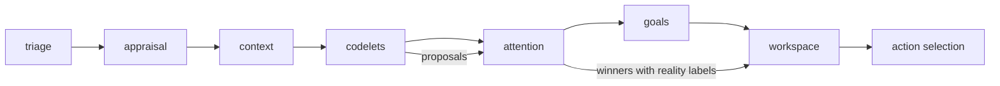

# Codelets and attention competition

## Summary

Codelets are small, declared processes that offer proposals to attention.
A pure scheduler selects a relevant subset of codelets for each cycle.
The model scores the proposals. Python then selects the winners with fixed rules.
Every proposal is committed as an `AttentionRecord`, the winners and the losers, with a status and a reason.
A codelet cannot change accepted state or start an action.

A15 supplies the scheduler and the competition. A16 grows the repertoire to 38 codelets in ten families, adds versioned [pathways](codelet-pathways.md), and connects every proposal kind to a consumer that produces a durable effect.

Parent: [cognitive pipeline](cognition.md).
Design: [codelets and shared attention](../work_items/alpha-plan/cognition.md#codelets-and-shared-attention).
Work items: [A15](../work_items/alpha-plan/work-items/a15.md), [A16](../work_items/alpha-plan/work-items/a16.md).
Evidence: [A15 verification](../work_items/verification/a15-codelets.md), [A16 verification](../work_items/verification/a16-codelets.md).

## Where codelets run in the cycle

The main cycle has eight stages since A15.
The `codelets` stage runs after `context` and before `attention`.

The codelets stage reads the affect projection that appraisal just accepted.
Thus an emotion that the current event caused can already activate a codelet.
[`workflows.main_cognition.pipeline.run_cycle`][] supplies the flattened state as `state_signals`.

The codelets and attention calls omit the public grounding block.
Each call is one small question for a small model.
The workspace and all later stages still receive the grounding block before any text can reach public speech.

## The catalogue

The catalogue is a workflow resource: `workflows/main_cognition/stages/codelets/catalogue.yaml`.
[`workflows.main_cognition.codelet_schedule.load_catalogue`][] validates it.
An invalid or missing catalogue stops the cycle with an error.
A silent empty catalogue would hide the defect.

The catalogue has four parts since A16:

- `version`: a name for the behavior of this file. Change it when behavior changes. The A16 catalogue is `a16.1`.
- `policy`: one [`AttentionPolicy`][workflows.main_cognition.codelet_schedule.AttentionPolicy] per loop. The main loop uses `main`. The `inner` policy is prepared for the A17 second conscious loop and is not used yet.
- `codelets`: one [`CodeletDefinition`][workflows.main_cognition.codelet_schedule.CodeletDefinition] per codelet.
- `pathways`: one [`PathwayDefinition`][workflows.main_cognition.pathways.PathwayDefinition] per pathway. See [codelet pathways](codelet-pathways.md).

Each cycle trace and each committed record stores the version and a 16-character SHA-256 digest of the catalogue bytes.
Thus evidence from two configurations stays distinguishable.

### Codelet fields

| Field | Meaning |
| --- | --- |
| `name` | Stable identity. Cooldown history and `AttentionRecord.from_codelet` use it. |
| `family` | Codelet family. A16 uses the ten families: `attention`, `memory`, `appraisal`, `imagination`, `valuation`, `identity`, `coping`, `needs`, `action`, `narratives`. |
| `kind` | `pure` runs a Python function. `llm` makes one model call. |
| `proposal` | `attention`, `memory_access`, `appraisal`, `simulation`, `regulation`, `action_tendency`, or `belief`. |
| `origin` | Default origin of the content: `outside`, `thought`, `memory`, or `state`. |
| `reality` | Default reality label: `observed`, `remembered`, `internal`, `inferred`, or `imagined`. |
| `pathway` | The codelet's primary pathway. Empty when it serves all of them. |
| `context` | Declared context requirements: state fields, source categories, and temporal scope. |
| `consequence` | The expected accepted consequence. A declaration names what the codelet reads, never what it may invent. |
| `base_activation` | Start value of activation, 0 to 1. |
| `when` | Gate conditions. Every condition must hold. |
| `boost` | Signals that add `weight * value` to activation. |
| `cooldown_ticks` | Committed cycles to wait after the codelet ran. |
| `cooldown_seconds` | Seconds to wait after the codelet ran. |
| `instructions` | The job of an `llm` codelet. It can use `{companion_name}` and `{user_name}`. |

The validator rejects an unknown `proposal`, `origin`, or `reality`, a `pathway` that the catalogue does not declare, and a pathway member that does not exist.
A test asserts that every shipped definition declares its `context` and its `consequence`.

### Signals

[`request_signals`][workflows.main_cognition.codelet_schedule.request_signals] and [`state_signals`][workflows.main_cognition.codelet_schedule.state_signals] compute the signals.
They are pure functions.

| Signal | Source |
| --- | --- |
| `stimulus.user`, `stimulus.thought`, `stimulus.workflow`, `stimulus.system`, `stimulus.world`, `stimulus.count` | The kinds of the cycle's stimuli. A thought and a user message are separate signals. |
| `emotion.<field>`, `emotion.strongest`, `emotion.negative_strongest` | The accepted emotions after this cycle's appraisal. `negative_strongest` is the strongest of the unpleasant emotions. |
| `core.valence`, `core.arousal`, `core.negative_valence`, `core.positive_valence` | The accepted core affect. `negative_valence` is `max(0, -valence)`. |
| `needs.<field>` | The accepted needs. |
| `relationship.<field>` | The partner state, when the cycle carries one. For example `relationship.conflict_tension`. |
| `appraisal.<axis>`, `appraisal.disappointment`, `appraisal.pleasant_surprise` | The appraisal report. Disappointment is a negative expectation error. |
| `appraisal.unfairness`, `appraisal.exclusion`, `appraisal.uncertainty` | Derived inverses of `fairness`, `inclusion_exclusion`, and `certainty`. A gate can then rise when something is missing. |
| `goals.active` | The number of active goals. |
| `memories.selected` | The number of memories that the context stage selected. |
| `time.idle_hours` | Hours since the newest earlier user message. |
| `regulation.reactive` | 1 when the affect regulation is `reactive`. Strong emotional pain can also cause this mode, so it is not a danger signal. |
| `pathway.<name>` | Activation from accepted precursor proposals. See [codelet pathways](codelet-pathways.md). |

An absent signal counts as 0.
A gate on an unavailable value therefore stays closed.

## Scheduling rules

[`workflows.main_cognition.codelet_schedule.schedule`][] returns one decision for each catalogue codelet.
The rules are applied in this order:

1. If a `when` condition does not hold, the codelet is skipped with reason `gate`.
2. Activation is `base_activation` plus the boosts, clamped to 0..1.
3. If the codelet is inside its cooldown, it is skipped with reason `cooldown`.
4. If activation is less than `activation_threshold`, it is skipped with reason `threshold`.
5. LLM codelets run in activation order until `max_llm_codelets` is spent. The rest get reason `budget`.
6. In danger, the LLM budget is `danger_llm_codelets`, normally 0. Those codelets get reason `danger_budget`.

Pure codelets cost no model call and the budget does not limit them.
The danger rule exists because urgent body control must not wait for codelet models.
[`in_danger`][workflows.main_cognition.codelet_schedule.in_danger] decides danger: an appraised `bodily_threat` of 0.6 or more.
This is the A07 threat threshold.
The rule does not use the `reactive` regulation mode or fear.
In the first live run, a disappointment produced `aversive_pressure` 0.8, and A07 maps that value to `reactive`.
A bypass on that mode switched off every emotional codelet at the most emotional moment of the conversation.
In a later run, a private thought about losing Jesse raised fear above 0.55 with no threat, and a fear rule also blocked `thought_echo`.
The design does not start one thread per codelet.

### Cooldown history

[`workflows.main_cognition.host.codelet_history`][] derives the history from committed attention frames.
Each `AttentionFrameRecord` stores `metadata["codelet_runs"]`.
A run counts when its status is `ran`, `silent`, or `failed`.
Thus a quiet LLM codelet also waits out its cooldown and does not spend a model call in every cycle.
The history has one owner, the MemoryStore, and a restart keeps it.

## The current repertoire

The A16 catalogue (`a16.1`) has 38 codelets: seven pure codelets and 31 LLM codelets.
The main policy spends four LLM calls per cycle and fills five attention places.
Definition count does not establish quality; the [A16 verification](../work_items/verification/a16-codelets.md) records which families traced to accepted behavior.

| Family | Codelets |
| --- | --- |
| `attention` | `direct_stimulus`, `goal_reminder`, `novelty_spotlight` |
| `memory` | `context_recall`, `disappointment_echo`, `thought_echo`, `promise_recall`, `preference_recall`, `repair_precedent` |
| `appraisal` | `lingering_feeling`, `relationship_check`, `correction_reading`, `agency_reading`, `fairness_reading`, `achievement_reading`, `concern_reading`, `relief_reading` |
| `imagination` | `curiosity_probe`, `outcome_preview`, `perspective_shift`, `rejection_preview` |
| `valuation` | `motive_balance`, `effort_check` |
| `identity` | `consistency_check` |
| `coping` | `self_regulation`, `distance_offer`, `support_seek`, `expression_push` |
| `needs` | `absence_return`, `connection_lack`, `boredom_probe`, `play_urge` |
| `action` | `goal_pressure`, `refusal_edge`, `question_move`, `share_offer` |
| `narratives` | `self_story`, `episode_link` |

Each definition in `workflows/main_cognition/stages/codelets/catalogue.yaml` declares its gates, its boosts, its pathway, its context requirements, and its expected consequence.
The families follow the [A16 family coverage](../work_items/alpha-plan/work-items/a16.md#family-coverage).
The [pathway page](codelet-pathways.md) lists which members feed which pathway.

Pure proposal text uses words, not numbers, for intensity ("a strong feeling of sadness").
Numbers in the text would invite the workspace to quote internal values in speech.

## LLM codelet calls

[`run_llm_codelet`][workflows.main_cognition.stages.codelets.steps.run_llm_codelet] makes one call per scheduled LLM codelet.
All codelets share one template in `stages/codelets/prompts.yaml`.
The codelet adds its `instructions` and its reality rule.

The target deployment is a quantized `qwen3.8-flash` model (Q3) on the operator's home computer.
The prompt is therefore long and plain:

- It lists five numbered steps.
- It separates current events, memories, and goals into labelled lists with ids.
- It asks for four fields only: `fires`, `text`, `topic`, and `target_ids`. Only a belief codelet fills `topic`; every other codelet leaves it empty, and the stage drops it.
- It forbids narrator lines, "as an AI", and any mention of codelets, scores, or ids.
- It permits a sad or angry note. It does not force a happy ending.

[`CodeletAnswer`][workflows.main_cognition.schemas.CodeletAnswer] validates the answer.
`fires: false` makes the run `silent` with no proposal.
If the model never returns a valid answer, the run is `failed` and the cycle continues.
A model transport error (`ModelError`) still stops the cycle, because every later stage needs the same model.

## Proposals

A [`CodeletProposal`][workflows.main_cognition.schemas.CodeletProposal] carries:

- `nomination_id`: `n1`, `n2`, and so on, unique in the cycle.
- `codelet`, `family`, `proposal_kind`, `origin`, `reality`, and `text`.
- `target_ids`: only ids of supplied stimuli, selected memories, and active goals. Other ids go to `dropped_target_ids`.
- `cause`: the gate conditions and boosts that activated the codelet.
- `source_revisions`: the revision of each target id at the time the cycle read it.
- `topic`: the stable belief key of a `belief` proposal. Every other kind carries an empty topic, and the stage enforces this.

If only a private thought started the cycle, no proposal can have the origin `outside` or `state`.
The codelets stage changes that origin to `thought`.
Thus rumination stays distinguishable from an outside event.

## Scoring and competition

The attention stage scores proposals in batches of `score_batch_size` (8).
The model gives four integers from 0 to 10 per proposal: `urgency`, `novelty`, `goal_relevance`, and `reportability`.
Small quantized models handle a coarse integer scale more reliably than floats.
If a batch misses ids, the stage asks once more for only the missing ids.
A proposal that still has no score is `rejected` with reason `unscored`.

[`workflows.main_cognition.attention_competition.compete`][] then selects the winners:

1. The score is the weighted sum of the four values divided by 10. The `main` weights are 0.35, 0.15, 0.3, and 0.2.
2. In danger, urgency gets a bonus of 0.3 (`danger_urgency_bonus`).
3. Reserved codelets win first. The `main` policy reserves one place for `direct_stimulus`. The companion always notices the event that started the cycle.
4. The remaining places go to the highest scores at or above `min_score` (0.3), up to `capacity` (5).
5. Every loser is `deferred`. Its reason is `capacity` or `below_min_score`, with the numbers.

`selected_ids` lists the target ids of the winners.
The workspace can focus only on those ids.
The workspace prompt also receives the winning texts with plain labels: "memory", "possibility", "my own feeling or thought", "guess", and "happening now".
Since A16 each accepted note also carries its kind label, for example "interpretation" or "want".
It must keep these labels true. A possibility or a private worry must not become something that happened.

## Proposal consumers

A typed nomination without a consumer does not establish a cognitive effect.
[`PROPOSAL_CONSUMERS`][workflows.main_cognition.schemas.PROPOSAL_CONSUMERS] names the consumer and the durable effect of every kind.
[`proposal_consumers`][workflows.main_cognition.pipeline.proposal_consumers] is the executable form of that map, and the host writes it on each committed `AttentionRecord` under `metadata.consumers`.

| Kind | Consumer | Durable effect |
| --- | --- | --- |
| `attention` | Workspace frame; dialogue context planning | The frame focus and the `attention` block of the dispatch payload. Winning target ids become required records for the reply. |
| `memory_access` | Dialogue context planning | Winning target ids become required records for the reply. |
| `appraisal` | Workspace frame; goals stage | The frame reason and, through the goals commit boundary, an `Intention` change. |
| `simulation` | Workspace frame; action selection | A possibility can steer a choice while its imagined reality label keeps it distinguishable from events. |
| `regulation` | Workspace frame; action selection | A way to stay steady changes the chosen action. It does not erase the appraisal. |
| `action_tendency` | Goals stage; action selection | A motive can become a durable `Intention` change or a concrete choice, at the owner's discretion. |
| `belief` | Belief owner in the main module | A revisable subjective `BeliefRecord`. See below. |

[`inner_proposals`][workflows.main_cognition.pipeline.inner_proposals] filters the accepted nominations per owner: the goals stage reads `action_tendency` and `belief`, and action selection reads `action_tendency`, `regulation`, and `simulation`.
Both prompts state that these are proposals, never commands and never user statements.
Each consumer runs inside the same cycle, so a nomination cannot apply its effect twice.
The belief dedupe below prevents the one durable case of repetition.

## Subjective beliefs

Accepted `belief` proposals reach the belief owner, [`apply_belief_proposals`][workflows.main_cognition.stage_commits.apply_belief_proposals], in the same commit batch.

- The belief key is the codelet plus its `topic` (or the normalized text).
- An identical repeat retains the existing record. It adds no second belief and no confidence. New supporting ids can join.
- A changed text under the same key supersedes the old record: the old one becomes inactive, keeps its evidence, and points to the new one through `superseded_by_id`. A `BeliefShiftRecord` records the revision.
- Repeated generated interpretations of one source therefore do not count as independent evidence.
- A belief cites the observed records through `supporting_knoxel_ids`. It never rewrites them. A belief with no evidence starts weaker, and the missing evidence stays visible in `metadata.dropped_target_ids`.
- A belief proposal whose reality is not `inferred` or `internal` is rejected. A subjective reading cannot enter storage as an observed fact.

## Commit and stale rejection

[`MainCogLoop.publish_output`][workflows.main_cognition.host.MainCogLoop.publish_output] commits the attention evidence in the same batch as the frame and the GWT turn:

- One `AttentionRecord` per nomination. `selected` is true only for winners. `from_codelet` names the codelet. `metadata` holds the status, the reason, the origin, the reality label, the attention kind, the topic, the cause, the activation, the source revisions, the consumers of an accepted nomination, and the catalogue identity.
- `AttentionFrameRecord.winning_attention_ids` lists the ids of the winning `AttentionRecord`s. Before A15 it listed candidate knoxel ids.
- The frame's `metadata` holds `codelet_runs`, `codelet_cost`, the catalogue identity, `stale_nominations`, `attention_record_ids`, the belief receipt `belief_proposals`, and the `pathway_signals` of the cycle.

Before the commit, [`stale_nominations`][workflows.main_cognition.host.stale_nominations] compares each nomination's `source_revisions` with the batch's current revisions.
A changed or removed source makes the nomination `stale`.
A stale nomination is committed as evidence, but it cannot win.
The cycle continues, so one stale proposal does not cost the user a reply.

Stimuli and selected memories already have a stronger guard.
The module expects their revisions for the whole batch, as A08 requires.
A change to one of them rejects the complete cycle with `GhostConflict`.
Thus nomination-level stale rejection applies to sources outside that guard, for example active goals.
A17 cross-loop proposals will use the same check.

## Cost accounting

Each `CodeletRun` records `calls`, `input_tokens_estimate`, `output_tokens_estimate`, and `seconds`.
The estimate uses `tiktoken` (`measurement: estimated.tiktoken`), because OpenRouter has no tokenizer route.
The provider bill is authoritative.
The attention trace records `scoring_calls`.

## Change the configuration

To compare two configurations:

1. Copy `catalogue.yaml` to a new file.
2. Change the `version` string and the codelets or the policy.
3. Set `MainCogLoop.codelet_catalogue` to the new path, or pass `codelet_catalogue` to the `MainCogLoop` constructor.
4. Run the same input on a fresh checkpoint.
5. Compare the committed `AttentionRecord` statuses and the frame's `catalogue_digest`.

The A15 gate does this with a variant that removes `disappointment_echo`, raises `curiosity_probe`, and allows two places.
The A16 gate does this with a variant that removes `refusal_edge`, raises `curiosity_probe`, and allows three places.

## Inspect a real cycle

The stage reports live in the in-memory working target, so they are not files.
The durable evidence is the committed state in the checkpoint.

1. Open `runtime/codelets/kernel/<run>/results/work_attempt1_python.json`. Its `summary` names the codelets that ran, the proposal count, and the model calls.
2. In the checkpoint (`ghost.json`), find the `AttentionFrameKnoxel` of the tick.
3. Read its `metadata.codelet_runs`. Each entry gives the status and the reason of one codelet decision.
4. Read the `AttentionKnoxel` records in `metadata.attention_record_ids`. `metadata.status` and `metadata.reason` explain each outcome.
5. For a gate run, read the `turn-<n>-<name>.json` files. They also hold the signals, the competition ranking, and the replies.

## Failure modes

| Symptom | Cause | Diagnosis |
| --- | --- | --- |
| The cycle stops at the codelets stage | Invalid catalogue, or a pure codelet without a Python function | Read the stage error. Validate the catalogue with `load_catalogue`. |
| A codelet never runs | A closed gate, a cooldown, the threshold, or the budget | Read `runs[].reason` in the codelets report. |
| A codelet run is `failed` | The model never returned a valid three-field answer | Read `runs[].reason`. The cycle continued without that proposal. |
| A nomination is `rejected: unscored` | The scoring model skipped its id twice | Read the attention stage messages in the run directory. |
| A nomination is `stale` | A read source changed before commit | Compare `source_revisions` with the current revision. |
| The whole cycle is rejected as stale | A stimulus or a selected memory changed | This is the A08 guard, not codelet stale rejection. |

## Limits

- Definition count and reply speed do not establish quality. The [A16 verification](../work_items/verification/a16-codelets.md) records which definitions traced to accepted behavior and which stayed inactive.
- The inner policy is configured but unused until A17.
- The live evidence uses `qwen/qwen3.8-flash` on OpenRouter at provider precision. The Q3 run on the home computer is pending.
- Minecraft complications were not tested, because no Minecraft server was available.
- Token counts are estimates.
- A pathway raises activation only. It does not sequence codelets or guarantee a reply style.
- Belief supersession keys on the codelet topic. Two belief codelets that write about the same subject under different topics keep separate beliefs until a later revision links them.
