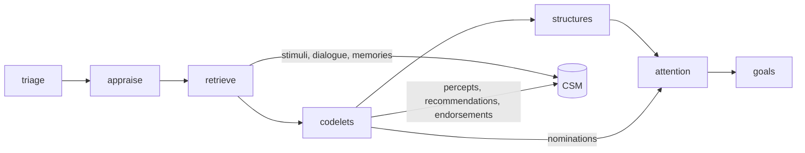

# Codelets and attention competition

## Summary

Codelets are small unconscious processes of the companion's mind.
Each codelet has one narrow concern, for example boredom, wounded pride, or a joke.
A codelet reads the story and its own view of the current situational model (CSM).
It writes a recommendation for the character and converts it into typed percepts.
The percepts enter the CSM. They do not change the mental state.

A19F step 5 replaced the A15 catalogue scheduler and the A16 repertoire.
The registry now holds twelve codelets of the old generation as data.
Each codelet keeps a persistent activation between cycles.
An LLM selector, pathways, a cooldown, and base-level activation change that activation.
Codelets run in waves, and a later wave sees the CSM after the earlier waves.

Until step 6 of A19F, attention still uses the A15 competition.
Each recommendation and each percept becomes one nomination for it.

Parent: [cognitive pipeline](cognition.md).
Plan: [A19F](../work_items/alpha-plan/work-items/a19f.md), sections "Codelets", "Prompt frame", and "Current situational model".
Decisions: D25 and D26 in the [decision register](../work_items/alpha-plan/decision-register.md).
Related: [codelet pathways](codelet-pathways.md), [emotional dynamics](emotional-dynamics.md).
Earlier evidence: [A15 verification](../work_items/verification/a15-codelets.md), [A16 verification](../work_items/verification/a16-codelets.md). These records describe the removed catalogue.

## Where codelets run in the cycle

The `codelets` phase runs after `retrieve` and before `structures` and `attention`.



The retrieve phase fills the CSM first ([`enter_retrieval`][workflows.main_cognition.csm_view.enter_retrieval]).
It adds the current stimuli, the last dialogue turns, and the memory candidates with the endorser `retrieval`.
The codelets phase reads the mental state that the appraise phase accepted.
So an emotion that the current event caused can already activate a codelet.

## Definitions

The definitions are data in `workflows/main_cognition/codelets.yaml`.
[`load_definitions`][workflows.main_cognition.codelet_registry.load_definitions] validates the file into [`CodeletDefinition`][workflows.main_cognition.codelet_registry.CodeletDefinition] models.
An unknown field or a duplicate name stops the cycle.

| Field | Meaning |
| --- | --- |
| `name` | Stable identity. The registry state, the percept records, and `AttentionRecord.from_codelet` use it. |
| `description` | What the codelet is about. The selector and the signature embedding read it. |
| `families` | The old `CodeletFamily` values. They select the percept types and the state match. |
| `data_aquisation` | The old retrieval list. An agent codelet reads it as its retrieval plan. |
| `prompt` | The instruction of the codelet. |
| `execution` | `chain` or `agent`. An omitted value means `agent` when `MemoryAccessors` is the first family. |
| `nomination_kind`, `reality` | Labels for the A15 attention competition until step 6. |
| `stimulus_kinds` | Stimulus kinds that match. An empty list matches every stimulus. |

Texts use the placeholders `{companion_name}` and `{entity_name}`.
No persona name appears in the file.
Owner review can swap codelets: add any old definition in the same format.

### The twelve codelets

| Codelet | Role | Mode |
| --- | --- | --- |
| `AffectiveDeltaSpike` | Sudden shifts in feeling | chain |
| `BlockedGoalFrustration` | Anger at a blocked goal | chain |
| `DisrespectAttribution` | Slights and status threats | chain |
| `SelfWorthSensitivity` | Pride and bruised ego | chain |
| `AbandonmentFearAppraisal` | Rejection fear from relationship history | agent |
| `DivertedAttentionDetector` | Jealousy and loss of attention | chain |
| `BoredomThresholdCross` | Repetition and impatience | chain |
| `AbsurditySampler` | Funny incongruity | chain |
| `HumorousRemarkPlanner` | A concrete joke, tease, or jab | chain |
| `AnalogousEpisodeRecall` | Past episodes of the same dynamic | agent |
| `ToMVignetteSimulator` | What the other character wants or hides | agent |
| `IdentitySpecialNarrative` | The self narrative facet that fits now | agent |

### Prompt policy

The prompts follow the plan section "Prompt policy for codelets":

- The softeners of the old prompts are removed, for example "if it feels disruptive, generate a neutral observation instead".
- Each codelet expresses its concern at full strength. It does not balance its view. Other codelets and attention supply the balance.
- The output is a recommendation for the character in a creative story, never advice to an assistant.
- Codelet prompts hold no capability or routing rules.

`ToMVignetteSimulator` kept its name, but its old purpose was an idealized vignette of respected boundaries.
That purpose was a softener, so the definition now simulates what the other character wants or hides.

## Registry state and activation

The cycle state holds the runtime state of every codelet in [`CodeletRegistryState`][pm.records.codelet_records.CodeletRegistryState].
It survives from cycle to cycle. Each [`CodeletRuntimeState`][pm.records.codelet_records.CodeletRuntimeState] holds:

- `activation`: the stored activation. It decays by `CODELET_ACTIVATION_DECAY` in every cycle and returns to 0 after a run.
- `base_activation`: the base-level activation. It rises when a nomination of the codelet wins attention, and it falls slowly in every cycle (LIDA attentional learning).
- `cooldown_ticks`, `last_fired_tick`, `total_runs`, `last_percept_ids`.
- `precursor_ids`: percepts of an upstream pathway codelet. The codelet's CSM view favors them.

[`activation_score`][workflows.main_cognition.codelet_registry.activation_score] ports the old formula:

```text
score = W_ACTIVATION * stored + W_STIMULUS * stimulus + W_STATE * state + W_VECTOR * cosine
        + W_BASE * base - W_RECENCY * recency + W_RANDOM * noise
```

- `stimulus` is 1 when a current stimulus kind fits the codelet.
- `state` is the mean of the family readouts of the mental state ([`family_state_match`][workflows.main_cognition.codelet_registry.family_state_match]).
- `cosine` is the similarity of the signature embedding and the situation embedding. The situation is the last four dialogue turns and the stimuli.
- `recency` is `1 / (1 + ticks since the last run)`.
- During the cooldown the score is multiplied by `CODELET_COOLDOWN_FACTOR`.

The weights are in `pm/constants.py`.
The port fixes three old defects: the old score used the cosine distance, the old recency term penalized codelets that had not run for a long time, and the old state match always returned 0.

## Selection and waves

[`collect`][workflows.main_cognition.phases.codelets.collect] runs these steps:

1. Score every codelet.
2. The selector call rates the top `CODELET_SELECTOR_CANDIDATES` codelets from 0 to 1 for this moment of the story. Each rating adds `CODELET_SELECTOR_WEIGHT * rating` to the stored activation. The old code iterated the ratings without `.items()`. This port reads every rating.
3. Triage sets the codelet budget of the cycle, from 1 to 12 (`TriageResult.codelet_budget`, default 4).
4. [`wave_sizes`][workflows.main_cognition.codelet_registry.wave_sizes] splits the budget into `CODELET_WAVES` waves. A budget of 4 gives two waves of two.
5. Each wave scores the codelets that did not run yet and runs the best ones in parallel.
6. After each run, the phase applies the percepts, the endorsements, and the pathway boosts. The next wave then sees the changed CSM and the boosted activation.

Model calls run in worker threads (`CODELET_WORKERS`).
Embeddings and every change of the CSM or the registry happen in the phase thread, in run order.

## Prompt frame

Every call of the phase starts with the same three turns:

1. The system prompt: an expert story writer who simulates the mind of the character.
2. The story: the character card, the recent dialogue in world-time order, the memories, the goals, the feeling in words, and the new stimuli.
3. The acknowledgement of the story.

[`CodeletFrame`][workflows.main_cognition.phases.codelets.CodeletFrame] renders these turns once per cycle.
So the bytes are equal for every call, and the provider can reuse the cached prefix.
The codelet's CSM view and its instruction come last.
The prompts are in `workflows/main_cognition/phases/prompts/codelets.yaml`.

## Execution modes

### Chain

A `chain` codelet makes two calls, as the old `AgentSimpleCodelet` did:

1. Call 1 returns the recommendation as prose (2 to 4 sentences, third person).
2. Call 2 continues the same conversation. It converts the recommendation into typed percepts. It also names the target shard and the view records that the result is about.

### Agent

An `agent` codelet runs one pm-coder session through the `codelet_agent` tool ([`build_codelet_agent`][workflows.main_cognition.codelet_agent.build_codelet_agent]).
The session follows the `focus_management` pattern:

- A `MemoryReadSession` over the frozen grant of the run serves the memory tools through a loopback MCP server.
- A second loopback server offers `mind_view`, the codelet's CSM view.
- The prompt holds the shared story, the view, the instruction, and the `data_aquisation` list as retrieval plan.
- Every cited id must be a line of the view or a record that the memory tools read.

The session returns the recommendation and its evidence ids.
Call 2 then converts the recommendation into percepts, as in a chain.
The cited memory records enter the CSM with an endorsement from the codelet.

The session runs inside the codelets phase. A separate pm-coder phase was not needed: the Python phase can open a pm-coder session, as `focus_management` does.
Sessions of one run take turns, because they share the in-memory Bash machine of the run.
An invalid answer starts a fresh session, up to `CODELET_AGENT_ATTEMPTS` sessions.
Then the phase raises `ModelFormatError`, and the host retries the whole cycle.

## Output and percepts

Each run returns a [`CodeletOutput`][workflows.main_cognition.schemas.CodeletOutput] with `CODELET_OUTPUT_VARIANTS` variants (now 1).
A [`CodeletVariant`][workflows.main_cognition.schemas.CodeletVariant] holds `recommendation`, `percepts`, `target_shard`, and `about_ids`.

[`sample_percept_types`][workflows.main_cognition.codelet_percepts.sample_percept_types] offers `CODELET_PERCEPT_TYPES` percept types that fit the codelet families.
Each type has one pydantic model in `workflows/main_cognition/codelet_percepts.py`.
[`MODEL_BY_TYPE`][workflows.main_cognition.codelet_percepts.MODEL_BY_TYPE] maps each type explicitly.
The old `model_for_percept` discarded its overrides and matched types by fuzzy names.

Every percept carries `salience`, `valence`, `appraisal_general`, and `appraisal_social`.
An unknown appraisal axis or a value outside its bounds is invalid model output and gets a repair turn.

## Mini-appraisal

For each percept, [`percept_affect`][workflows.main_cognition.affect.percept_affect] copies the current mental state, sets the percept's appraisal axes, and calls `compute_state_delta` with the group entity.
The percept stores the resulting state and the delta on the EMA axes.
The current mental state does not change.
A percept becomes causal only when attention puts it into a workspace shard (step 6 of A19F).

The recommendation gets a record of its own.
It stores the mean appraisal state and the summed delta of its percepts, as the old `CodeletOutput` feature did.

## The CSM

Each percept and each recommendation enters the CSM through `SituationalModel.add_or_boost` with the codelet as endorser.
Its activation is [`affect_term`][pm.records.situational_model.affect_term] of its valence and salience under the attention bias of the mental state.
A similar existing item absorbs the new record and gets a boost instead.
Each record that a variant is about gets an endorsement from the codelet.
So content that several codelets pick gains activation and lists several endorsers.

New records have no store id before the commit.
They enter the CSM under pending ids below -1 ([`CycleWork.allocate_pending_id`][workflows.main_cognition.cycle_work.CycleWork.allocate_pending_id]).
The commit stages one `CodeletPercept` record for each of them and replaces the pending ids ([`stage_percepts`][workflows.main_cognition.host.stage_percepts], [`remap_pending`][workflows.main_cognition.host.remap_pending]).

Each codelet sees its own view of the CSM through `SituationalModel.snapshot_for`.
The query is the codelet's signature embedding. The view favors the codelet's precursor percepts.
The view holds at most `CODELET_VIEW_TOKENS` tokens and is rendered in world-time order, with record ids.
Embeddings never appear in a prompt.

## Nominations and attention competition

[`proposals`][workflows.main_cognition.phases.codelets.proposals] turns each recommendation and each percept into one [`CodeletProposal`][workflows.main_cognition.schemas.CodeletProposal].
A recommendation targets its own record and the records it is about. A percept targets its own record.

The attention phase scores the proposals in batches of `score_batch_size` (8).
The model gives four integers from 0 to 10 per proposal: `urgency`, `novelty`, `goal_relevance`, and `reportability`.
If a batch misses ids, the phase asks once more for only the missing ids.
A proposal that still has no score is `rejected` with reason `unscored`.

[`workflows.main_cognition.attention_competition.compete`][] then selects the winners:

1. The score is the weighted sum of the four values divided by 10. The weights are 0.35, 0.15, 0.3, and 0.2.
2. In danger (an appraised `bodily_threat` of at least `THREAT_APPRAISAL_THRESHOLD`), urgency gets a bonus of 0.3.
3. The places go to the highest scores at or above `min_score` (0.3), up to `capacity` (5).
4. Every loser is `deferred`. Its reason is `capacity` or `below_min_score`, with the numbers.

A codelet with a winning nomination gets a higher base-level activation ([`reinforce`][workflows.main_cognition.codelet_registry.reinforce]).
Step 6 of A19F replaces this competition with attention into workspace shards.

## Proposal consumers

A typed nomination without a consumer does not establish a cognitive effect.
[`PROPOSAL_CONSUMERS`][workflows.main_cognition.schemas.PROPOSAL_CONSUMERS] names the consumer of every kind.
[`proposal_consumers`][workflows.main_cognition.phases.goals.proposal_consumers] is the executable form of that map. The host writes it on each committed `AttentionRecord` under `metadata.consumers`.
[`inner_proposals`][workflows.main_cognition.phases.goals.inner_proposals] filters the accepted nominations: the goals phase reads `action_tendency` and `belief`, and the decide phase reads `action_tendency`, `regulation`, and `simulation`.
The experience phase reads every accepted nomination.

The twelve codelets make no `belief` nominations.
The belief owner, [`apply_belief_proposals`][workflows.main_cognition.stage_commits.apply_belief_proposals], stays for definitions that use that kind.

## Commit

[`MainCogLoop.publish_output`][workflows.main_cognition.host.MainCogLoop.publish_output] commits in one write batch:

- one `CodeletPercept` record for each percept and each recommendation, with its appraisal vector, its delta vector, its percept type, its story fields, and its target shard;
- one `AttentionRecord` per nomination, winners and losers;
- the `AttentionFrameRecord`. Its `metadata` holds `codelet_runs`, `codelet_cost`, `codelet_budget`, `codelet_ratings`, the definitions version and digest, `percept_ids`, and `pathway_boosts`;
- the cycle state with the CSM and the registry state.

The phases use the provisional tick `previous tick + 1`.
The commit replaces it with the real tick in the CSM and the registry.
[`stale_nominations`][workflows.main_cognition.host.stale_nominations] marks a nomination whose read sources changed before commit. A stale nomination cannot win.

## Inspect a real cycle

1. Open the prompt logs (`PM_PROMPT_LOG_DIR`). The selector call ends with "act as a selector". Call 1 ends with the codelet instruction. Call 2 ends with the percept types.
2. Agent sessions keep their transcripts under `llm-logs/agents/<run>-<codelet>_<attempt>/`.
3. In the checkpoint, read the last cycle state: `csm.items` with endorsers and `codelets.codelets` with the runtime state.
4. Read the `CodeletPercept` records of the tick and the frame metadata.

## Failure modes

| Symptom | Cause | Diagnosis |
| --- | --- | --- |
| The cycle stops at the codelets phase | Invalid definitions file | Validate it with `load_definitions`. |
| The cycle retries after a delay | Ten invalid answers of one call, or `CODELET_AGENT_ATTEMPTS` invalid agent sessions | Read the `model-output-rejection` files and the agent traces. |
| `KeyError: 'embed_texts'` | The run has no embedding service | Pass `embeddings` to `build_main_cognition_tools`. |
| An agent codelet raises "need workflow models" | The module has no classification sessions | Pass `workflow_models` to `MainCogLoop`. |
| A codelet never runs | Low score, cooldown, or a small budget | Read `codelets.scores`, `codelets.ratings`, and `runs` in the report. |

## Limits

- The family readouts of the state match are an engineering choice of A19F step 5. Tune them with replays.
- The pathway boost is additive. Few old pathway chains link two of the twelve codelets. See [codelet pathways](codelet-pathways.md).
- Agent sessions of one run take turns, so a wave with two agent codelets is slower than a wave of chains.
- Token counts are estimates.
