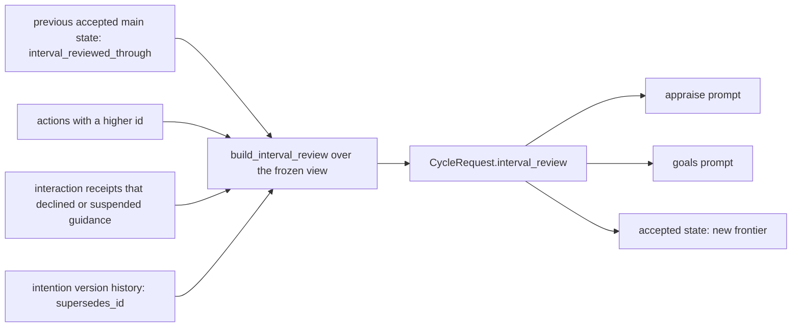

# Accepted cognition state

## Summary

Main cognition proposes affect, goals, and actions.
A06 makes the accepted path carry those proposals into Ghost state.
An appraisal adds one delta to the history that sets the mental state.
A goal change creates or moves an `Intention` through its lifecycle.
Actions keep a stable identity and a separate success prerequisite.

Parent: [Cognition](cognition.md).
Entry: [`workflows.main_cognition.steps.run`][].
Committer: [`workflows.main_cognition.host.MainCogLoop.publish_output`][].

## Place in the system

[`workflows.main_cognition.host.MainCogLoop`][] builds one request from a bus batch.
Each phase of the cycle adds its typed result to one shared
[`workflows.main_cognition.cycle_work.CycleWork`][].
[`workflows.main_cognition.steps.run`][] validates the incoming request once.
One kernel role runs the Python phases on the same in-memory object.
Intermediate phase state is neither serialized nor resumed after interruption.
The final work carries the appraisal, the appraisal affect, the goal changes, the
dispatches, and the changed cycle state.
The module applies those proposals inside one Ghost write batch.

## Input → change → output

| Input | Change | Output |
| --- | --- | --- |
| Appraisal report | EMA mental state and one appraisal Feature | Feature in accepted memory |
| Goal change list | New or changed `Intention` knoxel | Durable goal lifecycle |
| Decisions and routes | Stable action IDs, expectations, and prerequisite records | `action.request` or `action.receipt` |
| Startup gap | One system lifecycle Feature | First-cycle stimulus, unless an accepted wait suppresses routine cognition |
| `Sleep` | Wait and cognitive result commit together | Routine inference pauses; outside evidence or timeout ends the pause |

## Appraisal to affect

The appraise phase computes the affect of the cycle (D27).
[`workflows.main_cognition.phases.appraise.update_affect`][] reads the causal feature history of the request.
It derives the appraisal state and its delta with [`workflows.main_cognition.affect.appraise_state`][].
Then it sets the cycle `mental_state` to the EMA readout over the history and the new delta.
[`workflows.main_cognition.cycle_commits.apply_appraisal`][] stages one `Feature` with `feature_subtype=Appraisal`.
The Feature carries the appraisal state in `mental_state_appraisal_vec`.
It carries the delta in `mental_state_delta_vec`.
Its metadata carries the appraisal axes, the explicit deltas, the relationship entity id, the feeling in words, and the regulation mode.
The Feature is causal and self-origin (`SourceKind.Self`).
The next cycle reads its delta from the store.

Read [emotional dynamics](emotional-dynamics.md) for the formula, the regulation mode, and the departures from the old code.
The model names axes, for example `goal_congruence`, and deltas, for example `connection`.
`AppraisalResult` accepts only the field names of the appraisal, emotion, and need models.
An unknown name or an out-of-bounds axis is invalid model output, and the repair loop asks the model to fix it.
The math clamps every value to its field bounds, so the state stays in range.

## Goal lifecycle

[`workflows.main_cognition.cycle_commits.apply_goal_changes`][] accepts these
change kinds:

- `add` starts an active goal.
- `complete` closes a satisfied goal.
- `reprioritize` changes the salience of a goal.
- `defer` pauses a goal without closing it.
- `refuse` declines a requested goal and keeps the reason.
- `retain` leaves an existing goal unchanged.

Each intention has a stable `goal_key`.
The key comes from the `goal_key` field or from normalized goal text.
The lookup uses identity, not a slice of the text.
A repeated `add` with the same identity does not create a second intention.
A missing `complete` never invents a completion.
A `defer` or `refuse` of a new request is durable evidence.
Active intentions alone steer work.
The request builder reads only active goals.

## Interval review

**Implemented (B07).** A person who takes stock looks back at what they did since they last took stock, whether it arrived, and what they were trying to do then.
Each main cycle builds that view as a read-only [`IntervalReview`][workflows.main_cognition.interval_review.IntervalReview] from its frozen request view ([`build_interval_review`][workflows.main_cognition.interval_review.build_interval_review]).
It lists every action committed since the last accepted review: who chose it (main cognition, the fast path, or a task reply), its utterance and delivery status (the shared [`recent_move`][workflows.public_speech.situational_guidance.recent_move] projection), the exact intention versions that held when it was chosen, how each of those goals stands now, and the expectations it opened.
It also lists every ordinary exchange in which the fast path set accepted guidance aside, with its reason.
The appraise and goals prompts render it ([`render_interval_review`][workflows.main_cognition.interval_review.render_interval_review]) with three rules: an asked question is not an answer, a sent request is not a finished task, and something good after a move does not prove the move caused it.

**Frontier.** [`CycleState.interval_reviewed_through`][pm.records.cycle_state.CycleState] is the highest record id the last accepted main cycle's review read.
Record ids only grow, so an action committed while a cycle calculates is reviewed by the next cycle, and none is reviewed twice.
A cycle that is not accepted leaves the frontier unchanged.
A state from before B07 has no frontier: the first cycle then reviews nothing and starts the frontier.

**Attribution.** A goal changes by appending a successor with a new id, and an action records the intention ids that were active at its commit.
So the review shows an action under the goal text that held then, never under a later version, and says whether that goal is still pursued, revised, completed, deferred, or refused ([`goal_family_heads`][workflows.main_cognition.interval_review.goal_family_heads]).
An action's `intention_ids` are all active goals at its commit, not the one goal it served.

Observed in the B07 live gate (Part B): a fast-path reply chosen under "Finish the winter-sea story with Jesse this week" while the next main turn completed that goal reached the following real turn's appraise and goals prompts under that text, marked "since completed", and that turn moved the frontier past the reply.

## Stable actions and prerequisites

[`workflows.main_cognition.phases.route.stable_action_id`][] hashes the workflow,
action type, content, and arguments.
The same intent receives the same ID across cycles.
Two dependency kinds stay apart:

- `depends_on` only orders dispatch inside one selection.
- `requires_completed` needs a `completed` receipt.

[`workflows.main_cognition.dispatch.resolve_same_cycle`][] releases ordering
dependencies.
[`workflows.main_cognition.dispatch.resolve_prerequisites`][] gates success
dependencies.
A missing prerequisite leaves the action `queued`.
A failed prerequisite rejects it.
A queued action never starts dependent work.
[`workflows.main_cognition.host.MainCogLoop`][] suppresses a repeated non-reply start with the same
durable identity.

## Lifecycle evidence

Startup saves a `SystemMessage` Feature before the first cognition cycle.
The Feature records the boot identity, the last known activity, and the offline gap.
If the immediately preceding boot has a clean shutdown record, the startup Feature includes its ID.
If that boot has no clean shutdown record, the startup Feature reports an uncertain ending.
[Startup record][pm.app.lifecycle_records.record_startup]

After worker cleanup, PM records the clean shutdown as a `SystemMessage` Feature for the current boot.
The final checkpoint includes this Feature. Repeated boot or shutdown requests reuse the same record for that boot.
[Shutdown record][pm.app.lifecycle_records.record_shutdown]

At construction, [`workflows.companion.build_app`][] records the boot event.
For real cognition it also puts a `system.lifecycle` envelope on the bus.
[`workflows.main_cognition.host.MainCogLoop`][] accepts that topic in `_stimulus_from`.
The first cycle then appraises the offline interval.
The system never attributes an unknown stop cause to the user.

## State and side effects

The module opens one batch with `new_tick=True`.
It stages the appraisal Feature, the goal intentions, the codelet percepts, the
structures, the turn record, and each action in that batch.
The GWT turn record of that batch lists the shard changes of the cycle
(see [structures, attention, and the workspace](workspace.md)).
It commits once.
A failure before the commit leaves accepted state unchanged.
A stale revision raises `GhostConflict`, so no partial update lands.
The completed main cycle writes the checkpoint before action publication.
Ordinary memory commits stay in memory. A crash can lose messages received after the last checkpoint.
Restart loads accepted memory, including pending message records. The new process starts with fresh execution state.
The [wait controller](inference-wait.md) can accept a pause in that same commit.
Its generation fence prevents a late sleep decision from hiding newer input.

[`workflows.main_cognition.host.MainCogLoop`][] reads active goals from accepted memory.
It writes intentions and Features through the Ghost batch.
It sends `action.request`, `action.receipt`, and `gwt.updated` messages.
It sends no model call in the commit path.

## Traps

The pipeline maps unknown emotion or need names to no change.
A goal without a stable key resolves by normalized text only.
A queued prerequisite is not retried inside this item.
A12 owns publication recovery and requeue.
The current model still returns `DEFAULT_WORKFLOWS` when no configuration
catalogue is supplied.

## Go deeper

Read [emotional dynamics](emotional-dynamics.md) for the bounded affect step.
the receipts.
Read [Cognition](cognition.md) for the stage order.
Read [Ghost and bus](../ghost.md) for the commit boundary.
Read [`workflows.main_cognition.cycle_commits`][] for the exact helpers.
