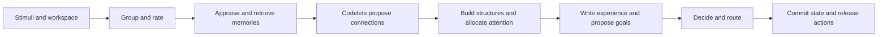

# Main cognition

A companion needs time to reconsider an event that changes what matters.
Main cognition brings the event together with memories, feelings, and goals.
For routine conversation, see [ordinary interaction](ordinary-interaction.md).

[`CycleRequest`][workflows.main_cognition.cycle_work.CycleRequest] carries the input.
[`CycleWork`][workflows.main_cognition.cycle_work.CycleWork] holds intermediate results.
The [workflow role][workflows.main_cognition.steps.run] runs the phases in order.

The story frame gives each mechanism the character card, current workspace,
subjective state, and stimuli. The last instruction specifies the mechanism’s job.
Later phases read workspace changes made by [attention](workspace.md).
The renderer fits the prompt to the serving budget and records evidence selection.
See [context planning](context-planning.md) and the [triage renderer][workflows.main_cognition.phases.triage.render_triage].

The runtime commits the cycle before releasing action requests.
Use [the overnight baseline](../workflows/spamuel-baseline.md) to follow a cycle
from its workspace into its workflow and model receipts.
