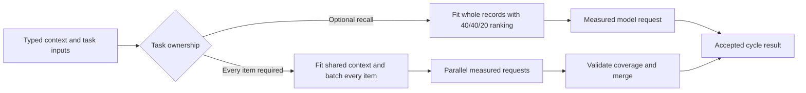

# Cognitive pipeline

## Summary

The main cognition workflow runs its typed phases in a fixed order.
Every model call of the cycle is an unconscious process: an immersive character story and choice simulator.
No call speaks as the companion to anyone, and no call has an assistant frame (decision D25).
The module commits the accepted cycle in one write batch before it publishes typed actions.
Ordinary conversation can also use [accepted guidance during background cognition](ordinary-interaction.md).
That path selects local moves while main cognition retains appraisal and deliberate intention ownership.

Parent: [system map](../concepts/architecture.md).
Entry: [`workflows.main_cognition.steps.run`][].
Plan: [A19F](../work_items/alpha-plan/work-items/a19f.md).
Game initiative: [cooperative survival](cooperative-survival.md) and [observed world events](world-events.md).

## Input, change, and output

The request contains the stimuli, the memory candidates, the open expectations, the user and entity context, and the available workflows.
One Python role in the kernel runs the phases intake, triage, appraise, retrieve, codelets, structures, attention, experience, goals, decide, route, and commit.
The phases share one typed cycle state and add their results to it.
The commit phase hands the finished cycle to the application module.
The module commits accepted state in one write batch and publishes one typed action request for each released action.

| Phase | Main responsibility | Implementation |
| --- | --- | --- |
| Intake | Put each stimulus into one group: an entity, a workflow, or the self. Set the shard tails | [`workflows.main_cognition.phases.intake.start`][] |
| Triage | Rate each stimulus and each group. Set the codelet budget | [`workflows.main_cognition.phases.triage.run`][] |
| Appraise | Check the open expectations, then appraise the situation and set the mental state | [`workflows.main_cognition.phases.appraise.run`][] |
| Retrieve | Select supplied memory candidates. Add them and the open expectations to the CSM | [`workflows.main_cognition.phases.retrieve.run`][] |
| Codelets | Run codelets in waves and fill the CSM with percepts | [`workflows.main_cognition.phases.codelets.run`][] |
| Structures | Build topical coalitions and bound structures from the CSM | [`workflows.main_cognition.phases.structures.run`][] |
| Attention | Rate the structures for each shard, then update the shards in Python | [`workflows.main_cognition.phases.attention.run`][] |
| Experience | Write the subjective experience into the self shard tail | [`workflows.main_cognition.phases.experience.run`][] |
| Goals | Propose goal changes | [`workflows.main_cognition.phases.goals.run`][] |
| Decide | Make zero or one in-character decision for each significant group | [`workflows.main_cognition.phases.decide.run`][] |
| Route | Map each decision to an action, check conflicts, and record expectations | [`workflows.main_cognition.phases.route.run`][] |
| Commit | Set the wait and write the report | [`workflows.main_cognition.phases.commit.run`][] |

## The story frame

Every model call starts from the same three-turn frame of [`workflows.main_cognition.story_prefix.StoryPrefix`][]:

1. The shared system prompt: an expert story writer who simulates the mind of one character from the inside.
2. The story: the character card, then the self shard, then the shard of each current stimulus group, each with its tail. Then the feeling in words and the new stimuli.
3. The acknowledgement.

The instruction of the call comes last.
Each instruction names its mechanism, for example "act as the triage mechanism" or "act as the choice mechanism".
The calls before attention read the shards of the previous cycle with the new tails. The experience, goals, decide, and route calls read the shards after attention changed them.
The prompts hold no assistant or therapy words and no softeners.
The shared [situational guidance](situational-guidance.md) supplies actual capabilities, partner evidence, intentions, and previous moves.
Workflow names and routing rules remain in the route call.
The private grounding turn of other calls has no separate capability section.

## Prompt fitting and complete evaluation

Internal cognition uses the chat entry's `cognition_context_window`, which defaults to 32,768 tokens.
The smaller serving window wins. The configured `context_input_fraction` then reserves response space.
For example, a 32,768-token window with fraction `0.85` admits at most 27,852 estimated input tokens.
This setting changes how much evidence a mechanism can consider; it does not change stored memory.

[`workflows.main_cognition.prompt_context.shard_content`][] attaches priorities to complete shard records.
The shared [`pm.context_render.budget.fit_turns`][] fits the whole attempt, including its instruction, grounding, and correction feedback.
Optional records combine 40% recency, 40% existing salience, and 20% randomness.
These are ranking weights, not fixed token quotas. Required evidence never competes with optional records.
The measured selection remains unchanged when the request is sent.

The character card, current events, situational guidance, instructions, and newest four partner lines remain required.
The fitter keeps cited support that is present in the prompt. It never cuts a record in half.
A prompt that already fits keeps its text. Selection receipts record included groups, omitted groups, and estimated tokens.
Instructions, schemas, and media remain fixed. Internal workflows can mark required evidence for a derived review on overflow.
[`workflows.main_cognition.model_json.fit_internal_prompt`][] first tries ordinary fitting.
If required evidence still exceeds the window, it reviews marked evidence in complete batches through the real model.
Every text span enters a review. Source IDs and coverage receipts accompany the derived evidence; original records remain unchanged.
The final appraisal, goal judgment, or decision still runs once. The runtime never adds emotion changes from separate partial appraisals.
A fitting prompt keeps its content and needs no review call. A larger configured window can therefore avoid reduction entirely.
Digests can lose detail. Coverage proves that a review received the evidence; it does not prove lossless meaning.
Fixed instructions or evidence metadata that cannot fit still raise `RequiredContextTooLarge`.

Some mechanisms must evaluate every candidate. They use [`pm.context_render.budget.batch_prompt`][] instead of dropping candidates:

| Mechanism | Complete evaluation | Result combination |
| --- | --- | --- |
| Attention | Every structure for every shard | Merge all ratings, then choose winners once across the full set |
| Recall | Every supplied memory candidate | Merge selected source IDs; handle goals and belief changes in one coherent call |
| Expectation checks | Every offered expectation and its uncounted observed stimuli | Merge outcomes by expectation ID |
| Main triage | Every new event, with batches when the required event payload overflows | Restore input order and retain the strongest requested codelet budget |

Each batch shares one fitted context. The task's own inputs remain complete.
[`workflows.main_cognition.model_json.batch_internal_prompt`][] adds evidence review when required shared context or a single task exceeds the window.
Its overflow fallback freezes one common context for every task and retains every task identity for result validation.
An oversized structure receives source-linked evidence reviews before its final attention rating.
Every member enters a review, and a coverage receipt retains the complete member set.
The digest allowance comes from the remaining window. Digests remain derived evidence; the stored structure keeps its original records.
The final attention pass compares those reviewed structures without averaging partial ratings.

Independent batches can run concurrently through the normal request pool.
Coverage checks reject missing or duplicate results before the cycle changes state.
Appraisal, experience, goals, decisions, and immediate entity-model maintenance retain a coherent view.
They do not average independent character judgments or merge conflicting entity revisions.

Triage remains a fast judgment, but its window is no longer a hardcoded special case.
Early triage still validates entity extraction against its frozen source grants.
Native codelets fit their initial story through the same renderer; pm-coder owns their later history and compaction.

## Subjective experience

[`workflows.main_cognition.phases.experience.run`][] ports `_generate_subjective_experience` with its seed phrases.

1. [`seed_phrases`][workflows.main_cognition.phases.experience.seed_phrases] turns the mental state into first-person phrases: the cognitive style, the dominant feeling, and the most pressing need. The phrase table is data in `phases/prompts/experience.yaml`.
2. The call ends with an assistant turn that opens with the seed phrases. The model continues the inner voice.
3. The text is the seed, the continuation, and a focus phrase for the newest message of an entity.
4. The text becomes a `SubjectiveExperience` feature. It enters the self shard tail at once, so the goals, decide, and route calls read it.
5. The commit links it from the broadcast (`BroadcastRef.experience_id`) and the turn record (`GwtTurnRecord.experience_id`). It is also the cycle summary and the `workspace` field of the action request.
6. When more than one stimulus group is significant, one more call runs for each of them, with the prefix of that group: the self shard and the group's shard only ([`GroupExperience`][workflows.main_cognition.schemas.GroupExperience]). The decide and route calls of the group and its action request read this experience. So the reply to one entity does not mention the content of another group.

The old "workspace frame" call and the `AttentionFrameRecord` are gone (A19F step 10). The turn record and the `Structure` records hold the attention decisions.

## Decisions and routing

Read [decisions, routing, and expectations](decisions-and-routing.md).
In short: one decision for each significant group, in the character's voice. A separate route call maps it to a workflow. A conflict check rejects a second action for one group and a second body claim. The decision text reaches the target workflow unchanged.

## Asynchronous boundary

[`workflows.main_cognition.host.build_main_cognition_tools`][] grants each run its model, embedding, and agent codelet tools. All phases run in one manifest and share one typed [`workflows.main_cognition.cycle_work.CycleWork`][].
The workflow does not need its own module thread or bus subscription.
[`workflows.main_cognition.host.MainCogLoop`][] connects the cycle to the bus and the memory store.
Each published action carries the correlation of its stimulus group. So the groups of one batch keep separate exchanges.

The endpoint has configurable concurrent request slots. Queued triage receives the next free slot; no workflow reserves the whole endpoint.
Independent interaction uses accepted main guidance and current evidence to select local moves.
Main cognition still appraises those inputs and suppresses duplicate conversational selection.
Critical triage interrupts obsolete work and holds ordinary publication until accepted reconsideration.

Story dialogue produces character speech.
Assistant dialogue can call scoped tools.
It is not offered as an action and serves direct requests and reply recovery.
SelfManagement operates managed runs.
These paths have separate contracts and prompts.
They share the [public context and grounding contract](public-dialogue.md).
Accepted public speech uses [durable publication and recovery](public-publication.md).

## Action requests

[`ActionRequest`][workflows.main_cognition.schemas.ActionRequest] is the payload of every `action.request` envelope. It holds:

- the decision text (`content`), the workflow, the arguments, and the presentation;
- the stimulus group and its stimuli;
- the partner: the entity that a reply addresses. A reply to an entity group addresses that entity. A reply to the self group or a workflow group addresses the user;
- the shards that the reply needs: the self shard, the partner's entity shard, and the group's workflow shard, each with its tail ([`request_shards`][workflows.main_cognition.action_request.request_shards]). The self tail leaves out the experiences of this cycle that belong to other groups;
- the subjective experience of the group, the feeling in words, and the regulation mode.

The host stores the same request in the action record. Dispatch recovery publishes it again after a restart ([`replay_intents`][workflows.main_cognition.dispatch_recovery.replay_intents]).
The public workflows build their reply context from the shards. They do not retrieve memory again. Read [public dialogue context](public-dialogue.md).

## State and side effects

Model calls occur outside the store commit lock.
Accepted cognition records reach the checkpoint before action publication.
Dialogue also stores accepted records before public replies.
Context selection repairs an invalid memory id once. If the repair fails, it drops the unavailable ids and rebuilds the memory text from the supplied sources.
The inner loop writes its own turn records with `slot_id="inner"` and claims no stimuli. A19G moves it onto the shared cycle.

## Traps

Context selects supplied evidence from the scoped semantic and episodic retrieval pool.
The accepted action and dialogue receive the same selected records and original ids.
A scheduled action does not prove that an external task succeeded.
The cycle report lists the duration of each phase. The whole cycle is one workflow run.

## Go deeper

Read [codelets](codelets.md) for the registry, the waves, and the percepts.
Read [structures, attention, and the workspace](workspace.md) for the shards, their requirements, and causality.
Read [decisions, routing, and expectations](decisions-and-routing.md) for the groups, the decisions, the routes, and the expectations.

Read [experienced memory](experienced-memory.md) for retrieval, attribution, and source constraints.

Read [emotional dynamics](emotional-dynamics.md) for the bounded affect step.
Read [accepted cognition state](cognition-state.md) for affect, goals, and
stable action identities.
Read [A06 verification](../work_items/verification/a06-cognition-state.md) for the real state
receipts.
Read [one exchange](../workflows/exchange.md), [managed work](managed-work.md),
and [next experiments](../work_items/experiments.md).
