# Decisions, routing, and expectations

## Summary

Main cognition decides in character and routes in a separate step (decision D28).

1. The intake phase puts each stimulus into one stimulus group: an entity, a workflow, or the self.
2. Triage rates each group. An insignificant group gets no decision.
3. The decide phase makes zero or one decision for each other group. A decision is a recommendation to the character, in the character's voice.
4. The route phase maps each decision to an action type, a workflow, arguments, and a presentation. It holds all capability and workflow rules.
5. A deterministic conflict check rejects a second action for one group and a second claim on one body lease.
6. Each released action records the reaction that the companion expects. A later appraisal checks that expectation against new stimuli.

The decision text goes to the target workflow unchanged. So the dialogue prompt reads the character's own choice as its intent.

A19F steps 7 and 8 replaced the single action selection call, its planner-style intents, and the `ActionIntent` and `ActionSelectionResult` models.

Parent: [cognitive pipeline](cognition.md).
Plan: [A19F](../work_items/alpha-plan/work-items/a19f.md), sections "Prompt frame" and "Stimulus groups and actions".
Decision: D28 in the [decision register](../work_items/alpha-plan/decision-register.md).
Related: [structures, attention, and the workspace](workspace.md), [story speech](story-speech.md), [wait for a stimulus](inference-wait.md).

## Flow

```mermaid
flowchart LR
    I[intake: groups] --> T[triage: category per group]
    T --> A[appraise: expectation check]
    A --> X[... attention ...] --> E[experience] --> G[goals]
    G --> D[decide: one call per significant group]
    D --> R[route: one call per decision]
    R --> C[conflict check]
    C --> P[anticipation: one call per released action]
    P --> M[commit: actions, expectations, decisions]
```

## Stimulus groups

[`group_key`][workflows.main_cognition.phases.intake.group_key] puts every stimulus into exactly one [`StimulusGroup`][pm.records.cycle_records.StimulusGroup]:

| Stimulus | Group |
| --- | --- |
| A dialogue line of a known entity other than the companion | The entity of the speaker. The host sets `Stimulus.entity_id`. A second companion is an entity like the user. |
| A user message | The entity of the user. Without an entity record for the user, the self group. |
| A Minecraft observation | The `minecraft` workflow group. |
| A workflow event or question | The workflow group of the module that reported it. |
| An own thought or a system event | The self group. |

The correlation of a group is the correlation of its newest stimulus.
The host supplies the names of the group entities in `CycleRequest.entity_names`.

[`rate_groups`][workflows.main_cognition.phases.triage.rate_groups] gives each group the highest triage category of its stimuli.
A group whose stimuli are all `Insignificant` is insignificant.
A category outside the four names is invalid model output. The repair turn asks for a valid name. A silent fallback could drop a decision.

## Decide

[`workflows.main_cognition.phases.decide.run`][] makes one story-framed call for each significant group. The calls run in parallel (`DECISION_WORKERS`).

Each call reads the shared story prefix and then the instruction of `phases/prompts/decide.yaml`:

- the part of the story that the group is, and its new stimuli;
- the feeling in words and the regulation mode;
- the subjective experience of this cycle;
- the causal codelet percepts in the self shard and in the group shard ([`group_percepts`][workflows.main_cognition.phases.decide.group_percepts]);
- the active goals and the goals that this cycle adds.

The answer is a [`DecisionAnswer`][workflows.main_cognition.schemas.DecisionAnswer] with zero or `DECISION_VARIANTS` texts.
An empty list means that the character does nothing about this group.
Silence and waiting can also be decisions. The route maps them to quiet actions.

The decision prompt holds no capability list, no workflow list, and no routing rule.
Validation rejects a text that names a configured workflow or a system word (`ToolCall`, `workflow`, `action_type`).
It also rejects a text that opens like a planner ticket, for example "Generate", "Validate", or "Respond to".
The repair turn asks for the choice in the words of the story.

The phase writes each decision as an [`ActionDecision`][pm.records.cycle_records.ActionDecision] into `CycleState.decisions`.

## Route

[`workflows.main_cognition.phases.route.run`][] makes one story-framed call for each decision. The calls run in parallel.

Each call reads the shared story prefix and then the instruction of `phases/prompts/route.yaml`:
the decision, the group's stimuli with their ids, the selected memories, the goal changes, the managed-run receipts, the capabilities, and the available workflows.
Only this call gets the capability section of the private grounding turn.

The route prompt holds every capability, Minecraft, task, and presentation rule of the old action selection prompt.
It tells the model to keep the intent and the attitude of the decision.
A tool workflow reads its task from `arguments.instructions`, so the route writes the task there.

The answer is a [`RouteAnswer`][workflows.main_cognition.schemas.RouteAnswer].
Validation rejects an unknown action type, an unavailable workflow, and an invalid Sleep duration.
The cycle stores the validated answer as a [`RouteChoice`][workflows.main_cognition.schemas.RouteChoice] in a [`RoutedDecision`][workflows.main_cognition.schemas.RoutedDecision].

[`action_dispatches`][workflows.main_cognition.phases.route.action_dispatches] turns each route that is not quiet into an [`ActionDispatch`][workflows.main_cognition.schemas.ActionDispatch]:

| Field | Value |
| --- | --- |
| `content` | The decision text, unchanged. |
| `group`, `stimulus_ids`, `correlation_id` | The stimulus group of the decision. |
| `action_id` | [`stable_action_id`][workflows.main_cognition.phases.route.stable_action_id] of the workflow, the action type, the content, and the arguments. |
| `expectations` | The expected reactions (see below). |

Quiet routes (`Ignore`, `Idle`, `Sleep`) make no dispatch. A Sleep route sets the wait of the cycle, with the decision text as its reason ([`wait_request`][workflows.main_cognition.phases.commit.wait_request]).

### Conflict check

[`resolve_conflicts`][workflows.main_cognition.phases.route.resolve_conflicts] runs after the ordering and prerequisite checks:

- One group gets at most one released action.
- Two released actions cannot claim the same body lease. A start of `minecraft` or `minecraft_project`, directly or through `self_management`, claims the `minecraft` body ([`body_lease`][workflows.main_cognition.phases.route.body_lease]). An update, a stop, or a read-only observation claims nothing.
- The group with the higher triage category keeps its action. Equal categories keep the group order.

A rejected dispatch gets a reason. The host publishes an `action.receipt` with status `rejected` for it.

## Dialogue intent and partner

The host stores each released dispatch as an `ActionSchemaRecord` whose content is the decision text.
The `action.request` envelope carries a typed [`ActionRequest`][workflows.main_cognition.schemas.ActionRequest]: the same text in `content`, the group's stimuli, the group's correlation, the partner, and the shards.
Story and Assistant dialogue read the intent from the stored action record (`action.content`).
Story renders it as "What {companion} decided to do with this reply: …" in its context message.
The workspace line of the dialogue prompt is the subjective experience of the cycle.

The partner is the entity that the reply addresses ([`partner_key`][workflows.main_cognition.action_request.partner_key]).
A reply to a second companion addresses that companion: its name, its shard, and its dialogue tail.
The reply record stores the partner as `Feature.addressee_entity_id`.
So the next cycle puts the reply into the tail of the partner's shard ([`dialogue_partner`][workflows.main_cognition.host.dialogue_partner]).

## Expectations

[`workflows.main_cognition.expectations`][] ports three old functions. The store holds the expectations as [`ExpectationRecord`][pm.records.cognitive_records.ExpectationRecord] records with the provenance reference `main_cognition`.

### Record

For each released dispatch, one story-framed anticipation call writes between 1 and `EXPECTATION_COUNT` expected reactions ([`anticipate`][workflows.main_cognition.expectations.anticipate]).
Each has a content, a wanted valence (-1..1), and an urgency.
The commit stores each with the action id, the group's stimuli, and the entities whose reaction is expected ([`stage_expectations`][workflows.main_cognition.host.stage_expectations]).

A new expectation supersedes an open one when the cosine similarity of their embeddings is at least `EXPECTATION_SAME_SIMILARITY`.
The old record gets the status `superseded` and the new record as its observation.
The old code tested `similarity < threshold` and so closed the unrelated expectations. The port closes the similar ones.

### Check

The host offers the newest `EXPECTATION_OPEN_LIMIT` pending expectations of main cognition (`CycleRequest.open_expectations`).
The appraise phase selects the relevant ones ([`relevant_expectations`][workflows.main_cognition.expectations.relevant_expectations]): recency (`EXPECTATION_RELEVANCE_DECAY` per tick) and similarity to a stimulus, weighted by urgency and salience.
One story-framed call rates each one for directness and fulfillment ([`check`][workflows.main_cognition.expectations.check]).

[`outcome_of`][workflows.main_cognition.expectations.outcome_of] then computes the outcome:

- `change = (fulfillment_score - previous) * directness`. The fulfillment moves only as far as the stimulus addressed the expectation.
- The valence impact is `change * wanted valence * EXPECTATION_VALENCE_MULT`. The sum becomes the `expectation_error` of the appraisal.
- The fear impact is the old anxiety impact. It adds to the fear delta of the appraisal.
- The status is `supported` at a fulfillment of `EXPECTATION_SUPPORTED`, `contradicted` for a direct stimulus that scores at or below `EXPECTATION_CONTRADICTED`, and else `pending`.

The appraisal prompt reads the outcomes in story words.
The commit stores the new fulfillment, the status, and the check on each record ([`apply_expectation_outcomes`][workflows.main_cognition.host.apply_expectation_outcomes]). A concurrent change of a checked record aborts the cycle.

### In the CSM

The retrieve phase puts each recent expectation that stays open into the CSM with the endorser `expectation` and `CSM_EXPECTATION_ACTIVATION`.
Attention can then move it into a shard. The entity requirement `interpersonal_expectations` selects expectations about the shard's entity.

## Inspect a real cycle

1. In the prompt logs, a decide call ends with "act as the choice mechanism". A route call ends with "act as the mechanism that turns". An anticipation call ends with "act as the anticipation mechanism". An expectation check ends with "act as the expectation check".
2. In the checkpoint, read `decisions` and `dispatches` of the last cycle state.
3. Read the `StateUpdate` feature with the metadata operation `action_selection`: its `decisions` and `routes`.
4. Read the `ExpectationRecord` records and their `metadata.last_check`.

## Limits

- The private loop keeps its own expectations. Main cognition does not check them.
- `DECISION_VARIANTS` is 1. No selection among several variants exists yet.
- A dispatch that depends on another dispatch of the same cycle is possible only across groups. The route answer has no `depends_on` field.

## Departures from the base references

- Zero or one action per group. LIDA Smooth Coping allows several non-conflicting behaviors in one selection. A19F uses groups and a conflict check in place of a behavior network.
- The expectation check is a model call with deterministic arithmetic, as in the old code. LIDA has no explicit expectation records.
