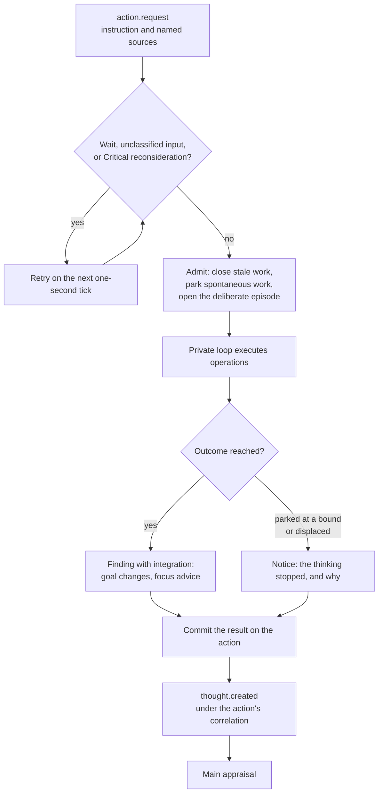
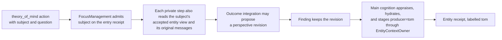

# Deliberate mental work

## Summary

Sometimes the companion decides to think something through.
Main cognition selects that as an action, like speech or a body task.
Deliberate mental work is the path that action takes.

The work runs in the same private slot and through the same inquiry steps as a spontaneous thought.
One difference matters: the companion chose it, so it takes the slot from a thought that only occurred to it, and someone waits for its result.
The result returns to main cognition as a proposal. It can contain goal changes and temporary focus advice.
Main cognition appraises it before any goal or focus change.
The workflow cannot change emotions, publish speech, or command the body.

This models one aspect of executive attention: choosing what to think about.
It does not establish humanlike deliberation.

Parent: [cognition](cognition.md).
Related: [the private thought loop](private-loop.md), which executes the work, and [waits](inference-wait.md).

## Who owns what

| Owner | Responsibility |
| --- | --- |
| Main cognition | Selects the action and its instruction. Appraises the result. Accepts or rejects proposed goals. |
| [`workflows.focus_management.host.FocusManagement`][] | Owns the selected action: admission to the private slot, lifecycle receipts, and delivery of the result. Runs no model. |
| [`workflows.inner_thought.host.PrivateThoughtLoop`][] | Executes the admitted episode, one operation per timer tick, through the thought and integrate stages. |
| Main attention | Accepts or rejects focus advice ([structures, attention, and the workspace](workspace.md)). |

## Flow of one action

1. **Requested.**
   [`workflows.focus_management.host.requested_action`][] reads the task from the action request.
   The task is `arguments.instruction`, else `arguments.instructions`, else the decision text.
   `arguments.operation` chooses the first inquiry operation when it names a delivered one.
   Otherwise the work starts with `memory_search`, because the workflow is offered to main cognition as scoped recall.
2. **Admitted.**
   [`workflows.inner_thought.graph_host.PrivateInquiryOwner.admit_deliberate_action`][] opens the episode.
   It parks a spontaneous inquiry that holds the slot; see [deliberate entry](private-loop.md#deliberate-entry).
   Admission runs no model call and creates no thought.
3. **Executed.**
   The private loop runs the episode. Each step is a node in the inquiry graph, with its reason, its relations, and its cited sources.
   The thought stage is told that main cognition waits and how many operations are left.
   A step whose operation reads recorded evidence also receives it: `reflection_review` gets the scoped experiments, episodes, and their sources (see [private reflection experiments](reflection.md#shared-inquiry-steps)), and the two inspection operations get the inspector's projection.
   Deliberate work often chooses `reflection_review`, because the companion was asked to think something through.
4. **Closed.**
   When the episode leaves the slot, the module commits the result identity and status on the action.
   A graph commit is append-only and cannot change an action, so this is a separate commit. It is idempotent.
5. **Delivered.**
   The module publishes the result as `thought.created` under the action's correlation.
   It repeats that until an accepted main cycle claims the result.

## Results

| Episode ends with | Result record | `mental_status` |
| --- | --- | --- |
| An outcome: finding, completion, information gap, pause, or abandonment | the outcome operation, with its integration | `proposed` |
| A step, time, or stall bound before any outcome | a notice | `parked` |
| Critical reconsideration before any outcome | a notice | `displaced` |

A **finding** carries the proposal that main cognition already reads from private findings:
a summary, proposed goal changes, and the cited evidence.
For deliberate work the integrate stage is also asked for **focus advice**: what to attend to, which records to promote or reduce, a strength, and a duration.
The advice may only name records that the integration can cite.
Accepted advice becomes CSM endorsements with the endorser `deliberate_focus`.
`FOCUS_ACTIVATION_WEIGHT`, `FOCUS_MAX_SHARE`, and the configured bias cap bound its influence.
Reserved outside stimuli and urgent concerns retain protection.

A **notice** is a short first-person record: the instruction, that no conclusion exists, and the episode's own stop reason
([`workflows.focus_management.host.unfinished_notice`][]).
It proposes nothing and invents no thought content.
It exists because main cognition selected the action and should hear back about it.
The parked question itself stays in the private slot's history and can return through shared attention.

Example from a recorded real run.
The instruction was: "Decide which of the two story endings I want to propose to Jesse first, and what I should keep in mind when we talk about the story tomorrow."
The episode ran `future_projection`, `feasibility_check`, and `commitment_review`, and then completed.
Its focus advice was: "Next, draft the comparison write-up of the reunion and parting endings as a proposal-ready pair, keeping the repair clause on the parting ending."
It promoted four records and reduced one, with strength 0.4 for one hour.
In an earlier run of the same situation the episode made two steps without progress and was parked.
The notice was then published for main appraisal instead.

## Theory of mind

A second catalogue entry, `theory_of_mind`, is deliberate thinking about another person or agent.
It exists because the companion sometimes needs to work out what another entity usually does, knows, believes, or wants before it acts — and asking is itself a decision for main cognition.
`FocusManagement` admits it exactly like `focus_management`; the only difference is the **subject**, the entity that the action's partner named.

- The subject is the person or agent this part of the story is about. Naming a third entity is later work.
- A perspective step reads only what this companion already has: the subject's accepted entity view and the original messages behind it, in the same reality and frame. It never reads another character's model or another conversation.
- At the outcome the integrate stage may propose at most four entity entries ([`workflows.inner_thought.perspective.PerspectiveRevisionRequest`][]). An empty or null revision is valid: not every conclusion changes the model.
- The revision is validated in the private loop (see [entity context](entity-context.md#deliberate-tom-as-a-producer)) and kept on the finding. Main cognition writes it through `EntityContextOwner` with `producer="tom"` at its final commit; each outcome, staged, deferred, or rejected, is recorded on the decision record.
- A perspective inquiry sends no message and asks nobody. If asking the subject is the best way to learn something, the finding states it as an information gap, and main cognition decides whether to ask.

Status of this path:

- **Implemented, observed in the real application:** from a dispatched `theory_of_mind` action to the entity receipt. A real main turn appraised the finding, and the entity owner staged the proposed entries with `producer="tom"`.
- **Implemented, not yet observed:** main cognition selecting `theory_of_mind` by itself from a real message. The catalogue entry and the route rule exist. In the observed runs the action was committed at the dispatch boundary as synthetic input.
- **Separate decision:** what main cognition does after it appraises the finding. It can ask the subject, and it did so in the observed run. The perspective inquiry itself sends nothing.

The first recorded scenario is `perspective-morning` ([recorded scenario replay](../workflows/scenario-replay.md)); the recorded and live evidence is in the <a href="../../dev/work_items/beta-b06.md">B06 engineering record</a>.

## Holds, failures, and restart

- An accepted wait, unclassified input, and required Critical reconsideration hold admission. The request stays in memory and the module retries each second without inference.
- The private loop does not run during an accepted wait. Deliberate work therefore pauses during the quiet window after a spoken reply.
- Other deliberate work in the slot makes a later action wait. The module reports that once as `mental.deferred`.
- An action that main cognition withdrew before admission never enters the slot.
- Critical reconsideration closes the deliberate episode as displaced at the next private opportunity. The action closes with a notice. The question can still restart later as private work; see [displacement](private-loop.md#displacement-by-critical-reconsideration).
- An unadmitted request is replayed after a restart by dispatch recovery, because its action is still pending.
- An admitted action is found again by its action identity. A restart repeats no inference and opens no second episode.
- A finding is delivered only after its inner turn exists. The private loop derives or repairs that turn.
- A result keeps its delivery across control generations. A wait or a Critical epoch does not discard it.

Telemetry: `action.receipt` when an action closes, with its status and result identity; `mental.deferred` when an admission waits for a reason other than a hold.
Neither requests a public reply.

## How this differs from the earlier agent session

Until 2026-11-14 this workflow ran one pm-coder agent session per action.
The agent searched memory as often as it wanted and returned one plan.
Its intermediate searches stayed in an agent trace file and were not part of memory.

| | Earlier agent session | Shared inquiry |
| --- | --- | --- |
| Where the thinking is recorded | final plan in memory; steps in a trace file | every step is a graph node in memory |
| Recall | several searches in one run | one retrieval per `memory_search` step, with the instruction as its query |
| Pace | one session, up to 600 seconds | one operation per private timer tick, 30 seconds by default |
| During an accepted wait | ran; only delivery waited | does not run |
| Slot conflict | none; it ran beside spontaneous thought | parks spontaneous work, with a receipt |
| No conclusion | a failed result | a notice |

Results that the earlier sessions committed are still delivered and appraised.

## FAQ

**Why does deliberate work go through the private slot instead of its own agent?**
Accepted design decision of B05: one inquiry mechanism for spontaneous and selected thought, so both leave the same kind of graph.
Owner criterion, 2026-11-14: the behavior should be more human, and the companion should be able to reflect on why its focus was managed the way it was.
The graph and the parking receipt are what such reflection would read.
Reading them in reflection is not implemented yet.

**Why does recall use the instruction as its only query?**
That is the current step contract of every inquiry. Letting each step propose the next query is designed as a separate change.

## Verification boundary

- Actual-store checks cover admission, parking, the wait for other deliberate work, replay, restart, the lifecycle commit, delivery, both notice cases, and the control fence. They run no model.
- The recorded scenario `deliberate-entry` runs the real thought and integrate stages against the configured provider; see [recorded scenario replay](../workflows/scenario-replay.md). It supplies the action at the dispatch boundary, so it cannot establish that main cognition selects such an action.
- Not verified in a real run: the default first operation `memory_search`, main attention accepting graph focus advice, an accepted wait holding admission, and Critical displacement of a deliberate episode.

The <a href="../../dev/work_items/beta-b05.md">B05 engineering record</a> holds the results and their limits.
