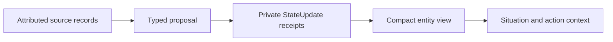
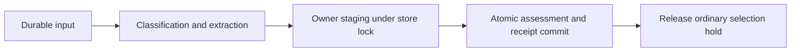
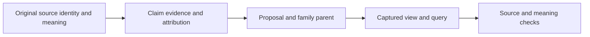

# Entity context

## Purpose and status

A character needs a revisable understanding of other entities across exchanges.
It must distinguish what someone reported, what it inferred, and what remains unknown.
This models continuity and situated interpretation. It does not establish humanlike knowledge or implement deliberate theory of mind.

The owner, receipt stream, projection, and consumer wiring are implemented.
Current checks cover immediate model extraction, persistence, and acceptance boundaries.
Sustained character quality and deliberate ToM remain separate beta work.

Parent: [cognition](cognition.md).
Related: [situational guidance](situational-guidance.md), [ordinary interaction](ordinary-interaction.md), and [public dialogue](public-dialogue.md).

## One accepted model for each observer

[`EntityContextOwner`][workflows.entity_context.owner.EntityContextOwner] stages accepted interpretations in the existing memory store.
Each family identifies a subject, an observer, and a [record scope](private-ontology.md).
The scope preserves reality and frame boundaries.
An imagined situation cannot become the actual entity's current situation through projection.
Another character's accessible records do not automatically become this observer's knowledge.

The owner retains background, relationship, pattern, situation, perspective, and open-question claims.
Speaker and addressee attribution remain separate from the subject of a claim.
An attributed perspective also names whose knowledge or belief it describes.

| Claim kind | Meaning |
| --- | --- |
| Observation | Evidence from a supported observation source |
| Report | An attributed statement with an exact source quotation |
| Inference | A revisable interpretation of cited evidence |
| Hypothetical | A possibility under consideration |

Confidence qualifies the stated claim kind.
Confidence that Jesse made a report does not prove the report's external truth.
Corrections and challenges reference explicit claim identities. They retain the earlier receipt history.

## Data, execution, and provenance

The owner writes no independent transaction and performs no inference.
Its caller holds the store lock through staging and commit.
The expected family parent prevents a stale proposal from overwriting a newer accepted interpretation.
Typed outcomes distinguish staged, deferred, and rejected proposals.
Broken receipt chains fail loudly.

Data flow:

Early triage extracts immediate entity proposals alongside classification.
The host supplies source fingerprints, clocks, observer identity, and parent identities from the frozen evidence.
Cognitive control stages accepted entity receipts and classification in the same recovery-preserved batch.
A deferred required immediate update keeps classification acceptance pending for refreshed evidence.

Execution flow:

Main cognition, ordinary interaction, and speech receive the compact projection through shared situational guidance.
Entity workspace items render that projection rather than the full receipt payload.
Main cognition stages entity proposals at its final acceptance boundary and records each outcome.
A stale proposal does not discard valid historical appraisal.
An action whose governing entity meaning changed remains deferred for a new decision.
Thought and deliberate ToM behavior remain separate work.

Provenance flow:

## Time and current meaning

[`project_entity_context`][workflows.entity_context.projection.project_entity_context] selects whole claims within a caller-supplied token budget.
It reports omitted claims and retains source dependencies.
Projection performs no model call and changes no memory.
Its UTC world time determines whether a claim is current, due for review, expired, or future.

For example, Jesse can report an absence.
The character can infer that Jesse cannot respond now, with a stated uncertainty and review time.
After that time, the estimate requires review. The clock does not establish that Jesse returned.
Missing, stale, hypothetical, or conflicting support cannot establish current ability or inability.

The view presents ability to receive and ability to respond separately.
These are attributed estimates. They never grant permission to contact someone.
Action selection still considers intentions, preferences, current purpose, and previous moves.
No speech permission agent or automatic contact rule exists in this library.

Writes require the current family parent. Current direction instead compares the relevant projected meaning.
A new receipt identity alone does not invalidate an ordinary choice.
Equivalent reports can preserve meaning; a relevant correction or changed uncertainty can invalidate it.
The captured query and original source guards remain fixed during calculation.
Critical publication barriers and partner-input frontiers still apply independently.

Current validation conservatively rejects a crossed captured review or applicability boundary.
This requires fresh direction even when newer equivalent support could preserve the estimate.
Historical main appraisal does not require the latest family receipt merely because it read an earlier view.

An ordinary stale reply returns its unresolved causes to local selection.
A stale main action instead creates a distinct internal reconsideration event.
That event preserves the selected move without appraising the original user message again.
Task-result reconsideration must preserve the actual terminal receipt and must not repeat task execution.
An explicitly deferred action cannot publish an old draft even if its earlier entity estimate later becomes applicable again.

## Inspection and source map

Compare original evidence, accepted receipts, the captured query, rendered context, and the eventual selected action.
Receipt IDs explain lineage. The projected fingerprint explains current-direction acceptance.
Neither identifier proves that the external entity actually changed state.

- [`EntityContextOwner`][workflows.entity_context.owner.EntityContextOwner] is the canonical owner overview and staging API.
- [`EntityContextClaim`][workflows.entity_context.schemas.EntityContextClaim] defines evidence, epistemic status, perspective, and applicability.
- [`EntityContextView`][workflows.entity_context.schemas.EntityContextView] retains the compact view and captured dependencies.
- [`render_entity_context`][workflows.entity_context.projection.render_entity_context] presents attribution and uncertainty.
- [`expect_entity_context`][workflows.entity_context.projection.expect_entity_context] guards relevant direction at acceptance.
- [`MainCogLoop.defer_public_action`][workflows.main_cognition.host.MainCogLoop.defer_public_action] retains an accepted action for reconsideration.

An empty receipt family means no accepted claims from this mechanism.
Existing identity anchors and attributed narrative context remain available.
Their presence does not establish current availability or completed deliberate ToM.
