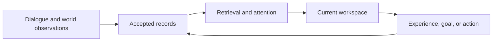

# Experienced memory

A companion needs a record of what happened and what it made of the event.
PM saves dialogue, observations, and accepted cognitive changes in its memory
store. Later cycles can use that evidence to recall an experience or revise a goal.

A cycle reads a stable view. It commits related state changes together before
releasing actions. Retrieval can use cached embeddings and record relationships.
The workspace carries selected records into later decisions.

- [Memory store][pm.memory.store.MemoryStore]
- [Workspace and attention](workspace.md)
- [Consolidation](memory-consolidation.md)
- [Inspect Spamuel’s final memory](../workflows/spamuel-baseline.md)
