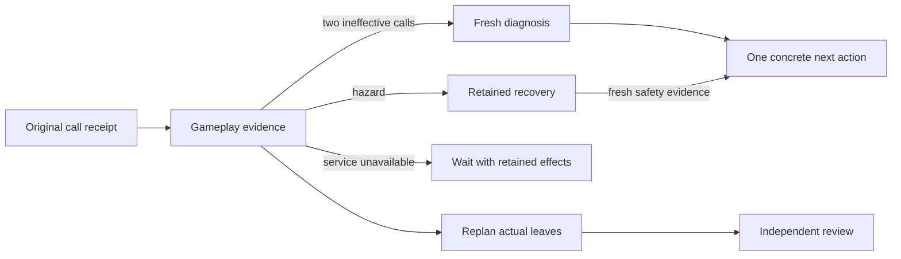

# Expected gameplay failures

## Summary

The sustained actor retains unsuccessful actions as gameplay evidence.
Two ineffective calls pause the unchanged method.
Fresh diagnostic reads support a concrete next action.
Hazards keep recovery active until observations prove safety.
The project planner retains partial work and changes actual leaves.

Parent: [durable projects](minecraft-tasks.md).
Details: [evidence and memory](gameplay-evidence.md) and [verification](../work_items/verification/a13/index.md).
Related: [body interruption](body-recovery.md) and [survival design](../work_items/alpha-plan/minecraft-operations.md).

## Owning code and execution path

The implementation lives in `pm_next_v2`.
[`workflows.minecraft_body.gateway.BodyGateway`][] runs its checks inside the existing serialized command boundary.
The journal retains the original dispatch and result before the actor receives gameplay guidance.
[`workflows.minecraft_body.call_outcomes.GameplayEvidence`][] derives method history, search coverage, service waiting, and recovery from that journal.

The existing sustained `minecraft` workflow activates these checks automatically.
The `minecraft_project` workflow supplies cumulative history from earlier actor attempts.
Its [selector](minecraft-tasks.md#workflow-path) gives an active recovery leaf priority over optional work.
The normal LLM chooses methods and revised leaves.
Laya remains inactive.

## Outcomes

[`workflows.minecraft_body.call_outcomes.classify`][] separates tool outcomes from independent acceptance.

| Outcome | Evidence and route |
| --- | --- |
| `transport_failure` | A connection exception or explicit unavailable-service reason. Retain the uncertain command and wait. |
| `unsuccessful_action` | The tool rejects a game action, yields zero useful output, or reports an empty local search. Diagnose its cause. |
| `partial_progress` | Positive quantities, inventory changes, measured travel, or actual block removal. Retain effects even when the action remains unsuccessful. |
| `changed_assumptions` | A fresh assumption check fails. Retain the original reads and revise affected work. |
| `completion_candidate` | A tool succeeds without sufficient evidence for leaf acceptance. Continue or request independent verification. |
| `completion_evidence` | The independent mechanical checks, interpretation, identity, and journal pairing all pass. Release prerequisites. |

The captured wrong-tool result rejects mining with `can_harvest=false` and supplies no removal or inventory gain.
It remains an unsuccessful action.
Only actual positive quantities or recorded effects can establish partial progress.
A positive construction count cannot establish a complete house.
Routine observation calls stay in the journal and do not create individual cognition events.

## Repetition and diagnosis

[`workflows.minecraft_body.gateway.argument_errors`][] checks operands against the actual upstream JSON schema before dispatch.
The gateway records an `arguments_rejected` event and returns `invalid_arguments` with the field errors.
No action is sent, and this rejection cannot create an uncertain external effect or a service wait.
The actor can correct the operands and continue with the same execution epoch.
An exception after a real dispatch still retains uncertainty and stops further action.

The actor compares omitted optional arguments with defaults from the live tool schema.
For example, an omitted `repetitions` and `repetitions=1` identify the same crafting method.
[`workflows.minecraft_body.call_outcomes.GameplayEvidence.method_key`][] applies these defaults only when comparing actions.
Original journal arguments remain unchanged, and a different repetition count stays distinct.

A method signature includes the tool name and actual argument values.
It excludes only `limit` and `include_image`.
Two unsuccessful calls without positive output pause that method.
Positive partial output resets the ineffective count while the action remains unsuccessful.
Walking compares the last reported feet position with the new result's position.
`moved_blocks` records the distance in blocks.
At least half a block counts as useful walking progress; smaller motion remains a recorded effect.
Missing position evidence cannot establish travel.
Fine control compares its own `pose_before` and `pose_after` when translation or jumping is requested.
Any recorded positive step remains useful, including steps below half a block.
An input acknowledgement with zero displacement is `unsuccessful_action` with reason `no_motion`.
Missing poses produce `motion_unobserved`; they cannot establish travel.
Two ineffective motion actions pause walking and fine control across changed operands.
Input-release calls remain available because they request no movement.
Fresh body observation and a relevant diagnosis are required before another stalled motion attempt.
Consumed inventory remains an effect; consumption alone cannot establish useful output.
The gateway returns `method_paused` before it sends another matching call.

The private `actor_diagnose` tool accepts a cause, current-journal read sequences, a next tool, and exact next arguments.
Each returned world receipt includes `journal_sequence` for these references.
The reads must remain usable and occur after the latest ineffective result.
An unchanged method also needs changed observed position, held equipment, or inventory.
Clock changes, camera rotation, and different explanatory wording cannot release it.

The accepted diagnosis permits one exact next call.
The journal retains its cause, read sequences, operands, instruction revision, and time.
An execution epoch change clears an unused permit.
Fresh observations and the original failure history still apply after restart.
Tool replies include compact decision facts and the projection path.
Full method preconditions and outcomes remain in `scratch/gameplay-evidence.json`.
This prevents repeated diagnosis replies from consuming the actor's context during recovery.

Walking also has one shared ineffective count across exact, visible, and surface tools.
Two failed walks without useful displacement pause further walking, even when their destinations differ.
A new walking diagnosis must cite a fresh body observation after the latest ineffective action.
This check exposes changed position, health, air, and supplies before another approach.
Useful observed travel or a supported changed body observation resets the shared count.
The exact-operand checks still apply independently.
The `navigation` projection retains this count, the last walking outcome, position, and observation time.
An older planning observation cannot replace the newer position or clear a current stall.

Different coordinates can represent another approach without proving that it is useful.
The survival prompt requires a relevant diagnosis instead of arbitrary coordinate changes.
Real adaptation evidence must establish that semantic requirement.

## Recovery priority and completion

Recovery starts from reduced oxygen, unexpected health loss, low health, low food, or liquid in the reported body space.
An observation with `in_water=true` starts water recovery even when air remains full.
The actor must establish dry supported ground before it resumes optional work.
Exact inspections can also establish an adjacent lava edge beside the floor, feet, or head.
The projection retains those lava positions.
The current deployment reports oxygen as 0 through 20 bubbles.
Low health means at most one quarter of `max_health`.
Low food means at most six points on the 20-point scale.
The `food` acceptance primitive checks an independent body observation against its numeric `minimum`.
Recovery uses at least seven food points; `alive` establishes only positive health.
These conservative thresholds live in `GameplayEvidence.consume`; they are not claims about vanilla damage timing.

While recovery remains active, each mutation needs `actor_diagnose` with `recovery_action=true` and a safety reason.
Read-only diagnostic tools and emergency stop remain available.
The permit binds exact operands; it does not grant an unrestricted sequence.
The model remains responsible for choosing an action that actually supports the recovery target.

Recovery clears only after two fresh observations show full oxygen, stable health, ground support, sufficient food, and dry state.
Both observations must retain the observed body session and death count.
The body session scopes that counter to one Node process.
A counter increase records a failed recovery and blocks mutation in the current actor epoch.
Respawn can restore health and food; those values cannot establish that the old hazard was survived.
The actor must return `replan` before a new attempt reconciles lost inventory and current geometry.
Missing lifecycle metadata fails recovery proof.
Fresh exact block inspections must also establish dry body space and a solid safe floor.
Non-solid dry grass can satisfy body space.
Water, lava, fire, powder snow, bubble columns, magma, and cactus cannot satisfy it.
Typed adjacent cells in an original inspection supply exact geometry with the same source and time.
Missing collision fields cannot establish a safe landing.
A `reached` movement result cannot substitute for those facts.
Recovery navigation also requires inspected dry destination cells before dispatch.
The destination identifies the feet cell above the floor.
An occupied floor cell or missing head-space evidence cannot authorize that navigation.
`walk_to_visible` can stop beside a landing in water, so recovery guidance recommends `walk_to_exact` for known dry landings.
A failed escape changes the method while the recovery target remains active.
Dry body space alone cannot prove retreat from a recorded adjacent lava edge.
The body must move beyond that adjacency or fresh inspection must establish a changed lava cell.
Recovery guidance supplies exact floor, feet, and head positions from `camera.block_position`.
Rounding floating feet coordinates can select the wrong cell, especially at negative coordinates.
The actor cannot propose accepted completion while recovery remains active.
After one reachable dry landing is observed, the guard pauses extra distance, relative-coordinate, and path previews.
The actor must diagnose and execute an escape action, then obtain fresh safety observations.

An observation identifies direct body danger.
Typed exact inspections identify the immediate lava edge described above.
More distant lava or a flooded excavation still requires the survival prompt's assessment before further work.
The current implementation does not infer every threat from screenshots or nearby terrain summaries.

## Replanning and deferral

[`workflows.minecraft_project.history_encoding.gameplay_history`][] supplies cumulative methods, search coverage, recent outcomes, and active recovery to planning.
Replanning after a requested method change must add, revise, or defer a concrete leaf.
An unchanged tree with a different explanation returns `invalid` before dispatch.
Unchanged accepted nodes keep their identities and certificates.
Original inventory baselines prevent repeated increments after partial work.
[`workflows.minecraft_project.tree_store.validate_tree`][] reports the affected node, condition, and certificate source when a proposed reference fails.
For a leaf, the message lists allowed prerequisites and explains the required direct `depends_on` reference.
The planner repairs the proposal and submits it to the same validation rules.
Later proposals can replace or add explicit nodes through `updates`; omitted nodes remain unchanged.
The merged complete tree still passes those same rules and independent review.
When no recovery leaf is ready, active recovery supersedes an earlier optional refinement restriction.
Once a recovery leaf is ready, the named refinement boundary applies again.

[`workflows.minecraft_project.schemas.Node`][] supports `deferred=true` with an explicit `defer_reason`.
Only a leaf can be deferred.
The selector skips it while other ready work proceeds.
Its specification, attempts, and world effects remain.
Deferral cannot establish final project acceptance.

The selector requires a prerequisite-ready `recovery` specialist leaf while recovery remains active.
Without one, it requests replanning instead of releasing an optional leaf.
Independent review still checks each revised specification.

## Service waiting and cancellation

A transport exception retains an uncertain result and stops the actor.
Typed service failures from observation tools also enter service waiting.
They do not pause the unchanged observation method as a gameplay failure.
The parent keeps the attempt and enters its existing waiting phase.
It does not repeat the mutation or poll the service through a hidden worker.
After an answer or explicit restart recovery, planning obtains fresh body state.
The actor reconciles retained targets before mutation.

Cancellation retains all original evidence.
It cannot undo a mined block or consumed item.
The existing [leases and epochs](body-leases.md) govern ownership and cleanup.
No outcome category grants permission to replay an uncertain action.

## Go deeper

Read [gameplay evidence](gameplay-evidence.md) for durable records and meaningful cognition events.
Read [verification](../work_items/verification/a13/index.md) for real receipts, commands, and outstanding acceptance.
