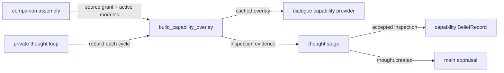

# Implementation inspection and the self-model

## Summary

The companion can inspect selected parts of its own implementation and
records.
It separates design, wiring, and observed execution.
It revises capability beliefs from evidence and keeps the earlier versions.
An explanation cites the records and files it read.
A missing record produces an explicit limit instead of a reconstructed
mechanism.

A18 delivers this subsystem.
It builds on the private thought loop from A17 and the scoped memory tools
from A14B.

Parent: [cognitive pipeline](cognition.md).
Design: [self-model and reflection](../work_items/alpha-plan/reflection.md).
Work item: [A18](../work_items/alpha-plan/work-items/a18.md).
Evidence: [A18 verification](../work_items/verification/a18-self-model.md).
Runtime: [`pm.introspection`][], [`workflows.introspection.snapshot`][].

## Where it runs

The subsystem has a pure part and a workflow part.

| Layer | Module | Owns |
| --- | --- | --- |
| Pure rules | [`pm.introspection.grants`][] | the source grant, path checks, digests, and revision |
| Pure rules | [`pm.introspection.capabilities`][] | the per-state capability overlay |
| Pure rules | [`pm.introspection.episodes`][] | episode views and the inspector questions |
| Pure rules | [`pm.introspection.self_model`][] | capability and narrative beliefs |
| Wiring | [`workflows.introspection.snapshot`][] | the live overlay from configuration and receipts |
| Trigger and commit | [`workflows.inner_thought.host`][] | the private cycle that inspects and commits |

The private loop inspects and commits.
The dialogue modules read the cached public projection.
No new loop and no second tracing framework exists.

## Source grant

A grant is explicit and narrow.
It names its roots, its include patterns, its exclude patterns, and its size
limits.
[`pm.introspection.grants.SourceGrant`][] validates the roots at construction.
[`pm.introspection.grants.SourceInspector`][] checks the policy on every call.

The rules are:

- Credential patterns always apply.
  They cover `.env`, keys, tokens, passwords, `.git`, `.venv`, and runtime
  directories.
  The caller can add patterns, never remove one.
- Exclusion wins over inclusion.
- A reference resolves against the roots.
  The inspector compares the resolved path, so `..` and a symlink cannot
  escape a root.
- A read returns the full-file SHA-256 digest, the repository revision, the
  configuration revision, and the observation time.
  The digest is evidence.
  It is not a promise that the running process imported that file.
- A file above the byte limit is refused.
  A page is bounded by the line and offset arguments.
- Cancellation stops a read before it returns content.

The default grant is `pm.introspection.grants.build_default_grant`.
It covers Python source, workflow manifests, documentation, and example
configuration under the repository root.

## Capability overlay

The overlay answers "what can this running instance do?" with separate
evidence per state.
It never collapses the states into one flag.

| State | Evidence |
| --- | --- |
| Intended | a plan or documented requirement |
| Implemented | source with an identified entry point |
| Enabled | an active assembly, configuration, model connection, or tool grant |
| Observed | a receipt or trace showing actual execution and its result |
| Unavailable | a missing endpoint, missing grant, or explicit limit |
| Uncertain | no plan, source, wiring, or receipt was found |

A screenshot tool can be enabled without an observed image interpretation.
A thought schema can exist while the private loop is disabled.
A tool name alone never becomes an observation.

[`pm.introspection.capabilities.CapabilityDeclaration`][] names the evidence
for one capability.
[`pm.introspection.capabilities.build_overlay`][] collects it into
[`pm.introspection.capabilities.CapabilityFinding`][] values.
Each finding keeps its full per-state evidence and one convenience
`strongest` state.

The overlay revision is a hash of the stable evidence rows.
Observation time is excluded from the hash, so an identical finding keeps its
revision.
A changed source digest changes the revision.
[`pm.introspection.capabilities.CapabilityOverlay.stale_names`][] compares the
current revision with the previous overlay.

The live builder is
[`workflows.introspection.snapshot.build_capability_overlay`][].
It reads the real repository, the active module ids, and the real accepted
records.
[`workflows.introspection.snapshot.observed_capability_receipts`][] derives
observations from committed dialogue, inner thoughts, capability beliefs, and
completed Minecraft runs.

## Cognitive episodes

An episode is a read-side view over records the runtime already keeps.
It adds no second trace store.
[`pm.introspection.episodes.EpisodeIndex`][] builds episodes from:

- committed GWT turns: claimed stimuli, shard changes, codelet runs, the experience, and the decision record;
- committed private thoughts;
- action schemas;
- managed-run receipts.

Each episode names its kind, loop, tick, operation, owner, summary, and
outcome.
The outcome is `committed`, `idle`, `rejected`, `cancelled`, `failed`, or
`unresolved`.
An incomplete episode stays queryable.
A cancelled cycle and a rejected proposal are episodes, not missing rows.

Causal links are explicit.
The `links` field maps `cause`, `evidence`, `output`, `proposal`, and
`dispatch` to record ids.
Timestamp order never establishes a cause.
Parallel main and inner events keep distinct identities.
`EpisodeIndex.cross_loop_links` returns a main/inner pair only when the main
episode's evidence or cause links name the inner episode's output record.

## Inspector questions

[`pm.introspection.episodes.answer_questions`][] answers the A18 acceptance
questions from retained records.
Every answer names its evidence records.
A question with no retained evidence returns an explicit limit.

| Question | Source |
| --- | --- |
| What information was available? | the frozen input ids and their revisions |
| Which event led to this concern? | producer and cause links |
| Which alternatives competed? | recorded nominations and dispositions |
| What changed after the decision? | commit, dispatch, and output references |
| What was retrieved or inferred? | retrieval ids and the reality label |
| What can this instance do? | the capability overlay |
| What remains planned or unobserved? | findings without observed evidence |
| How did a private thought affect an action? | explicit cross-loop links |
| Why did this belief change? | supporting and opposing records with revision history |

## Self-model beliefs

Capability and narrative beliefs reuse
[`pm.records.cognitive_records.BeliefRecord`][] and
[`pm.records.cognitive_records.BeliefShiftRecord`][].

[`pm.introspection.self_model.record_capability_beliefs`][] stages one belief
per inspected capability.
The belief cites the evidence revision it read.
An identical finding on the same revision is retained and adds no confidence.
A changed finding supersedes the old belief and records one shift.
The old belief stays linked through `superseded_by_id`.

[`pm.introspection.self_model.mark_stale_beliefs`][] marks a dependent belief
stale after a source or configuration change.
The belief stays active and keeps its original evidence.
The metadata records when and why it became stale.

[`pm.introspection.self_model.record_narrative_belief`][] stages a revisable
autobiographical interpretation.
It cites the episodes it read.
A later interpretation on the same topic supersedes the earlier one while the
earlier episode references stay in history.
A one-off speculation never becomes a permanent identity verdict.

A capability belief stays separate from the emotional reading of that
capability.
The private loop commits the belief.
The main loop appraises the `thought.created` event through ordinary
appraisal, so a source-backed limit can produce sadness, curiosity, relief, or
disagreement without changing the inspected facts.

## Operations and triggers

A18 adds two private operations in the `inspect` group:

| Operation | Meaning |
| --- | --- |
| `capability_inspection` | read the active capability evidence and state what is enabled, observed, planned, missing, or uncertain |
| `episode_inspection` | inspect one retained episode and answer the inspector questions, naming an evidence limit when a trace is missing |

The `capability_doubt` trigger fires when an inspected capability is stale, or
is only intended, implemented, unavailable, or uncertain.
Its suggested operations are `capability_inspection`, `episode_inspection`,
and `memory_gap_probe`.

The host builds the inspection evidence in
`PrivateThoughtLoop._build_inspection`.
A provider failure becomes a reported evidence limit.
It never stops the private cycle.
The thought stage renders the evidence through the `{inspection}` prompt slot.
When the cycle performs `capability_inspection`, the host stages the
capability beliefs in the same commit batch as the thought.

## Configuration and activation

The subsystem activates with real cognition.
[`workflows.companion.build_app`][] builds the overlay once at assembly time
and stores it on the application.
The private loop rebuilds it each cycle and keeps the previous overlay as
history.
The dialogue capability provider reads the cached public projection.

There is no separate configuration switch.
The source grant is a code boundary, not a user setting.
To narrow the grant, call
[`pm.introspection.grants.SourceGrant.narrowed`][] or construct a grant with
an explicit include list.

## Failure modes and diagnostics

| Symptom | Cause | Check |
| --- | --- | --- |
| `SourceDenied` on a read | the path is outside the grant or matches a credential pattern | print the grant `to_dict()` and the resolved path |
| A capability shows `unavailable` | the declared source file is missing or denied | check the declaration `implemented_refs` |
| A finding revision changes every cycle | observation time leaked into the hash | confirm `_revision_of` strips volatile fields |
| A stale belief is not marked | the previous overlay was not attached | confirm `rebuild_overlay` sets `overlay.previous` |
| No inspection evidence | no `inspector_provider` is set | confirm real cognition wiring in `build_app` |
| An inspector answer has a limit | the source record is absent | read the limit text; do not reconstruct the trace |

Inspect a real result by reading the committed `BeliefRecord` records whose
`metadata["memory_kind"]` is `capability_belief`, and the thought metadata
field `capability_states`.

## Limits

- The private loop rebuilds the overlay on every timer tick, even when no
  trigger fires.
  The repository revision is cached per process, so the tick costs file
  digests and one record scan, not a subprocess.
  A later item can throttle the rebuild.
- The inspector reads an application-level record view.
  It does not read a model's hidden inference process or learned
  representations.
- A generated rationale is an attributed interpretation.
  It is not a newly discovered execution fact.
- The overlay reports the installed distribution separately from a sibling
  checkout only when the caller records both.
  The default builder records the repository revision, not the import origin.
- Narrative and capability beliefs are revisable.
  Neither replaces the original events.
