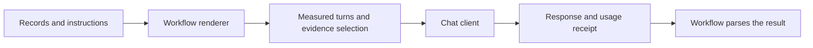

# Model requests and context

A model needs the character’s immediate situation and relevant memories.
Context preparation fits those inputs into the serving window and reserves room for output.

The workflow owns evidence selection and meaning. The model session supplies the
serving limits. The transport encodes the prepared turns and sends them.
Configuration controls the context cap and input fraction.

- [Model session][pm.llm.session.ModelSession]
- [Chat transport][pm.llm.activation.ChatClient]
- [Renderer input and output][pm.context_render.prompt.RenderedPrompt]
- [Context planning](context-planning.md)
- [Prompt logs](prompt-log.md)
