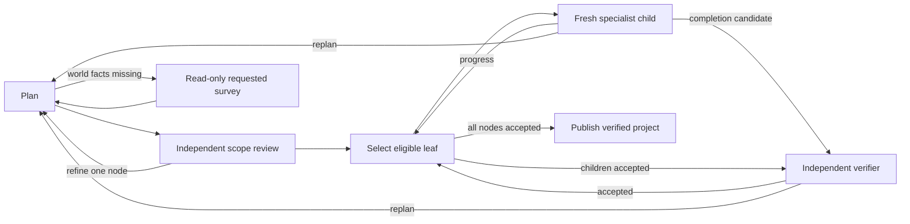

# Durable Minecraft projects

## Summary

The `minecraft_project` workflow plans generic goals as durable goal/story/leaf trees.
Independent review checks the plan before execution.
Fresh specialist sessions perform meaningful leaf outcomes.
Independent observations establish acceptance and release prerequisites.
Specifications, attempts, and verification receipts remain separate.

Parent: [managed work](managed-work.md).
Related: [sustained actor](minecraft-actor.md), [task evidence](minecraft-task-evidence.md), and [A11 verification](minecraft-task-verification.md).

## Place in the system

[`main._managed_workflows`][] registers the project beside the existing single-leaf `minecraft` workflow.
The cognitive action catalog recommends the project for goals with several dependent outcomes.
User appraisal can select its ordinary managed-start path.
Any future private-loop caller can use that same path.
A11 does not activate the private loop.

The supervisor adds the current companion identity, character card, and accepted public context.
Specialists remain private parts of that companion.
Only the existing public-dialogue pathway speaks to the user.
An inventory question retains its direct Assistant observation path.

## Input and result

[`workflows.minecraft_tasks.schemas.ProjectRequest`][] accepts a goal or instruction, body identity, persona context, and optional proposed specification.
`plan_only=true` retains an independently reviewed plan without world mutation.
It does not establish an executed project.
Ordinary execution writes `outbox/report.yaml` with schema `pm.minecraft-project-report.v1`.
Its `verified` flag requires retained independent evidence for every leaf, story, and goal.

[`workflows.minecraft_tasks.schemas.TaskTree`][] contains stable IDs, hierarchy, dependencies, acceptance criteria, and relevant assumptions.
Goals and stories have children.
Leaves have no children and describe meaningful outcomes.
The model can choose any feasible goal content within the configured Minecraft action space.
House and resource scenarios are acceptance fixtures, rather than goal categories.

## Workflow path

The executable manifest declares every progress, completion, replanning, waiting, and blocked route.
[`workflows.minecraft_tasks.steps.run`][] performs one declared Python role.
The planner and reviewer use separate scoped normal-LLM calls.
The planner can return `survey` with explicit world-query operands.
The survey phase reads those operands without an actor or world mutation.
It retains original results under `planning/requested-surveys/` and returns them to planning.
These reads supply terrain or inventory facts. They cannot accept a task.
An instruction change discards the pending query before it runs.
Before review, the runtime surveys the proposed block and region operands through read-only MCP calls.
Shared cells appear once, even when parent and child specifications repeat them.
Review also receives the validated leaf-prerequisite graph and original inventory baseline.
Read-only recipe lookups for exact inventory names supply ingredient counts and recipe output counts.
Their retained stock counts describe the observation time; they do not establish future crafting or current acceptance.
The original results remain in `planning/surveys/`; decision inputs retain relevant fields and original-result digests.
These observations describe the current site. They do not require future construction conditions to hold yet.
Later replanning receives the retained survey with its exact specification identity and observation times.
After verification, replanning receives the latest original verifier scope, operands, checks, and reads.
It keeps the earlier survey's identity, path, and digest instead of adding duplicate historical cells to that repair input.
Independent review surveys each revised specification again.
The selector uses deterministic graph and evidence checks.
It verifies ready stories before selecting leaves that depend on those stories.
This preserves an attained material contract before construction consumes the stock.
Dependent work requires the story certificate and its guarded child certificates.
References to a stable node remain valid when refinement changes that leaf into a story.
Final publication retains verified attainment instead of requiring consumed materials again.
The specialist dispatcher invokes the existing leaf manifest in a separate attempt folder.
The leaf retains native pm-coder history handling and automatic compaction.

## State ownership and revisions

[`workflows.minecraft_tasks.tree.TreeStore`][] owns one managed task folder.
`planning/state.json` indexes immutable specification snapshots, attempts, decisions, and active acceptance receipts.
It keeps the original project observation separately from the latest observation.
Replanning receives both. An unchanged relative inventory request keeps its original baseline after partial work.
The supervisor owns the Ghost receipt and its artifact-directory reference.
No second Ghost or bus owns project state.

Each revision writes `planning/specs/NNNN.json` before it updates the active index.
Evidence commits retry a transient file lock locally, up to five attempts with 50, 100, 150, and 200 millisecond waits.
A persistent lock fails explicitly. It cannot trigger the outer runner's generic permission-error phase retry.
Other role file-access permission errors also fail the project and retain its world receipts.
Runtime code assigns tree and node revision counters.
Unchanged node content retains its revision and acceptance.
Changed content invalidates that node and dependent acceptance.
Old verification files remain available after invalidation.

Controlled refinement can turn a selected leaf into a story with new descendants.
It preserves the selected acceptance conditions and every unrelated specification.
The separate `revise` outcome repairs incorrect or incomplete acceptance conditions.
Stable nodes cannot disappear or move to another parent.
Missing dependencies, dependency cycles, hierarchy cycles, duplicate IDs, and inconsistent parent references fail before dispatch.
Dependencies on a story expand to all its leaves.
Ancestor dependencies also apply to descendant leaves.

## Configuration and limits

The project uses the configured normal LLM through `minecraft_reason`.
It does not require Laya.
Planner, reviewer, and verifier calls disable hidden thinking, like native actor sessions and cognitive action selection.
Each decision retains that generation setting beside its exact messages.
There is no output-token cap that could truncate a specification or verdict.
Direct decisions receive one scoped snapshot with an explicit 120,000-character input budget.
Planner snapshots omit fields whose defaults the supplied schema defines.
That tree representation restores the exact full specification through schema validation.
Malformed model output stays intact as repair input; it cannot become an accepted tree.
Inputs persist before the budget check, including their measured character count.
Verifier snapshots preserve required positions, names, counts, vitals, and original-result hashes.
Oversized inputs fail explicitly; the caller never silently removes required evidence.
This budget is separate from the serving model's token context.
Native actor sessions retain their own context discovery and compaction.
The workflow kernel retains its existing 999-visit backstop for each cyclic phase.
The project adds no actor tool-call ceiling or fixed leaf count.

`MINECRAFT_MCP_URL` selects the real MCP endpoint.
Specialists receive the live tool schemas and existing compiled survival resources.
The resource compiler also appends local specialist guidance from `workflows/minecraft/guidance/` when that file exists.
The manifest records its path and hash separately from the unchanged upstream skill sources.
Builder guidance covers observed placement collisions and vegetation clearance.
The repaired body uses normal digging for grass and tall grass despite their empty collision bounds.
The actor adds this current behavior to the mining tool description used for model selection.
`inbox/original-tool-schemas.json` retains the original descriptions and argument schemas for the exposed live tools.
`inbox/tool-schemas.json` retains the effective descriptions and unchanged tool argument schemas.
Screenshots remain separate artifacts.
The configured text actor and verifier do not interpret their pixels.

## Failures and recovery

An invalid model proposal retains its raw output and exact validation error.
The declared `invalid` outcome returns that evidence to scoped planning before any dispatch.
It does not accept or normalize a malformed dependency graph.

An actor's `complete` outcome becomes a verification candidate.
It does not release dependencies.
Invalid native completion JSON remains a rejected attempt with its original session trace and world journal.
After child cleanup, the parent routes to replanning with fresh observations.
It does not invent required fields or treat the invalid candidate as accepted work.
A failed verification returns its unmet conditions to the planner.
Repeated yielded attempts with identical observed state request a changed method.
Waiting suspends through the existing managed question-and-answer mechanism.
The answer resumes planning from the retained folder.
There is no automatic polling of an unavailable external service.

[`runtime.cancellation.LinkedStopEvent`][] links each actor's local stop to the parent cancellation signal.
Parent cancellation stops all current and later child work.
A gateway uncertainty stops only that actor.
After cleanup, the parent retains its original unpaired call and asks the planner to obtain fresh world state.
It does not retry the world command automatically.
Instruction updates invalidate the selected leaf before its next tool dispatch.
The dispatcher retains existing world effects and requests replanning.
Cancellation cannot undo an external call that already started.
The existing actor cleanup waits before releasing body ownership.

A11 persists plans and evidence but does not automatically resume interrupted world actions.
The supervisor records an interrupted run after restart.
Cross-process ownership, epochs, and interruption recovery remain A12 work.

## Go deeper

Read [independent evidence](minecraft-task-evidence.md) for observation primitives and public claims.
Read [verification](minecraft-task-verification.md) for real commands, inspected results, and remaining limits.
