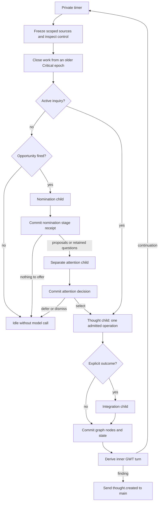
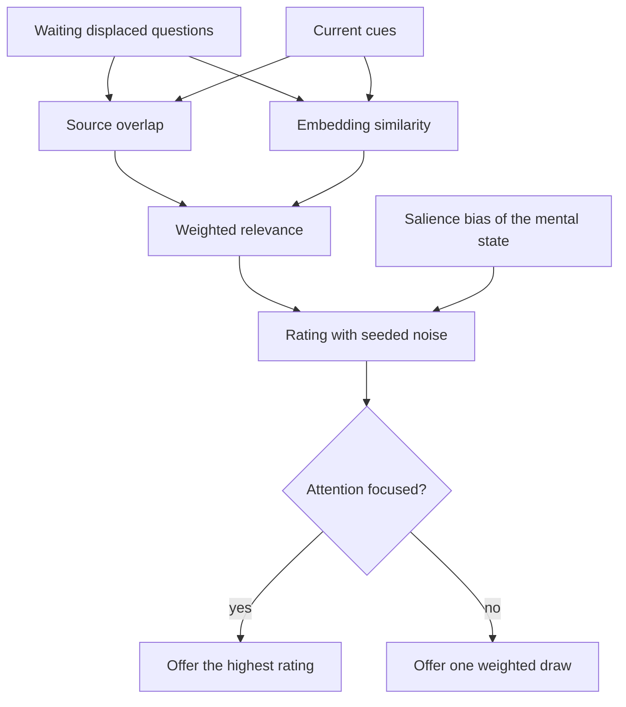
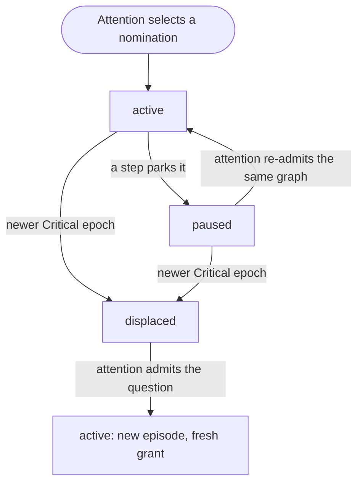
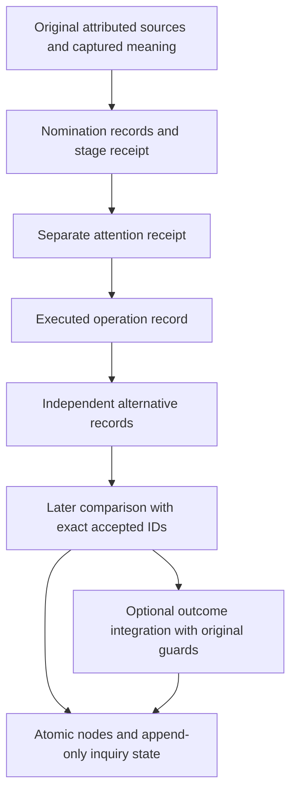
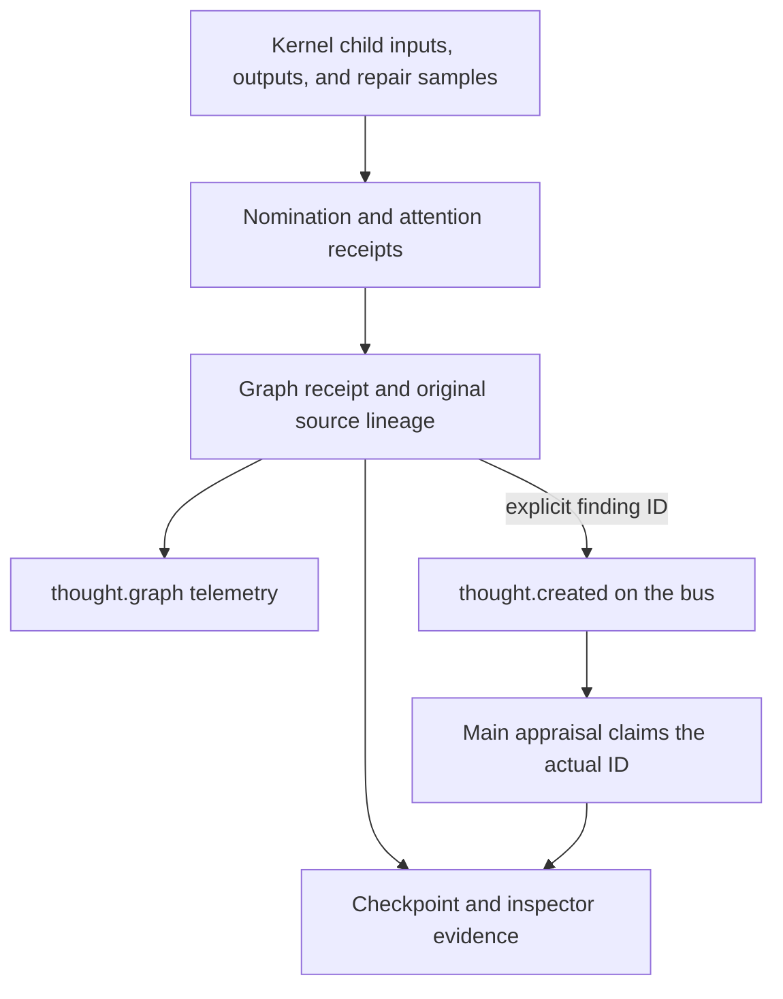

# The private thought loop

## Summary

The private loop gives the companion a place to explore a concern without a conversation partner.
A possible thought, a selected question, an executed operation, and a finding remain separate events.
Attention can decline an interesting possibility without pretending that the companion already examined it.
This mechanism models aspects of private cognition. It does not establish humanlike consciousness or emotion.

**Partial implementation.**
The application binds its timer to nomination, shared attention selection, and bounded inquiry graphs.
An unrelated ordinary message no longer discards a private step that is already calculating.
Actual-store checks and recorded scenario replays cover storage, recovery, and that continuity boundary.
They do not establish generated thought quality.
The <a href="../../dev/work_items/beta-b05.md">B05 engineering record</a> contains current verification results and their limits.

The canonical owner is [`workflows.inner_thought.host.PrivateThoughtLoop`][].
The parent architecture is the [cognitive pipeline](cognition.md).
[Deliberate mental work](deliberate-mental-work.md) and [private reflection experiments](reflection.md) retain separate execution paths for now.
Their migration to shared inquiry remains designed.

## Where the loop runs

The application assembles main and private cognition on one bus, one memory store, and one companion identity.
The private loop uses a timer rather than a bus subscription.
Its default period is 30 seconds through [`workflows.companion.build_app`][].
A main event therefore cannot directly cascade into another private cycle.

An accepted [inference wait](inference-wait.md) prevents routine private admission.
The host also checks classification and Critical reconsideration before inquiry entry.
Those checks now describe *admission and acceptance authority*, not generic input arrival:
see [What supersedes private work](#what-supersedes-private-work).

The parent manifest remains `workflows/inner_thought/inner_thought.workflow.md`.
Its injected `run_private_inquiry` tool calls [`workflows.inner_thought.graph_execution.run_graph_opportunity`][].
Child stages use the existing workflow kernel and configured model transport.
Private stages receive a frozen read-only memory environment, without the public grounding block.

## Execution flow

One invocation can retain a nomination batch, select attention, and execute one graph operation.
A later timer opportunity can continue the accepted graph without main appraisal of each intermediate node.
Only an explicit outcome produces a finding for main appraisal.
A storage bound can pause unfinished work without an integration call or finding event.

The coordinator reuses a retained nomination result for the same captured opportunity.
Its identity depends on source guards, main guidance, and fired triggers, rather than a fresh timer invocation ID.
An empty batch retains its reason and is not an executed thought.
An accepted attention decision also prevents repetition of that selection call for the same batch.

Runtime parked re-entry is wired: a parked question competes for the slot inside the same attention
decision as fresh nominations, and only that decision can re-open it.
Deliberate-action admission exists at the owner boundary through
[`workflows.inner_thought.graph_host.PrivateInquiryOwner.accept_deliberate_entry`][], while the
deliberate path that would call it remains designed work.
Work admitted under an older Critical epoch is closed before anything else happens in the opportunity.
The coordinator never replaces an original epoch with a newer value; see [Displacement by Critical reconsideration](#displacement-by-critical-reconsideration).

### Explicit parked admission

Typed resume staging is available through [`workflows.inner_thought.inquiry.stage_inquiry_resume`][] and [`workflows.inner_thought.graph_host.PrivateInquiryOwner.accept_resume`][].
An explicit [`workflows.inner_thought.schemas.InquiryResumeDecision`][] names the admitted operation, its reason, and any new outside evidence.
The original parked deadline or newly supplied original outside evidence permits reconsideration.
Generated thoughts cannot serve as independent outside triggers.

Staging requires the exact paused parent and preserves its nodes, source fingerprints, observer, reality, and Critical epoch.
The original operation count and active-time budget remain unchanged.
Admission creates no executed operation, GWT turn, or finding.

[`workflows.inner_thought.inquiry.parked_offer`][] builds a reconsideration only when the retained deadline has elapsed or outside evidence newer than the pause exists.
[`workflows.inner_thought.graph_execution.parked_candidate`][] reads the observer's eligible parked work each opportunity and delivers that single offer beside the nominations, because one observer holds one private slot.
It examines parked heads from newest to oldest by receipt allocation order and offers the first eligible head.
An exhausted newer inquiry cannot hide older eligible work. A different current Critical epoch excludes the retained inquiry.

[`workflows.inner_thought.graph_execution.admit_opportunity`][] makes the one paid selection call and routes its outcome.
Selecting a parked receipt commits the attention outcome and the resume in one store batch through [`workflows.inner_thought.graph_host.PrivateInquiryOwner.admit_parked_inquiry`][], so a restart cannot pay for the same decision twice.
Both parked admission and parked-only deferral check the captured focus head and its original expiry under the store lock.
Changed or expired advice leaves the opportunity unconsumed for fresh selection.
A decision that admits nothing still leaves one durable outcome behind through [`workflows.inner_thought.graph_host.PrivateInquiryOwner.record_attention_outcome`][] and [`workflows.inner_thought.inquiry.stage_attention_outcome`][].
Both carry the opportunity's attention batch identity, which the host reads back before spending another selection call.

### Displacement by Critical reconsideration

A Critical message makes the character reconsider its situation.
An inquiry admitted before that reconsideration holds a grant from an authority the character no longer has.
The inquiry therefore cannot continue. Its question is a different matter: the message interrupted the thinking, it did not answer the question.

The loop separates the two.
The first private opportunity after the accepted reconsideration closes every active or parked inquiry from the older epoch.
[`workflows.inner_thought.graph_host.PrivateInquiryOwner.displace_superseded`][] commits one terminal `displaced` receipt per inquiry through [`workflows.inner_thought.inquiry.stage_inquiry_displacement`][].
That receipt makes no model call, executes no thought, and creates no GWT turn.
It frees the private slot at once, so the same opportunity can nominate and admit new work.
The closed episode keeps its grant, nodes, operation count, and active duration as readable history, and it accepts no further transition.
The displacement does not depend on the old source fingerprints: the inquiry ends whether or not its sources changed.

The question returns as an offer, not as a continuation.
[`workflows.inner_thought.graph_execution.displaced_candidate`][] chooses one displaced question that no episode took over, and [`workflows.inner_thought.inquiry.displaced_offer`][] names it for shared attention as a [`workflows.inner_thought.schemas.DisplacedInquiryOffer`][].
It competes in the same single attention decision as fresh nominations and parked work.
Unlike parked work it needs no elapsed deadline and no new outside evidence, because the inquiry itself never chose to stop.

#### Which displaced question comes into focus

Several displaced questions can wait, and the attention prompt offers one.
A single waiting question is offered without any measurement.
With several, [`workflows.inner_thought.offer_salience.select_retained_offer`][] rates each one against what the private mind holds right now.
Those cues are the records the private stages can already cite, plus the summary of the newest main turn; [`workflows.inner_thought.offer_salience.attention_cues`][] reads them from the frozen request.

Two separate signals feed the rating:

| Signal | Meaning | Value |
| --- | --- | --- |
| Source overlap | the context holds an original record the question came from | share of the question's source roots among the cue records |
| Similarity | something in the context means nearly the same, whichever record it is | highest embedding cosine between the question and any one cue |

The relevance is their weighted sum, with equal weights for now.
Seeded noise is added, and the accepted mental state decides how strictly the top rating wins.
Focused attention offers the highest rating. Wider attention samples one question by rating, so a weakly cued question can still surface.
This is the same sampling the main loop uses for a codelet's view in [`pm.records.situational_model.SituationalModel.snapshot_for`][], driven by the same salience bias from [`pm.records.mental_state.compute_attention_bias`][].

The selection only decides which question the attention stage sees. It grants nothing, and the attention decision still admits, defers, or dismisses.
The random generator is seeded with the opportunity's own identity, so a restart offers the same question for the same opportunity.
Rating several questions costs one embedding request for the question and cue texts. An opportunity that already has an attention outcome returns before that request.

Every attention outcome of the opportunity keeps the full selection as [`workflows.inner_thought.schemas.RetainedOfferSelection`][] on its [`workflows.inner_thought.schemas.ThoughtAttentionReceipt`][]: each question's shared sources, similarity, most similar cue, noise, and rating, plus the seed and the mode.
The selection is not part of the attention prompt.

*Verified implementation example* (real embedding endpoint, synthetic texts): two questions waited, one about an unfinished harbour sketch and one about a dripping kitchen tap.
A new remark about a leaking pipe under the sink shared no source with either. It rated the tap question at similarity 0.40 and the sketch question at 0.06.
A private thought about the half-painted harbour picture rated the sketch question at 0.45 and the tap question at 0.06.
Holding the tap's original report again gave the tap question a source overlap of 1.0 and a rating of 0.83.

Admission opens a new episode through [`workflows.inner_thought.inquiry.stage_displaced_inquiry`][] and [`workflows.inner_thought.graph_host.PrivateInquiryOwner.admit_displaced_inquiry`][].
The new episode starts with no nodes, operation count zero, and no active duration, under a grant captured from the current view at the current epoch.
Its origin is the displaced receipt, which [`workflows.inner_thought.schemas.InquiryOrigin`][] records as `displaced_inquiry`.
The earlier nomination judgments do not carry over, because they were made under the superseded authority.

`displaced` is terminal for its episode and holds no slot.
The last edge creates a different episode; the closed one stays closed.

The earlier nodes reach the new episode's thought stage as `earlier_artifacts` of [`workflows.inner_thought.graph_execution.GraphThoughtRequest`][].
The stage instruction calls them the character's own earlier thinking, made before the reconsideration: not outside evidence, not observations, and not corroboration.
Three guards back that wording.
An earlier artifact is never a relation target or a compared node, because it is not a node of the new graph.
It can be cited as internal material, and its source roots resolve through the earlier receipt chain to the same original records, so citing it adds no root.
It can never count as newly acquired evidence.

A question can be displaced more than once.
[`workflows.inner_thought.graph_execution.earlier_artifacts`][] then follows the origin chain and supplies the nodes of every closed episode, oldest first.

**Modeled capacity and its limit.**
This models one aspect of how people handle an interrupted line of thought: the urgent event takes the mind at once, the unfinished concern stays latent, and it is picked up again later from the present situation instead of being restored unchanged.
That reading is an analogy drawn from general accounts of interrupted goals and current concerns, not from this project's research collection, and it is not a claim about human memory mechanisms.
The runtime contract is only what the paragraphs above state.
In particular the loop does not model forgetting: a displaced question does not fade with time, and the rating has no recency term.

**Why does similar text count, and not only a shared source?**
Owner rationale of 2026-11-14: a shared source is a good signal, but simply hearing something similar, or having an adjacent thought, should also bring a displaced question into focus.
The owner also asked for the two signals to be combined into one weighted score with some random chance, instead of offering the newest question first.
The equal weights are a starting value chosen during implementation, not an owner decision.

**Why can attention not dismiss a displaced question?**
Owner decision of 2026-11-14: for now a displaced question is not dismissed.
A deferral or dismissal in one opportunity leaves it offered at the next qualifying opportunity, and [`workflows.inner_thought.schemas.ThoughtAttentionDecision`][] rejects any non-selecting decision that names it.
The owner named a later memory-reconsolidation "sleep" phase as the possible place to retire such questions. That phase is proposed, not designed.
Until then a waiting displaced question never causes a chat model call by itself. Two or more waiting questions cost one embedding request per opportunity that reaches the attention call.

### Deliberate entry

An accepted deliberate action can open the same slot without any nomination.
[`workflows.inner_thought.inquiry.stage_deliberate_inquiry`][] requires the actual `ActionSchemaRecord` whose dispatch main cognition already released.
A deferred dispatch, an action that already owns a mental result, or an action from another reality cannot enter, and a second admission for the same accepted work is refused.
[`workflows.inner_thought.schemas.DeliberateAdmission`][] names the operation main cognition already delivered, so the first step runs the chosen work rather than a fresh suggestion.
[`workflows.inner_thought.schemas.InquiryOrigin`][] records which route opened the episode, and [`workflows.inner_thought.inquiry.inquiry_origin`][] reads it.
The accepted instruction stays self-origin content: it cites its evidence and never impersonates outside evidence.
The deliberate path that would call this boundary is not wired yet.

## Private attention

The deterministic trigger policy identifies opportunities from committed material.
Examples include an unresolved intention, an unanswered expectation, a surprising event, idle time, and a repeated concern.
A trigger permits nomination. It does not require an inquiry or manufacture an idle thought.
[`workflows.inner_thought.triggers.evaluate_triggers`][] owns this cheap opportunity policy.

The nomination child proposes at most three incomplete questions.
Each [`workflows.inner_thought.schemas.ThoughtNomination`][] carries exact evidence IDs, an epistemic label, a suggested operation, and separate judgments.
Interestingness, character relevance, plausibility, consequence, desirability, and action suitability have distinct meanings.
Desire or emotional intensity can motivate exploration without increasing evidence support.

The existing `trigger` child now also accepts an explicit private-attention request.
It considers committed nominations, one offered parked question, one offered displaced question, pending input, accepted focus, active intentions, and the accepted mental aperture.
Which displaced question is offered follows from [what the private mind currently holds](#which-displaced-question-comes-into-focus).
[`workflows.inner_thought.schemas.ParkedInquiryOffer`][] carries the paused question, its stop reason, its deadline state, and the outside evidence supplied since the pause.
[`workflows.inner_thought.schemas.DisplacedInquiryOffer`][] carries a question that Critical reconsideration interrupted, and how many operations its closed episode retains.
[`workflows.cognitive_control.attention.validate_private_attention`][] validates that decision against the supplied identities and admission context.
The choice selects at most one question, defers it, or dismisses it with a reason.
A selection names exactly one admitted identity: a nomination, a parked receipt plus the operation it admits, or a displaced receipt plus the operation its new episode starts with.
Admitting parked work travels through that same decision, so elapsed parking alone never resumes a question.
The nomination producer cannot select itself with a high score.

Nomination and selection produce private receipts without an inner GWT turn or a `thought.created` event.
The first executed operation creates the actual inner turn.
One active episode occupies the observer's private inquiry slot.
No attention decision grants public contact or external action authority.

## Sources and graph data

The host filters citable source views to the companion observer's reality and frame before graph entry.
[`workflows.inner_thought.nominations.capture_inquiry_grant`][] captures source identities, meaning fingerprints, and the accepted Critical epoch.
Governing intentions and pending expectations retain current-authority guards.
Historical evidence retains its original identity without a global latest-record requirement.

The graph path excludes legacy experiment and inspection summaries whose source scope it does not capture.
The request reports this evidence limit explicitly.
An admitted `memory_search` calls the existing memory retrieval service before the thought child.
The search uses the invocation's frozen view and the observer's reality and frame, with at most eight matches.
[`workflows.inner_thought.graph_execution.PrivateRecall`][] retains actual matches, original source guards, and the retrieval trace.
Recalled sources extend the grant without replacing earlier fingerprints.
The trace records which retrieval mechanisms actually ran.
Missing memory remains missing, and a failed required retrieval remains an error.
This source integration does not establish recall quality across the companion's complete history.

[`workflows.inner_thought.graph_execution.GraphThoughtRequest`][] supplies the accepted graph to the existing `thought` child.
Its nodes retain text, assumptions, judgments, evidence, and exact parent relations.
New alternatives have no committed IDs until the host accepts them.
A later discriminatory operation can compare, merge, or dismiss accepted branches without deleting their history.

Generation cannot certify its own conclusion.
Pending generated nodes require discrimination before a finding or completion.
An unresolved information gap can also end an inquiry.
Changing the wording alone does not count as progress.

Source-root traversal follows actual derivation links.
Repeated thoughts and summaries therefore retain one original source instead of acquiring independent corroboration.
An imagined conversation remains imagined, even when it changes simulated feelings after main appraisal.
An introspective explanation remains an interpretation rather than privileged access to its own cause.

## Thought operations and bounds

[`workflows.inner_thought.operations.OPERATIONS`][] lists the delivered operations and their declarations.
Each operation names its group, generative or discriminatory mode, and temporal focus.
The current graph step must execute its admitted operation.
A continuation names another delivered operation and a specific purpose.

The initial bounds permit three nominations, one active episode, and three alternatives per generative step.
The control configuration also limits accepted steps, active computation time, and consecutive stalls.
Duration uses measured monotonic computation time at accepted boundaries.
World chronology and offline time cannot replace that measurement.

The historical catalogue named 37 thought types.
`OLD_TYPE_MAPPING` retains each successor or an explicit non-port decision.
Public reply composition and social bids remain with the dialogue and main action owners.

## The commit boundary

[`workflows.inner_thought.graph_host.PrivateInquiryOwner`][] binds graph staging to the private host's control fence.
Nomination, attention, and operation acceptance have separate commits.
[`workflows.inner_thought.inquiry.stage_inquiry_step`][] stages an operation, its alternatives, and the next state receipt atomically.
Exact parent and private-slot guards reject competing continuations.
Captured source guards preserve the original meaning that the model read.

The graph commit is an append-only recovery root.
It preserves accepted inquiry records independently of a later main cycle.
Recovery roots cannot contain workspace, cycle, or expectation-lifecycle mutation.
The owner therefore derives the inner GWT turn in a second, idempotent commit.

If interruption occurs between these commits, the accepted graph remains authoritative.
The owner can restore the missing inner turn from its actual operation ID without another model call.
A main turn that cites the operation does not substitute for its inner projection.
The accepted operation remains immutable during that repair.
[`workflows.inner_thought.graph_host.FrozenProjectionPayload`][] retains the operation's original accepted mental state before graph commit.
Repair uses that frozen payload rather than later state.

Explicit outcomes use the existing `integrate` child.
[`workflows.inner_thought.graph_outcomes.capture_graph_outcome`][] retains integration beside the operation before graph acceptance.
The payload preserves the original source dependencies, disclosure choice, summary, and proposed goal changes.
[`workflows.inner_thought.graph_outcomes.stage_graph_outcome`][] applies expectation effects in the derived GWT batch.
A changed expectation target rejects that projection without refreshing its old guards or erasing the accepted graph.

## Turns and cross-loop reads

Both loops use the same keyed GWT map.
The `slot_id` is `main` for main cognition and `inner` for private cognition.
The private loop reads recent main turns and accepted mental state before execution.
It never writes the main workspace or changes accepted mental state directly.

`begin_batch(new_tick=True)` reserves ticks under the store lock.
An inner projection contains the actual operation ID and a cycle without main stimulus claims.
Main appraisal later records accepted finding IDs through `CycleState.claimed_ids()`.
Private branches need no separate main cycle merely to remain accepted graph history.

## Expectations

An [`pm.records.cognitive_records.ExpectationRecord`][] records an anticipation before its outcome exists.
Its status starts `pending` and can resolve to `supported`, `contradicted`, or `unmet`.
The absence of a reply is not evidence of rejection.

The outcome bridge requires the original current-authority dependency for a resolution target.
It also requires cited observations from the captured grant.
Generated or imagined content cannot become an observed outcome through integration.
An opened expectation keeps the operation's reality and frame.

Main cognition records and checks its own expectations separately.
Its provenance reference remains `main_cognition`.
See [decisions, routing, and expectations](decisions-and-routing.md).

## Disclosure

The integration boundary records `candid` or `withhold`, with a shareable summary and reason.
This choice precedes public dialogue generation.
It proposes disclosure without creating speech or authorizing an external action.

`build_public_context` can include reportable felt states and candid private thoughts in its `private_state` lane.
The lane holds at most five records.
Withheld thoughts and dormant qualia stay outside it.
The dialogue prompts label selected material as private observations that the companion chose to share.
Deliberate misrepresentation remains the main loop's `Presentation` choice.

## Self-origin events and telemetry

The host emits `thought.graph` telemetry with the parent result, accepted receipt ID, and optional finding ID.
Only a finding sends `thought.created` to main cognition.
The main intake treats that operation as a self-origin stimulus for triage, appraisal, and attention.
An internal branch remains an actual private event about content with its own epistemic status.

Checkpoint records retain proposals, choices, relations, and source fingerprints.
Kernel artifacts retain actual prompts, outputs, and structured-output repair samples.
The graph library itself emits no event or telemetry.
The host owns delivery and tracks findings that actual main appraisal has not yet claimed.

## Concurrency, interruption, and restart

The store validates cancellation before checkpoint replacement.
The child runner propagates requested cancellation through the existing kernel boundary.
Unexpected Python errors still reach the application.
An accepted graph commit survives a failed later projection or delivery.

### What supersedes private work

Three different events used to be one fence. They are now separate because they mean different things.

| Event | Effect on private work | Why |
| --- | --- | --- |
| Unrelated ordinary message arrives | keeps calculating | the message has not been classified yet and may not concern the work |
| Input is classified Critical | cancelled, and its generation never commits again; after main cognition accepts the reconsideration, the next opportunity closes the inquiry as `displaced` | accepted reconsideration changes what the character may do, but it does not answer the interrupted question |
| Input is still unclassified | acceptance waits for the assessment | an unknown message could still turn out to be Critical |
| Accepted inference wait | no continuation and no late commit | the character chose silence, not more thinking |
| Wake or wait expiry | older private generations are refused | the quiet window ended |
| Source meaning or current parent changed | the guarded commit fails | the work reasoned from superseded evidence |

Input arrival alone therefore changes no control generation.
[`workflows.cognitive_control.host.CognitiveControl.observe`][] records the message and tracks it as pending input;
[`workflows.cognitive_control.host.CognitiveControl.accept_triage`][] owns Critical cancellation and the generation advance;
[`workflows.cognitive_control.host.CognitiveControl.commit_private`][] accepts independent work under the current authority and holds it, cancellably, while a classification is outstanding.
The same rule applies to a main cycle whose only stimuli are accepted private findings: ordinary input no longer supersedes it.

The retirement of the old fence was verified by recording one synthetic situation, then replaying it.
Both samples showed the private step aborted before the change and accepted after it.
That scenario and its limits are described in [Recorded scenario replay](../workflows/scenario-replay.md).

## Legacy linear episodes

The old `run_cycle` path remains an explicit compatibility path for retained linear contracts and direct callers.
It uses `TriggerChoice`, `ThoughtResult`, and `IntegrationResult` through trigger, thought, and integration children.
The assembled application's private host uses graph execution instead.
[`workflows.inner_thought.steps.run`][] enforces the split: a private cycle with no retained linear episode must enter the inquiry graph through `run_private_inquiry`, and only a retained linear episode continues on the linear children.

[`workflows.inner_thought.schemas.LegacyEpisodeContext`][] keeps legacy episode state and suppression reasons in named fields.
[`workflows.inner_thought.inquiry.read_legacy_inquiry`][] preserves the old chain and its recorded world-clock duration.
It invents no branches, missing judgments, active computation time, or offline activity.
The old episode's acknowledgment, parking, and generation rules remain legacy semantics rather than graph resumption authority.

The original loop and its earlier live evidence remain in the [A17 verification](../work_items/verification/a17-private-loop.md).
Those results do not verify connected graph generation or the unfinished lifecycle migration.

## Felt-state channels

The retained [`workflows.inner_thought.felt_state`][] mechanism projects five channels from accepted state.
The graph request can read earlier channel samples as context.
Graph GWT projection does not yet reproduce the linear path's channel sampling and new `QualeRecord` emission.

| Channel | Units | Source |
| --- | --- | --- |
| `affect.valence` | -1..1 | positive emotions minus negative emotions, over 5 |
| `affect.arousal` | 0..1 | fear, anger, surprise, intimacy arousal, curiosity, over 4 |
| `relationship.warmth` | -1..1 | affection, trust, and communication warmth for the partner |
| `attention.engagement` | 0..1 | curiosity and playfulness |
| `goal.conflict` | 0..1 | the fraction of active goals that are unhappy and unfulfilled |

Position is a deterministic projection.
Velocity and acceleration describe differences between accepted samples over their measured interval.
The first sample uses zero derivatives, which does not establish an absence of movement.
A nonpositive interval also supplies no measured stillness.

The legacy path stores its sample in `CycleState.qualia_channels`.
It emits a `QualeRecord` when velocity or acceleration reaches 0.05.
The reportable flag also requires an accepted causal or attention driver.
An offline gap contains no invented intermediate samples.

## Failure modes and evidence limits

| Condition | Current behavior |
| --- | --- |
| No opportunity | no nomination call |
| Valid empty nomination batch | retain its stage receipt and reason without a thought |
| Attention defers or dismisses | retain the decision without an executed node |
| Invalid citation or graph relation | reject before graph acceptance |
| Source meaning or current parent changes | the guarded commit fails |
| Projection fails after graph commit | preserve the graph for visible diagnosis and projection repair |
| Active or parked inquiry belongs to an older Critical epoch | close it with a `displaced` receipt and offer its question to attention as a new episode |
| Several displaced questions wait and the run has no embedding endpoint | raise; the questions cannot be rated |
| A generative step claims discrimination progress | reject with a message that names the operation mode, separately from the two-node rule |
| One identical rejection fills two complete repair conversations | `RepeatedRejectionError` discards the cycle with `thought.rejected` telemetry |
| Broken manifest, catalogue, or internal contract | fail through the actual error path |

The B05 engineering record distinguishes connected workflow evidence from generated-content review and sustained behavior.
Deliberate-entry wiring, scoped reflection and inspection evidence, and new graph felt-state emission remain incomplete.
Displacement has actual-store and real-control checks; no recorded scenario or live gate has driven it through a model-classified Critical message yet.
The [output recovery guide](cognitive-output-recovery.md) explains the shared error and repair boundaries.
