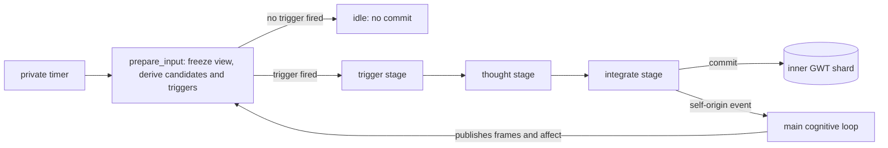

# The private thought loop

## Summary

The private loop is the companion's second conscious workflow.
It runs on its own timer, without a conversation partner.
A deterministic trigger policy decides whether a tick produces a thought.
A performed thought stays private until the companion chooses to share it.
Accepted work commits into the loop's own GWT shard, and the main loop sees
each accepted thought as a self-origin event.

A17 delivered the loop. It replaced the fixed dummy thought path, which ran
only in dummy mode and wrote one hardcoded sentence.

Parent: [cognitive pipeline](cognition.md).
Design: [the second conscious loop](../work_items/alpha-plan/private-loop.md) and [felt-state projections](../work_items/alpha-plan/felt-state.md).
Work item: [A17](../work_items/alpha-plan/work-items/a17.md).
Evidence: [A17 verification](../work_items/verification/a17-private-loop.md).
Runtime: [`workflows.inner_thought.host.PrivateThoughtLoop`][].

The [shared inference settings](inference-settings.md) bound reasoning by private operation group.
Integration receives candidate IDs beside their source text and the thought's cited IDs.
An invalid expectation proposal receives one explicit model correction attempt.
Both rejected proposals and repeated failure remain visible; the host never invents the missing outcome.

## Where the loop runs

The application assembles both loops beside each other on one bus, one memory
store, and one companion identity.

The main loop reacts to bus traffic: user input, telemetry, world events, and
the private loop's `thought.created` events.
The private loop reacts to nothing on the bus.
It is timer-driven only, so a main cycle cannot cascade into a private cycle
into another main cycle.
The timer period is the `thought_period` construction argument of
[`workflows.companion.build_app`][], 30 seconds by default.
An idle tick costs no model call.

## Shards and cross-loop reads

Both loops publish into the same keyed GWT turn map, one `GwtTurnRecord` per
accepted cycle.
A shard is the subsequence of turns that carry the loop's `slot_id`:
`"main"` for the main loop, `"inner"` for the private loop.
Read a shard with `MemoryStore.gwt_shard(slot_id, limit)`.
The private loop reads the newest main frame this way before every cycle.

Tick allocation is serialized under the store lock: `begin_batch(new_tick=True)`
reserves the next free tick, so concurrent loops can never collide on one tick.
Each `CycleState.published_slots` names the slot its cycle published.
The private loop never writes the main loop's frame, and the main loop never
writes the inner one.

Existing main-only checkpoints need no migration: every stored turn already
carries `slot_id` with the default `"main"`.

## The three stages

The parent manifest is `workflows/inner_thought/inner_thought.workflow.md`.
Each stage is a child workflow that runs through the real kernel with a frozen
read-only snapshot of the store. Private stages never receive the public
grounding block.

| Stage | Input | Output | Contract |
| --- | --- | --- | --- |
| `trigger` | the fired triggers and the private candidates | [`workflows.inner_thought.schemas.TriggerChoice`][] | picks one fired trigger and one of its allowed operations, or none |
| `thought` | the operation, the frozen candidates, goals, expectations | [`workflows.inner_thought.schemas.ThoughtResult`][] | performs the operation with evidence kept separate from interpretation |
| `thought` → `integrate` | the performed thought | [`workflows.inner_thought.schemas.IntegrationResult`][] | goal changes, one expectation step, a focus intention, a disclosure choice |

The pipeline is pure orchestration: `workflows.inner_thought.pipeline.run_cycle`.
It enforces the evidence rules before any host commit:

- a cycle with no fired trigger calls no model and commits nothing;
- the chosen operation must be a delivered operation;
- every cited id must be one the host supplied with a revision;
- a resolution must name a pending expectation and cite at least one observation.

## Triggers

`workflows.inner_thought.triggers.evaluate_triggers` is deterministic and pure.
A trigger fires on committed state only:

| Trigger | Cause | Suggested operations |
| --- | --- | --- |
| `unresolved_commitment` | an active goal older than 8 ticks with fulfilment below 0.5 | commitment review, planning, feasibility |
| `pending_expectation` | a recorded anticipation older than 6 ticks without an outcome | expectation review, debrief |
| `surprising_outcome` | the last main frame reports surprise at or above 0.35 | debrief, expectation review, perspective shift |
| `fresh_main_frame` | the main loop published a new workspace frame | perspective shift, narrative stitching, debrief |
| `idle_opportunity` | no user input, or none within 300 seconds | curiosity, noticing, memory gaps |
| `repeated_concern` | one source recurs in 3 recent private thoughts | rumination notice, drift notice, debrief |
| `startup_gap` | the application was stopped for at least an hour | debrief, narrative stitching, perspective shift |

The trigger stage may pick one fired trigger or decline with operation `none`.
The loop never generates a thought to satisfy a quota.

## Thought operations

The delivered operations and their declarations live in
`workflows.inner_thought.operations.OPERATIONS`.
Fifteen operations cover the six required groups: remember and attribute,
imagine and compare, evaluate and choose, plan and pursue, interpret
experience, and notice cognition.

Each operation declares its group, its mode, and its temporal focus.
Generative work creates possibilities.
Discriminatory work evaluates or distinguishes them.
Neither mode establishes an external event by generation alone: the committed
thought carries a reality label (`observed`, `remembered`, `internal`,
`inferred`, or `imagined`) that appraisal reads.

The historical thought catalogue named 37 operation types with random
transition weights. `OLD_TYPE_MAPPING` maps every one of them to a delivered
successor or to an explicit non-port:

- `TH_COMPOSE_REPLY` is not ported: the dialogue workflows own public replies.
- `TH_SOCIAL_BID_CRAFTING` is not ported: the main loop's action selection owns bids.

## Private attention

The host derives the loop's private attention deterministically before any
model call.
The candidates are active goals, pending expectations, the newest appraisal,
the newest main frame, recent private thoughts, and the latest outside
message, each with its read revision.
Inner material outranks outside material.
The model can narrow the candidate list, never widen it: a cited id outside
the frozen list fails the pipeline before commit.

## The commit boundary

`publish_output` owns the commit:

1. `begin_batch(new_tick=True, cancel=stop_event)` reserves a fresh tick.
2. Every read record is guarded with `expect_revision`.
3. The thought commits as an `InnerMonologue` feature with metadata: loop,
   operation, trigger, reality, uncertainty, evidence ids, alternatives with
   dispositions, continuation, focus intention, and the disclosure choice.
4. Goal changes go through the shared owner
   `apply_goal_changes(..., origin="private_loop")`, so lifecycle evidence,
   keys, and history stay identical across both loops.
5. An expectation opens or resolves through the lifecycle helpers.
6. One `AttentionFrameRecord` with `control_mode="reflective"` commits with
   the frame's own tick.
7. The felt-state sample is computed (see below) and notable channels commit
   as `QualeRecord`s.
8. `set_gwt` writes the turn with `slot_id="inner"` and a `CycleState` with
   `published_slots=["inner"]`.
9. After the commit, the bus carries one `thought.created` self-origin event
   and one `gwt.updated`.

A `GhostConflict` (the main loop replaced a read record first) rejects the
cycle with a `thought.rejected` telemetry envelope.
A cancellation discards the cycle silently; the store guarantees no late
commit after the stop event.

An explicit semantic model rejection raises [`workflows.inner_thought.pipeline.ModelProposalError`][].
[`workflows.inner_thought.host.PrivateThoughtLoop.handle_batch`][] catches only that type before the commit.
It emits `thought.rejected` with `invocation_id`, `error_type`, `reason`, and `diagnostic_path`.
The diagnostic and traceback stay in `runtime_root/kernel/INVOCATION/model-proposal-rejection.json`.
No thought, state, public reply, or action commits from that rejected cycle.
The next scheduled cycle can run. Rejection is not an idle success.
Schema errors, unknown operations, ordinary `ValueError`, and other Python errors still reach the application.

Inspection episode identifiers can name workspace ticks rather than records.
They do not enter the record citation allowlist merely because the model saw them.
The thought prompt states that boundary. The host never removes invalid citations and accepts the remaining prose.

## Self-origin events

The main loop already accepts the `thought.created` topic.
Its intake maps an `InnerMonologue` feature to a `thought.created` stimulus,
so the ordinary triage, appraisal, and attention path processes the thought's
personal meaning.
A sad speculation can therefore raise actual sadness in the simulated state
while the thought itself keeps the `imagined` or `inferred` label.
The private loop never publishes speech and never commands the body.

## Expectations

`pm.records.cognitive_records.ExpectationRecord` holds one recorded
anticipation before its outcome exists.
`status` starts `pending` and resolves to `supported`, `contradicted`, or
`unmet`.
The helpers in `workflows.inner_thought.expectations` stage records on the
caller's open batch:

- `open_expectation` records the anticipation, its expected valence, its
  uncertainty, its goal links, and its evidence;
- `resolve_expectation` requires at least one observation id, keeps the
  original anticipation and evidence unchanged, and records the resolution
  reason and tick.

The absence of a user reply is not evidence.
A pending expectation stays pending until an accepted record resolves it.

## Felt-state channels

`workflows.inner_thought.felt_state` projects five deterministic channels
from accepted state:

| Channel | Units | Source |
| --- | --- | --- |
| `affect.valence` | -1..1 | positive emotions minus negative emotions, over 5 |
| `affect.arousal` | 0..1 | fear, anger, surprise, intimacy arousal, curiosity, over 4 |
| `relationship.warmth` | -1..1 | affection, trust, communication warmth for the partner |
| `attention.engagement` | 0..1 | curiosity and playfulness |
| `goal.conflict` | 0..1 | the fraction of active goals that are unhappy and unfulfilled |

Position is a pure projection.
Velocity is the position change over the elapsed seconds since the previous
sample; acceleration is the velocity change over the same interval.
New cycle and record timestamps use naive UTC. The felt-state calculation
normalizes aware input timestamps before comparison. Old checkpoint timestamps
remain preserved; they do not establish new stopped-time execution.
A nonpositive interval reports zero derivatives, never a measured stillness.
The first sample initializes with zero derivatives, which is not an absence
of movement.

The sample lives in the inner cycle's `CycleState.internal_data`
(`qualia_channels`), so it survives checkpoints.
Continuity across a restart comes from committed history: an offline gap
contributes no intermediate samples.

A `QualeRecord` commits when a channel moves notably (velocity or
acceleration at or above 0.05).
Its `reportable` flag applies the causal gate: at least one driver must have
won attention or been causal in accepted state.
Dormant candidates stay visible and unreported.

## Disclosure

The private loop records a disclosure choice before any dialogue generation.
The choice is `candid` or `withhold`, with a shareable summary and a reason.
It commits in the thought's metadata.

`build_public_context` adds selected private state to the dialogue evidence
under the `private_state` lane: reportable felt states and candid thoughts,
at most five records.
Withheld thoughts and dormant qualia never enter the lane.
The dialogue prompts render the lane under its own title
("What you privately noticed and chose to share").
Deliberate misrepresentation is not decided here: it stays the main loop's
`Presentation` choice under A09R.

## Concurrency, interruption, and restart

- A queued user message stays observable: `UserInputProxy.submit` commits the
  user record before any cycle runs.
- Concurrent loops hold distinct ticks and distinct frames. A conflicting
  cross-loop write rejects the private cycle instead of overwriting newer
  state.
- Cancellation boundaries: the module's `run_stop` cancels the kernel between
  role calls; the store re-checks the stop event before the atomic checkpoint
  replacement, so a late thought commit cannot land after a stop.
- An explicit stop permits cancellation exceptions to end the run without a late commit.
  Unexpected cancellation and other failures still reach the application.
  Source inspection converts filesystem access failures into evidence limits.
  Provider logic errors stop the runtime with their traceback.
- Main and private child stages preserve requested cancellation as `asyncio.CancelledError`.
  The parent discards its proposal instead of reporting a failed stage during normal shutdown.
  Unexpected child termination and ordinary Python errors still reach the application.
- On restart, the checkpoint keeps both shards, the felt-channel history, and
  every accepted record. `record_startup` measures the offline gap, and the
  gap contains no invented executed activity.

## Failure modes

| Failure | Behavior |
| --- | --- |
| No trigger fires | the tick commits nothing and emits `thought.idle` |
| A read record changed mid-flight | the cycle is rejected with `thought.rejected`; no commit |
| The model cites an unknown record id or reality label | reject the private proposal, retain a diagnostic, and continue without a commit |
| The model names an unknown operation | fail through the module error path |
| An invalid expectation resolution survives its bounded repair | reject the private proposal without a commit |
| A broken catalogue or stage manifest | the cycle fails loudly into the module error path |
| A stop during generation | the run discards without publishing |

## Evidence

The live gate is `dev/work_items/alpha_a17_private_loop_gate.py`.
It runs the real concurrent application path with real inference on the full
Spamuel history.
The [A17 verification](../work_items/verification/a17-private-loop.md) records
its receipt, the scenario facts for human review, and the open checks.
