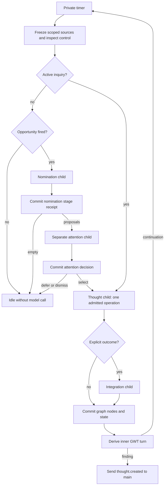
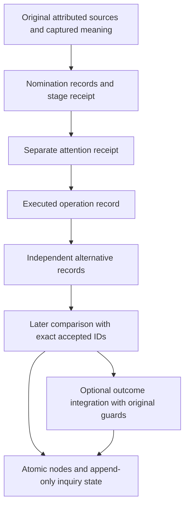
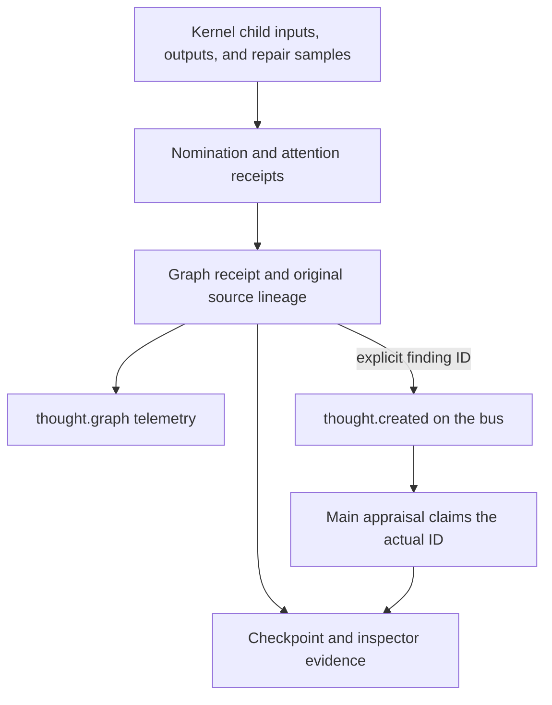

# The private thought loop

## Summary

The private loop gives the companion a place to explore a concern without a conversation partner.
A possible thought, a selected question, an executed operation, and a finding remain separate events.
Attention can decline an interesting possibility without pretending that the companion already examined it.
This mechanism models aspects of private cognition. It does not establish humanlike consciousness or emotion.

**Partial implementation.**
The application binds its timer to nomination, shared attention selection, and bounded inquiry graphs.
Actual-store checks cover storage and recovery boundaries.
They do not establish generated thought quality or uninterrupted operation during ordinary conversation.
The <a href="../../dev/work_items/beta-b05.md">B05 engineering record</a> contains current verification results and their limits.

The canonical owner is [`workflows.inner_thought.host.PrivateThoughtLoop`][].
The parent architecture is the [cognitive pipeline](cognition.md).
[Deliberate mental work](deliberate-mental-work.md) and [private reflection experiments](reflection.md) retain separate execution paths for now.
Their migration to shared inquiry remains designed.

## Where the loop runs

The application assembles main and private cognition on one bus, one memory store, and one companion identity.
The private loop uses a timer rather than a bus subscription.
Its default period is 30 seconds through [`workflows.companion.build_app`][].
A main event therefore cannot directly cascade into another private cycle.

An accepted [inference wait](inference-wait.md) prevents routine private admission.
The host also checks classification and Critical reconsideration before inquiry entry.
The existing ordinary-input cancellation and generation fences still apply.
Source-bound graph storage does not yet remove those lifecycle checks.

The parent manifest remains `workflows/inner_thought/inner_thought.workflow.md`.
Its injected `run_private_inquiry` tool calls [`workflows.inner_thought.graph_execution.run_graph_opportunity`][].
Child stages use the existing workflow kernel and configured model transport.
Private stages receive a frozen read-only memory environment, without the public grounding block.

## Execution flow

One invocation can retain a nomination batch, select attention, and execute one graph operation.
A later timer opportunity can continue the accepted graph without main appraisal of each intermediate node.
Only an explicit outcome produces a finding for main appraisal.
A storage bound can pause unfinished work without an integration call or finding event.

The coordinator reuses a retained nomination result for the same captured opportunity.
Its identity depends on source guards, main guidance, and fired triggers, rather than a fresh timer invocation ID.
An empty batch retains its reason and is not an executed thought.
An accepted attention decision also prevents repetition of that selection call for the same batch.

Parked graph resumption and deliberate-action admission remain unimplemented.
An active inquiry from an older Critical epoch stays held for fresh admission.
The coordinator does not replace its original epoch with a newer value.

## Private attention

The deterministic trigger policy identifies opportunities from committed material.
Examples include an unresolved intention, an unanswered expectation, a surprising event, idle time, and a repeated concern.
A trigger permits nomination. It does not require an inquiry or manufacture an idle thought.
[`workflows.inner_thought.triggers.evaluate_triggers`][] owns this cheap opportunity policy.

The nomination child proposes at most three incomplete questions.
Each [`workflows.inner_thought.schemas.ThoughtNomination`][] carries exact evidence IDs, an epistemic label, a suggested operation, and separate judgments.
Interestingness, character relevance, plausibility, consequence, desirability, and action suitability have distinct meanings.
Desire or emotional intensity can motivate exploration without increasing evidence support.

The existing `trigger` child now also accepts an explicit private-attention request.
It considers committed nominations, pending input, accepted focus, active intentions, and the accepted mental aperture.
[`workflows.cognitive_control.attention.validate_private_attention`][] validates that decision against the supplied identities and admission context.
The choice selects at most one question, defers it, or dismisses it with a reason.
The nomination producer cannot select itself with a high score.

Nomination and selection produce private receipts without an inner GWT turn or a `thought.created` event.
The first executed operation creates the actual inner turn.
One active episode occupies the observer's private inquiry slot.
No attention decision grants public contact or external action authority.

## Sources and graph data

The host filters citable source views to the companion observer's reality and frame before graph entry.
[`workflows.inner_thought.nominations.capture_inquiry_grant`][] captures source identities, meaning fingerprints, and the accepted Critical epoch.
Governing intentions and pending expectations retain current-authority guards.
Historical evidence retains its original identity without a global latest-record requirement.

The graph path excludes legacy experiment and inspection summaries whose source scope it does not capture.
The request reports this evidence limit explicitly.
An admitted `memory_search` calls the existing memory retrieval service before the thought child.
The search uses the invocation's frozen view and the observer's reality and frame, with at most eight matches.
[`workflows.inner_thought.graph_execution.PrivateRecall`][] retains actual matches, original source guards, and the retrieval trace.
Recalled sources extend the grant without replacing earlier fingerprints.
The trace records which retrieval mechanisms actually ran.
Missing memory remains missing, and a failed required retrieval remains an error.
This source integration does not establish recall quality across the companion's complete history.

[`workflows.inner_thought.graph_execution.GraphThoughtRequest`][] supplies the accepted graph to the existing `thought` child.
Its nodes retain text, assumptions, judgments, evidence, and exact parent relations.
New alternatives have no committed IDs until the host accepts them.
A later discriminatory operation can compare, merge, or dismiss accepted branches without deleting their history.

Generation cannot certify its own conclusion.
Pending generated nodes require discrimination before a finding or completion.
An unresolved information gap can also end an inquiry.
Changing the wording alone does not count as progress.

Source-root traversal follows actual derivation links.
Repeated thoughts and summaries therefore retain one original source instead of acquiring independent corroboration.
An imagined conversation remains imagined, even when it changes simulated feelings after main appraisal.
An introspective explanation remains an interpretation rather than privileged access to its own cause.

## Thought operations and bounds

[`workflows.inner_thought.operations.OPERATIONS`][] lists the delivered operations and their declarations.
Each operation names its group, generative or discriminatory mode, and temporal focus.
The current graph step must execute its admitted operation.
A continuation names another delivered operation and a specific purpose.

The initial bounds permit three nominations, one active episode, and three alternatives per generative step.
The control configuration also limits accepted steps, active computation time, and consecutive stalls.
Duration uses measured monotonic computation time at accepted boundaries.
World chronology and offline time cannot replace that measurement.

The historical catalogue named 37 thought types.
`OLD_TYPE_MAPPING` retains each successor or an explicit non-port decision.
Public reply composition and social bids remain with the dialogue and main action owners.

## The commit boundary

[`workflows.inner_thought.graph_host.PrivateInquiryOwner`][] binds graph staging to the private host's control fence.
Nomination, attention, and operation acceptance have separate commits.
[`workflows.inner_thought.inquiry.stage_inquiry_step`][] stages an operation, its alternatives, and the next state receipt atomically.
Exact parent and private-slot guards reject competing continuations.
Captured source guards preserve the original meaning that the model read.

The graph commit is an append-only recovery root.
It preserves accepted inquiry records independently of a later main cycle.
Recovery roots cannot contain workspace, cycle, or expectation-lifecycle mutation.
The owner therefore derives the inner GWT turn in a second, idempotent commit.

If interruption occurs between these commits, the accepted graph remains authoritative.
The owner can restore the missing inner turn from its actual operation ID without another model call.
A main turn that cites the operation does not substitute for its inner projection.
The accepted operation remains immutable during that repair.
[`workflows.inner_thought.graph_host.FrozenProjectionPayload`][] retains the operation's original accepted mental state before graph commit.
Repair uses that frozen payload rather than later state.

Explicit outcomes use the existing `integrate` child.
[`workflows.inner_thought.graph_outcomes.capture_graph_outcome`][] retains integration beside the operation before graph acceptance.
The payload preserves the original source dependencies, disclosure choice, summary, and proposed goal changes.
[`workflows.inner_thought.graph_outcomes.stage_graph_outcome`][] applies expectation effects in the derived GWT batch.
A changed expectation target rejects that projection without refreshing its old guards or erasing the accepted graph.

## Turns and cross-loop reads

Both loops use the same keyed GWT map.
The `slot_id` is `main` for main cognition and `inner` for private cognition.
The private loop reads recent main turns and accepted mental state before execution.
It never writes the main workspace or changes accepted mental state directly.

`begin_batch(new_tick=True)` reserves ticks under the store lock.
An inner projection contains the actual operation ID and a cycle without main stimulus claims.
Main appraisal later records accepted finding IDs through `CycleState.claimed_ids()`.
Private branches need no separate main cycle merely to remain accepted graph history.

## Expectations

An [`pm.records.cognitive_records.ExpectationRecord`][] records an anticipation before its outcome exists.
Its status starts `pending` and can resolve to `supported`, `contradicted`, or `unmet`.
The absence of a reply is not evidence of rejection.

The outcome bridge requires the original current-authority dependency for a resolution target.
It also requires cited observations from the captured grant.
Generated or imagined content cannot become an observed outcome through integration.
An opened expectation keeps the operation's reality and frame.

Main cognition records and checks its own expectations separately.
Its provenance reference remains `main_cognition`.
See [decisions, routing, and expectations](decisions-and-routing.md).

## Disclosure

The integration boundary records `candid` or `withhold`, with a shareable summary and reason.
This choice precedes public dialogue generation.
It proposes disclosure without creating speech or authorizing an external action.

`build_public_context` can include reportable felt states and candid private thoughts in its `private_state` lane.
The lane holds at most five records.
Withheld thoughts and dormant qualia stay outside it.
The dialogue prompts label selected material as private observations that the companion chose to share.
Deliberate misrepresentation remains the main loop's `Presentation` choice.

## Self-origin events and telemetry

The host emits `thought.graph` telemetry with the parent result, accepted receipt ID, and optional finding ID.
Only a finding sends `thought.created` to main cognition.
The main intake treats that operation as a self-origin stimulus for triage, appraisal, and attention.
An internal branch remains an actual private event about content with its own epistemic status.

Checkpoint records retain proposals, choices, relations, and source fingerprints.
Kernel artifacts retain actual prompts, outputs, and structured-output repair samples.
The graph library itself emits no event or telemetry.
The host owns delivery and tracks findings that actual main appraisal has not yet claimed.

## Concurrency, interruption, and restart

The store validates cancellation before checkpoint replacement.
The child runner propagates requested cancellation through the existing kernel boundary.
Unexpected Python errors still reach the application.
An accepted graph commit survives a failed later projection or delivery.

The current implementation still uses ordinary control generation during private acceptance and legacy replay.
It does not yet establish continuity through unrelated conversation.
Source guards, Critical epochs, unknown-triage holds, waits, replay, parking, and main private-only checks require coordinated migration.
A stored graph or a clean local check is not evidence that this migration is complete.

## Legacy linear episodes

The old `run_cycle` path remains an explicit compatibility path for retained linear contracts and direct callers.
It uses `TriggerChoice`, `ThoughtResult`, and `IntegrationResult` through trigger, thought, and integration children.
The assembled application's private host uses graph execution instead.

[`workflows.inner_thought.schemas.LegacyEpisodeContext`][] keeps legacy episode state and suppression reasons in named fields.
[`workflows.inner_thought.inquiry.read_legacy_inquiry`][] preserves the old chain and its recorded world-clock duration.
It invents no branches, missing judgments, active computation time, or offline activity.
The old episode's acknowledgment, parking, and generation rules remain legacy semantics rather than graph resumption authority.

The original loop and its earlier live evidence remain in the [A17 verification](../work_items/verification/a17-private-loop.md).
Those results do not verify connected graph generation or the unfinished lifecycle migration.

## Felt-state channels

The retained [`workflows.inner_thought.felt_state`][] mechanism projects five channels from accepted state.
The graph request can read earlier channel samples as context.
Graph GWT projection does not yet reproduce the linear path's channel sampling and new `QualeRecord` emission.

| Channel | Units | Source |
| --- | --- | --- |
| `affect.valence` | -1..1 | positive emotions minus negative emotions, over 5 |
| `affect.arousal` | 0..1 | fear, anger, surprise, intimacy arousal, curiosity, over 4 |
| `relationship.warmth` | -1..1 | affection, trust, and communication warmth for the partner |
| `attention.engagement` | 0..1 | curiosity and playfulness |
| `goal.conflict` | 0..1 | the fraction of active goals that are unhappy and unfulfilled |

Position is a deterministic projection.
Velocity and acceleration describe differences between accepted samples over their measured interval.
The first sample uses zero derivatives, which does not establish an absence of movement.
A nonpositive interval also supplies no measured stillness.

The legacy path stores its sample in `CycleState.qualia_channels`.
It emits a `QualeRecord` when velocity or acceleration reaches 0.05.
The reportable flag also requires an accepted causal or attention driver.
An offline gap contains no invented intermediate samples.

## Failure modes and evidence limits

| Condition | Current behavior |
| --- | --- |
| No opportunity | no nomination call |
| Valid empty nomination batch | retain its stage receipt and reason without a thought |
| Attention defers or dismisses | retain the decision without an executed node |
| Invalid citation or graph relation | reject before graph acceptance |
| Source meaning or current parent changes | the guarded commit fails |
| Projection fails after graph commit | preserve the graph for visible diagnosis and projection repair |
| Active inquiry belongs to an older Critical epoch | hold it for fresh admission |
| Broken manifest, catalogue, or internal contract | fail through the actual error path |

The B05 engineering record distinguishes connected workflow evidence from generated-content review and sustained behavior.
Parked resumption, deliberate-entry sharing, ordinary-input continuity, and new graph felt-state emission remain incomplete.
The [output recovery guide](cognitive-output-recovery.md) explains the shared error and repair boundaries.
