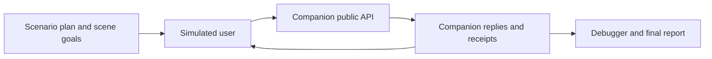

# Simulations

A simulation lets you compare the same situation across models or code changes.
Each companion runs the normal PM runtime in a separate process. It owns its
memory, clock, logs, and optional Minecraft body.

The run engine advances the scenario and routes speech. Participant processes
use the virtual clock while Minecraft runs on wall time. A coordinated
checkpoint records the participants and the controller at a shared boundary.
Frozen source files and model configuration hashes identify each attempt.

## Run a scenario

- [Jesse and Spamuel](../workflows/simulation-jesse-spamuel.md)
- [Jesse and two Spamuels](../workflows/simulation-jesse-two-spamuels.md)
- [Two Spamuels in Minecraft](../workflows/simulation-two-spamuels-minecraft.md)
- [Jesse and Spamuel in Minecraft](../workflows/simulation-jesse-spamuel-minecraft.md)

## Inspect results

- [Overnight baseline](../workflows/spamuel-baseline.md)
- [Simulation workspace](../workflows/simulation-workspace.md)
- [Execution timeline](timeline.md)
- [Run engine][simulation.engine.RunEngine]
- [Participant process][simulation.participant.Participant]
