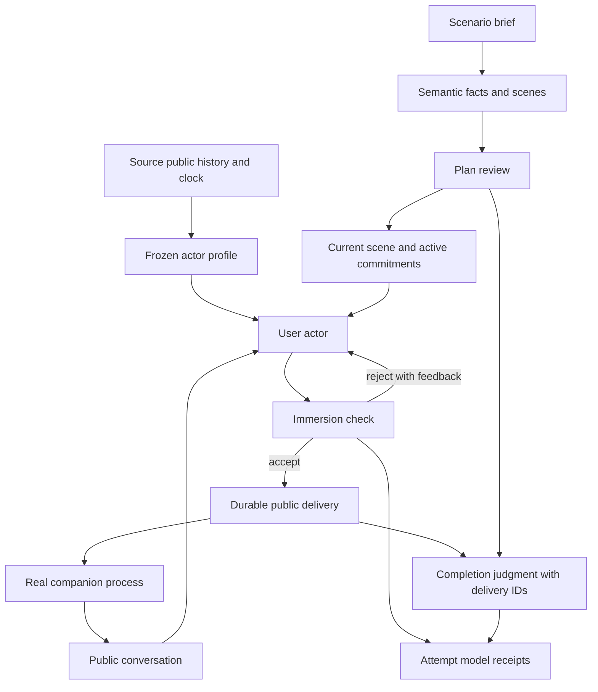

# Simulation and review

## Summary

The simulation browser runs real PM companions in separate processes.
Each participant owns a home, ghost, workflow files, logs, and clock.
The harness owns scenario actors, public message routing, and coordinated checkpoints.

Parent: [engineering manual](../index.md).
Requirements and evidence: [K002](../work_items/k002/index.md).
Recovery rules: [causal memory](../work_items/k002/causal-memory.md).
Capture format: [record packages](record-packages.md).

## Start the browser

The selected configuration supplies chat, evaluation, and embedding endpoints.
The default configuration is the private `config.yaml` in the repository root.
Git ignores this file because it can contain credentials.

For an OpenRouter run, use the launcher:

```powershell
.\simulation\start.ps1
```

The launcher requires OpenRouter for all three connections and rejects local startup scripts.
It disables completion replay for the browser and its participant processes.
It opens the server without starting a scenario.
No local model or embedding service is required.

The equivalent command is:

```powershell
uv run --locked python -m simulation --config config.yaml --openrouter-only --port 8095
```

`api_key` contains a literal credential. `api_key_env` contains an environment-variable name.
Configure only one credential field per connection.
An embedding provider can return a shorter model name; set its exact `response_model` alias when needed.
Set the embedding `context_window` from the provider's embedding catalog when chat discovery cannot find it.
For other endpoints, omit `--openrouter-only` and select their configuration explicitly.

Open `http://127.0.0.1:8095/`.
The dashboard uses light mode and shares its palette with the memory debugger.
Select **Memory debugger** inside a run to inspect captured attempts on the same website.
The standalone debugger remains available.
The server binds to `0.0.0.0`. Remote browsers can use the machine address or a forwarded local port.
The default homes directory is `~/.pm/private-machine`.
The default evidence directory is `.runtime/simulation/`.
Use `--homes` or `--data` to select different directories.

1. Select an existing home, or load the unchanged Spamuel canon into a new home.
2. Inspect its history and select a checkpoint before creating a fork.
3. Select the primary character and an optional connected character.
4. Enter a scenario. Inspect the proposed start time, or enter a time with an explicit UTC offset.
5. Generate the plan, inspect its facts, and edit its JSON when necessary.
6. Create the run, then select **Start / resume**.
7. Inspect conversation, mandatory facts, and the attempt report.

Each run forks its source homes before startup.
Connected personas retain their own identities and see the partner as Other Spamuel.
The endpoint does not announce whether that entity is human or another PM.
The backend accepts a graph of participants; the browser currently selects two.
Minecraft and its managed workflows remain disabled for simulation participants.

## Scenario execution

### Templates and longer scenarios

The browser imports and exports `pm.simulation-template.v1` JSON files.
A template contains participants, directed connections, the scenario brief, director settings, and rating settings.
An optional exact plan supplies the scenes without model-based planning.
Run creation forks each source home and saves the resolved template as `template.json`.
The source home stays unchanged.

Set the duration, conversations per day, and minimum user messages per conversation.
Add a daily rhythm, story threads, scheduled events, director guidance, and actor guidance.
The planner creates one day at a time and combines the results into an editable plan.
Expand a scene to edit its time, circumstances, private motive, recipient, and completion condition.
The JSON editor retains access to all plan fields.
The director cannot finish a scene before its minimum message count and required facts are satisfied.

The included adult Jesse/Spamuel scenario covers 30 days and 90 conversations.
It requires at least 360 user messages, plus actual companion responses and autonomous activity.
Its themes include a foster cat, work, a shared project, attraction, conflict, repair, and joy.
Companion agreement, romantic consent, and emotional outcomes remain the companion's choices.

Validate or create a run without the browser:

```powershell
uv run --locked python -m simulation.templates validate test_data/simulation/eventful-month.json
uv run --locked python -m simulation.templates create test_data/simulation/eventful-month.json --config config.yaml --run-id eventful-month
```

Add `--start` to create and execute the run in the same command.
Use `python -m simulation.templates schema` to print the JSON schema.
Relative home paths resolve against the template's directory in the CLI.
Paths beginning with `~` resolve against the current user's home.
The browser requires registered character homes.

Virtual time still executes normal cognition and private-thought deadlines.
A simulated month can require substantial real time and model work.
The harness does not bypass cognition to reach later dates.

### Automatic ratings

The **Analysis** tab contains editable agent instructions and captured findings.
The starter agents rate conversational sense and AI companion immersion.
Knowing that Spamuel is an AI is part of the intended experience.
Consensual adult romance, disagreement, refusal, and unresolved feelings can fit the character.
An introspective report is assessed when present; its absence alone is not a defect.

After a completed run, enabled agents use the configured `UnitTestEvaluator` connection.
Each call assesses one criterion and one section of public conversation.
Every delivery belongs to one section.
Eight preceding deliveries and twelve historical reference lines per participant provide context.
This sampled historical context does not establish a complete historical-memory audit.
Exact delivery citations support numerical scores.
The browser links each citation to its exchange.
Section means are summaries of model judgments, not human ratings or statistical guarantees.

Save changed settings and select **Analyze completed run** to run the agents again.
Analysis never repeats companion execution.
Each analysis has separate settings, coverage, model receipts, and results under `analysis/<id>/`.
A failed analysis remains visible without changing completed simulation status.
Owner feedback remains separate from automatic scores.

### Optional ghost backups

The model YAML configuration controls extra per-cycle ghost copies:

```yaml
ghost_backups: false
```

The default is `false`.
Set it to `true` to retain a full ghost copy after each accepted cognition cycle.
The current `ghost.pickle` and explicit simulation recovery snapshots remain required in both modes.
Changing this setting does not remove existing backups.

Immersion depends on believable user input as well as companion behavior.
The harness reads the selected home's complete public dialogue and actual user and companion names.
It freezes this actor profile under `actors/<participant>.json` when the run is created.
The profile excludes private companion thoughts and remains fixed across attempts.
Missing user dialogue fails explicitly; the harness does not substitute a generic user.

The browser proposes the next 23:58 after the source's saved history and clock.
An explicit later date remains available, with the gap shown before planning.
A start before saved continuity is rejected.

The planner first extracts mandatory facts, then creates the editable plan.
Facts distinguish events from commitments. Initial choices and later reaffirmations stay separate.
A semantic plan review rejects premature plot disclosures and invented completion requirements.
A timed fact must occur at its stage time.
Delivery timestamps establish time; actors do not have to announce clock values.
Stage circumstances and private intent guide dialogue without prescribing exact words.
The actor sees public history, current circumstances, active commitments, and delivered conversation.
Future events and completion rubrics stay outside its generation context.
A separate checker sees future facts to detect premature claims.
It checks historical voice, correct identity, natural conversation, and scenario consistency before delivery.
Incidental details and future intentions are allowed. Required facts can emerge across several turns.
Rejected drafts remain available for debugging.
The actor sends ordinary entity messages through the public API.
The director checks the delivered conversation against the stage facts.
Each completed fact cites actual actor delivery IDs. Timed facts must retain their specified time and recipient.
It cannot end the scenario successfully while mandatory facts remain missing.
Companion disagreement does not cancel the actor's required commitments.



The diagram separates actor input from director evidence.
The controller waits for participant work before judging a stage.
Model receipts preserve drafts and rejections; completion receipts cite actual public deliveries.

No harness quota limits turns, model calls, cost, or execution time.
The configured serving context still limits an individual prompt.
Invalid model output retains a receipt before repair.
A context overflow, process failure, or contradictory scenario execution fails the attempt explicitly.

Virtual time advances through semantic wake and private-thought deadlines.
Model transport, process supervision, and diagnostics use real time.
Fast scheduler polls do not create artificial inference steps.
Clock receipts retain the virtual origin and timer deadlines for resume.
The local speech stream sends keepalive pings without a response deadline.
Long context preparation must not impose a transport deadline on inference.
An actual stream closure or participant exit still fails the attempt.

## Pause, stop, and resume

Pause and stop fence new routing, drain runnable work, and retain parked workflows.
Both operations retain the plan position and pending deliveries for resume.
A forcefully interrupted process remains a failed attempt, with its evidence retained.
Main cognition determines which inputs survive recovery.
The controller can resend an excluded delivery through its stable delivery ID.
A failed single-participant run retains its causally accepted progress.
A failed multi-participant run restores all participants and routing state from the latest coordinated barrier.
Every new run records an initial barrier before any public exchange.

A coordinated checkpoint contains every participant snapshot, the shared time, and the transit ledger.
A participant snapshot alone cannot retract speech that another participant already accepted.
Completed attempts and their source copies remain immutable evidence.
Each later attempt receives a separate source copy, report, and failure receipt.
The source receipt records the repository revision, local file hashes, and installed dependency origins.

## Public companion API

POST `/v1/completion`, `/v1/completions`, or `/v1/chat/completions` with an OpenAI-shaped body:

```json
{"messages":[{"role":"user","content":"Hello"}],"delivery_id":"client-message-1"}
```

Only the final message content supplies the stimulus.
PM owns conversation history; earlier supplied messages do not become memory.
The endpoint returns HTTP 202 after durable delivery, without waiting for a reply or an embedding call.
An optional `user` names the speaker.
An optional `entity_ref` distinguishes connections that share a display name.
Reusing a delivery ID with different content raises an error.

Connect to `/v1/events?after=SEQUENCE:ORDINAL` for public companion speech.
Each event includes the knoxel output ID and its durable cursor.
Speech can include several messages or unsolicited messages.
Reconnect with the last cursor and deduplicate output IDs.
The cursor follows commit order because IDs can be reserved before other commits finish.

## Control API

The controlled participant starts with `python -m simulation.participant`.
The harness supplies its home, configuration, and readiness file.
These controls remain separate from the asynchronous public API.

| Endpoint | Behavior |
| --- | --- |
| `/control/start` | Start real cognition with `clock_start`; state reports loading and errors. |
| `/control/state`, `/control/status` | Read clock, activity, timers, parked work, and the output cursor. |
| `/control/send` | Deliver `text`, optionally after advancing to `ts`. |
| `/control/advance` | Advance through semantic deadlines and return buffered public outputs. |
| `/control/advance-step` | Advance one coordinated clock step without waiting for resulting work. |
| `/control/env` | Queue observed environment events at their recorded times. |
| `/control/freeze`, `/control/thaw` | Fence intake and autonomous timers for a checkpoint barrier, then reopen them. |
| `/control/snapshot`, `/control/restore` | Save or restore a named ghost and its clock receipt. Names cannot overwrite prior snapshots. |
| `/control/delivery` | Check whether a delivery exists and whether cognition accepted it. |
| `/control/trace/ID` | Read the exact output record and its creating transaction. |
| `/control/shutdown`, `/control/stop` | Fence intake, drain running work, save parked work, and exit. |
| `/control/inject` | Reject experimental controls. The owner deferred them to another work item. |

The ordinary PM chat server also exposes runtime lifecycle controls.
Process startup and restore belong to the participant controller.
Compatibility does not suppress runtime errors or overwrite mental state.
Dependent controls wait for startup. Status remains available during loading.
Legacy output and trace responses include empty gateway-call lists with an explicit unavailable-linkage reason.
PM prompt IDs remain in persona logs; they are not contributor gateway IDs.

## Evidence and human review

Attempt reports link conversation, private activity, GWT cycles, transactions, and captured prompt files.
Relative artifact paths use `/` separators so browser links work on Windows.
The browser also opens existing captures that contain Windows filesystem separators.
Ready review packages use the accepted causal view.
Raw branch records remain separate debugging evidence.
Record links follow captured IDs through appraisal, codelets, attention, decisions, and public replies.
Expand a record to inspect all captured fields except embeddings.
Uncaptured references remain explicit.

Human feedback is separate from immutable captures.
Automated fact checks do not supply companion-quality ratings.
Register offline runtime packages with:

```powershell
uv run --locked python -m simulation.review register-package .runtime/debug/chat.json --id example --title "Example review"
```

The command prints a direct browser URL.
`python -m simulation.review feedback` reads saved owner feedback when the owner requests it.
The old development review server is retired.
Its registrations remain in `simulation/review/legacy-registry.json`.
Existing capture files under `.runtime/dev-review/` remain unchanged.

## Code ownership

- [`simulation.engine.RunEngine`][] owns scenario progress, routing, and attempt evidence.
- [`simulation.actors.ActorProfile`][] preserves user voice, identity, and source continuity.
- [`simulation.agents.Agents`][] owns harness planning, actor generation, and immersion checks.
- [`simulation.templates.SimulationTemplate`][] owns browser and CLI run definitions.
- [`simulation.analysis.analyze_run`][] owns automatic post-run ratings and their separate evidence.
- [`simulation.participant.Participant`][] owns one controlled PM process.
- [`simulation.review.catalog.register`][] registers immutable offline captures.
- [`pm.app.control.RuntimeControl`][] supplies ordinary runtime controls.
- [`pm.app.transport.public_events`][] supplies replayable public speech.

The simulation imports the runtime and workflow assembly.
Product runtime code does not import the simulation application.
K003 adds the read-only [execution timeline](timeline.md) over the same capture and presentation interfaces.
