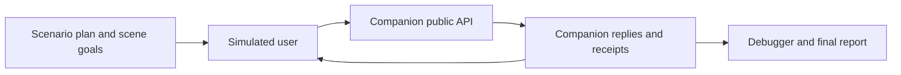

# Simulations

A simulation lets you compare the same situation across models or code changes.
Each companion runs the normal PM runtime in a separate process. It owns its
memory, clock, logs, and optional Minecraft body.



The run engine advances the scenario and routes speech. Participant processes
use the virtual clock while Minecraft runs on wall time. A coordinated
checkpoint records the participants and the controller at a shared boundary.
Frozen source files and model configuration hashes identify each attempt.

## Run a scenario

- [Jesse and Spamuel](../workflows/simulation-jesse-spamuel.md)
- [Jesse and two Spamuels](../workflows/simulation-jesse-two-spamuels.md)
- [Two Spamuels in Minecraft](../workflows/simulation-two-spamuels-minecraft.md)
- [Jesse and Spamuel in Minecraft](../workflows/simulation-jesse-spamuel-minecraft.md)

### Jesse and Spamuel across shutdowns

Scenario 5 follows Jesse and Spamuel through a PC shutdown and the next
morning. Jesse sends public chat messages. On memory-sleep nights, she leaves
the PC on and gives the live worker time to prepare memory. She also leaves it
on when she finds memory work active at bedtime. The virtual clock advances at
the normal simulation pace while PM stays online.

On a shutdown night, Jesse turns in after a reply or one PM decision cycle for
her goodbye. Her wait ends after ten wall-clock minutes if that cycle is still
pending. The harness requests a graceful shutdown and waits for the process to
exit. The virtual clock moves to morning while PM is offline. PM records the
clean stop and reports the elapsed offline time on startup.

```powershell
.\simulation\simulation_5_jesse_spamuel_overnight.ps1 -RunId overnight-01
```

The launcher uses Windows Task Scheduler. It first runs one evening and
morning, then starts the three-night run after the gate passes. Use
`-SmokeOnly` for the single-night gate. Use `-Interactive` to run under an
existing Windows login if Windows denies registration for a separate logon.
The run uses the synthetic Spamuel
canon, a 6× online clock, OpenRouter DeepSeek chat with a 64K context cap, and
the embedding route in the selected model configuration.

Open `.runtime/simulation/overnight/overnight-01/` for the current stage and
its chat. Each verified night captures the exit code, shutdown checkpoint,
lifecycle records, and morning memory evidence.
[Scenario controller][simulation.overnight.OvernightRun]

The run observer keeps a diagnosis beside the run logs when a stage stalls.
A scenario can also give it a goal and evidence to judge. The harness checks
the agent's supporting quote against the candidate evidence. PM's own receipts
establish the process exit, checkpoint integrity, and memory retention.
[Run observer][simulation.observer.RunObserver]

## Inspect results

- [Overnight baseline](../workflows/spamuel-baseline.md)
- [Simulation workspace](../workflows/simulation-workspace.md)
- [Execution timeline](timeline.md)
- [Run engine][simulation.engine.RunEngine]
- [Participant process][simulation.participant.Participant]
