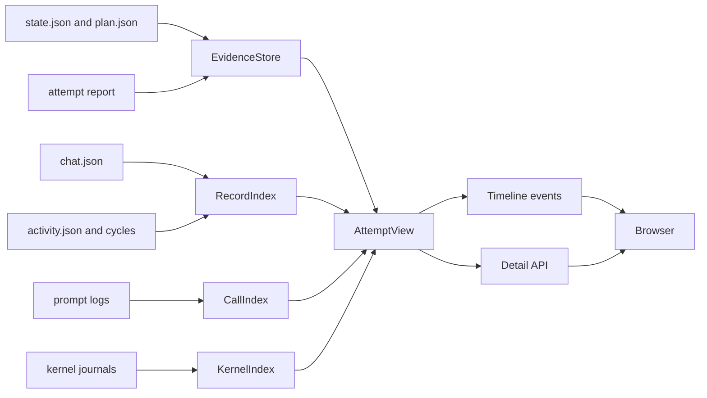

# Execution timeline

## Summary

The execution timeline is a read-only review surface for one simulation attempt.
The simulation dashboard mounts this same reader under `/debugger/`.
Select **Memory debugger** in a run to inspect its captured attempt without another server.
The standalone launcher remains available for independent review.
It joins the public conversation, model calls, workflow phases, global-workspace
cycles, and captured records by time and recorded identity.
The owner uses it to trace why a companion said or did something after a run.

Parent: [engineering manual](../index.md).
Requirements and POC status: [K003](../work_items/k003/index.md).
Capture path: [simulation and review](simulation.md).
Record presentation: [runtime record packages](record-packages.md).

## Why it exists

A companion run is asynchronous. A visible reply can depend on a stimulus, an
attention cycle, several codelet calls, a workflow decision, a story call, and a
routing step. The accepted records explain what survived. They do not show the
order of execution by themselves.

The older console shows live bus traffic, workflow reports, and model calls.
It is a development service, and its memory views are mostly flat lists. K003
adds a post-run view that starts from the event the owner wants to explain and
follows the recorded evidence around it.

The timeline does not claim that recorded order proves causality. It shows:

- the public line and its record ID;
- the GWT cycle that carried the stimulus and decision;
- the workflow invocation and its phases;
- the exact model calls and prompts in that invocation;
- the private records the cycle captured;
- the recorded links between records;
- failures and missing evidence.

## How one view is built

The simulation controller owns the run format.
The timeline reads that format as evidence and never imports the application
assembly, bus, or simulation application.



Each evidence source has one owner:

| Module | Responsibility |
| --- | --- |
| [`pm.tools.timeline.evidence`][] | Discover runs and attempts, validate identities, and keep evidence paths inside their root. |
| [`pm.tools.timeline.calls`][] | Join the exact prompt JSON, readable Markdown log, and usage events by call ID. |
| [`pm.tools.timeline.workflows`][] | Read kernel journals, workflow names, phases, and local artifacts. |
| [`pm.tools.timeline.records`][] | Read chat, activity, and cycle packages; call the shared record formatter. |
| [`pm.tools.timeline.timeline`][] | Merge the sources into one ordered event stream. |
| [`pm.tools.timeline.api`][] and [`pm.tools.timeline.server`][] | Expose the view in the browser. |

`AttemptView` loads one participant's `RecordIndex`, `CallIndex`, and
`KernelIndex` once. Moving between tabs does not re-read the same call or kernel
folder.

## Time and identity

The simulation uses a virtual clock. The runtime also writes real time for
model transport and process activity. The timeline keeps both:

- `at` is the UTC sort instant;
- `wall_at` is the recorded real time when one exists;
- `clock` is `virtual`, `wall`, or `unknown`.

A cycle stores its world time in `cycle.timestamp` and its wall time in
`gwt.timestamp`. A speech record stores world time in
`timestamp_world_begin` and wall time in `timestamp_creation`. A prompt log
stores `world_time` and `started_at`. The page shows a `wall` marker when only
real time exists.

The join identities are recorded identities, not guesses:

- a record opens by its knoxel ID;
- a call opens by its prompt-log call ID;
- a workflow opens by its kernel invocation ID;
- a cycle opens by its participant and tick ID.

A link that the evidence does not record stays absent. A missing record in a
cycle is shown as uncaptured.

## Data flow

The timeline is a projection. It does not create a second memory store.

1. `EvidenceStore` reads the controller run and attempt documents.
2. `RecordIndex` merges the captured chat, activity, raw activity, and cycle
   packages. Two different captured versions of one knoxel raise an error.
3. `CallIndex` maps every prompt-log JSON file to its usage events and response.
4. `KernelIndex` maps every kernel folder to its journal, workflow name, and
   artifacts.
5. `AttemptView` holds those indexes for one attempt.
6. `TimelineEvent` rows reference the source identity that opens a detail view.

## Execution and failure flow

The timeline starts no cognition. A request reads prepared evidence and builds
or reuses one `AttemptView`.
Unknown run or participant IDs fail with a visible response.
An unreadable prompt log becomes an error row.
A conflicting captured record stops the attempt view instead of choosing one
version silently.
A file outside the selected evidence root is refused.
The server binds to `0.0.0.0` by default.

## Telemetry and provenance

The timeline is itself a telemetry reader. It adds no runtime events.
It keeps these provenance points visible:

- participant ID on every call, record, cycle, and workflow;
- call ID on every model request;
- invocation ID on every workflow phase and its calls;
- cycle tick on every GWT view;
- delivery ID and routing status where the controller recorded them;
- failure text and attempt number.

The page separately labels simulation harness calls such as the actor and stage
director. They are not companion model calls.

## Read the evidence

Start the page from the repository root:

```powershell
uv run --locked python -m pm.tools.timeline --port 8772
```

Open the page through the machine address or your forwarded local port.
Select a run and an attempt.
Use the timeline to find the moment, then open the call, workflow, cycle, or
record behind it.

The detail panel shows the exact prompt, response, usage, and artifacts when the
evidence recorded them. It shows a missing-evidence message when it did not.

The timeline and record lists initially show 600 rows.
Their counters show the full matching count. Use **Show 600 more** to continue.
Search includes every summary in the selected attempt, including later rows.
The page automatically selects the participant when an attempt contains only one.

To inspect evidence kept outside the active harness, select its run directory:

```powershell
uv run --locked python -m pm.tools.timeline --runs-root .runtime/debugger/runs --port 8772
```

## Limits

The POC does not compare runs, replay a branch, or draw a graph.
It does not judge companion quality.
It does not prove that a cycle caused a later line. It shows recorded order and
recorded links.
The richer comparison and graph views remain open work in
[K003](../work_items/k003/index.md).
