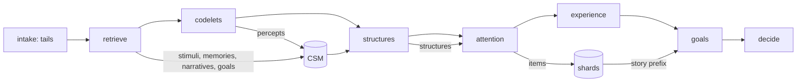

# Structures, attention, and the workspace

## Summary

The workspace holds the conscious content of the companion.
It has one self shard, one shard for each entity, and one shard for each workflow.
Each shard holds items and a tail.
The items come from attention. The tail is the newest stream of the shard, for example the latest dialogue.

After the codelets, two structure builders bind the content of the current situational model (CSM) into structures.
Attention rates every structure for each shard that the cycle updates.
Python then changes each shard in place.
Requirements reserve places for important content and cap the share of each content type.
A codelet percept that enters a shard becomes causal: its feeling change enters the mental state of the next cycle.

A19F step 6 replaced the A15 attention competition, its nominations, and the `AttentionRecord` per nomination.

Parent: [cognitive pipeline](cognition.md).
Plan: [A19F](../work_items/alpha-plan/work-items/a19f.md), sections "Structures", "Global workspace and shards", "Deliberate focus", and "Departures from the base references".
Decision: D24 in the [decision register](../work_items/alpha-plan/decision-register.md).
Related: [codelets](codelets.md), [emotional dynamics](emotional-dynamics.md), [deliberate mental work](deliberate-mental-work.md).

## Where the phases run

| Phase | Change | Implementation |
| --- | --- | --- |
| Intake | Sets the tail of each shard from the newest stream records. | [`set_tails`][workflows.main_cognition.phases.intake.set_tails] |
| Retrieve | Adds the narratives of the self and the group entities and the active goals to the CSM. Prune keeps the protected items. | [`enter_retrieval`][workflows.main_cognition.csm_view.enter_retrieval] |
| Structures | Builds coalitions and bound structures. | [`workflows.main_cognition.phases.structures.build`][] |
| Attention | Applies deliberate focus, rates the structures, and updates the shards. | [`workflows.main_cognition.phases.attention.run`][] |
| Commit | Stages percepts and structures, makes entered percepts causal, and writes the shard changes into the turn record. | [`MainCogLoop.publish_output`][workflows.main_cognition.host.MainCogLoop.publish_output] |

## Shards and tails

[`GlobalWorkspace`][pm.records.workspace.GlobalWorkspace] in the cycle state holds the shards.
A [`WorkspaceShard`][pm.records.workspace.WorkspaceShard] holds `items`, `tail_ids`, and the name of its requirement set.
A [`WorkspaceItem`][pm.records.workspace.WorkspaceItem] holds the record id, the entry tick, the CSM activation at entry, the structure that brought it, the reason, the token count, and `required_by`.

The host offers the newest stream records of each shard ([`ShardStream`][workflows.main_cognition.schemas.ShardStream]):

| Shard | Stream |
| --- | --- |
| Self | The companion's thoughts and experiences (`Thought`, `ExternalThought`, `InnerMonologue`, and `SubjectiveExperience` features). The experience phase adds the experience of the current cycle at once. |
| Entity | The dialogue with the entity: its own lines and the companion replies that address it (`Feature.addressee_entity_id`). Lines without a known partner belong to the user's shard. |
| Workflow | The `WorldEvent` features that the workflow reported. |

The intake phase keeps the newest unbroken stretch of each stream within `WORKSPACE_TAIL_TOKENS` ([`select_tail`][workflows.main_cognition.workspace_selection.select_tail]).
The current stimuli are not part of a tail, because the prompt shows them as new.
The tails come before the codelets, so the codelets already read the latest dialogue.

Token counts use `pm.llm.context_window.estimate_tokens` on the story line of each record, without its id ([`record_tokens`][workflows.main_cognition.csm_view.record_tokens]).

## Requirements

`workflows/main_cognition/workspace.yaml` holds the requirements.
[`load_workspace_requirements`][pm.records.workspace.load_workspace_requirements] validates the file.
Each [`WorkspaceRequirement`][pm.records.workspace.WorkspaceRequirement] has a name, a [`RecordSelector`][pm.records.workspace.RecordSelector], `min_items`, `max_items`, and `max_token_share`.

[`selector_matches`][workflows.main_cognition.workspace_selection.selector_matches] reads the facts of the [`RecordView`][workflows.main_cognition.schemas.RecordView] of a record:

- `record`: the Python record class, for example `Narrative` or `CodeletPercept`.
- `entity`: `self` matches a record about the companion's entity. `shard` matches a record about the entity of the shard. `group` matches a record about an entity of a current stimulus group.
- `category`: the narrative type, the claim kind, or the belief kind.
- `feature_type`: the feature type of a `Feature` record. Other record classes match without it.
- `scope: current_stimuli`: only the stimuli of this cycle.

The shipped sets:

| Shard | Requirement | Rule |
| --- | --- | --- |
| Self | `self_narrative` | At least 1 and at most 3 self narratives, at most 25 % of the budget. |
| Self | `self_model` | At least 1 semantic record or belief about the self, at most 15 %. |
| Self | `self_goals` | Goals, at most 15 %. Goal records store entity 0, so this selector has no entity filter. |
| Self | `codelet_percepts` | Codelet percepts, at most 35 %. |
| Entity | `entity_narrative` | At least 1 and at most 2 narratives about the entity, at most 20 %. |
| Entity | `memories` | Episodes, facts, and semantic records about the entity, at most 40 %. |
| Entity | `interpersonal_expectations` | Expectations and goals about the entity, at most 15 %. |
| Workflow | `receipts` | Action schemas and world events, at most 40 %. |
| Workflow | `world_memories` | Places, objects, and body episodes, at most 30 %. |

The CSM requirements protect the current stimuli, the self narratives, and the narratives of the group entities.
[`csm_protected`][workflows.main_cognition.csm_view.csm_protected] returns their CSM ids. Every prune in the retrieve and codelets phases keeps them.

## Structures

A [`StructureDraft`][workflows.main_cognition.schemas.StructureDraft] holds a pending id, the builder, the kind, a theme, a reason, the record ids in world-time order, relations, a target shard, and the mean valence and salience of its percepts.
The current stimuli and the tail records are not part of any structure.

### Topical coalitions

[`TopicalCoalitionBuilder`][workflows.main_cognition.phases.structures.TopicalCoalitionBuilder] ports `_build_structures_get_coalitions`:

1. Cluster the CSM items by embedding with [`average_linkage`][workflows.main_cognition.phases.structures.average_linkage]: cosine distance, average linkage, one cluster for each `COALITION_ITEMS_PER_CLUSTER` items, at most `COALITION_MAX_CLUSTERS`. The project locks no numeric library, so the clustering is pure Python.
2. A *hard* coalition holds the records of one cluster.
3. A *balanced* coalition gets one record of each type group in turn: each record goes to the nearest cluster that has no record of its group yet.

The old code filled the hard coalitions with the same round-robin records as the balanced ones. The port fixes that.

### Bound structures

[`StructureBinder`][workflows.main_cognition.phases.structures.StructureBinder] makes one story-framed call.
It reads the shared story prefix, the CSM view of [`binder_view`][workflows.main_cognition.phases.structures.binder_view] with ids, and the recent broadcasts.
It binds codelet percepts to memories and narratives and states the reason, for example a matching topic and a similar feeling at that time.
A structure can hold an impulse and the memory that argues against it.
Each structure names a target shard. The target is `self` only for a structure about the companion alone, and one structure does not bind lines about two different characters. The prompt is `phases/prompts/structures.yaml`.

The commit stages one [`Structure`][pm.records.codelet_records.Structure] record for each draft ([`stage_structures`][workflows.main_cognition.host.stage_structures]).
`CycleState.structure_ids` names the structures of the last cycle.

## Attention

[`workflows.main_cognition.phases.attention.run`][] ports `_simulate_attention_on_coalitions`.

1. **Deliberate focus.** `resolve_focus` accepts or rejects fresh focus proposals. [`apply_focus`][workflows.main_cognition.phases.attention.apply_focus] turns accepted advice into CSM endorsements with the endorser `deliberate_focus`. One endorsement adds at most `FOCUS_ACTIVATION_WEIGHT`. A reduced record loses at most that much, except in danger.
2. **Rating.** One call for each updated shard rates every structure from 0 to 1. The shards are the self shard and the shard of each current stimulus group. One call per shard keeps each prompt about one kind of awareness. The calls run in parallel. Each call reads the shared story prefix (with the character card), the AttentionFocus narrative of the self, the state of mind in words, the structures, and the mental aperture instruction of the old code. The prompt is `phases/prompts/attention.yaml`.
   The instruction says that awareness is small: of all structures, at most the winner count can become conscious. It asks for a spread of ratings: above 0.6 only for what the character notices now, 0.3 or less for the rest.
3. **Auxiliary rating.** [`aux_rating`][workflows.main_cognition.phases.attention.aux_rating] ports the old rule rating. The score of a structure is `rating + aux / max_aux * COALITION_AUX_RATING_FACTOR`, so it only breaks ties.
4. **Winners.** Only the best structures of each shard win ([`winner_count`][workflows.main_cognition.phases.attention.winner_count]): one at a narrow mental aperture, as in the old code (`ATTENTION_WINNERS_NARROW`), two at a medium aperture (`ATTENTION_WINNERS_DEFAULT`), three at a broad one (`ATTENTION_WINNERS_BROAD`). `RatedStructure.won` records the result. Only the records of a winner become newcomers. In the A19F step 6 replays every rating was 0.75 to 0.95 and every percept became causal. The winner rule and the prompt make some structures lose.
5. **Selection.** [`select_shards`][workflows.main_cognition.workspace_selection.select_shards] updates the shards in place.
6. **Learning.** A codelet whose percept entered a shard gets a higher base-level activation ([`reinforce`][workflows.main_cognition.codelet_registry.reinforce]).

### Selection rules

- The pool of a shard holds every record of every winning structure that the shard admits, with the best score for that shard, and the incumbents.
- A record can have a home shard ([`record_home`][workflows.main_cognition.phases.attention.record_home]): a line that the companion said belongs to the shard of its listener; a record about another entity belongs to that entity's shard; a record about the companion belongs to the self shard; a codelet percept belongs to the shard that its variant named. Other records, for example an episode without an entity, have no home shard.
- A record with a home shard enters only that shard ([`admits`][workflows.main_cognition.phases.attention.admits]). When its home shard is not updated in this cycle, it can rest in the self shard. An incumbent that its shard no longer admits leaves with the reason "belongs to another shard". This rule keeps the content of one entity out of the shard of another entity. In the A19F step 8 gate, memories about the user entered the second companion's shard, and the reply to that companion mentioned the user.
- A record without a home shard enters an entity or workflow shard only from a structure that targets that shard. It can enter the self shard from any structure.
- A record gets `WORKSPACE_HOME_BONUS` in its home shard, or else in the target shard of its structure ([`home_shard`][workflows.main_cognition.phases.attention.home_shard]).
- An incumbent's priority is the larger of its CSM activation and its newcomer score, plus `WORKSPACE_HOLD_BONUS`. So an incumbent stays while it beats the newcomers.
- Each `min_items` requirement first takes the matching pool records with the highest priority, without the focus bonus. If the pool has none, it takes the matching CSM items with the highest activation.
- Then every other pool entry enters in priority order, until the budget (`WORKSPACE_SHARD_TOKENS`) or a cap (`max_items`, `max_token_share`) refuses it.
- An entry below `WORKSPACE_MIN_RATING` (0.6) does not enter. A reserved place ignores this limit.
- Records with a focus endorsement fill at most `FOCUS_MAX_SHARE` of the budget. Focus cannot pin an item and cannot remove a reserved item.
- One record is in at most one shard. It goes to the shard where its priority is highest.
- Each entered item records the tick, the structure, and the reason. Each left item records its reason: displaced (with the budget or the cap), faded, moved, or now in a tail.

## Causality

A codelet percept is unconscious until it enters a shard.
[`stage_percepts`][workflows.main_cognition.host.stage_percepts] stages a percept of this cycle that is a workspace item with `causal=True`.
[`mark_causal`][workflows.main_cognition.host.mark_causal] replaces a stored percept of an earlier cycle when it enters now.
The host reads [`features_to_history`][pm.records.mental_state.features_to_history] over the features and the causal percepts.
So the delta of an entered percept enters the EMA mental state of the next cycle.
A percept that never enters stays non-causal and changes nothing.
An item that leaves a shard stays causal.

## The shared story prefix

[`StoryPrefix`][workflows.main_cognition.story_prefix.StoryPrefix] renders the character card, then the self shard, then the shard of each current stimulus group.
Each shard shows its items and then its tail, each in world-time order.
The feeling in words and the new stimuli follow.
The prefix holds no record ids and no embeddings.
All calls that read the same workspace get the same bytes, so the provider can reuse its cache.
The triage, appraise, retrieve, codelets, structures, and attention calls read the workspace before attention.
The experience, goals, decide, and route calls build the prefix again and read the updated shards.
The goals, decide, and route calls also read the subjective experience of this cycle in the self tail.

The decide and route calls of one stimulus group read the prefix of that group (`StoryPrefix(work, group=key)`): the self shard and the group's shard only, the group's stimuli as new events, and the group's entity as the other character.
When several groups are significant, the experience phase also writes one experience for each group, from the prefix of that group.
The prefix of a group shows only its own experience of this cycle in the self tail ([`ExperienceResult.hidden_for`][workflows.main_cognition.schemas.ExperienceResult.hidden_for]).
So the content of one group does not leak into the decision or the reply of another group.
Each entity shard is named by the entity name (`CycleRequest.entity_names`).

## Turn record

[`GwtTurnRecord`][pm.records.global_workspace.GwtTurnRecord] (`pm.gwt-turn.v2`) holds one [`ShardChange`][pm.records.global_workspace.ShardChange] for each updated shard: the entered items, the left items with reasons, the kept ids, and the tail ids.
`stimulus_ids` names the claimed stimuli. `decision_id` names the decision record. `trace` ([`CycleTrace`][pm.records.global_workspace.CycleTrace]) holds the codelet runs, the ratings, the pathway boosts, and the created percepts and structures.
`knoxel_ids` keeps its old meaning for its readers and now also holds every workspace item and tail record.
No attention frame exists since A19F step 10. Old checkpoints keep their `AttentionFrameKnoxel` records as read-only legacy records.

Each `action.request` carries copies of the shards that its reply needs: the self shard, the partner's shard, and a workflow shard.
The self shard copy leaves out the experiences of this cycle that belong to other groups.
The public workflows build their context from these shards ([public dialogue context](public-dialogue.md)).

## Departures from the base references

These are engineering choices, not LIDA parameters:

- Token budgets for shards and tails. LIDA only says that conscious content is small.
- Reserved places for a self narrative and an entity narrative. Kronsted describes narratives as mostly preconscious. A reserved place keeps the character stable for the language model. Attention still chooses the facet, so contradicting evidence can reach the workspace.
- Shards for the self, entities, and workflows. LIDA has one workspace.
- One rating call per shard, not one call per coalition as in the old code. The old code skipped these calls by default (`complex_coalition_rating`).
- Several structures can fill a shard. The old code put only the single winning coalition into the workspace.

## Inspect a real cycle

1. In the prompt logs, the binder call ends with "act as the structure-building mechanism". Each rating call ends with "act as the attention mechanism".
2. In the checkpoint, read the last cycle state: `workspace.self_shard.items`, `workspace.entity_shards`, and `structure_ids`.
3. Read the turn record of the tick: `shard_changes`.
4. Read the `Structure` records: `primitive_metadata.reason` and `metadata.attention`.

## Limits

- Dialogue records before A19F step 10 name no partner. They stay in the user's shard.
- Goal records store entity 0. The self goal requirement therefore matches every goal.
- A percept that merges into another CSM item is not a CSM key. It enters a shard only through the item that absorbed it.
- The binder sees at most `STRUCTURE_VIEW_TOKENS` of the CSM.
- The thresholds and caps are first values. Tune them with replays.
