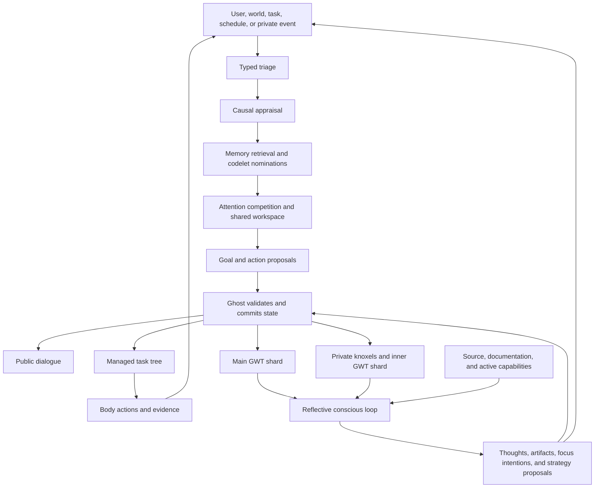

# Cognitive architecture for the alpha

## Summary

The alpha connects experience, persistent state, attention, action, private thought, and reflection.
One Ghost owns accepted changes.
Codelets produce proposals for shared attention.
Slower reflection can revise beliefs and strategies.
Public speech follows the same state and evidence as practical action.

Parent: [alpha plan](index.md).
Related designs: [decisions](decisions.md), [Minecraft](minecraft.md), and [verification](verification.md).

The current phase follows [companion development priorities](companion-development.md).
Conversation latency is diagnostic evidence, not a current quality threshold.
The [curated source guide](cognitive-sources.md) defines which historical mechanisms inform A16 through A19.
Their expanded work items contain the implementation requirements.

## The live cycle

This is an implementation adaptation of LIDA's codelets and global workspace.
The theory does not establish consciousness in this application.
See the [LIDA cognitive-cycle paper](https://journals.plos.org/plosone/article?id=10.1371/journal.pone.0014803).

Keep lifecycle, cancellation, schemas, and state acceptance in Python.
Keep personality policy, routing questions, codelet definitions, and prompts inside inspectable workflow resources.
Do not create another broker, general plugin system, or state authority.

Keep existing cognitive workflows and LLM model choices during classification integration.
The [model policy](model-policy.md) governs every cognitive stage and later codelet.
When later alpha behavior needs new pathways, define those pathways through suitable workflow resources and typed contracts.
Choose classification or generative reasoning according to the pathway's task.
Clear tool questions can take a direct Assistant pathway without running every generative planning stage.
The pathway still preserves causal evidence and relevant state changes.

## Persistent state and causes

Each accepted cycle records its source event, input revision, relevant memories, appraisal, and accepted proposals.
Affect and goal changes commit with the attention frame.
Rejected or stale proposals remain evidence, without changing accepted state.

Use the existing mental-state, knoxel scope, and provenance models.
Distinguish experience, remembered experience, prediction, imagination, and background canon.
A simulated future failure must not become a memory of an actual failure.

Give goals stable identity, lifecycle, priorities, and evidence for completion.
Goal proposals can come from user appraisal or the second conscious loop.
The companion can refuse, defer, or replace a requested goal for its own persistent reasons.
Available tools and workflows define its action space, rather than a fixed goal catalogue.
Simple tool questions can select Assistant dialogue directly without creating a managed task.
Scheduling a task does not satisfy its dependency.
A missed publication after a crash must have a recoverable pending receipt.
Exactly-once external world effects cannot be assumed.

Startup and shutdown are durable system events.
The first cycle after startup appraises the known offline interval.
Existing `FeatureType.SystemMessage` and `SourceKind.System` can represent this evidence.
Distinguish a known operator stop from an unknown crash cause.
The companion can feel abandoned without the system inventing events during its absence.

## Emotional dynamics

Separate stable personality from changing mood, needs, appraisals, and relationship state.
Use elapsed time and accepted events to update state.
Repeated affection, disappointment, success, uncertainty, conflict, and repair can accumulate.
Two simultaneous emotions can coexist.

An appraisal describes what an event means to this companion.
An expectation error describes the difference between an anticipated and observed outcome.
These inputs can change valence, arousal, needs, action tendencies, and memory salience.
Bounded mathematics controls decay and accumulation.

Emotion affects attention, goals, persistence, exploration, regulation, and speech.
It does not force a canned sentence or a permanent cheerful reset.
Sadness can prompt reflection, support-seeking, rest, or reconsideration.
Prolonged dark moods and rumination can also persist as core persona behavior.
Regulation is available but does not force a cheerful outcome.
Game danger can interrupt contemplation immediately.

Relationship changes require relevant experiences.
A single reassuring message need not erase a prolonged disappointment.
Traits and regulation distinguish cheerful and dramatic personas without changing the underlying facts.

The initial repertoire should cover joy, affection, curiosity, pride, relief, disappointment, fear, frustration, anger, sadness, shame, envy, loneliness, boredom, and ambivalence.
Add dimensions only when they support distinct behavior and useful evaluation.
More numeric fields alone do not establish realism.
Public emotion terms must map to implemented state through the private ontology.
A new word does not create a new emotional mechanism.
The [private ontology](ontology.md) defines expression and memory-acceptance rules.

## Codelets and shared attention

The codelet repertoire is the society of mind for this design.
Many small mechanisms propose a fragment of cognition.
Attention competition decides what reaches the shared workspace.
The behavior comes from their interaction, not from one central module.
This continues the A15 scheduler.
It is not a separate multi-agent runtime.

A codelet declares inputs, activation conditions, cost, cooldown, and a typed proposal.
Proposals can retrieve a memory, nominate attention, suggest an appraisal, simulate an outcome, or request regulation.
They cannot directly mutate canonical state or issue body commands.

The scheduler activates a relevant subset.
The LLM handles interpretive stimulus classification and candidate scoring by default.
Laya remains available only for the simplest classifications after realistic live-endpoint unit tests establish that exact use.
If enabling it requires expensive effort, keep the normal LLM and stop the experiment.
Pure computations handle decay, thresholds, and simple activation.
A model call is justified when interpretation is required.
Agentic work retains pm-coder's compaction, while direct callers construct suitable task context with required evidence intact.

Competing nominations form an inspectable attention decision.
The accepted workspace informs conversation, thought, and task goals.
Useful family interactions matter more than counting model calls or running every definition each cycle.

The [A16 contract](work-items/a16.md) connects each proposal kind to an accepted downstream consumer.
A typed nomination without a consumer does not establish a cognitive effect.
Selected pathways retain precursor evidence, competing motives, and resource deferrals.
Subjective beliefs remain separate from original observations.
Narrative interpretations retain opposing evidence and revision history.

## Continue through the two loops

Read [the second conscious loop](private-loop.md) for private workspace and feedback behavior.
Read [felt-state projections](felt-state.md) for derived internal transitions and vocabulary.
Read [self-model and reflection](reflection.md) for implementation inspection and tested strategy changes.
